
<section class="attention-article">
Open the <a href="https://arxiv.org/pdf/2609.19969">DeepSeek-V4.1-Flash report</a> and the attention architecture comes with a small vocabulary of its own: CSA2, sparse indexing, cross-layer reuse. Open the <a href="https://arxiv.org/pdf/2607.24653">Kimi K3 report</a> and the names change: KDA, Gated MLA, hybrid attention. Several of these choices appear in the same model.

Why do we need so many kinds of attention? Which ones solve the same problem? Which can work together? And when a new architecture arrives, how do we tell what it actually changes?

Start with the job itself. <strong>Attention lets a model use the current position’s needs to retrieve and combine information from its context.</strong> A word need not rely only on its neighbors: information much farther away can influence its representation.

But a read needs something to read from. A model must also decide what to retain, how to represent it, and what happens when new information arrives. Seen together, these decisions define a <strong>context memory system</strong>. That is the thread we will follow: from reading context, to making that read affordable, to managing what the model carries forward.

<figure id="n02-fork">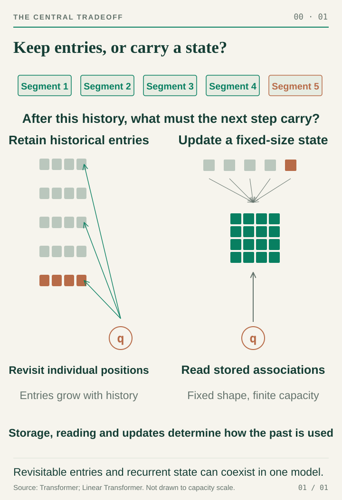</figure>
<em>Figure 0.1. Two memory interfaces recur throughout the story: retained entries and recurrent state.</em>

Technical note: Keep entries, or carry a state?

An entry cache preserves an addressable history. A recurrent core merges contributions into a state of fixed feature dimensions. Neither diagram area nor tile count represents a measured capacity ratio. In the equations below, state matrices use key features as rows and value components as columns; fixed state size always assumes fixed feature widths and head counts.

Entry-cache size ∝ number of entries × elements per entry × independent cache layers
Normalized kernel core, per head: S ∈ ℝᵐˣᵈᵛ and z ∈ ℝᵐ

Primary references: <a href="https://arxiv.org/pdf/1706.03762">Attention Is All You Need, §3.2</a>; <a href="https://arxiv.org/pdf/2006.16236">Transformers Are RNNs, §3</a>.

The split in this picture will recur throughout the article. One path keeps historical entries that a later query can revisit. The other folds history into a state whose shape stays fixed. Both offer useful capabilities; both impose limits. A hybrid can use both.

Explore the 14 chapters
<nav data-contents=""><a href="#chapter-1">1. Why Attention Was Needed</a><a href="#chapter-2">2. Standard Attention: Flexible Reads, Growing Costs</a><a href="#chapter-3">3. MQA and GQA: Sharing the KV Cache</a><a href="#chapter-4">4. MLA: Compressing Each Memory Entry</a><a href="#chapter-5">5. Sparse Attention: Reading Less History</a><a href="#chapter-6">6. Linear Attention: Replacing History with a State</a><a href="#chapter-7">7. RetNet and GLA: Learning What to Forget</a><a href="#chapter-8">8. DeltaNet: Correcting Stored Associations</a><a href="#chapter-9">9. KDA: Forgetting One Feature at a Time</a><a href="#chapter-10">10. Hybrid Attention: Combining Different Memories</a><a href="#chapter-11">11. FlashAttention: Moving Less Data</a><a href="#chapter-12">12. How to Read a New Architecture</a><a href="#chapter-13">13. What Attention’s Evolution Adds Up To</a><a href="#chapter-14">14. Where Memory Systems Could Go Next</a></nav>

<h2 id="chapter-1">1. Why Attention Was Needed</h2>

Before neural attention, machine translation already had ways to connect words across languages. Statistical translation used alignment models and phrase tables. Early neural sequence-to-sequence models took a different approach: an encoder read the source sentence, and a decoder generated the translation from a fixed-length representation. The recurrent neural network, or RNN, carried information forward through successive hidden states.

The bottleneck was easy to state: <strong>one representation had to carry everything the decoder would need from the source sentence.</strong> In the basic encoder–decoder arrangement, the decoder could not return to an individual source position whenever it needed more detail.

<figure id="n01-history">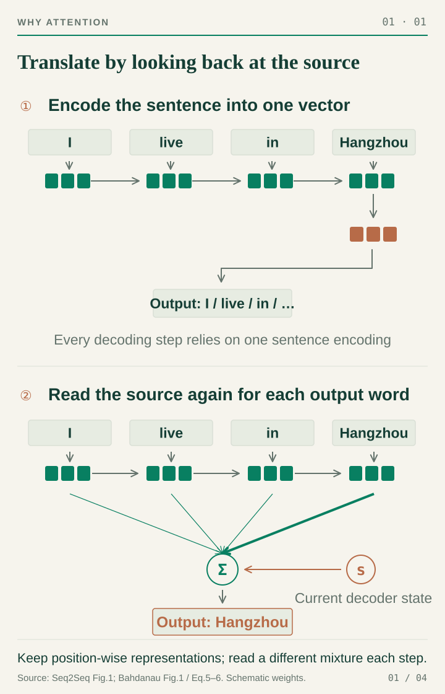</figure>
<em>Figure 1.1. A dynamic context vector gives each translation step its own read of the source.</em>

Technical note: Translate by looking back at the source

Statistical alignment preceded neural attention. The specific bottleneck illustrated is the basic fixed-vector neural encoder–decoder: its decoder receives a sentence representation rather than a fresh read of source positions. Bahdanau attention retains encoder annotations hⱼ and forms a new mixture for each decoder step. The weights shown are schematic.

cᵢ = Σⱼ αᵢⱼ hⱼ
αᵢⱼ = softmaxⱼ a(sᵢ₋₁, hⱼ)

Primary references: <a href="https://aclanthology.org/N03-1017.pdf">Statistical phrase-based translation</a>; <a href="https://arxiv.org/pdf/1409.3215">Sequence to Sequence Learning</a>; <a href="https://arxiv.org/pdf/1409.0473">Bahdanau attention</a>; <a href="https://aclanthology.org/D15-1166.pdf">Luong attention</a>.

<a href="https://arxiv.org/pdf/1409.0473">Bahdanau attention</a> opened that return path. Retain the encoder’s position-wise representations; at each decoding step, score them against the decoder state and read a weighted combination. The context vector changes as the translation progresses. <a href="https://aclanthology.org/D15-1166.pdf">Luong attention</a> developed related alignment-based reads with different scoring and alignment choices.

The Transformer took the idea further. <strong>Self-attention connects positions within a sequence directly, replacing recurrence as the main sequence-mixing operation.</strong> For a known input sequence, the positions in a layer can be processed in parallel, subject to the attention mask. This offers both flexible contextual access and a computation that maps well to matrix operations.

<figure id="n01-transformer">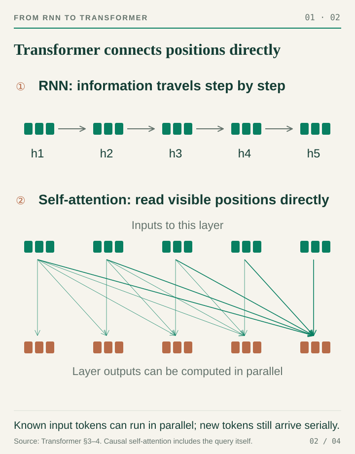</figure>
<em>Figure 1.2. Self-attention provides a direct path between visible positions within a layer.</em>

Technical note: Transformer connects positions directly

In a recurrent layer, information is propagated along a sequence of state transitions. In self-attention, each query can read visible inputs to that layer directly. Known sequence positions can be processed together during training or prefill; autoregressive token generation is still sequential. The illustration uses causal visibility, including the current position.

Primary references: <a href="https://arxiv.org/pdf/1706.03762">Attention Is All You Need, §3.2</a>.

That combination helps explain attention’s central role in modern language models. It does not mean a model generates every future token simultaneously: autoregressive generation still feeds each newly generated token into the next step. Nor does attention replace the entire network. Feed-forward layers, normalization, residual connections, and training remain essential.

Inside a Transformer block: self-attention, cross-attention, and residual paths

<figure id="c2-vf-05-block">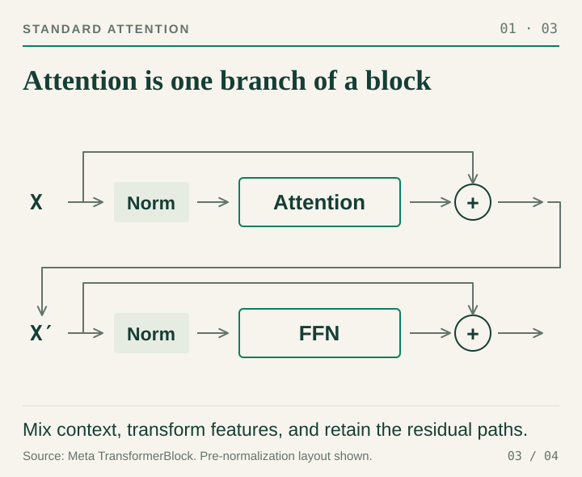</figure>
<em>Figure 1.3. Attention mixes positions inside a larger block; it is not the entire model.</em>

Technical note: Attention is one branch of a block

The diagram uses a pre-normalization residual layout. Attention reads context, while the feed-forward branch transforms features. Residual additions preserve the model-width representation. Normalization placement varies across architectures; the original Transformer paper and modern implementations need not use identical layouts.

Primary references: <a href="https://arxiv.org/pdf/1706.03762">Attention Is All You Need, §3.2</a>.

Attention exchanges information between positions; the feed-forward network transforms each position’s features. Residual paths preserve a route around each branch. The illustration uses a modern pre-normalization block, rather than claiming that every Transformer uses this exact placement.

<figure id="c2-vf-06-sources">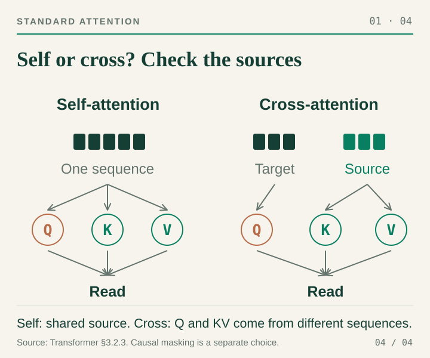</figure>
<em>Figure 1.4. Self-attention and cross-attention are distinguished by where Q and KV come from.</em>

The distinction between self-attention and cross-attention concerns the source of the vectors. In self-attention, queries, keys, and values come from the same sequence. In translation cross-attention, decoder queries read encoder keys and values. Causal masking is another decision: it determines which positions are visible.

Attention solved a read-access problem. Its next problem was the cost of keeping that access as context grew.

<h2 id="chapter-2">2. Standard Attention: Flexible Reads, Growing Costs</h2>

A position’s representation is projected into three vectors: a <strong>query</strong> Q, which specifies what to look for; a <strong>key</strong> K, which participates in matching; and a <strong>value</strong> V, which supplies the content to combine. These are learned vectors, not literal database fields.

We will reuse a small example: an earlier message names Shanghai as a destination, a later message changes it to Hangzhou, and the current message asks “Where?” The five text chunks in the diagrams make positions easy to track; they are not an actual tokenizer output. The weights are illustrations, not measurements of whether a trained model answers correctly.

<figure id="n02-qkv">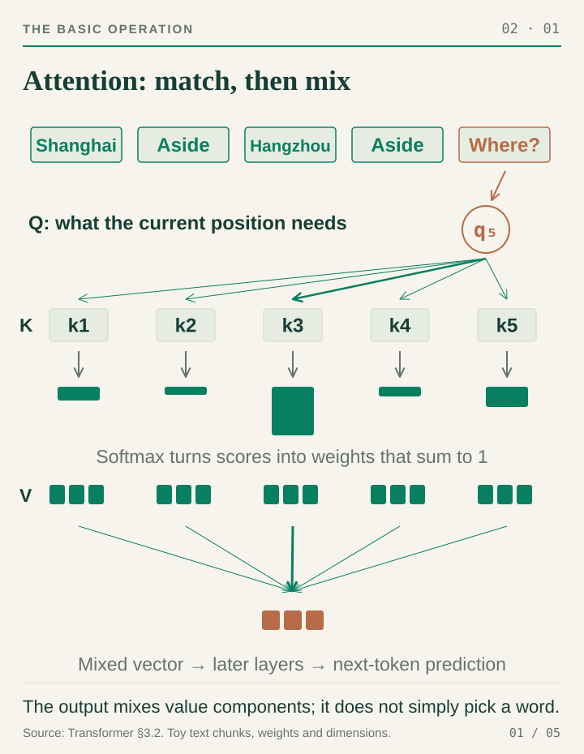</figure>
<em>Figure 2.1. A query matches visible keys, then combines the corresponding values.</em>

Technical note: Attention: match, then mix

For a full sequence, collect queries, keys, and values into matrices. Softmax operates along the key/history axis, independently for each query. The causal mask contributes zero at visible pairs and negative infinity at forbidden pairs. The result is a vector mixture whose width is the value width, not a selected token or a concatenation of all values.

Q = XW_Q; K = XW_K; V = XW_V
A = softmax_row(QKᵀ / √dₖ + M)
O = AV

Primary references: <a href="https://arxiv.org/pdf/1706.03762">Attention Is All You Need, §3.2</a>.

The query scores every visible key. Softmax converts those scores into nonnegative weights summing to one, and the output is a weighted sum of value vectors. <strong>Attention mixes information; it does not ordinarily return the index of one winning word.</strong>

Multi-head attention, or <strong>MHA</strong>, repeats this operation in several learned representation spaces. The heads’ output vectors are concatenated and then mixed by an output projection. A head may learn a useful pattern of interaction, but the architecture does not assign it a human-readable job in advance.

<figure id="c2-vf-04-heads">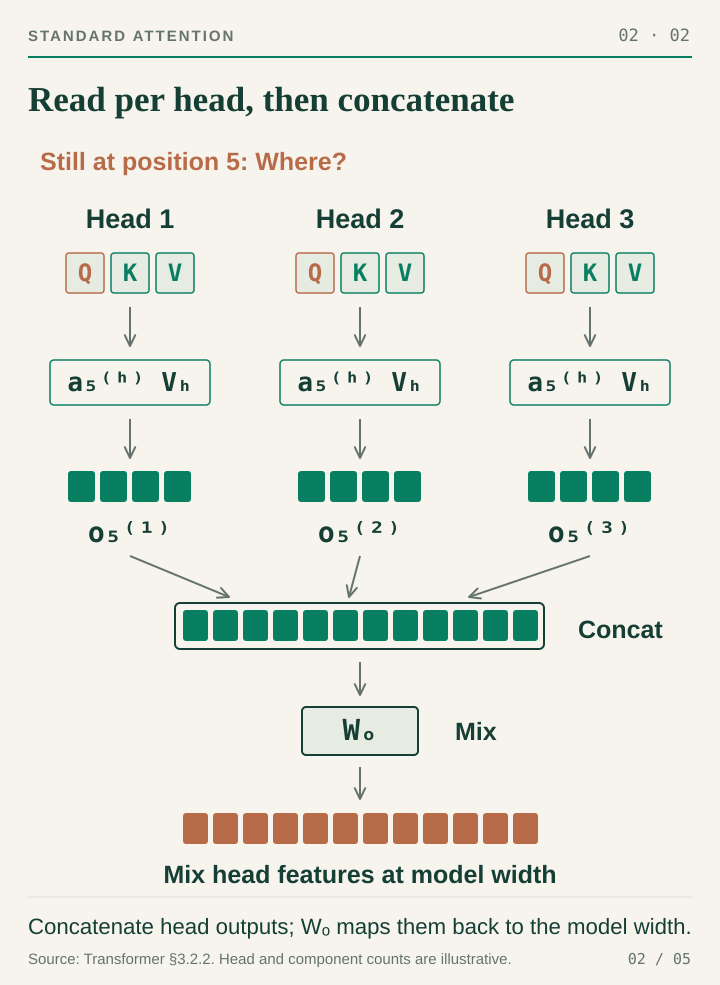</figure>
<em>Figure 2.2. Each head returns a vector; concatenate those vectors before the output projection.</em>

Technical note: Read per head, then concatenate

Different heads use learned projections and form their own attention weights. Their value-weighted outputs are concatenated along the feature axis. The output projection mixes those features back into model width. The illustrated head count and vector components are teaching choices, not a particular model configuration.

oₜ⁽ʰ⁾ = Σⱼ aₜⱼ⁽ʰ⁾ vⱼ⁽ʰ⁾
O = Concat(O⁽¹⁾, …, O⁽ᴴ⁾) W_O

Primary references: <a href="https://arxiv.org/pdf/1706.03762">Attention Is All You Need, §3.2</a>.

Long context brings several costs that are easy to confuse. Processing an entire sequence involves a grid of query–key pairs. Decoding one additional position involves one new query, but it still reads the visible history. Intermediate matrices, retained KV, and transfers through the memory hierarchy are separate costs.

<figure id="c2-vf-09-costs">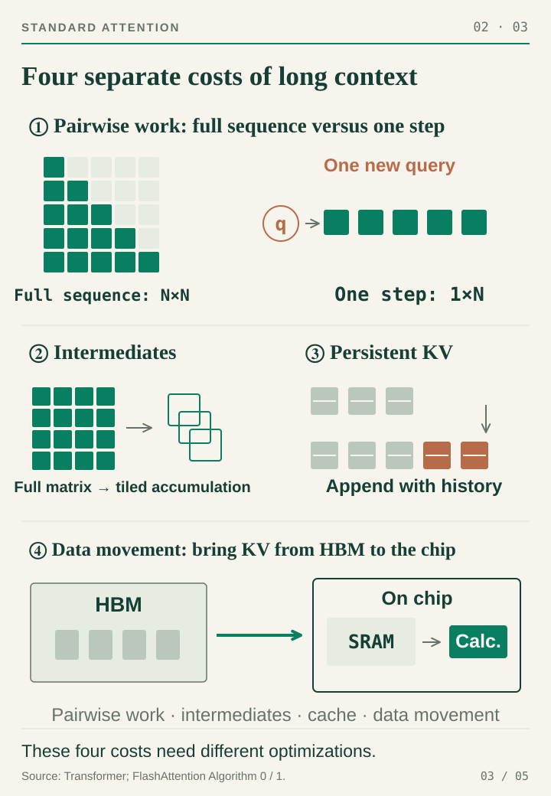</figure>
<em>Figure 2.3. Pairwise work, intermediate storage, persistent KV, and data movement are different costs.</em>

Technical note: Four separate costs of long context

A full sequence has a query–key grid that grows quadratically in its length. One cached decode step adds a single query row but reads a history that grows with context. The full intermediate matrix need not be stored, even when all the pairwise scores still participate in the computation. Persistent KV is a separate object.

Primary references: <a href="https://arxiv.org/pdf/1706.03762">Attention Is All You Need, §3.2</a>; <a href="https://arxiv.org/pdf/2205.14135">FlashAttention, §3 / Algorithm 1</a>; <a href="https://arxiv.org/pdf/1911.02150v1">Fast Transformer Decoding</a>.

A <strong>KV cache</strong> saves each processed position’s keys and values so later steps can reuse them. It avoids reprojecting the old positions; it does not make their storage or later reads free. This distinction explains why “faster attention” can mean several very different changes.

Try the causal mask, then follow the KV cache

<figure id="c2-vf-03-matrix"><svg aria-label="A query sees its past and itself" height="765" id="matrix-scene" lang="en" role="img" viewbox="0 0 720 765" width="720" xml:lang="en" xmlns="http://www.w3.org/2000/svg"><rect fill="#F6F4ED" height="765" width="720"></rect><text data-label-slot="664.0" data-max-width="664.0" fill="#64736C" font-family='Arial,"Helvetica Neue",sans-serif' font-size="15" font-weight="600" letter-spacing="2" text-anchor="start" x="28" y="41">STANDARD ATTENTION</text><text data-label-slot="672.0" data-max-width="672.0" fill="#64736C" font-family='"SFMono-Regular",Menlo,monospace' font-size="17" font-weight="500" letter-spacing="0" text-anchor="end" x="690" y="41">02 · 04</text><line stroke="#087F61" stroke-width="2" x1="28" x2="692" y1="57" y2="57"></line><text data-label-slot="664.0" data-max-width="664.0" fill="#153E35" font-family='Georgia,"Times New Roman",serif' font-size="35" font-weight="700" letter-spacing="0" text-anchor="start" x="28" y="111">A query sees its past and itself</text><rect data-token-box="0" fill="#E7ECE2" height="49" rx="5" width="112" x="39" y="152"></rect><text data-label-slot="100.0" data-max-width="154.0" data-token-text="0" fill="#153E35" font-family='Arial,"Helvetica Neue",sans-serif' font-size="22.2" font-weight="600" letter-spacing="0" text-anchor="middle" x="95" y="185">Shanghai</text><text data-label-slot="126.0" data-max-width="154.0" fill="#64736C" font-family='"SFMono-Regular",Menlo,monospace' font-size="22" font-weight="500" letter-spacing="0" text-anchor="middle" x="95" y="229">1</text><rect data-token-box="1" fill="#E7ECE2" height="49" rx="5" width="112" x="171" y="152"></rect><text data-label-slot="100.0" data-max-width="418.0" data-token-text="1" fill="#153E35" font-family='Arial,"Helvetica Neue",sans-serif' font-size="27" font-weight="600" letter-spacing="0" text-anchor="middle" x="227" y="185">Aside</text><text data-label-slot="126.0" data-max-width="418.0" fill="#64736C" font-family='"SFMono-Regular",Menlo,monospace' font-size="22" font-weight="500" letter-spacing="0" text-anchor="middle" x="227" y="229">2</text><rect data-token-box="2" fill="#E7ECE2" height="49" rx="5" width="112" x="303" y="152"></rect><text data-label-slot="100.0" data-max-width="682.0" data-token-text="2" fill="#153E35" font-family='Arial,"Helvetica Neue",sans-serif' font-size="20.6" font-weight="600" letter-spacing="0" text-anchor="middle" x="359" y="185">Hangzhou</text><text data-label-slot="126.0" data-max-width="682.0" fill="#64736C" font-family='"SFMono-Regular",Menlo,monospace' font-size="22" font-weight="500" letter-spacing="0" text-anchor="middle" x="359" y="229">3</text><rect data-token-box="3" fill="#E7ECE2" height="49" rx="5" width="112" x="435" y="152"></rect><text data-label-slot="100.0" data-max-width="422.0" data-token-text="3" fill="#153E35" font-family='Arial,"Helvetica Neue",sans-serif' font-size="27" font-weight="600" letter-spacing="0" text-anchor="middle" x="491" y="185">Aside</text><text data-label-slot="126.0" data-max-width="422.0" fill="#64736C" font-family='"SFMono-Regular",Menlo,monospace' font-size="22" font-weight="500" letter-spacing="0" text-anchor="middle" x="491" y="229">4</text><rect data-token-box="4" fill="#B76B48" height="49" rx="5" width="112" x="567" y="152"></rect><text data-label-slot="100.0" data-max-width="158.0" data-token-text="4" fill="#FFFFFF" font-family='Arial,"Helvetica Neue",sans-serif' font-size="27" font-weight="600" letter-spacing="0" text-anchor="middle" x="623" y="185">Where?</text><text data-label-slot="126.0" data-max-width="158.0" fill="#64736C" font-family='"SFMono-Regular",Menlo,monospace' font-size="22" font-weight="500" letter-spacing="0" text-anchor="middle" x="623" y="229">5</text><text data-label-slot="684.0" data-max-width="684.0" data-query-label="" fill="#B76B48" font-family='Arial,"Helvetica Neue",sans-serif' font-size="26" font-weight="600" letter-spacing="0" text-anchor="middle" x="360" y="278">Query q₅ at position 5: Where?</text><text data-label-slot="328.0" data-max-width="328.0" fill="#153E35" font-family='Arial,"Helvetica Neue",sans-serif' font-size="27" font-weight="600" letter-spacing="0" text-anchor="middle" x="182" y="328">All pairs</text><text data-label-slot="330.0" data-max-width="330.0" fill="#153E35" font-family='Arial,"Helvetica Neue",sans-serif' font-size="27" font-weight="600" letter-spacing="0" text-anchor="middle" x="537" y="328">Hide future tokens</text><text data-label-slot="35.0" data-max-width="150.0" fill="#64736C" font-family='"SFMono-Regular",Menlo,monospace' font-size="22" font-weight="500" letter-spacing="0" text-anchor="middle" x="93" y="370">1</text><text data-label-slot="80.0" data-max-width="80.0" fill="#64736C" font-family='"SFMono-Regular",Menlo,monospace' font-size="22" font-weight="500" letter-spacing="0" text-anchor="middle" x="58" y="405">1</text><text data-label-slot="35.0" data-max-width="232.0" fill="#64736C" font-family='"SFMono-Regular",Menlo,monospace' font-size="22" font-weight="500" letter-spacing="0" text-anchor="middle" x="134" y="370">2</text><text data-label-slot="80.0" data-max-width="80.0" fill="#64736C" font-family='"SFMono-Regular",Menlo,monospace' font-size="22" font-weight="500" letter-spacing="0" text-anchor="middle" x="58" y="446">2</text><text data-label-slot="35.0" data-max-width="314.0" fill="#64736C" font-family='"SFMono-Regular",Menlo,monospace' font-size="22" font-weight="500" letter-spacing="0" text-anchor="middle" x="175" y="370">3</text><text data-label-slot="80.0" data-max-width="80.0" fill="#64736C" font-family='"SFMono-Regular",Menlo,monospace' font-size="22" font-weight="500" letter-spacing="0" text-anchor="middle" x="58" y="487">3</text><text data-label-slot="35.0" data-max-width="396.0" fill="#64736C" font-family='"SFMono-Regular",Menlo,monospace' font-size="22" font-weight="500" letter-spacing="0" text-anchor="middle" x="216" y="370">4</text><text data-label-slot="80.0" data-max-width="80.0" fill="#64736C" font-family='"SFMono-Regular",Menlo,monospace' font-size="22" font-weight="500" letter-spacing="0" text-anchor="middle" x="58" y="528">4</text><text data-label-slot="35.0" data-max-width="478.0" fill="#64736C" font-family='"SFMono-Regular",Menlo,monospace' font-size="22" font-weight="500" letter-spacing="0" text-anchor="middle" x="257" y="370">5</text><text data-label-slot="80.0" data-max-width="80.0" fill="#64736C" font-family='"SFMono-Regular",Menlo,monospace' font-size="22" font-weight="500" letter-spacing="0" text-anchor="middle" x="58" y="569">5</text><text data-label-slot="35.0" data-max-width="508.0" fill="#64736C" font-family='"SFMono-Regular",Menlo,monospace' font-size="22" font-weight="500" letter-spacing="0" text-anchor="middle" x="448" y="370">1</text><text data-label-slot="349.0" data-max-width="578.0" fill="#64736C" font-family='"SFMono-Regular",Menlo,monospace' font-size="22" font-weight="500" letter-spacing="0" text-anchor="middle" x="413" y="405">1</text><text data-label-slot="35.0" data-max-width="426.0" fill="#64736C" font-family='"SFMono-Regular",Menlo,monospace' font-size="22" font-weight="500" letter-spacing="0" text-anchor="middle" x="489" y="370">2</text><text data-label-slot="349.0" data-max-width="578.0" fill="#64736C" font-family='"SFMono-Regular",Menlo,monospace' font-size="22" font-weight="500" letter-spacing="0" text-anchor="middle" x="413" y="446">2</text><text data-label-slot="35.0" data-max-width="344.0" fill="#64736C" font-family='"SFMono-Regular",Menlo,monospace' font-size="22" font-weight="500" letter-spacing="0" text-anchor="middle" x="530" y="370">3</text><text data-label-slot="349.0" data-max-width="578.0" fill="#64736C" font-family='"SFMono-Regular",Menlo,monospace' font-size="22" font-weight="500" letter-spacing="0" text-anchor="middle" x="413" y="487">3</text><text data-label-slot="35.0" data-max-width="262.0" fill="#64736C" font-family='"SFMono-Regular",Menlo,monospace' font-size="22" font-weight="500" letter-spacing="0" text-anchor="middle" x="571" y="370">4</text><text data-label-slot="349.0" data-max-width="578.0" fill="#64736C" font-family='"SFMono-Regular",Menlo,monospace' font-size="22" font-weight="500" letter-spacing="0" text-anchor="middle" x="413" y="528">4</text><text data-label-slot="35.0" data-max-width="180.0" fill="#64736C" font-family='"SFMono-Regular",Menlo,monospace' font-size="22" font-weight="500" letter-spacing="0" text-anchor="middle" x="612" y="370">5</text><text data-label-slot="349.0" data-max-width="578.0" fill="#64736C" font-family='"SFMono-Regular",Menlo,monospace' font-size="22" font-weight="500" letter-spacing="0" text-anchor="middle" x="413" y="569">5</text><rect data-c="0" data-grid="full" data-r="0" fill="#087F61" height="37" rx="2" width="37" x="75" y="382"></rect><rect data-c="1" data-grid="full" data-r="0" fill="#087F61" height="37" rx="2" width="37" x="116" y="382"></rect><rect data-c="2" data-grid="full" data-r="0" fill="#087F61" height="37" rx="2" width="37" x="157" y="382"></rect><rect data-c="3" data-grid="full" data-r="0" fill="#087F61" height="37" rx="2" width="37" x="198" y="382"></rect><rect data-c="4" data-grid="full" data-r="0" fill="#087F61" height="37" rx="2" width="37" x="239" y="382"></rect><rect data-c="0" data-grid="full" data-r="1" fill="#087F61" height="37" rx="2" width="37" x="75" y="423"></rect><rect data-c="1" data-grid="full" data-r="1" fill="#087F61" height="37" rx="2" width="37" x="116" y="423"></rect><rect data-c="2" data-grid="full" data-r="1" fill="#087F61" height="37" rx="2" width="37" x="157" y="423"></rect><rect data-c="3" data-grid="full" data-r="1" fill="#087F61" height="37" rx="2" width="37" x="198" y="423"></rect><rect data-c="4" data-grid="full" data-r="1" fill="#087F61" height="37" rx="2" width="37" x="239" y="423"></rect><rect data-c="0" data-grid="full" data-r="2" fill="#087F61" height="37" rx="2" width="37" x="75" y="464"></rect><rect data-c="1" data-grid="full" data-r="2" fill="#087F61" height="37" rx="2" width="37" x="116" y="464"></rect><rect data-c="2" data-grid="full" data-r="2" fill="#087F61" height="37" rx="2" width="37" x="157" y="464"></rect><rect data-c="3" data-grid="full" data-r="2" fill="#087F61" height="37" rx="2" width="37" x="198" y="464"></rect><rect data-c="4" data-grid="full" data-r="2" fill="#087F61" height="37" rx="2" width="37" x="239" y="464"></rect><rect data-c="0" data-grid="full" data-r="3" fill="#087F61" height="37" rx="2" width="37" x="75" y="505"></rect><rect data-c="1" data-grid="full" data-r="3" fill="#087F61" height="37" rx="2" width="37" x="116" y="505"></rect><rect data-c="2" data-grid="full" data-r="3" fill="#087F61" height="37" rx="2" width="37" x="157" y="505"></rect><rect data-c="3" data-grid="full" data-r="3" fill="#087F61" height="37" rx="2" width="37" x="198" y="505"></rect><rect data-c="4" data-grid="full" data-r="3" fill="#087F61" height="37" rx="2" width="37" x="239" y="505"></rect><rect data-c="0" data-grid="full" data-r="4" fill="#B76B48" height="37" rx="2" width="37" x="75" y="546"></rect><rect data-c="1" data-grid="full" data-r="4" fill="#B76B48" height="37" rx="2" width="37" x="116" y="546"></rect><rect data-c="2" data-grid="full" data-r="4" fill="#B76B48" height="37" rx="2" width="37" x="157" y="546"></rect><rect data-c="3" data-grid="full" data-r="4" fill="#B76B48" height="37" rx="2" width="37" x="198" y="546"></rect><rect data-c="4" data-grid="full" data-r="4" fill="#B76B48" height="37" rx="2" width="37" x="239" y="546"></rect><rect aria-label="Select query row 1" data-query="0" fill="transparent" height="41" role="button" style="cursor:pointer" tabindex="0" width="211" x="70" y="380"></rect><rect aria-label="Select query row 2" data-query="1" fill="transparent" height="41" role="button" style="cursor:pointer" tabindex="0" width="211" x="70" y="421"></rect><rect aria-label="Select query row 3" data-query="2" fill="transparent" height="41" role="button" style="cursor:pointer" tabindex="0" width="211" x="70" y="462"></rect><rect aria-label="Select query row 4" data-query="3" fill="transparent" height="41" role="button" style="cursor:pointer" tabindex="0" width="211" x="70" y="503"></rect><rect aria-label="Select query row 5" data-query="4" fill="transparent" height="41" role="button" style="cursor:pointer" tabindex="0" width="211" x="70" y="544"></rect><rect data-c="0" data-grid="causal" data-r="0" fill="#087F61" height="37" rx="2" width="37" x="430" y="382"></rect><rect data-c="1" data-grid="causal" data-r="0" fill="#E7ECE2" height="37" rx="2" width="37" x="471" y="382"></rect><rect data-c="2" data-grid="causal" data-r="0" fill="#E7ECE2" height="37" rx="2" width="37" x="512" y="382"></rect><rect data-c="3" data-grid="causal" data-r="0" fill="#E7ECE2" height="37" rx="2" width="37" x="553" y="382"></rect><rect data-c="4" data-grid="causal" data-r="0" fill="#E7ECE2" height="37" rx="2" width="37" x="594" y="382"></rect><rect data-c="0" data-grid="causal" data-r="1" fill="#087F61" height="37" rx="2" width="37" x="430" y="423"></rect><rect data-c="1" data-grid="causal" data-r="1" fill="#087F61" height="37" rx="2" width="37" x="471" y="423"></rect><rect data-c="2" data-grid="causal" data-r="1" fill="#E7ECE2" height="37" rx="2" width="37" x="512" y="423"></rect><rect data-c="3" data-grid="causal" data-r="1" fill="#E7ECE2" height="37" rx="2" width="37" x="553" y="423"></rect><rect data-c="4" data-grid="causal" data-r="1" fill="#E7ECE2" height="37" rx="2" width="37" x="594" y="423"></rect><rect data-c="0" data-grid="causal" data-r="2" fill="#087F61" height="37" rx="2" width="37" x="430" y="464"></rect><rect data-c="1" data-grid="causal" data-r="2" fill="#087F61" height="37" rx="2" width="37" x="471" y="464"></rect><rect data-c="2" data-grid="causal" data-r="2" fill="#087F61" height="37" rx="2" width="37" x="512" y="464"></rect><rect data-c="3" data-grid="causal" data-r="2" fill="#E7ECE2" height="37" rx="2" width="37" x="553" y="464"></rect><rect data-c="4" data-grid="causal" data-r="2" fill="#E7ECE2" height="37" rx="2" width="37" x="594" y="464"></rect><rect data-c="0" data-grid="causal" data-r="3" fill="#087F61" height="37" rx="2" width="37" x="430" y="505"></rect><rect data-c="1" data-grid="causal" data-r="3" fill="#087F61" height="37" rx="2" width="37" x="471" y="505"></rect><rect data-c="2" data-grid="causal" data-r="3" fill="#087F61" height="37" rx="2" width="37" x="512" y="505"></rect><rect data-c="3" data-grid="causal" data-r="3" fill="#087F61" height="37" rx="2" width="37" x="553" y="505"></rect><rect data-c="4" data-grid="causal" data-r="3" fill="#E7ECE2" height="37" rx="2" width="37" x="594" y="505"></rect><rect data-c="0" data-grid="causal" data-r="4" fill="#B76B48" height="37" rx="2" width="37" x="430" y="546"></rect><rect data-c="1" data-grid="causal" data-r="4" fill="#B76B48" height="37" rx="2" width="37" x="471" y="546"></rect><rect data-c="2" data-grid="causal" data-r="4" fill="#B76B48" height="37" rx="2" width="37" x="512" y="546"></rect><rect data-c="3" data-grid="causal" data-r="4" fill="#B76B48" height="37" rx="2" width="37" x="553" y="546"></rect><rect data-c="4" data-grid="causal" data-r="4" fill="#B76B48" height="37" rx="2" width="37" x="594" y="546"></rect><rect aria-label="Select query row 1" data-query="0" fill="transparent" height="41" role="button" style="cursor:pointer" tabindex="0" width="211" x="425" y="380"></rect><rect aria-label="Select query row 2" data-query="1" fill="transparent" height="41" role="button" style="cursor:pointer" tabindex="0" width="211" x="425" y="421"></rect><rect aria-label="Select query row 3" data-query="2" fill="transparent" height="41" role="button" style="cursor:pointer" tabindex="0" width="211" x="425" y="462"></rect><rect aria-label="Select query row 4" data-query="3" fill="transparent" height="41" role="button" style="cursor:pointer" tabindex="0" width="211" x="425" y="503"></rect><rect aria-label="Select query row 5" data-query="4" fill="transparent" height="41" role="button" style="cursor:pointer" tabindex="0" width="211" x="425" y="544"></rect><line stroke="#64736C" stroke-width="2" x1="310" x2="395" y1="481" y2="481"></line><path d="M384.1946347717679 486.21958640933474 L395 481 L384.1946347717679 475.78041359066526" fill="none" stroke="#64736C" stroke-linecap="round" stroke-linejoin="round" stroke-width="2"></path><text data-label-slot="224.5" data-max-width="637.0" fill="#64736C" font-family='Arial,"Helvetica Neue",sans-serif' font-size="24" font-weight="400" letter-spacing="0" text-anchor="start" x="55" y="623">Queries ↓</text><text data-label-slot="262.0" data-max-width="262.0" fill="#64736C" font-family='Arial,"Helvetica Neue",sans-serif' font-size="18.6" font-weight="400" letter-spacing="0" text-anchor="start" x="430" y="623">Keys → · pale cells are masked</text><text data-label-slot="684.0" data-max-width="684.0" fill="#153E35" font-family='Arial,"Helvetica Neue",sans-serif' font-size="27" font-weight="600" letter-spacing="0" text-anchor="middle" x="360" y="664">Apply softmax along each row</text><line stroke="#D9DFD5" stroke-width="1" x1="28" x2="692" y1="677" y2="677"></line><text data-label-slot="664.0" data-max-width="664.0" data-range-label="" fill="#153E35" font-family='Arial,"Helvetica Neue",sans-serif' font-size="21.6" font-weight="500" letter-spacing="0" text-anchor="start" x="28" y="714">Position 5 reads 1–5. Select an earlier row to reveal the causal mask.</text><text data-label-slot="587.0" data-max-width="587.0" fill="#64736C" font-family='Arial,"Helvetica Neue",sans-serif' font-size="15" font-weight="400" letter-spacing="0" text-anchor="start" x="28" y="744">Source: Transformer §3.2. Select a row to change the query.</text><text data-label-slot="673.0" data-max-width="673.0" fill="#64736C" font-family='"SFMono-Regular",Menlo,monospace' font-size="15" font-weight="500" letter-spacing="0" text-anchor="end" x="691" y="744">04 / 05</text></svg></figure>
<em>Figure 2.4. The causal mask excludes future positions before normalization.</em>

Technical note: A query sees its past and itself

Rows represent queries and columns represent keys. Select an earlier row to see its legal read range shrink. This full-sequence example uses a square causal mask. Prefix-cached decoding requires masking aligned to absolute positions, rather than blindly applying the same square construction to unequal query and key lengths.

Primary references: <a href="https://arxiv.org/pdf/1706.03762">Attention Is All You Need, §3.2</a>.

Select a query row. A causal decoder may read that position and all earlier positions, but never a later one. The mask is applied before softmax; otherwise forbidden positions could still affect normalization.

<figure id="c2-vf-08-cache">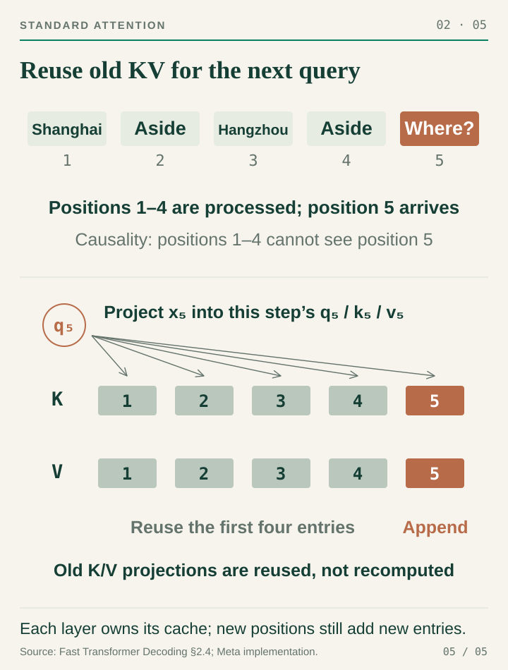</figure>
<em>Figure 2.5. Cache old K and V, append the current entry, and use the current query to read them.</em>

Technical note: Reuse old KV for the next query

A previous position’s causal representation did not depend on later tokens, so its K and V can be reused. Each ordinary attention layer owns its own cached projections. The cache avoids repeated projection of old positions; it does not avoid storing or reading their retained representations.

Primary references: <a href="https://arxiv.org/pdf/1911.02150v1">Fast Transformer Decoding</a>; <a href="https://arxiv.org/pdf/1706.03762">Attention Is All You Need, §3.2</a>.

The current token supplies a new Q, K, and V. Older K and V remain valid because causal processing did not depend on future tokens. Each attention layer maintains its own cache under the ordinary arrangement.

<pre><code class="language-python">import math
import torch

def causal_attention(q, k, v):
    # A complete sequence, no padding or cached prefix.
    n = q.shape[-2]
    score = q @ k.transpose(-2, -1)
    score = score / math.sqrt(q.shape[-1])
    future = torch.ones(n, n, device=q.device,
                        dtype=torch.bool).triu(1)
    score = score.masked_fill(future, -float('inf'))
    weight = score.float().softmax(-1).to(v.dtype)
    return weight @ v</code></pre>

This is a teaching implementation. A cached decode call can have different query and key lengths, and masking must account for the prefix length. Production kernels also handle padding, layouts, precision, and batching.

We can now separate two questions: can we make each stored entry smaller, and can we avoid reading every entry?

<h2 id="chapter-3">3. MQA and GQA: Sharing the KV Cache</h2>

MHA gives every query head its own key and value heads. That provides flexibility, but the cache retains many parallel descriptions of the same historical positions.

<strong>Multi-query attention (MQA)</strong> shares one KV head across all query heads. <strong>Grouped-query attention (GQA)</strong> takes an intermediate position: query heads are divided into groups, with one KV head per group. The number of query heads need not change.

<figure id="c3-vf-01-head-map">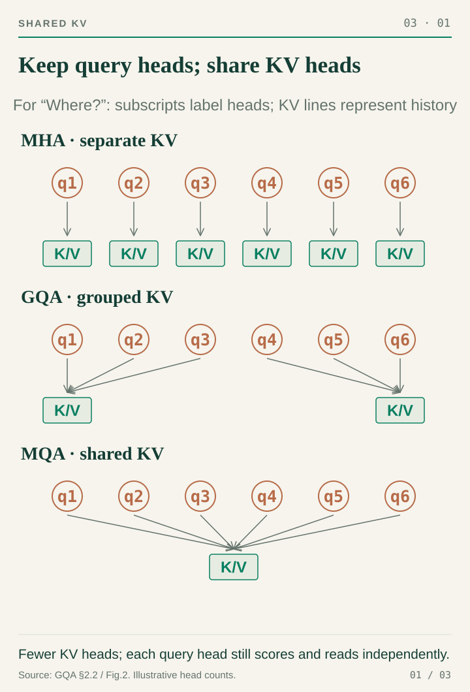</figure>
<em>Figure 3.1. MQA and GQA share the KV heads without removing query heads.</em>

Technical note: Keep query heads; share KV heads

Let g(h) identify the KV group for query head h. Each head h has its own query and normalization over history, but reads the keys and values of group g(h). One group gives MQA; one KV group per query head gives MHA. Shared KV is not shared attention weights.

aₜⱼ,ₕ = softmaxⱼ(qₜ,ₕᵀ kⱼ,g(h) / √dₖ + Mₜⱼ)
oₜ,ₕ = Σⱼ aₜⱼ,ₕ vⱼ,g(h)

Primary references: <a href="https://arxiv.org/pdf/2305.13245">GQA, §2.2</a>; <a href="https://arxiv.org/pdf/1911.02150v1">Fast Transformer Decoding</a>.

The saving is on the <strong>head axis</strong> of the cache. Sharing does not force the query heads to produce identical attention weights: different queries can match the same keys differently. GQA offers a way to trade KV capacity and bandwidth against representational freedom; the quality outcome depends on the model and its training.

Shared keys, different reads; smaller entries, growing history

<figure id="c3-vf-02-shared-weights">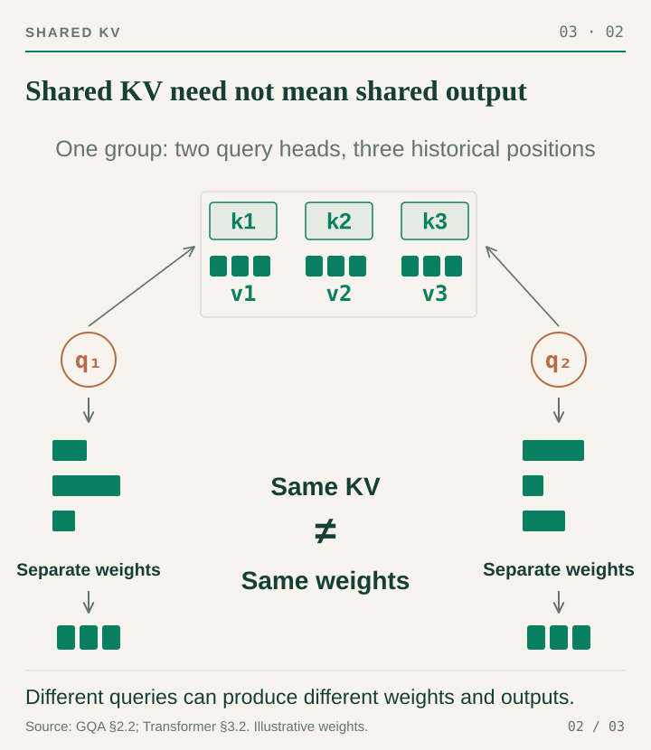</figure>
<em>Figure 3.2. Two queries can retrieve different mixtures from the same KV group.</em>

Technical note: Shared KV need not mean shared output

The key and value content is shared, but the query vectors are not. Their dot products can therefore differ, producing different normalized weights and output vectors. The bars illustrate this distinction; they are not measurements on the destination example.

Primary references: <a href="https://arxiv.org/pdf/2305.13245">GQA, §2.2</a>; <a href="https://arxiv.org/pdf/1706.03762">Attention Is All You Need, §3.2</a>.

<figure id="c3-vf-03-cache-axes">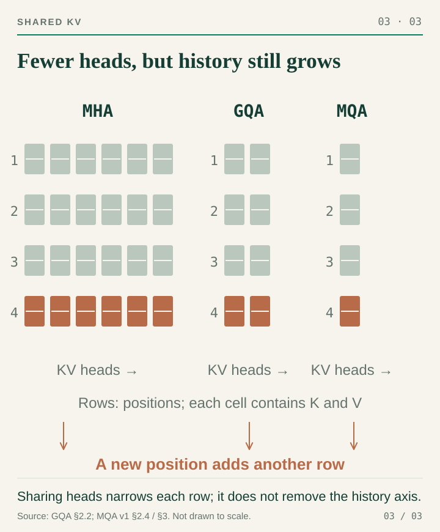</figure>
<em>Figure 3.3. Head sharing shrinks each history row, while each new position still adds a row.</em>

Technical note: Fewer heads, but history still grows

These shapes count persistent elements before multiplying by element precision. They assume one full-history cache per layer, without cross-layer sharing. Batch size and the number of layers multiply the total, and padding or implementation layout can add further storage.

Q: [B, Hq, N, dₖ]
K: [B, Hkv, N, dₖ]; V: [B, Hkv, N, dᵥ]
Elements per layer: B·N·Hkv·(dₖ+dᵥ)

Primary references: <a href="https://arxiv.org/pdf/2305.13245">GQA, §2.2</a>; <a href="https://arxiv.org/pdf/1911.02150v1">Fast Transformer Decoding</a>.

For batch B, history N, and Hkv KV heads, a layer stores B·N·Hkv·(dₖ+dᵥ) elements. Reducing Hkv shrinks each history row. The N factor remains.

<pre><code class="language-python"># Teaching expansion of grouped KV for a complete causal sequence.
# q: [B, Hq, N, dk]; k/v: [B, Hkv, N, dk/dv]
assert q.shape[1] % k.shape[1] == 0
repeat = q.shape[1] // k.shape[1]
k_expanded = k.repeat_interleave(repeat, dim=1)
v_expanded = v.repeat_interleave(repeat, dim=1)
out = causal_attention(q, k_expanded, v_expanded)</code></pre>

Explicit repetition makes the correspondence visible but loses the implementation advantage. An efficient GQA kernel reuses shared KV instead of creating all those copies.

MQA and GQA share heads. MLA asks whether the heads’ information can instead share a compact representation.

<h2 id="chapter-4">4. MLA: Compressing Each Memory Entry</h2>

<strong>Multi-head latent attention (MLA)</strong>, introduced in DeepSeek-V2, jointly encodes a position’s multi-head key and value information in a lower-dimensional <em>latent</em> vector. Here “latent” simply means a learned compact representation.

<figure id="c4-vf-01-latent-cache">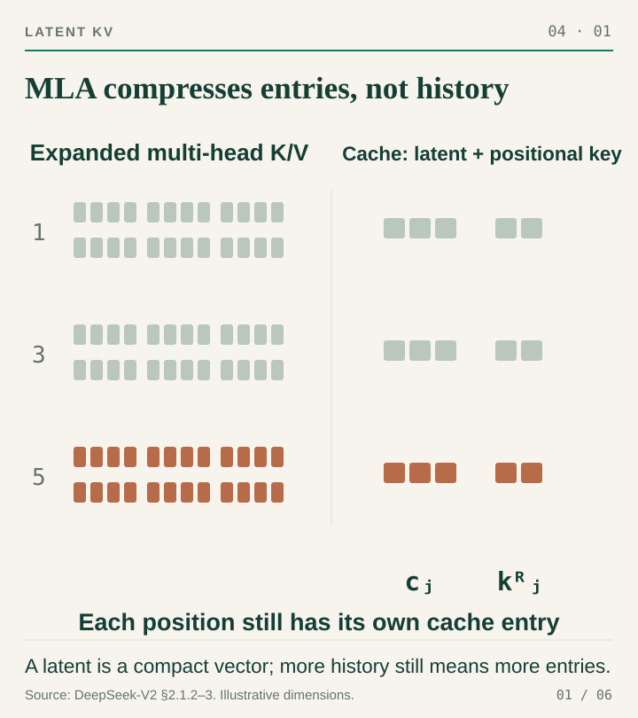</figure>
<em>Figure 4.1. A latent cache keeps one compressed representation per historical position.</em>

Technical note: MLA compresses entries, not history

DeepSeek-V2 jointly compresses a position’s content K/V into cⱼ. Its decoupled positional branch additionally retains kᴿⱼ. Low-rank feature compression reduces each entry’s width; it does not remove the history-length factor. Other MLA configurations can use different positional choices.

cⱼ = Wᴰᴷⱽ xⱼ
Content cache: [B, N, d_c]
Positional-key cache: [B, N, d_r]
Elements per layer: B·N·(d_c+d_r)

Primary references: <a href="https://arxiv.org/pdf/2405.04434">DeepSeek-V2, §2.1</a>; <a href="https://github.com/deepseek-ai/DeepSeek-V3/blob/main/inference/model.py">Author implementation</a>.

There is still a separate entry for each historical position. <strong>MLA compresses the feature representation of an entry; it does not turn the whole history into one fixed state.</strong> The latent can feed different per-head projections, so this is a different constraint from making all heads share identical K and V.

Compression is only half the design. If decoding immediately expanded every old latent into full multi-head K/V, much of the transfer advantage would be lost. MLA can absorb the key projection into the query path and move value expansion after weighted latent aggregation.

<figure id="c4-vf-03-absorption">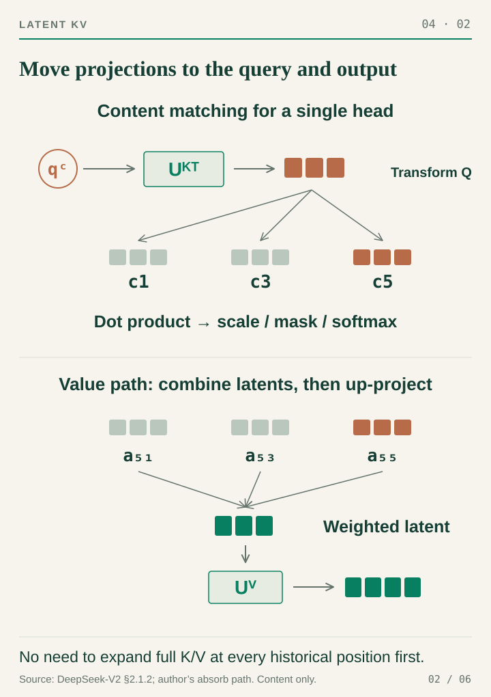</figure>
<em>Figure 4.2. Linear projections can move to the query side and after weighted aggregation.</em>

Technical note: Move projections to the query and output

For one head’s content branch, move the key up-projection onto the query before reading cached latents. On the value side, sum weighted latents before up-projecting. This avoids first expanding every historical position’s full K/V. Efficient execution still depends on layouts and kernels; the identities alone are not a measured speedup.

qᶜᵀ(Uᴷcⱼ) = (Uᴷᵀqᶜ)ᵀcⱼ
Σⱼ aⱼ(Uⱽcⱼ) = Uⱽ(Σⱼ aⱼcⱼ)

Primary references: <a href="https://arxiv.org/pdf/2405.04434">DeepSeek-V2, §2.1</a>; <a href="https://github.com/deepseek-ai/DeepSeek-V3/blob/main/inference/model.py">Author implementation</a>.

That rearrangement relies on linear algebra. Position-dependent transformations complicate it. DeepSeek-V2 separates the content path from a rotary positional path, preserving the useful absorption while retaining positional matching.

Latent expansion, projection absorption, and the RoPE complication

<figure id="c4-vf-02-latent-expand">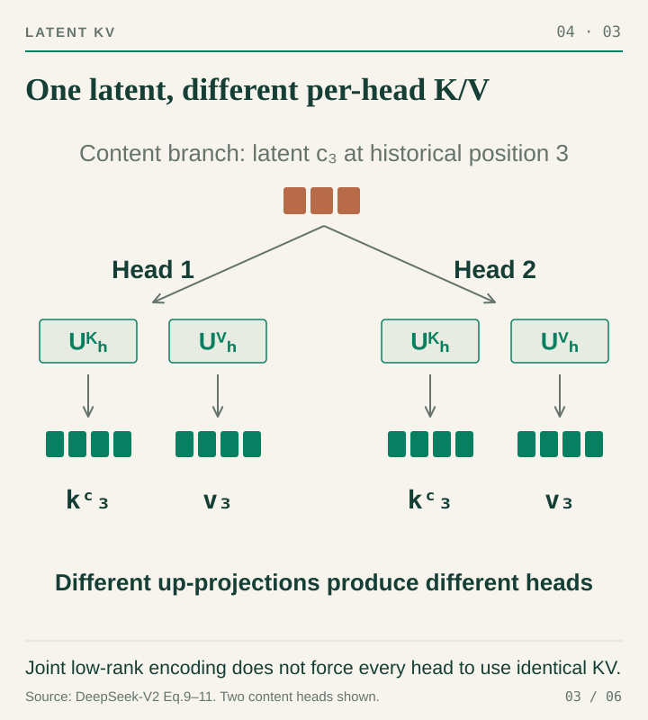</figure>
<em>Figure 4.3. Different per-head up-projections can recover different keys and values from one latent.</em>

Technical note: One latent, different per-head K/V

Joint compression constrains the representation through a learned low-rank bottleneck. It does not require every expanded key or value head to be identical. The diagram shows only the content branch and two illustrative heads.

kᶜⱼ,ₕ = Uᴷₕ cⱼ; vⱼ,ₕ = Uⱽₕ cⱼ
Uᴷₕ ∈ ℝᵈᵏᶜˣᵈᶜ; Uⱽₕ ∈ ℝᵈᵛˣᵈᶜ

Primary references: <a href="https://arxiv.org/pdf/2405.04434">DeepSeek-V2, §2.1</a>; <a href="https://github.com/deepseek-ai/DeepSeek-V3/blob/main/inference/model.py">Author implementation</a>.

<figure id="c4-vf-04-rope-obstacle">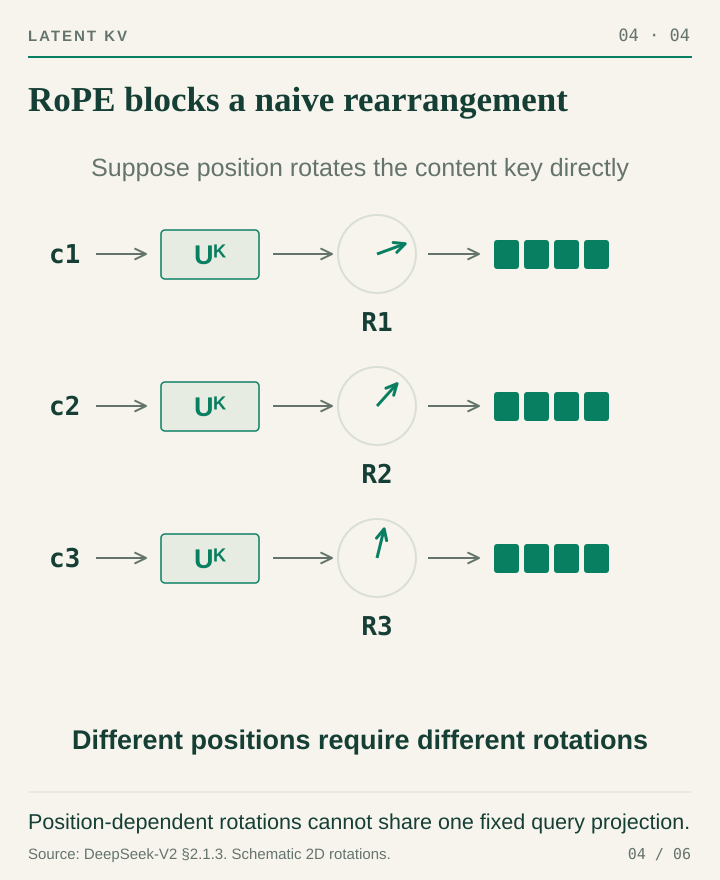</figure>
<em>Figure 4.4. A different rotation at each historical position obstructs naive query-side absorption.</em>

Technical note: RoPE blocks a naive rearrangement

If RoPE rotates the content key directly, the query-side factor after rearrangement would depend on the historical key position j. It cannot generally be precomputed once as a fixed transform of the current query. This motivates the separate positional path in DeepSeek-V2 MLA.

Content score with rotations: qᵢᵀ Rᵢᵀ Rⱼ Uᴷ cⱼ
Query-side factor: Uᴷᵀ Rⱼᵀ Rᵢ qᵢ, which depends on j

Primary references: <a href="https://arxiv.org/pdf/2405.04434">DeepSeek-V2, §2.1</a>; <a href="https://github.com/deepseek-ai/DeepSeek-V3/blob/main/inference/model.py">Author implementation</a>; <a href="https://arxiv.org/pdf/2104.09864">RoFormer, §3.2</a>.

<strong>Rotary position embedding (RoPE)</strong> rotates query and key feature pairs according to their positions. If a historical key’s rotation sits between the query and its up-projection, that rotation changes with the historical position. One fixed query-side projection cannot generally absorb all of them.

<figure id="c4-vf-05-decoupled-rope">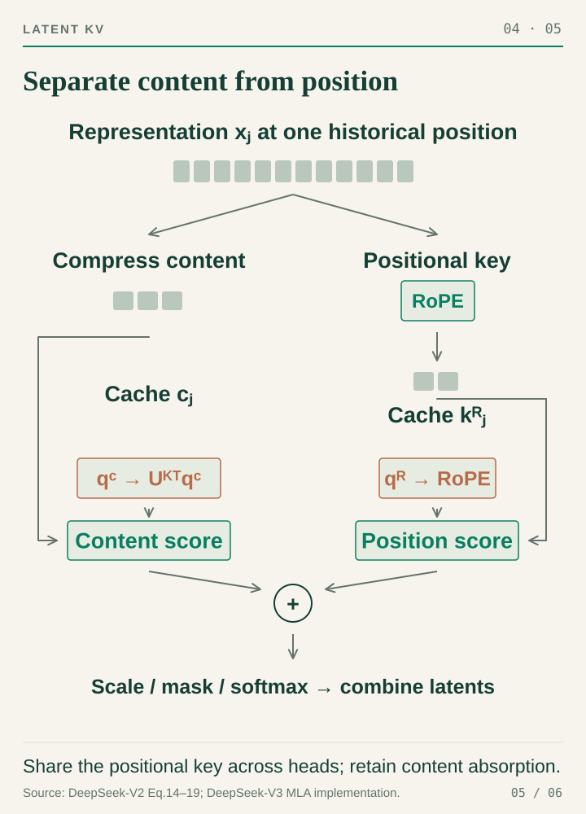</figure>
<em>Figure 4.5. Combine a compressed content score with a separate positional score.</em>

Technical note: Separate content from position

The positional key is shared across heads in this DeepSeek-V2 layout. Content matching can still use the absorbed query transform. Add content and positional scores before scaling, masking, and softmax; the scaling dimension includes both contributing key subspaces.

s_content = (Uᴷₕᵀqᶜₜ,ₕ)ᵀcⱼ
s_position = qᴿₜ,ₕᵀkᴿⱼ
aₜⱼ,ₕ = softmaxⱼ((s_content+s_position)/√(dₖᶜ+d_r) + Mₜⱼ)

Primary references: <a href="https://arxiv.org/pdf/2405.04434">DeepSeek-V2, §2.1</a>; <a href="https://github.com/deepseek-ai/DeepSeek-V3/blob/main/inference/model.py">Author implementation</a>.

<figure id="c2-vf-07-position">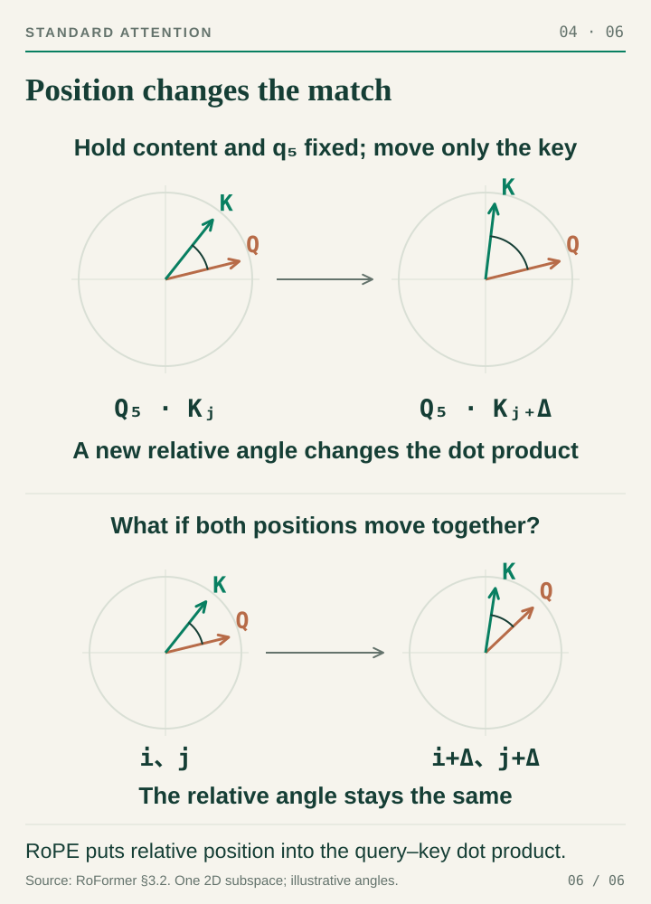</figure>
<em>Figure 4.6. Relative rotation changes a query–key match without changing the underlying content vectors.</em>

Technical note: Position changes the match

RoPE acts on two-dimensional feature pairs. Moving a key changes its relative angle to a fixed query. Shifting both positions together preserves their relative angle in this construction. The diagram is one subspace with illustrative angles, not a visualization of a complete model embedding.

Primary references: <a href="https://arxiv.org/pdf/2104.09864">RoFormer, §3.2</a>.

For DeepSeek-V2-style MLA, the cache therefore contains a content latent plus a positional key. This is a configuration-specific description: later models can make different positional choices. Kimi K3’s MLA uses No Position Encoding (NoPE), as we will see in Chapter 10.

Even a compact entry must still be read. The next group of designs reduces how much history participates in a read.

<h2 id="chapter-5">5. Sparse Attention: Reading Less History</h2>

A local window is the simplest restriction: read nearby positions and exclude the rest from this layer’s direct read. Global positions can add longer-range links. These patterns alter access, rather than merely changing how a cache entry is represented.

<strong>Mixture of Block Attention (MoBA)</strong> makes the selection depend on the query. Summarize blocks, score the summaries, select blocks, and attend to the tokens inside them. The current block remains available under a causal mask.

<figure id="c5-vf-02-moba">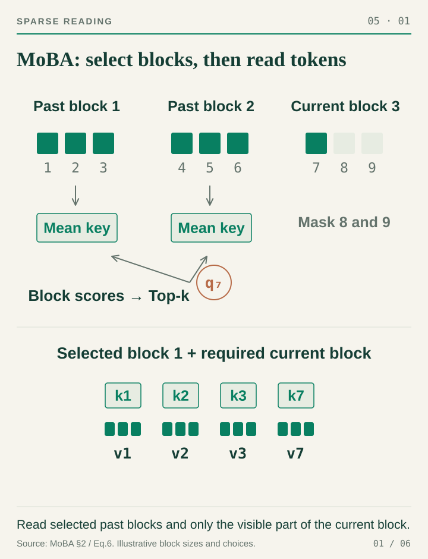</figure>
<em>Figure 5.1. MoBA routes a query to blocks before reading their individual tokens.</em>

Technical note: MoBA: select blocks, then read tokens

Mean keys provide coarse block summaries. Select completed past blocks by their query scores, while also reading the causally visible part of the current block. Future positions remain masked. The block choices shown illustrate routing, rather than measured relevance or a guaranteed speedup.

k̄_b = meanⱼ∈block_b(kⱼ)
s_b = qₜᵀk̄_b
Read set = selected past blocks ∪ visible current-block positions

Primary references: <a href="https://arxiv.org/pdf/2502.13189">MoBA, §2</a>.

Selection is approximate routing: a block summary cannot retain every detail of every key. It also has its own cost. Fewer token-level pairs do not automatically translate into the same factor of wall-clock speedup.

Another choice is to compress groups of historical positions. DeepSeek-V4’s <strong>Compressed Sparse Attention (CSA)</strong> selects from a compressed pool and combines the selected entries with local KV. Its <strong>Heavily Compressed Attention (HCA)</strong> reads a more aggressively compressed visible pool together with local KV. Both can build one combined KV set for the core attention read.

<figure id="n05-csa">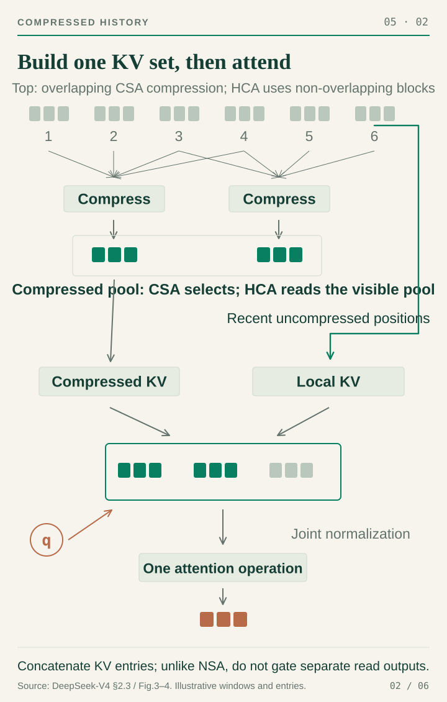</figure>
<em>Figure 5.2. CSA/HCA form a combined local-and-historical KV set for one normalized read.</em>

Technical note: Build one KV set, then attend

DeepSeek-V4 CSA compresses overlapping groups and selects from its compressed pool. HCA uses heavier, non-overlapping compression and reads the visible compressed pool. The core sketch concatenates retained KV entries before attention. This differs from NSA’s weighted sum of independently computed branch outputs.

o = Attn(q, concat(K_local, K_history), concat(V_local, V_history))
NSA instead: o = g_cmp·o_cmp + g_sel·o_sel + g_win·o_win

Primary references: <a href="https://arxiv.org/pdf/2606.19348">DeepSeek-V4, §2.3</a>; <a href="https://arxiv.org/pdf/2502.11089">Native Sparse Attention, §3</a>.

That combination matters: concatenating KV entries before one normalization is different from gating several independently normalized branch outputs. <strong>Native Sparse Attention (NSA)</strong> uses the latter pattern, combining compressed, selected, and local branch outputs with learned gates.

Windows, DSA, NSA, and the cost that sparsity leaves behind

<figure id="c5-vf-01-patterns"><svg aria-label="Restrict which history can be read" height="750" lang="en" role="img" viewbox="0 0 720 750" width="720" xml:lang="en" xmlns="http://www.w3.org/2000/svg"><rect fill="#F6F4ED" height="750" width="720"></rect><text data-label-slot="664.0" data-max-width="664.0" fill="#64736C" font-family='Arial,"Helvetica Neue",sans-serif' font-size="15" font-weight="600" letter-spacing="2" text-anchor="start" x="28" y="41">SPARSE READING</text><text data-label-slot="672.0" data-max-width="672.0" fill="#64736C" font-family='"SFMono-Regular",Menlo,monospace' font-size="17" font-weight="500" letter-spacing="0" text-anchor="end" x="690" y="41">05 · 03</text><line stroke="#087F61" stroke-width="2" x1="28" x2="692" y1="57" y2="57"></line><text data-label-slot="664.0" data-max-width="664.0" fill="#153E35" font-family='Georgia,"Times New Roman",serif' font-size="35" font-weight="700" letter-spacing="0" text-anchor="start" x="28" y="111">Restrict which history can be read</text><text data-label-slot="684.0" data-max-width="684.0" fill="#64736C" font-family='Arial,"Helvetica Neue",sans-serif' font-size="25" font-weight="500" letter-spacing="0" text-anchor="middle" x="360" y="173">Extend the toy history; inspect one query row</text><text data-label-slot="208.0" data-max-width="208.0" fill="#153E35" font-family='Arial,"Helvetica Neue",sans-serif' font-size="25" font-weight="600" letter-spacing="0" text-anchor="middle" x="122" y="243">Full history</text><rect data-c="0" data-pattern="full" data-r="0" fill="#087F61" height="27" rx="2" width="27" x="29" y="282"></rect><rect data-c="1" data-pattern="full" data-r="0" fill="#E7ECE2" height="27" rx="2" width="27" x="60" y="282"></rect><rect data-c="2" data-pattern="full" data-r="0" fill="#E7ECE2" height="27" rx="2" width="27" x="91" y="282"></rect><rect data-c="3" data-pattern="full" data-r="0" fill="#E7ECE2" height="27" rx="2" width="27" x="122" y="282"></rect><rect data-c="4" data-pattern="full" data-r="0" fill="#E7ECE2" height="27" rx="2" width="27" x="153" y="282"></rect><rect data-c="5" data-pattern="full" data-r="0" fill="#E7ECE2" height="27" rx="2" width="27" x="184" y="282"></rect><rect aria-label="Select query row 1" data-sparse-query="0" fill="transparent" height="31" role="button" tabindex="0" width="186" x="27" y="280"></rect><rect data-c="0" data-pattern="full" data-r="1" fill="#087F61" height="27" rx="2" width="27" x="29" y="313"></rect><rect data-c="1" data-pattern="full" data-r="1" fill="#087F61" height="27" rx="2" width="27" x="60" y="313"></rect><rect data-c="2" data-pattern="full" data-r="1" fill="#E7ECE2" height="27" rx="2" width="27" x="91" y="313"></rect><rect data-c="3" data-pattern="full" data-r="1" fill="#E7ECE2" height="27" rx="2" width="27" x="122" y="313"></rect><rect data-c="4" data-pattern="full" data-r="1" fill="#E7ECE2" height="27" rx="2" width="27" x="153" y="313"></rect><rect data-c="5" data-pattern="full" data-r="1" fill="#E7ECE2" height="27" rx="2" width="27" x="184" y="313"></rect><rect aria-label="Select query row 2" data-sparse-query="1" fill="transparent" height="31" role="button" tabindex="0" width="186" x="27" y="311"></rect><rect data-c="0" data-pattern="full" data-r="2" fill="#087F61" height="27" rx="2" width="27" x="29" y="344"></rect><rect data-c="1" data-pattern="full" data-r="2" fill="#087F61" height="27" rx="2" width="27" x="60" y="344"></rect><rect data-c="2" data-pattern="full" data-r="2" fill="#087F61" height="27" rx="2" width="27" x="91" y="344"></rect><rect data-c="3" data-pattern="full" data-r="2" fill="#E7ECE2" height="27" rx="2" width="27" x="122" y="344"></rect><rect data-c="4" data-pattern="full" data-r="2" fill="#E7ECE2" height="27" rx="2" width="27" x="153" y="344"></rect><rect data-c="5" data-pattern="full" data-r="2" fill="#E7ECE2" height="27" rx="2" width="27" x="184" y="344"></rect><rect aria-label="Select query row 3" data-sparse-query="2" fill="transparent" height="31" role="button" tabindex="0" width="186" x="27" y="342"></rect><rect data-c="0" data-pattern="full" data-r="3" fill="#087F61" height="27" rx="2" width="27" x="29" y="375"></rect><rect data-c="1" data-pattern="full" data-r="3" fill="#087F61" height="27" rx="2" width="27" x="60" y="375"></rect><rect data-c="2" data-pattern="full" data-r="3" fill="#087F61" height="27" rx="2" width="27" x="91" y="375"></rect><rect data-c="3" data-pattern="full" data-r="3" fill="#087F61" height="27" rx="2" width="27" x="122" y="375"></rect><rect data-c="4" data-pattern="full" data-r="3" fill="#E7ECE2" height="27" rx="2" width="27" x="153" y="375"></rect><rect data-c="5" data-pattern="full" data-r="3" fill="#E7ECE2" height="27" rx="2" width="27" x="184" y="375"></rect><rect aria-label="Select query row 4" data-sparse-query="3" fill="transparent" height="31" role="button" tabindex="0" width="186" x="27" y="373"></rect><rect data-c="0" data-pattern="full" data-r="4" fill="#087F61" height="27" rx="2" width="27" x="29" y="406"></rect><rect data-c="1" data-pattern="full" data-r="4" fill="#087F61" height="27" rx="2" width="27" x="60" y="406"></rect><rect data-c="2" data-pattern="full" data-r="4" fill="#087F61" height="27" rx="2" width="27" x="91" y="406"></rect><rect data-c="3" data-pattern="full" data-r="4" fill="#087F61" height="27" rx="2" width="27" x="122" y="406"></rect><rect data-c="4" data-pattern="full" data-r="4" fill="#087F61" height="27" rx="2" width="27" x="153" y="406"></rect><rect data-c="5" data-pattern="full" data-r="4" fill="#E7ECE2" height="27" rx="2" width="27" x="184" y="406"></rect><rect aria-label="Select query row 5" data-sparse-query="4" fill="transparent" height="31" role="button" tabindex="0" width="186" x="27" y="404"></rect><rect data-c="0" data-pattern="full" data-r="5" fill="#B76B48" height="27" rx="2" width="27" x="29" y="437"></rect><rect data-c="1" data-pattern="full" data-r="5" fill="#B76B48" height="27" rx="2" width="27" x="60" y="437"></rect><rect data-c="2" data-pattern="full" data-r="5" fill="#B76B48" height="27" rx="2" width="27" x="91" y="437"></rect><rect data-c="3" data-pattern="full" data-r="5" fill="#B76B48" height="27" rx="2" width="27" x="122" y="437"></rect><rect data-c="4" data-pattern="full" data-r="5" fill="#B76B48" height="27" rx="2" width="27" x="153" y="437"></rect><rect data-c="5" data-pattern="full" data-r="5" fill="#B76B48" height="27" rx="2" width="27" x="184" y="437"></rect><rect aria-label="Select query row 6" data-sparse-query="5" fill="transparent" height="31" role="button" tabindex="0" width="186" x="27" y="435"></rect><text data-label-slot="208.0" data-max-width="208.0" fill="#64736C" font-family='Arial,"Helvetica Neue",sans-serif' font-size="24" font-weight="500" letter-spacing="0" text-anchor="middle" x="122" y="523">Keys →</text><text data-label-slot="199.6" data-max-width="676.0" fill="#153E35" font-family='Arial,"Helvetica Neue",sans-serif' font-size="25" font-weight="600" letter-spacing="0" text-anchor="middle" x="356" y="243">Local window</text><rect data-c="0" data-pattern="window" data-r="0" fill="#087F61" height="27" rx="2" width="27" x="263" y="282"></rect><rect data-c="1" data-pattern="window" data-r="0" fill="#E7ECE2" height="27" rx="2" width="27" x="294" y="282"></rect><rect data-c="2" data-pattern="window" data-r="0" fill="#E7ECE2" height="27" rx="2" width="27" x="325" y="282"></rect><rect data-c="3" data-pattern="window" data-r="0" fill="#E7ECE2" height="27" rx="2" width="27" x="356" y="282"></rect><rect data-c="4" data-pattern="window" data-r="0" fill="#E7ECE2" height="27" rx="2" width="27" x="387" y="282"></rect><rect data-c="5" data-pattern="window" data-r="0" fill="#E7ECE2" height="27" rx="2" width="27" x="418" y="282"></rect><rect aria-label="Select query row 1" data-sparse-query="0" fill="transparent" height="31" role="button" tabindex="0" width="186" x="261" y="280"></rect><rect data-c="0" data-pattern="window" data-r="1" fill="#087F61" height="27" rx="2" width="27" x="263" y="313"></rect><rect data-c="1" data-pattern="window" data-r="1" fill="#087F61" height="27" rx="2" width="27" x="294" y="313"></rect><rect data-c="2" data-pattern="window" data-r="1" fill="#E7ECE2" height="27" rx="2" width="27" x="325" y="313"></rect><rect data-c="3" data-pattern="window" data-r="1" fill="#E7ECE2" height="27" rx="2" width="27" x="356" y="313"></rect><rect data-c="4" data-pattern="window" data-r="1" fill="#E7ECE2" height="27" rx="2" width="27" x="387" y="313"></rect><rect data-c="5" data-pattern="window" data-r="1" fill="#E7ECE2" height="27" rx="2" width="27" x="418" y="313"></rect><rect aria-label="Select query row 2" data-sparse-query="1" fill="transparent" height="31" role="button" tabindex="0" width="186" x="261" y="311"></rect><rect data-c="0" data-pattern="window" data-r="2" fill="#087F61" height="27" rx="2" width="27" x="263" y="344"></rect><rect data-c="1" data-pattern="window" data-r="2" fill="#087F61" height="27" rx="2" width="27" x="294" y="344"></rect><rect data-c="2" data-pattern="window" data-r="2" fill="#087F61" height="27" rx="2" width="27" x="325" y="344"></rect><rect data-c="3" data-pattern="window" data-r="2" fill="#E7ECE2" height="27" rx="2" width="27" x="356" y="344"></rect><rect data-c="4" data-pattern="window" data-r="2" fill="#E7ECE2" height="27" rx="2" width="27" x="387" y="344"></rect><rect data-c="5" data-pattern="window" data-r="2" fill="#E7ECE2" height="27" rx="2" width="27" x="418" y="344"></rect><rect aria-label="Select query row 3" data-sparse-query="2" fill="transparent" height="31" role="button" tabindex="0" width="186" x="261" y="342"></rect><rect data-c="0" data-pattern="window" data-r="3" fill="#E7ECE2" height="27" rx="2" width="27" x="263" y="375"></rect><rect data-c="1" data-pattern="window" data-r="3" fill="#087F61" height="27" rx="2" width="27" x="294" y="375"></rect><rect data-c="2" data-pattern="window" data-r="3" fill="#087F61" height="27" rx="2" width="27" x="325" y="375"></rect><rect data-c="3" data-pattern="window" data-r="3" fill="#087F61" height="27" rx="2" width="27" x="356" y="375"></rect><rect data-c="4" data-pattern="window" data-r="3" fill="#E7ECE2" height="27" rx="2" width="27" x="387" y="375"></rect><rect data-c="5" data-pattern="window" data-r="3" fill="#E7ECE2" height="27" rx="2" width="27" x="418" y="375"></rect><rect aria-label="Select query row 4" data-sparse-query="3" fill="transparent" height="31" role="button" tabindex="0" width="186" x="261" y="373"></rect><rect data-c="0" data-pattern="window" data-r="4" fill="#E7ECE2" height="27" rx="2" width="27" x="263" y="406"></rect><rect data-c="1" data-pattern="window" data-r="4" fill="#E7ECE2" height="27" rx="2" width="27" x="294" y="406"></rect><rect data-c="2" data-pattern="window" data-r="4" fill="#087F61" height="27" rx="2" width="27" x="325" y="406"></rect><rect data-c="3" data-pattern="window" data-r="4" fill="#087F61" height="27" rx="2" width="27" x="356" y="406"></rect><rect data-c="4" data-pattern="window" data-r="4" fill="#087F61" height="27" rx="2" width="27" x="387" y="406"></rect><rect data-c="5" data-pattern="window" data-r="4" fill="#E7ECE2" height="27" rx="2" width="27" x="418" y="406"></rect><rect aria-label="Select query row 5" data-sparse-query="4" fill="transparent" height="31" role="button" tabindex="0" width="186" x="261" y="404"></rect><rect data-c="0" data-pattern="window" data-r="5" fill="#E7ECE2" height="27" rx="2" width="27" x="263" y="437"></rect><rect data-c="1" data-pattern="window" data-r="5" fill="#E7ECE2" height="27" rx="2" width="27" x="294" y="437"></rect><rect data-c="2" data-pattern="window" data-r="5" fill="#E7ECE2" height="27" rx="2" width="27" x="325" y="437"></rect><rect data-c="3" data-pattern="window" data-r="5" fill="#B76B48" height="27" rx="2" width="27" x="356" y="437"></rect><rect data-c="4" data-pattern="window" data-r="5" fill="#B76B48" height="27" rx="2" width="27" x="387" y="437"></rect><rect data-c="5" data-pattern="window" data-r="5" fill="#B76B48" height="27" rx="2" width="27" x="418" y="437"></rect><rect aria-label="Select query row 6" data-sparse-query="5" fill="transparent" height="31" role="button" tabindex="0" width="186" x="261" y="435"></rect><text data-label-slot="228.0" data-max-width="676.0" fill="#64736C" font-family='Arial,"Helvetica Neue",sans-serif' font-size="24" font-weight="500" letter-spacing="0" text-anchor="middle" x="356" y="523">Keys →</text><text data-label-slot="224.0" data-max-width="224.0" fill="#153E35" font-family='Arial,"Helvetica Neue",sans-serif' font-size="25" font-weight="600" letter-spacing="0" text-anchor="middle" x="590" y="243">Window + global</text><rect data-c="0" data-pattern="global" data-r="0" fill="#087F61" height="27" rx="2" width="27" x="497" y="282"></rect><rect data-c="1" data-pattern="global" data-r="0" fill="#E7ECE2" height="27" rx="2" width="27" x="528" y="282"></rect><rect data-c="2" data-pattern="global" data-r="0" fill="#E7ECE2" height="27" rx="2" width="27" x="559" y="282"></rect><rect data-c="3" data-pattern="global" data-r="0" fill="#E7ECE2" height="27" rx="2" width="27" x="590" y="282"></rect><rect data-c="4" data-pattern="global" data-r="0" fill="#E7ECE2" height="27" rx="2" width="27" x="621" y="282"></rect><rect data-c="5" data-pattern="global" data-r="0" fill="#E7ECE2" height="27" rx="2" width="27" x="652" y="282"></rect><rect aria-label="Select query row 1" data-sparse-query="0" fill="transparent" height="31" role="button" tabindex="0" width="186" x="495" y="280"></rect><rect data-c="0" data-pattern="global" data-r="1" fill="#087F61" height="27" rx="2" width="27" x="497" y="313"></rect><rect data-c="1" data-pattern="global" data-r="1" fill="#087F61" height="27" rx="2" width="27" x="528" y="313"></rect><rect data-c="2" data-pattern="global" data-r="1" fill="#E7ECE2" height="27" rx="2" width="27" x="559" y="313"></rect><rect data-c="3" data-pattern="global" data-r="1" fill="#E7ECE2" height="27" rx="2" width="27" x="590" y="313"></rect><rect data-c="4" data-pattern="global" data-r="1" fill="#E7ECE2" height="27" rx="2" width="27" x="621" y="313"></rect><rect data-c="5" data-pattern="global" data-r="1" fill="#E7ECE2" height="27" rx="2" width="27" x="652" y="313"></rect><rect aria-label="Select query row 2" data-sparse-query="1" fill="transparent" height="31" role="button" tabindex="0" width="186" x="495" y="311"></rect><rect data-c="0" data-pattern="global" data-r="2" fill="#087F61" height="27" rx="2" width="27" x="497" y="344"></rect><rect data-c="1" data-pattern="global" data-r="2" fill="#087F61" height="27" rx="2" width="27" x="528" y="344"></rect><rect data-c="2" data-pattern="global" data-r="2" fill="#087F61" height="27" rx="2" width="27" x="559" y="344"></rect><rect data-c="3" data-pattern="global" data-r="2" fill="#E7ECE2" height="27" rx="2" width="27" x="590" y="344"></rect><rect data-c="4" data-pattern="global" data-r="2" fill="#E7ECE2" height="27" rx="2" width="27" x="621" y="344"></rect><rect data-c="5" data-pattern="global" data-r="2" fill="#E7ECE2" height="27" rx="2" width="27" x="652" y="344"></rect><rect aria-label="Select query row 3" data-sparse-query="2" fill="transparent" height="31" role="button" tabindex="0" width="186" x="495" y="342"></rect><rect data-c="0" data-pattern="global" data-r="3" fill="#087F61" height="27" rx="2" width="27" x="497" y="375"></rect><rect data-c="1" data-pattern="global" data-r="3" fill="#087F61" height="27" rx="2" width="27" x="528" y="375"></rect><rect data-c="2" data-pattern="global" data-r="3" fill="#087F61" height="27" rx="2" width="27" x="559" y="375"></rect><rect data-c="3" data-pattern="global" data-r="3" fill="#087F61" height="27" rx="2" width="27" x="590" y="375"></rect><rect data-c="4" data-pattern="global" data-r="3" fill="#E7ECE2" height="27" rx="2" width="27" x="621" y="375"></rect><rect data-c="5" data-pattern="global" data-r="3" fill="#E7ECE2" height="27" rx="2" width="27" x="652" y="375"></rect><rect aria-label="Select query row 4" data-sparse-query="3" fill="transparent" height="31" role="button" tabindex="0" width="186" x="495" y="373"></rect><rect data-c="0" data-pattern="global" data-r="4" fill="#087F61" height="27" rx="2" width="27" x="497" y="406"></rect><rect data-c="1" data-pattern="global" data-r="4" fill="#E7ECE2" height="27" rx="2" width="27" x="528" y="406"></rect><rect data-c="2" data-pattern="global" data-r="4" fill="#087F61" height="27" rx="2" width="27" x="559" y="406"></rect><rect data-c="3" data-pattern="global" data-r="4" fill="#087F61" height="27" rx="2" width="27" x="590" y="406"></rect><rect data-c="4" data-pattern="global" data-r="4" fill="#087F61" height="27" rx="2" width="27" x="621" y="406"></rect><rect data-c="5" data-pattern="global" data-r="4" fill="#E7ECE2" height="27" rx="2" width="27" x="652" y="406"></rect><rect aria-label="Select query row 5" data-sparse-query="4" fill="transparent" height="31" role="button" tabindex="0" width="186" x="495" y="404"></rect><rect data-c="0" data-pattern="global" data-r="5" fill="#B76B48" height="27" rx="2" width="27" x="497" y="437"></rect><rect data-c="1" data-pattern="global" data-r="5" fill="#E7ECE2" height="27" rx="2" width="27" x="528" y="437"></rect><rect data-c="2" data-pattern="global" data-r="5" fill="#E7ECE2" height="27" rx="2" width="27" x="559" y="437"></rect><rect data-c="3" data-pattern="global" data-r="5" fill="#B76B48" height="27" rx="2" width="27" x="590" y="437"></rect><rect data-c="4" data-pattern="global" data-r="5" fill="#B76B48" height="27" rx="2" width="27" x="621" y="437"></rect><rect data-c="5" data-pattern="global" data-r="5" fill="#B76B48" height="27" rx="2" width="27" x="652" y="437"></rect><rect aria-label="Select query row 6" data-sparse-query="5" fill="transparent" height="31" role="button" tabindex="0" width="186" x="495" y="435"></rect><text data-label-slot="224.0" data-max-width="224.0" fill="#64736C" font-family='Arial,"Helvetica Neue",sans-serif' font-size="24" font-weight="500" letter-spacing="0" text-anchor="middle" x="590" y="523">Keys →</text><text data-label-slot="684.0" data-max-width="684.0" fill="#64736C" font-family='Arial,"Helvetica Neue",sans-serif' font-size="24" font-weight="500" letter-spacing="0" text-anchor="middle" x="360" y="571">Orange: visible to this query; pale: not read</text><text data-label-slot="684.0" data-max-width="684.0" fill="#153E35" font-family='Arial,"Helvetica Neue",sans-serif' font-size="28" font-weight="600" letter-spacing="0" text-anchor="middle" x="360" y="628">Future tokens remain invisible</text><line stroke="#D9DFD5" stroke-width="1" x1="28" x2="692" y1="662" y2="662"></line><text data-label-slot="664.0" data-max-width="664.0" fill="#153E35" font-family='Arial,"Helvetica Neue",sans-serif' font-size="21.5" font-weight="500" letter-spacing="0" text-anchor="start" x="28" y="699">Windows bound distance; global positions add direct long-range links.</text><text data-label-slot="587.0" data-max-width="587.0" fill="#64736C" font-family='Arial,"Helvetica Neue",sans-serif' font-size="15" font-weight="400" letter-spacing="0" text-anchor="start" x="28" y="729">Source: Mistral §2; Longformer §3. Causal teaching examples.</text><text data-label-slot="673.0" data-max-width="673.0" fill="#64736C" font-family='"SFMono-Regular",Menlo,monospace' font-size="15" font-weight="500" letter-spacing="0" text-anchor="end" x="691" y="729">03 / 06</text></svg></figure>
<em>Figure 5.3. A sparse access pattern changes which historical positions a query can directly read.</em>

Technical note: Restrict which history can be read

A causal local window reads only recent positions. Adding global positions can provide direct long-range links. Multi-layer information propagation can reach beyond one layer’s direct window, so the pattern is not a complete statement about the model’s effective receptive field.

Local window at step t: max(1,t−w+1) ≤ j ≤ t
Window + global positions: local set ∪ visible global positions

Primary references: <a href="https://arxiv.org/pdf/2310.06825">Mistral 7B</a>; <a href="https://arxiv.org/pdf/2004.05150">Longformer</a>.

<figure id="c5-vf-04-dsa">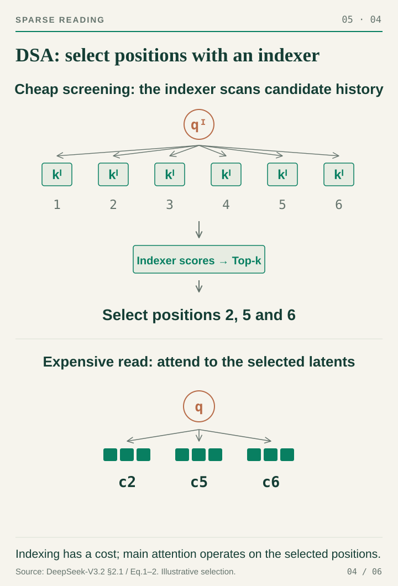</figure>
<em>Figure 5.4. DSA uses lightweight scores to choose positions for the main attention computation.</em>

Technical note: DSA: select positions with an indexer

The indexer and main attention have distinct roles. Indexer scores rank candidate positions; main attention then reads selected latent entries. Indexer work, candidate representation, and selected-value transfers remain part of the cost.

Iₜⱼ = Σₕ wᴵₜ,ₕ ReLU(qᴵₜ,ₕ · kᴵⱼ)
Selected positions = Top-k({Iₜⱼ : j ≤ t})

Primary references: <a href="https://arxiv.org/pdf/2512.02556">DeepSeek-V3.2, §2.1</a>.

<strong>DeepSeek Sparse Attention (DSA)</strong> uses a lightweight indexer to score candidate positions, then runs main attention over selected positions. The main read becomes sparse; the indexer still examines candidates.

<figure id="c5-vf-03-nsa">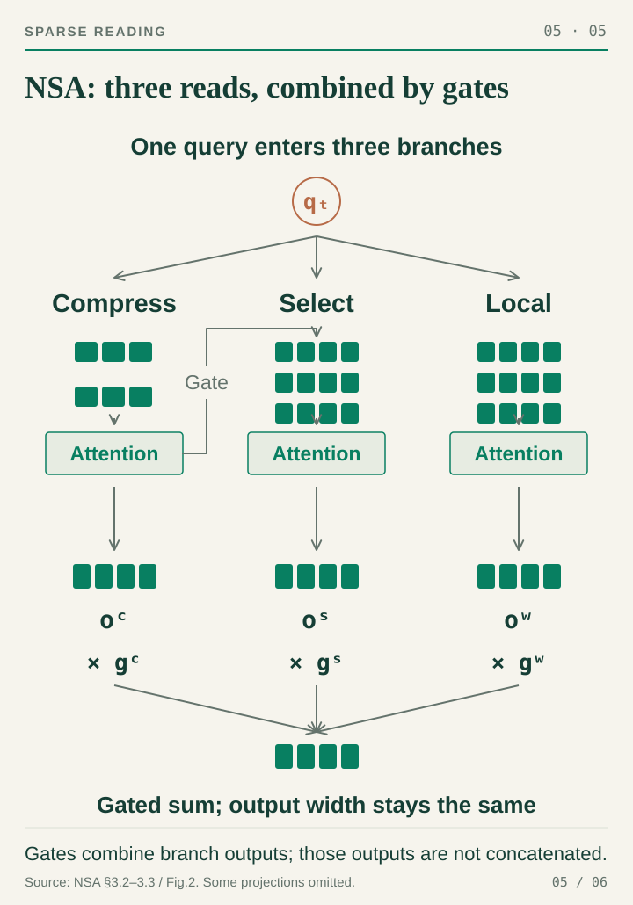</figure>
<em>Figure 5.5. NSA gates three branch outputs; it does not concatenate their output vectors.</em>

Technical note: NSA: three reads, combined by gates

Compression, selection, and sliding-window attention compute complementary reads. Learned gates control each branch’s contribution to the sum. Each output has the value width, and the combined output retains that width. The sketch omits some projections and implementation details.

oₜ = gᶜₜ oᶜₜ + gˢₜ oˢₜ + gʷₜ oʷₜ

Primary references: <a href="https://arxiv.org/pdf/2502.11089">Native Sparse Attention, §3</a>.

<figure id="c5-vf-05-sparse-cache">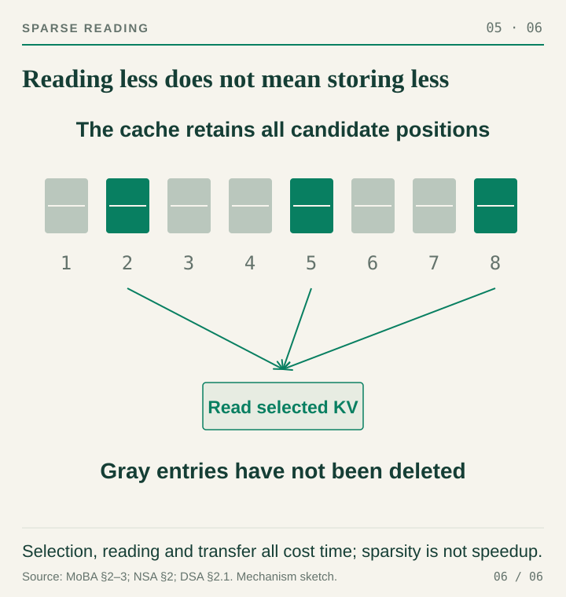</figure>
<em>Figure 5.6. Skipping an entry in this read does not delete it from the candidate history.</em>

Technical note: Reading less does not mean storing less

A future query may select a position that the current query skips. Reducing cache size therefore requires an additional representation or retention decision. Sparse ratios omit indexer work, memory transfer, kernel efficiency, and model-wide computation; they should not be read as speedup factors.

Primary references: <a href="https://arxiv.org/pdf/2502.13189">MoBA, §2</a>; <a href="https://arxiv.org/pdf/2502.11089">Native Sparse Attention, §3</a>; <a href="https://arxiv.org/pdf/2512.02556">DeepSeek-V3.2, §2.1</a>.

A skipped entry may remain in memory because a different future query could select it. Cache reduction requires an additional decision about representation, retention, or eviction. “Not read now” and “not stored” are different statements.

Sharing, compression, and sparse reads preserve some form of revisitable history. What if the model did not keep a separately addressable entry for every position?

<h2 id="chapter-6">6. Linear Attention: Replacing History with a State</h2>

A <strong>recurrent state</strong> is the information carried from one step to the next. Linear attention can accumulate key–value associations into a fixed-shape matrix and query that matrix later. Its storage no longer needs a new row for every historical position.

<figure id="n06-return">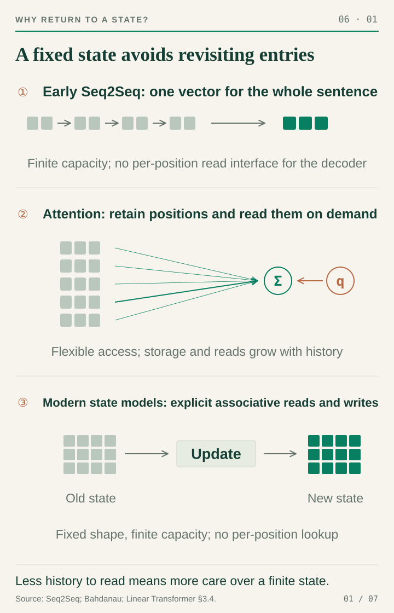</figure>
<em>Figure 6.1. A fixed state replaces per-position revisits with a learned associative read/write interface.</em>

Technical note: A fixed state avoids revisiting entries

This is a return to finite memory, not a return to the unchanged early Seq2Seq model. Modern recurrent forms specify how keys write associations and queries read them. Their core state size can stay independent of history length, but direct access to every individual historical representation is no longer available.

Primary references: <a href="https://aclanthology.org/N03-1017.pdf">Statistical phrase-based translation</a>; <a href="https://arxiv.org/pdf/1409.3215">Sequence to Sequence Learning</a>; <a href="https://arxiv.org/pdf/1409.0473">Bahdanau attention</a>; <a href="https://aclanthology.org/D15-1166.pdf">Luong attention</a>; <a href="https://arxiv.org/pdf/2006.16236">Transformers Are RNNs, §3</a>.

This revisits the old finite-memory constraint, but with a much more explicit read/write interface than the basic encoder–decoder bottleneck. A key determines how to write an association; a query determines how to read it. The state’s rows are learned key features, not token positions.

<figure id="n06-state">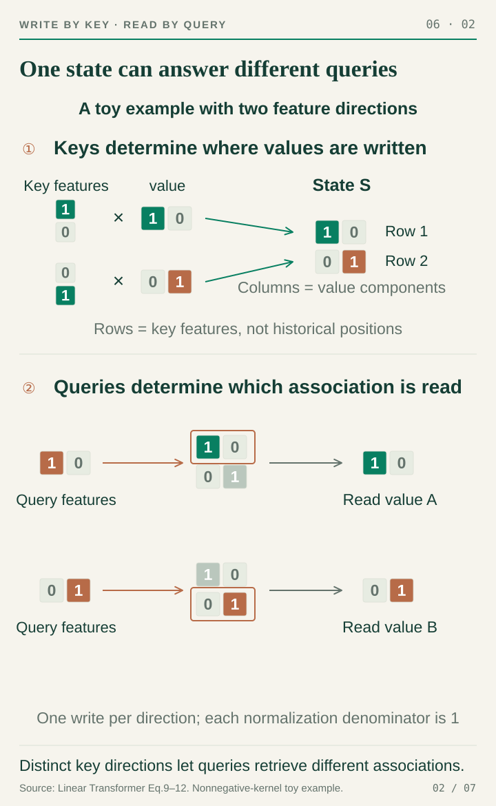</figure>
<em>Figure 6.2. Different query directions can retrieve different associations from the same matrix state.</em>

Technical note: One state can answer different queries

For the teaching example, two nonnegative key-feature directions are orthogonal and each has been written once. Their reads do not interfere, and both normalization denominators equal one. Learned feature directions in a real model need not be orthogonal or correspond to named semantic categories.

Sₜ = Sₜ₋₁ + φ(kₜ)vₜᵀ; zₜ = zₜ₋₁ + φ(kₜ)
oₜ = Sₜᵀφ(qₜ) / (zₜᵀφ(qₜ))

Primary references: <a href="https://arxiv.org/pdf/2006.16236">Transformers Are RNNs, §3</a>.

The benefit is clear: the recurrent core can update and read a state of constant shape at each decode step. The constraint is equally important: <strong>historical contributions now share a finite representation.</strong> They are no longer independent entries waiting to be revisited.

<figure id="n06-interference">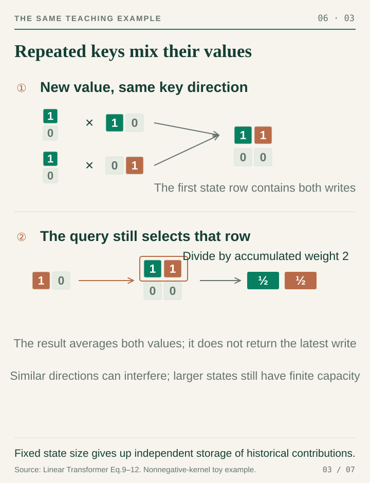</figure>
<em>Figure 6.3. Writing two values with the same key makes their contributions share a state direction.</em>

Technical note: Repeated keys mix their values

The normalized nonnegative-kernel example reads an average of the two values. This isolates interference without claiming a trained model must fail a particular language task. Close rather than identical key directions can also interact. Fixed shape is a storage property, not unlimited information capacity.

φ(k₁)=φ(k₂)=φ(q)=(1,0)ᵀ
v₁=(1,0)ᵀ; v₂=(0,1)ᵀ
S=[[1,1],[0,0]]; z=(2,0)ᵀ
o = Sᵀφ(q)/(zᵀφ(q)) = (½,½)ᵀ

Primary references: <a href="https://arxiv.org/pdf/2006.16236">Transformers Are RNNs, §3</a>.

In the nonnegative-kernel example shown here, two values written with the same key contribute to the same direction. Normalization produces a mixture, not a guaranteed latest-value lookup. Similar keys can also interfere. Making the state larger gives it more room; it does not remove the capacity constraint.

Kernel similarity, outer products, normalization, and chunked execution

<figure id="c6-vf-01-kernel">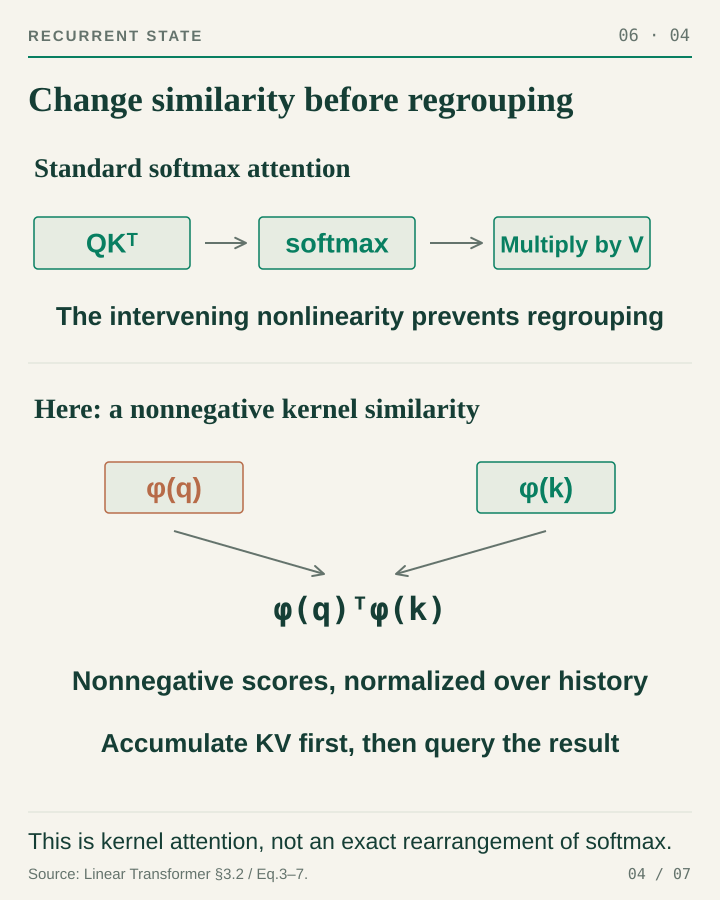</figure>
<em>Figure 6.4. Factorized kernel similarity enables the regrouping that ordinary softmax does not.</em>

Technical note: Change similarity before regrouping

The similarity is changed before regrouping. A nonnegative feature kernel allows the denominator to be accumulated separately through z. Unless a particular approximation is specified and analyzed, this should not be described as an exact replacement for the exponential softmax kernel.

Softmax kernel: exp(qᵀk/√dₖ)
Here: κ(q,k)=φ(q)ᵀφ(k) ≥ 0
[Φ(Q)Φ(K)ᵀ]V = Φ(Q)[Φ(K)ᵀV]

Primary references: <a href="https://arxiv.org/pdf/2006.16236">Transformers Are RNNs, §3</a>.

Softmax attention cannot be regrouped by simply moving parentheses around its nonlinear normalization. The linear form here first uses a factorized nonnegative similarity κ(q,k)=φ(q)ᵀφ(k). That makes it possible to accumulate the key–value products before reading with a query. It is a different attention form, not a free exact rewrite of softmax.

<figure id="c6-vf-02-outer-product">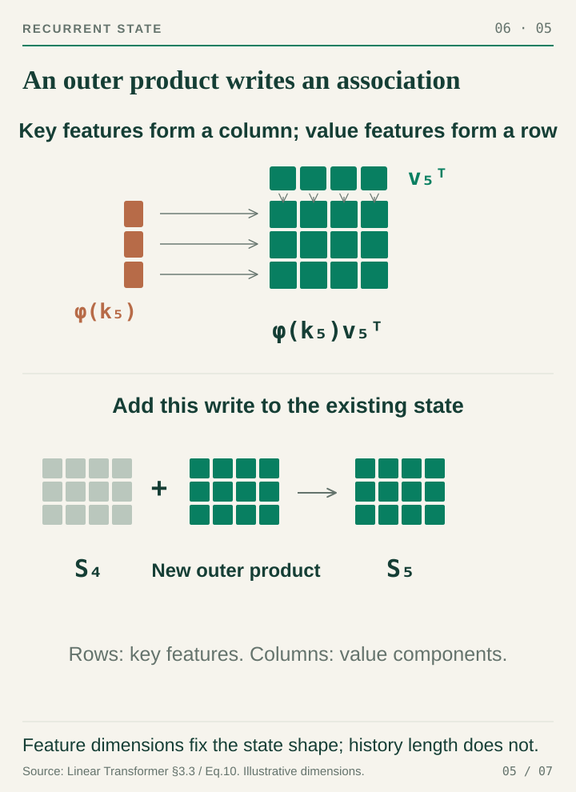</figure>
<em>Figure 6.5. An outer product places a value along the directions specified by its key features.</em>

Technical note: An outer product writes an association

With column vectors, the key features form the rows of the key×value association matrix, and value components form its columns. Adding an outer product writes an association into the same fixed shape rather than appending a token row.

φ(kₜ) ∈ ℝᵐ; vₜ ∈ ℝᵈᵛ
ΔSₜ = φ(kₜ)vₜᵀ ∈ ℝᵐˣᵈᵛ
Sₜ = Sₜ₋₁ + ΔSₜ

Primary references: <a href="https://arxiv.org/pdf/2006.16236">Transformers Are RNNs, §3</a>.

<figure id="c6-vf-03-normalization">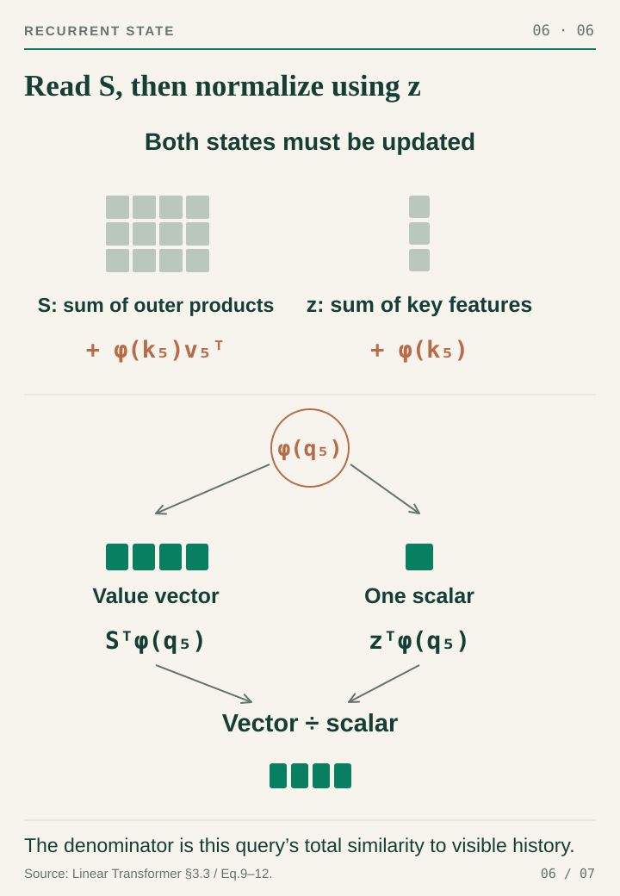</figure>
<em>Figure 6.6. The association matrix supplies a numerator; the key-feature sum supplies a denominator.</em>

Technical note: Read S, then normalize using z

Both accumulators must advance with the same visible history. The denominator is a scalar for the current query, while the numerator is a value-width vector. A numerical implementation needs a safe denominator, particularly at initialization. Other recurrent models may use different normalizations.

Sₜ = Sₜ₋₁ + φ(kₜ)vₜᵀ
zₜ = zₜ₋₁ + φ(kₜ)
oₜ = Sₜᵀφ(qₜ)/(zₜᵀφ(qₜ))

Primary references: <a href="https://arxiv.org/pdf/2006.16236">Transformers Are RNNs, §3</a>.

<figure id="c6-vf-04-execution">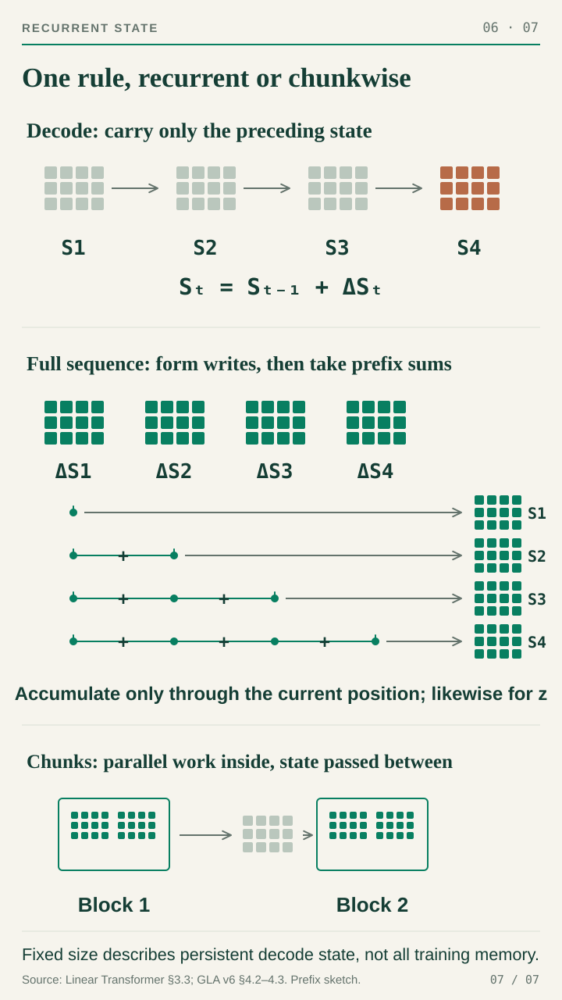</figure>
<em>Figure 6.7. Parallel, recurrent, and chunkwise computations can implement the same causal update rule.</em>

Technical note: One rule, recurrent or chunkwise

For plain additive kernel attention, prefix sums provide the causal accumulated writes. Chunkwise methods organize local work and carry the state between chunks. Gated and delta-rule variants require richer algorithms. Constant persistent decode state does not imply constant total training memory or automatic GPU efficiency.

Persistent state per head in this normalized form: m·dᵥ + m elements
One recurrent update/read: O(m·dᵥ)
Sequence state-core work: O(N·m·dᵥ)

Primary references: <a href="https://arxiv.org/pdf/2006.16236">Transformers Are RNNs, §3</a>; <a href="https://arxiv.org/pdf/2312.06635v6">Gated Linear Attention, §4</a>.

For this normalized kernel form, retain both an association matrix S and a key-feature sum z. Other recurrent architectures use other normalization and gating choices. Fixed persistent decode state also says nothing by itself about total training activation memory.

<pre><code class="language-python">def linear_step(q, k, v, state, normalizer):
    # This feature map keeps m equal to the query/key width.
    qf = torch.nn.functional.elu(q.float()) + 1
    kf = torch.nn.functional.elu(k.float()) + 1
    state = state + kf.unsqueeze(-1) * v.float().unsqueeze(-2)
    normalizer = normalizer + kf
    numerator = torch.einsum('...m,...mv-&gt;...v', qf, state)
    denominator = (qf * normalizer).sum(-1).clamp_min(1e-6)
    return numerator / denominator.unsqueeze(-1), state, normalizer</code></pre>

A finite state needs a policy for what should remain. First, give it a way to forget.

<h2 id="chapter-7">7. RetNet and GLA: Learning What to Forget</h2>

An additive state keeps accumulating writes. Multiplying the old state by a retention factor before adding the new write gives older contributions less influence. In the controlled example, that means an earlier A can fade while a new B is written at full strength.

<figure id="n07-example">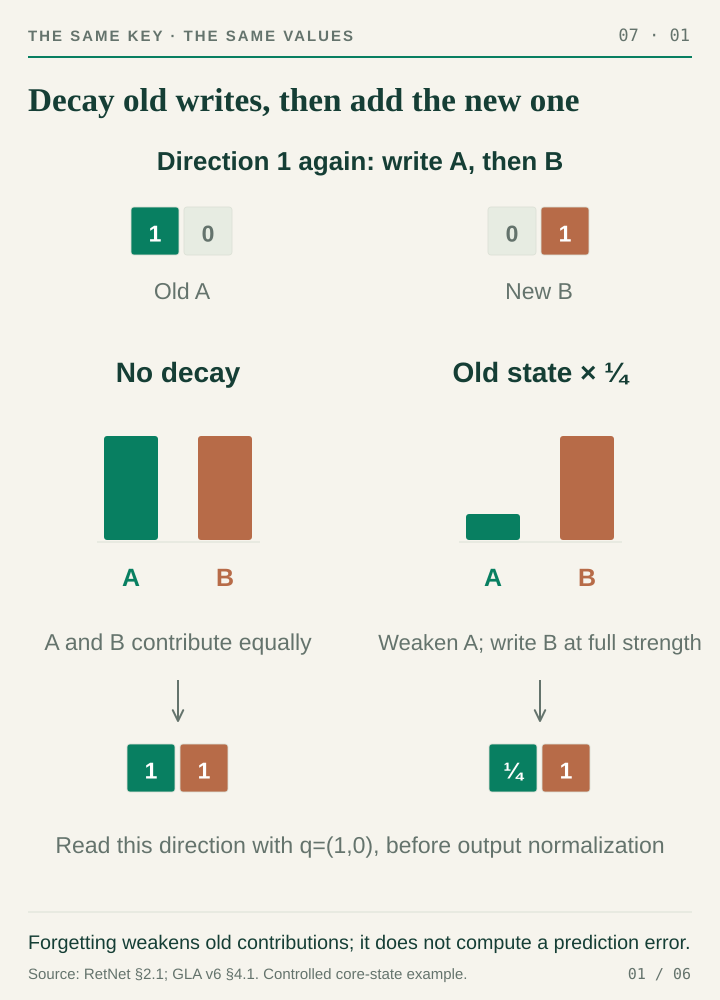</figure>
<em>Figure 7.1. Decay reduces old contributions without changing the strength of the new additive write.</em>

Technical note: Decay old writes, then add the new one

This controlled example reads raw state outputs before model-specific output normalization. Use the same unit key and query to compare no decay with retention factor ¼. The new value B is still written at full strength. No prediction-error correction is performed.

k=q=e₁; old S=e₁Aᵀ
No decay: S′=S+e₁Bᵀ; S′ᵀq=A+B
Decay: S′=¼S+e₁Bᵀ; S′ᵀq=¼A+B

Primary references: <a href="https://arxiv.org/pdf/2307.08621">Retentive Network, §2</a>; <a href="https://arxiv.org/pdf/2312.06635v6">Gated Linear Attention, §4</a>.

<strong>Retentive Network (RetNet)</strong> makes a decayed associative read available in parallel, recurrent, and chunkwise forms. These are different ways to compute the same core rule, with position transforms, normalization, and gates completing the module.

<figure id="n07-retnet">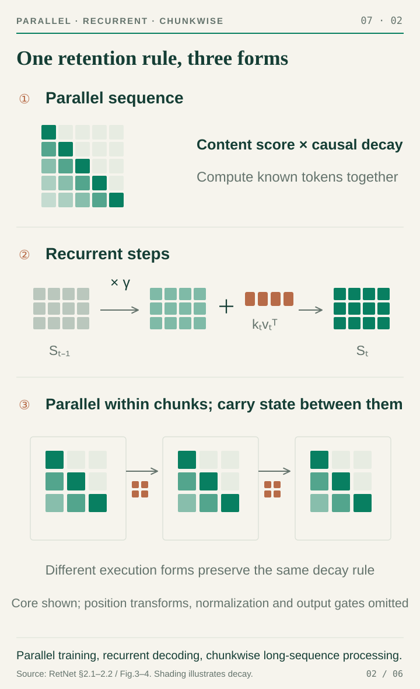</figure>
<em>Figure 7.2. The retention core has equivalent parallel, recurrent, and chunkwise forms.</em>

Technical note: One retention rule, three forms

A causal decay mask weights older contributions in the parallel form; the recurrent form carries the decayed state. Full RetNet adds positional transformations, multi-scale retention, normalization, and output gating. Those module components should not be confused with the simplified scalar-decay core shown here.

Sₜ = γSₜ₋₁ + kₜvₜᵀ; oₜ=Sₜᵀqₜ
O = ((QKᵀ) ⊙ D)V
Dᵢⱼ=γ⁽ⁱ⁻ʲ⁾ for j≤i, and 0 otherwise

Primary references: <a href="https://arxiv.org/pdf/2307.08621">Retentive Network, §2</a>.

<strong>Gated Linear Attention (GLA)</strong> makes retention depend on the input and can control it along key-feature channels. Forgetting is then more selective than one scalar applied to an entire head. The efficient training algorithm must also account for the products of those gates over time.

Where a gate acts, and how GLA computes it efficiently

<figure id="c7-vf-02-gate-axes">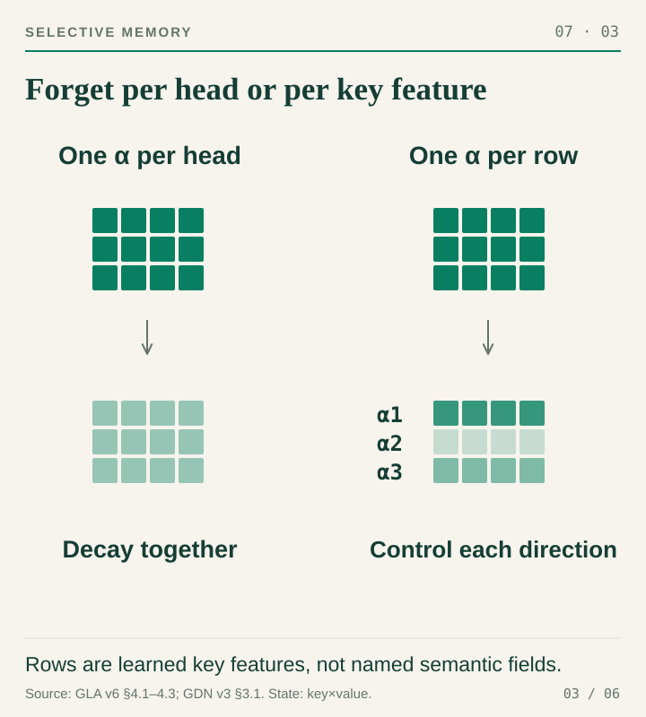</figure>
<em>Figure 7.3. Scalar and channelwise gates retain different amounts of an old association matrix.</em>

Technical note: Forget per head or per key feature

With S drawn as key×value, a scalar scales all entries equally, while a diagonal key-side matrix scales rows independently. The rows are learned feature coordinates. The diagram does not claim explicit semantic labels or independent control of every stored event.

S ∈ ℝᵈᵏˣᵈᵛ
Scalar retention: αS
Key-channel retention: Diag(α)S

Primary references: <a href="https://arxiv.org/pdf/2312.06635v6">Gated Linear Attention, §4</a>; <a href="https://arxiv.org/pdf/2412.06464v3">Gated Delta Networks, §3.1</a>.

<figure id="n07-gla-chunks">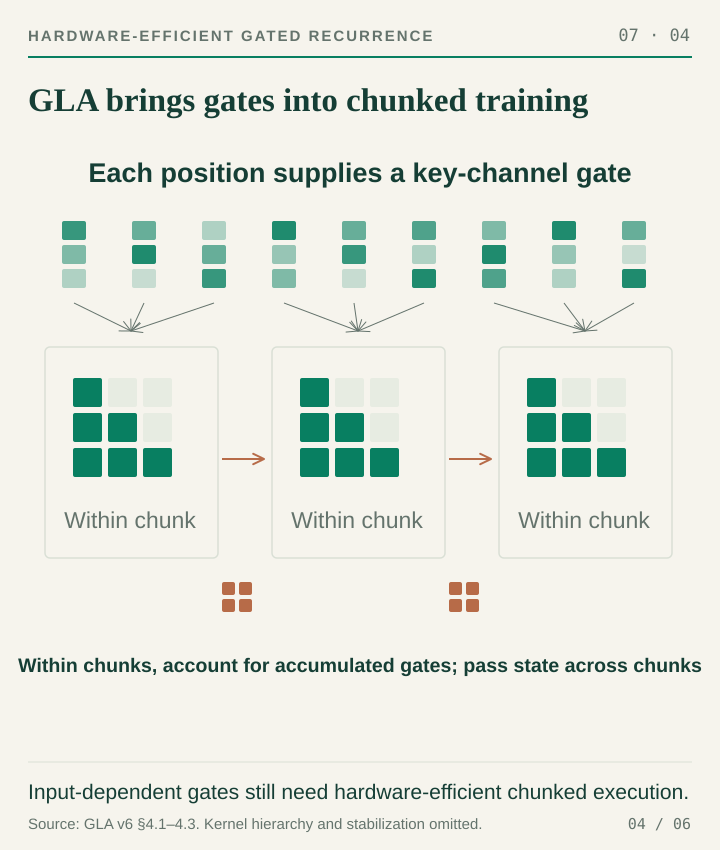</figure>
<em>Figure 7.4. A gated history read must include the retention factors accumulated between write and read.</em>

Technical note: GLA brings gates into chunked training

An association written at j experiences every relevant intervening gate before time t. GLA’s hardware-efficient formulation organizes those products into chunkwise matrix work rather than treating a low-FLOP sequential recurrence as automatically fast training.

Sₜ = Diag(αₜ)Sₜ₋₁ + kₜvₜᵀ
Retention of write j at step t includes ∏ᵤ₌ⱼ₊₁ᵗ Diag(αᵤ)

Primary references: <a href="https://arxiv.org/pdf/2312.06635v6">Gated Linear Attention, §4</a>.

We consistently draw S as key features × value components. A diagonal retention matrix on the left scales rows. Those rows are learned coordinates, not explicit fields such as “address” or “name.”

The related state-space route: Mamba and SSD

<figure id="c7-vf-03-mamba">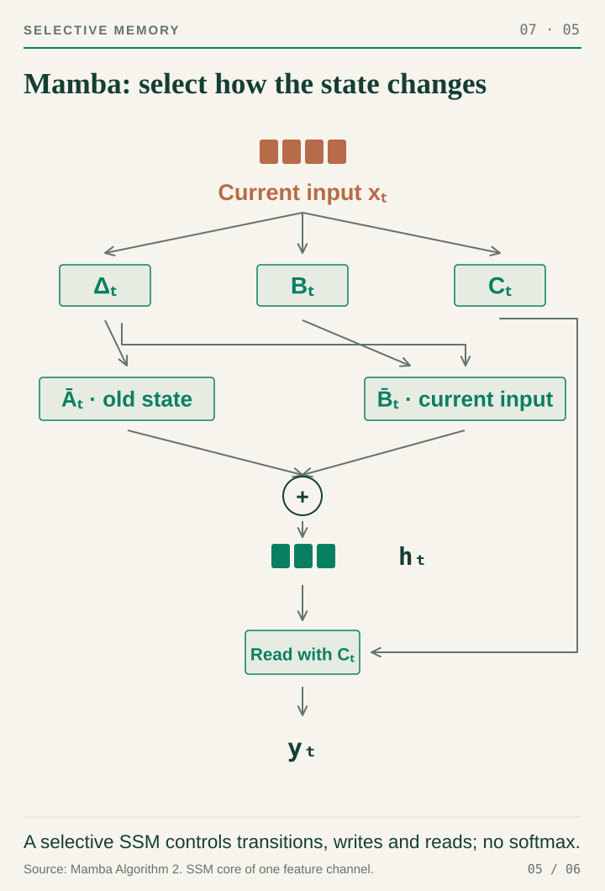</figure>
<em>Figure 7.5. A selective SSM makes state transitions, input writes, and reads depend on the input.</em>

Technical note: Mamba: select how the state changes

The sketch shows one feature channel’s state-space core, with discretized transition and input parameters. A full Mamba module includes additional projections, convolution, nonlinearities, and skip or gate paths. It is a related finite-state design, not ordinary softmax rewritten without conditions.

hₜ = Āₜhₜ₋₁ + B̄ₜxₜ
yₜ = Cₜᵀhₜ

Primary references: <a href="https://arxiv.org/pdf/2312.00752">Mamba, Algorithm 2</a>.

A <strong>state-space model (SSM)</strong> carries a latent dynamical state. Mamba makes the transition, input, and readout selective through input-dependent parameterization. It belongs in this comparison because it also manages a recurrent state, but its complete module is not simply ordinary softmax attention under another name.

<figure id="n07-ssd">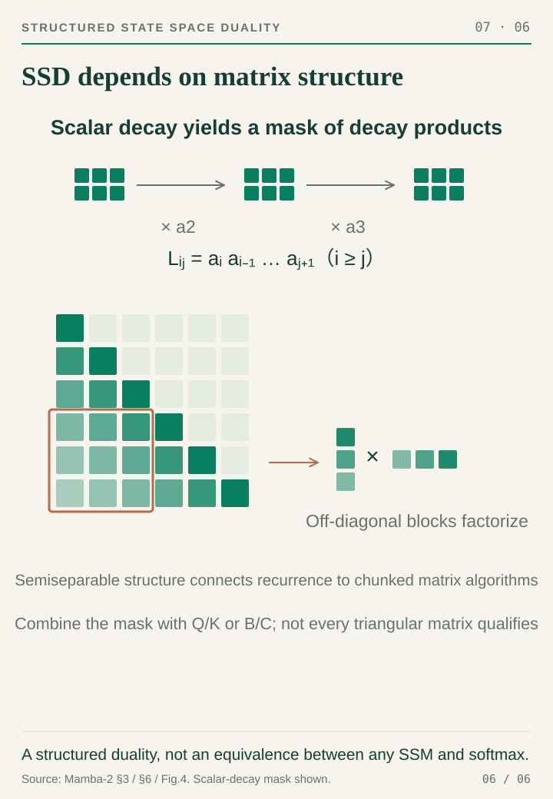</figure>
<em>Figure 7.6. Semiseparable structure makes a particular recurrence compatible with efficient matrix algorithms.</em>

Technical note: SSD depends on matrix structure

For scalar state transitions, products of intermediate decays define a structured causal mask. Combine that mask with content factors to obtain the sequence operator. SSD connects those structured forms to state-space recurrence; an arbitrary lower-triangular or softmax matrix need not have the required structure.

Lᵢⱼ = ∏ᵤ₌ⱼ₊₁ⁱ aᵤ for j≤i
Core sequence operator: Y=(L⊙QKᵀ)X

Primary references: <a href="https://arxiv.org/pdf/2405.21060">Transformers Are SSMs, §3–6</a>.

<strong>State Space Duality (SSD)</strong>, developed with Mamba-2, connects particular state-space recurrences to structured attention-like matrix computations. The matrix structure is the reason efficient dual forms exist. It is not a claim that every SSM equals arbitrary softmax attention.

Decay can weaken old content. It still does not ask whether the state’s existing prediction disagrees with the new information.

<h2 id="chapter-8">8. DeltaNet: Correcting Stored Associations</h2>

Suppose a write key already retrieves A, but the incoming target is B. Adding B leaves both contributions in the state. A <strong>delta-rule update</strong> first predicts the current value, subtracts that prediction from B, and writes the resulting error.

<figure id="n08-delta">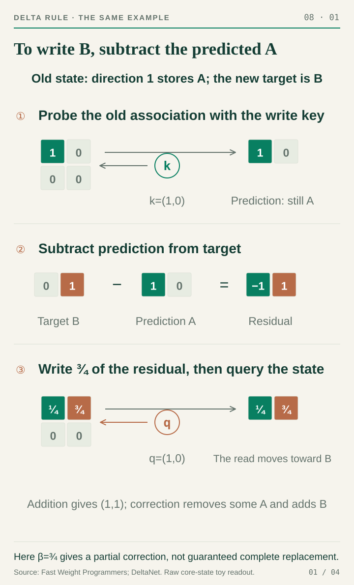</figure>
<em>Figure 8.1. A delta write updates the error between the incoming target and the state’s current prediction.</em>

Technical note: To write B, subtract the predicted A

Use the write key to predict the value currently associated with that direction, then write a β-scaled residual. The diagram chooses β=¾, giving a partial correction. The following query reads the updated state. These raw state outputs isolate the recurrence, not task-level answer accuracy.

v̂ₜ = Sₜ₋₁ᵀkₜ; δₜ = vₜ−v̂ₜ
Sₜ = Sₜ₋₁ + βₜkₜδₜᵀ
oₜ = Sₜᵀqₜ

Primary references: <a href="https://arxiv.org/pdf/2102.11174">Linear Transformers Are Secretly Fast Weight Programmers</a>; <a href="https://arxiv.org/pdf/2406.06484">Parallelizing Linear Transformers with the Delta Rule</a>.

The write key performs this diagnostic read. The ordinary query then reads the updated state. A learned step size β controls how much correction is applied. Complete replacement is a special case under specific normalization and step-size conditions, not a universal guarantee.

<strong>Gated DeltaNet (GDN)</strong> combines decay and correction. First decay the old state; then predict from that decayed state and correct its error. The order is part of the mechanism.

<figure id="c8-vf-03-gated-delta">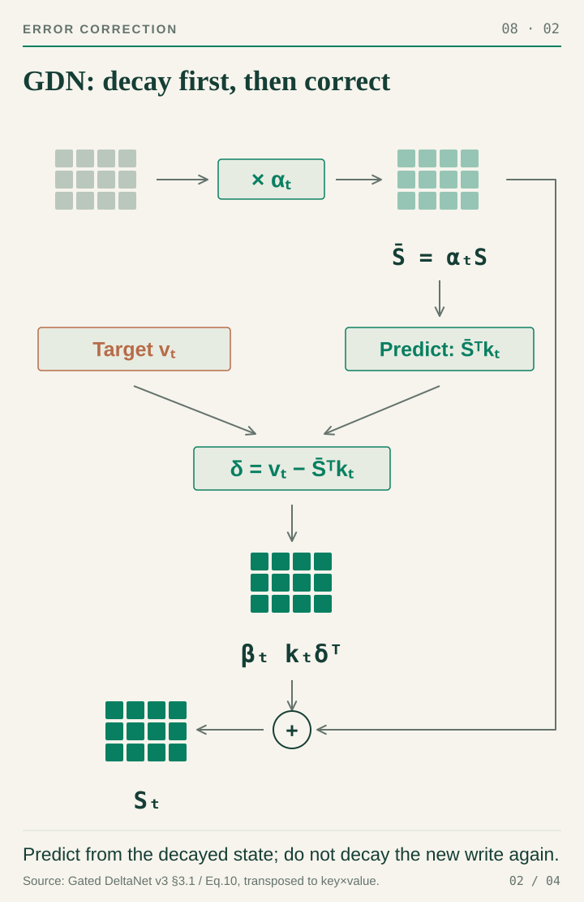</figure>
<em>Figure 8.2. Gated DeltaNet predicts from the decayed state before applying a corrective write.</em>

Technical note: GDN: decay first, then correct

Decay and correction are complementary operations. Compute the prediction from S̄, then add the residual update to that same S̄. Multiplying the final new-write term by α again would implement a different recurrence. The paper’s state orientation is transposed here to keep key×value notation consistent.

S̄ₜ = αₜSₜ₋₁
δₜ = vₜ−S̄ₜᵀkₜ
Sₜ = S̄ₜ + βₜkₜδₜᵀ
= αₜ(I−βₜkₜkₜᵀ)Sₜ₋₁ + βₜkₜvₜᵀ

Primary references: <a href="https://arxiv.org/pdf/2412.06464v3">Gated Delta Networks, §3.1</a>.

Additive writes versus delta writes, step by step

<figure id="c8-vf-02-delta-compare">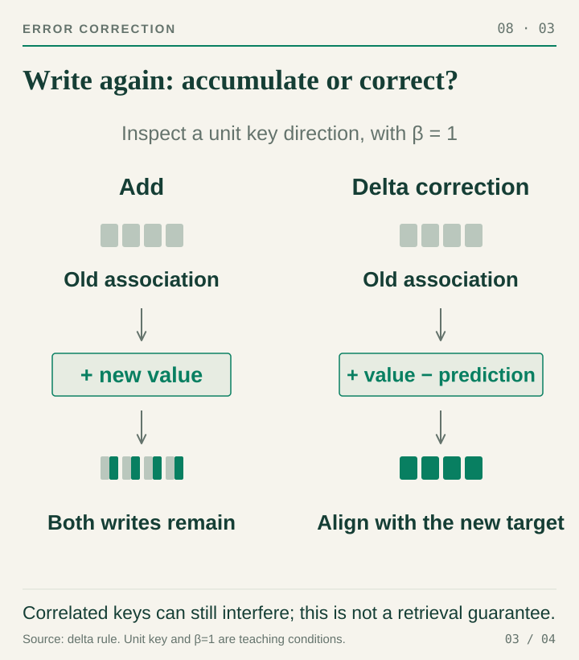</figure>
<em>Figure 8.3. With a unit key and β=1, the idealized delta update replaces that direction’s prediction.</em>

Technical note: Write again: accumulate or correct?

The unit-key condition matters: the correction seen when reading back with k is scaled by kᵀk. A smaller β gives a partial correction. Other correlated keys can be affected, so this calculation is not a universal latest-write guarantee for all stored associations.

Sₜᵀk = Sₜ₋₁ᵀk + β(v−Sₜ₋₁ᵀk)(kᵀk)

Primary references: <a href="https://arxiv.org/pdf/2102.11174">Linear Transformers Are Secretly Fast Weight Programmers</a>; <a href="https://arxiv.org/pdf/2406.06484">Parallelizing Linear Transformers with the Delta Rule</a>.

<figure id="c8-vf-01-delta-flow">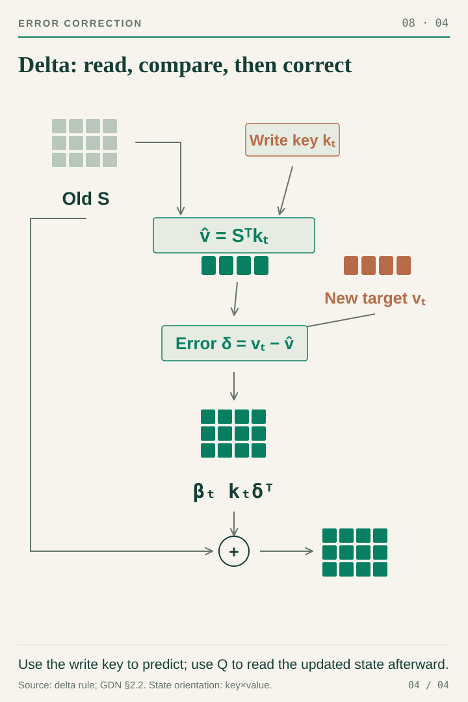</figure>
<em>Figure 8.4. Prediction uses the write key; the subsequent read uses the query.</em>

Technical note: Delta: read, compare, then correct

The key and query participate in different operations even when a toy example sets their directions equal. First reconstruct the current association at k, compare it with the incoming value, and edit the matrix. Then read the new matrix at q. This is the core delta-rule information flow.

v̂ₜ=Sₜ₋₁ᵀkₜ
δₜ=vₜ−v̂ₜ
Sₜ=Sₜ₋₁+βₜkₜδₜᵀ
oₜ=Sₜᵀqₜ

Primary references: <a href="https://arxiv.org/pdf/2102.11174">Linear Transformers Are Secretly Fast Weight Programmers</a>; <a href="https://arxiv.org/pdf/2406.06484">Parallelizing Linear Transformers with the Delta Rule</a>; <a href="https://arxiv.org/pdf/2412.06464v3">Gated Delta Networks, §3.1</a>.

The delta rule can be understood as an online update that reduces reconstruction error for the current key–value association. Nonorthogonal keys can still affect one another. Efficient chunkwise algorithms also matter: a useful recurrence needs a practical training path, not just a compact decode equation.

GDN’s scalar decay still weakens every direction in a head together. The next refinement is to make that forgetting more granular.

<h2 id="chapter-9">9. KDA: Forgetting One Feature at a Time</h2>

<strong>Kimi Delta Attention (KDA)</strong> replaces GDN’s headwise scalar decay with a vector of retention factors along the key-feature axis. It keeps delta-rule correction, but lets different directions retain different amounts of their old content.

<figure id="n09-kda">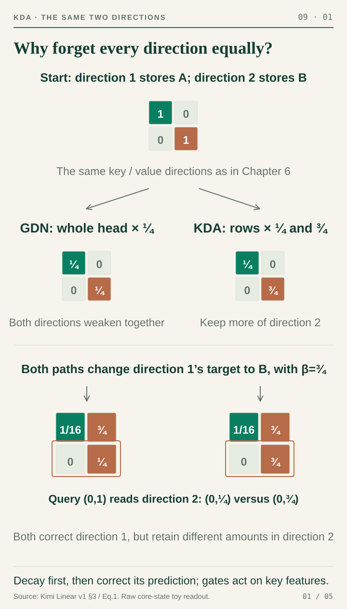</figure>
<em>Figure 9.1. KDA can retain one key-feature direction more strongly while editing another.</em>

Technical note: Why forget every direction equally?

Both sides of the toy comparison start from the same two-direction state and correct direction 1 toward B. They use the same β=¾. Scalar retention weakens direction 2 by ¼; the chosen channelwise retention keeps ¾ of it. The comparison isolates gate granularity rather than claiming semantic field-level control.

Dₜ=Diag(αₜ); S̄ₜ=DₜSₜ₋₁
δₜ=vₜ−S̄ₜᵀkₜ
Sₜ=S̄ₜ+βₜkₜδₜᵀ; oₜ=Sₜᵀqₜ

Primary references: <a href="https://arxiv.org/pdf/2510.26692">Kimi Linear, §3</a>; <a href="https://github.com/fla-org/flash-linear-attention/blob/main/fla/layers/kda.py">KDA layer implementation</a>.

Our two-direction example holds the write key, target, and correction strength fixed. Both paths update direction 1, but the channelwise gate can preserve more of direction 2. This isolates what changed: <strong>the granularity of forgetting, not a new guarantee of perfect recall.</strong>

<figure id="n09-family">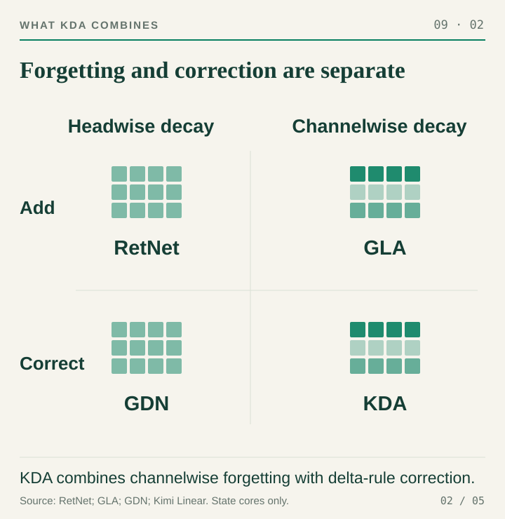</figure>
<em>Figure 9.2. Forgetting granularity and delta correction are independent design axes.</em>

Technical note: Forgetting and correction are separate

Compare state cores rather than entire model blocks. A method may use additive or corrective writes, and uniform or feature-dependent retention. KDA combines channelwise forgetting with a delta-rule edit. Additional module operations, training algorithms, and normalization can still differ.

Primary references: <a href="https://arxiv.org/pdf/2307.08621">Retentive Network, §2</a>; <a href="https://arxiv.org/pdf/2312.06635v6">Gated Linear Attention, §4</a>; <a href="https://arxiv.org/pdf/2412.06464v3">Gated Delta Networks, §3.1</a>; <a href="https://arxiv.org/pdf/2510.26692">Kimi Linear, §3</a>; <a href="https://github.com/fla-org/flash-linear-attention/blob/main/fla/layers/kda.py">KDA layer implementation</a>.

Forgetting and correction are separate design choices. Additive linear attention, gated accumulation, delta updates, and channelwise gated delta updates occupy different positions on these axes. The full model also includes projections, normalization, short convolutions, and output gating.

Rowwise decay, update order, and the complete KDA state

<figure id="c9-vf-01-row-decay">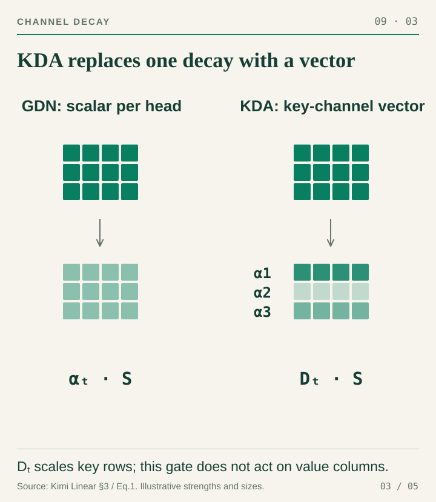</figure>
<em>Figure 9.3. A diagonal retention matrix scales the key-feature rows independently.</em>

Technical note: KDA replaces one decay with a vector

In the key×value orientation used throughout this article, D acts on the left of S. The value axis is not the axis controlled by this retention gate. KDA subsequently applies a delta correction based on the decayed state.

Dₜ=Diag(αₜ) ∈ ℝᵈᵏˣᵈᵏ
Sₜ=(I−βₜkₜkₜᵀ)DₜSₜ₋₁+βₜkₜvₜᵀ

Primary references: <a href="https://arxiv.org/pdf/2510.26692">Kimi Linear, §3</a>; <a href="https://github.com/fla-org/flash-linear-attention/blob/main/fla/layers/kda.py">KDA layer implementation</a>.

<figure id="c9-vf-02-update-order">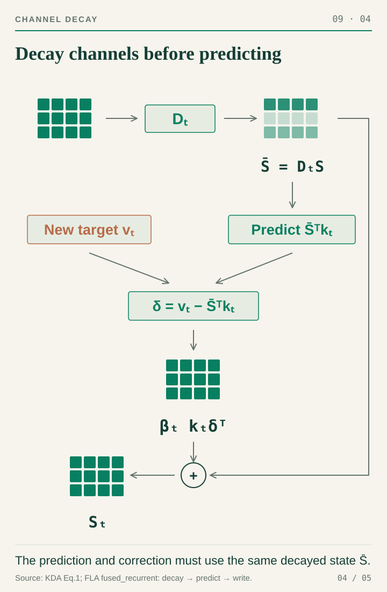</figure>
<em>Figure 9.4. Decay, predict, and correct in that order.</em>

Technical note: Decay channels before predicting

Both the residual’s prediction and the base of the final update must use the same decayed matrix. The KDA equation and author implementations make this ordering explicit. Computing the residual from the undecayed old matrix changes the result even if the final update includes a decay factor.

S̄ₜ=DₜSₜ₋₁
v̂ₜ=S̄ₜᵀkₜ
Sₜ=S̄ₜ+βₜkₜ(vₜ−v̂ₜ)ᵀ

Primary references: <a href="https://arxiv.org/pdf/2510.26692">Kimi Linear, §3</a>; <a href="https://github.com/fla-org/flash-linear-attention/blob/main/fla/layers/kda.py">KDA layer implementation</a>.

<figure id="c9-vf-03-module-state">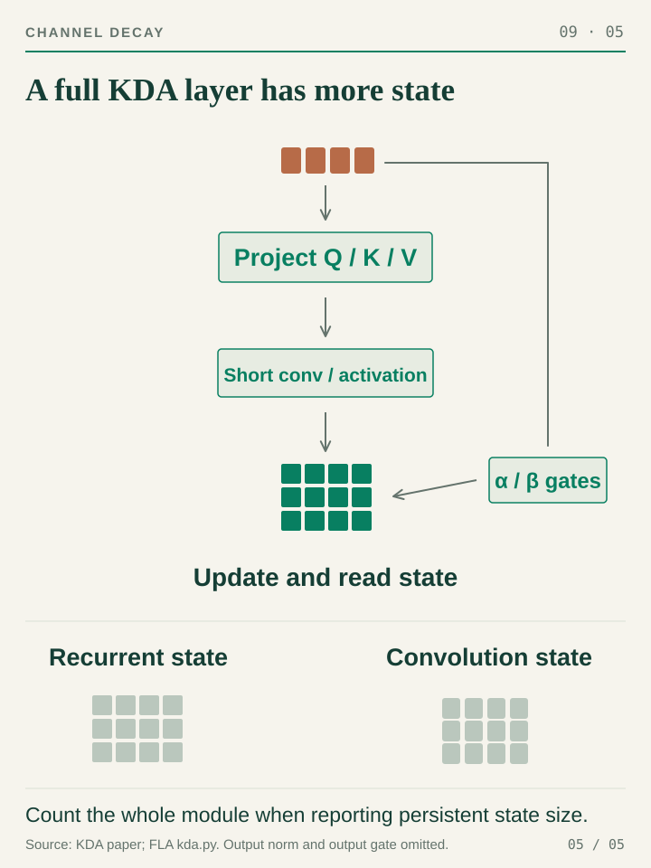</figure>
<em>Figure 9.5. Persistent state accounting must include the short convolution, not only the association matrix.</em>

Technical note: A full KDA layer has more state

A complete KDA layer can include Q/K/V projections, short convolutions, activations, normalization, gates, and an output projection. The figure highlights the separately retained convolution state. Fixed shape of the recurrent core is therefore not the entire module’s state-size formula.

Primary references: <a href="https://arxiv.org/pdf/2510.26692">Kimi Linear, §3</a>; <a href="https://github.com/fla-org/flash-linear-attention/blob/main/fla/layers/kda.py">KDA layer implementation</a>.

<pre><code class="language-python">def kda_step(q, k, v, state, alpha, beta):
    # Inputs have already been projected and Q/K normalized.
    # state: [..., dk, dv]; alpha: [..., dk]; beta: [...]
    decayed = state.float() * alpha.float().unsqueeze(-1)
    prediction = torch.einsum('...k,...kv-&gt;...v', k.float(), decayed)
    residual = v.float() - prediction
    edit = k.float().unsqueeze(-1) * residual.unsqueeze(-2)
    updated = decayed + beta.float()[..., None, None] * edit
    out = torch.einsum('...k,...kv-&gt;...v', q.float(), updated)
    return out, updated</code></pre>

This is the state core only. A complete module must also retain any short-convolution state. The toy readout omits the query scaling and post-read processing used by a particular implementation.

Selective forgetting makes finite memory more useful. It does not make retained historical entries redundant.

<h2 id="chapter-10">10. Hybrid Attention: Combining Different Memories</h2>

Recurrent layers offer a fixed-shape state. Historical attention offers a direct content-dependent read over retained positions. A <strong>hybrid</strong> puts these interfaces together so different layers or branches can perform different kinds of sequence mixing.

<figure id="n10-hybrid">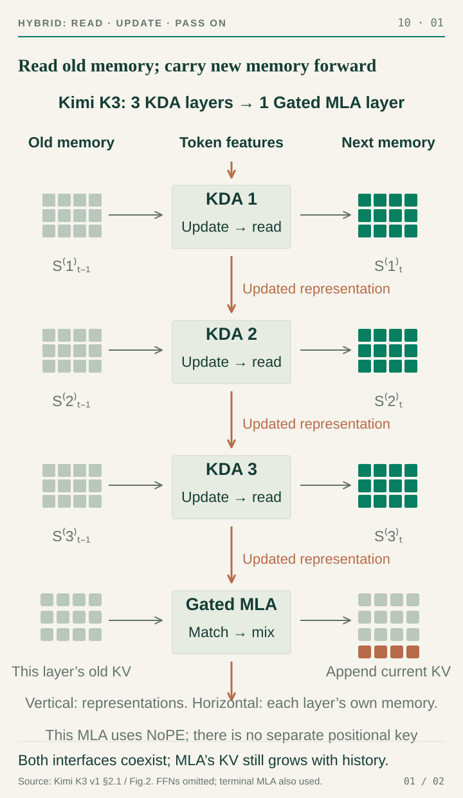</figure>
<em>Figure 10.1. Representations move through depth while each layer updates its own memory across time.</em>

Technical note: Read old memory; carry new memory forward

The Kimi K3 configuration repeats three KDA layers followed by one Gated MLA, plus an additional final Gated MLA. The report uses NoPE for MLA. The diagram omits feed-forward and other block operations. Its finite KDA states do not remove the MLA layers’ growing per-position caches.

Persistent model state = Σ recurrent-layer states + Σ historical-layer caches + auxiliary retained state

Primary references: <a href="https://arxiv.org/pdf/2607.24653v1">Kimi K3, §2.1–2.2</a>.

The Kimi K3 report describes repeated groups of three KDA layers followed by one Gated MLA layer, with an additional Gated MLA layer at the end. Representations flow vertically through the model; each layer maintains its own memory across token steps. The fixed KDA states and growing MLA caches coexist.

Kimi K3 applies NoPE to its MLA queries and keys. Its KDA layers supply position-sensitive, recency-aware mixing between global attention layers. This is why the DeepSeek-V2 positional-key layout from Chapter 4 should not be pasted indiscriminately onto every architecture called MLA.

What a model-level memory budget must include

A hybrid’s persistent memory is the sum of its recurrent states, historical attention caches, and other retained module state. A 3:1 layer pattern is one model’s configuration, not a universal hybrid recipe or a measured speedup. Dimensions, precision, batching, training, and kernels still matter.

The roles can complement one another: a recurrent state need not reproduce every token for a historical layer to retain a route to details. Whether a particular division works well must be established by training and task evaluation.

An output gate is different from a forget gate

<figure id="n10-outputgate">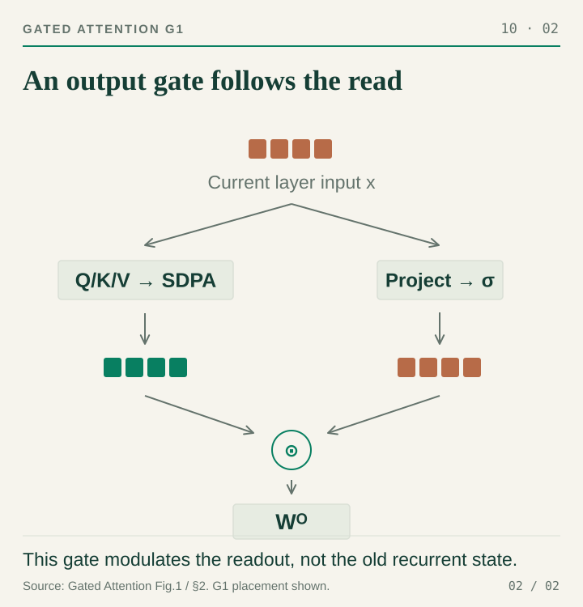</figure>
<em>Figure 10.2. An output gate scales the attention readout before the output projection.</em>

Technical note: An output gate follows the read

At the illustrated G1 placement, the gate modulates channels after attention has computed its read. It is different from a retention gate acting on the old recurrent matrix. Gate rank, parameterization, and placement are model-specific; do not infer them from the word “gated” alone.

h = SDPA(Q,K,V)
g = sigmoid(W_g x)
o = W_O(h⊙g)

Primary references: <a href="https://arxiv.org/pdf/2505.06708">Gated Attention for Large Language Models</a>; <a href="https://arxiv.org/pdf/2607.24653v1">Kimi K3, §2.1–2.2</a>.

A channelwise output gate can modulate the attention readout before the output projection. It regulates the information forwarded from the read. A state-retention gate instead changes what remains in recurrent memory. Both may be called “gating,” but they act on different objects.

So far we have changed memory representations and read/write rules. We can also keep a rule and execute it more efficiently.

<h2 id="chapter-11">11. FlashAttention: Moving Less Data</h2>

<strong>FlashAttention</strong> computes standard attention in tiles and maintains online normalization statistics. Its central saving is to avoid materializing and repeatedly transferring a full attention matrix through high-bandwidth memory, or HBM.

<figure id="c11-vf-01-flash-io"><svg aria-label="FlashAttention: tiles, not a full matrix" height="1040" lang="en" role="img" viewbox="0 0 720 1040" width="720" xml:lang="en" xmlns="http://www.w3.org/2000/svg"><rect fill="#F6F4ED" height="1040" width="720"></rect><text data-label-slot="664.0" data-max-width="664.0" fill="#64736C" font-family='Arial,"Helvetica Neue",sans-serif' font-size="15" font-weight="600" letter-spacing="2" text-anchor="start" x="28" y="41">HARDWARE EXECUTION</text><text data-label-slot="672.0" data-max-width="672.0" fill="#64736C" font-family='"SFMono-Regular",Menlo,monospace' font-size="17" font-weight="500" letter-spacing="0" text-anchor="end" x="690" y="41">11 · 01</text><line stroke="#087F61" stroke-width="2" x1="28" x2="692" y1="57" y2="57"></line><text data-label-slot="664.0" data-max-width="664.0" fill="#153E35" font-family='Georgia,"Times New Roman",serif' font-size="34.2" font-weight="700" letter-spacing="0" text-anchor="start" x="28" y="111">FlashAttention: tiles, not a full matrix</text><text data-label-slot="308.0" data-max-width="308.0" fill="#153E35" font-family='Arial,"Helvetica Neue",sans-serif' font-size="28" font-weight="600" letter-spacing="0" text-anchor="middle" x="172" y="177">Materialize</text><text data-label-slot="308.0" data-max-width="308.0" fill="#153E35" font-family='Arial,"Helvetica Neue",sans-serif' font-size="28" font-weight="600" letter-spacing="0" text-anchor="middle" x="548" y="177">Tile and accumulate</text><rect fill="#E7ECE2" height="61" rx="4" stroke="#64736C" stroke-width="1.5" width="231" x="64" y="216"></rect><text data-label-slot="219.0" data-max-width="323.0" fill="#64736C" font-family='Arial,"Helvetica Neue",sans-serif' font-size="25" font-weight="600" letter-spacing="0" text-anchor="middle" x="179.5" y="255.25">HBM：Q / K / V</text><rect fill="#E7ECE2" height="61" rx="4" stroke="#64736C" stroke-width="1.5" width="231" x="439" y="216"></rect><text data-label-slot="219.0" data-max-width="295.0" fill="#64736C" font-family='Arial,"Helvetica Neue",sans-serif' font-size="25" font-weight="600" letter-spacing="0" text-anchor="middle" x="554.5" y="255.25">HBM：Q / K / V</text><line stroke="#64736C" stroke-width="2" x1="177" x2="177" y1="292" y2="331"></line><path d="M171.78041359066523 320.1946347717679 L177 331 L182.21958640933477 320.1946347717679" fill="none" stroke="#64736C" stroke-linecap="round" stroke-linejoin="round" stroke-width="2"></path><line stroke="#64736C" stroke-width="2" x1="550" x2="550" y1="292" y2="331"></line><path d="M544.7804135906653 320.1946347717679 L550 331 L555.2195864093347 320.1946347717679" fill="none" stroke="#64736C" stroke-linecap="round" stroke-linejoin="round" stroke-width="2"></path><rect fill="#087F61" height="25" rx="2" width="25" x="87" y="354"></rect><rect fill="#E7ECE2" height="25" rx="2" stroke="#D9DFD5" stroke-width="1" width="25" x="460" y="354"></rect><rect fill="#E7ECE2" height="25" rx="2" width="25" x="116" y="354"></rect><rect fill="#E7ECE2" height="25" rx="2" stroke="#D9DFD5" stroke-width="1" width="25" x="489" y="354"></rect><rect fill="#E7ECE2" height="25" rx="2" width="25" x="145" y="354"></rect><rect fill="#E7ECE2" height="25" rx="2" stroke="#D9DFD5" stroke-width="1" width="25" x="518" y="354"></rect><rect fill="#E7ECE2" height="25" rx="2" width="25" x="174" y="354"></rect><rect fill="#E7ECE2" height="25" rx="2" stroke="#D9DFD5" stroke-width="1" width="25" x="547" y="354"></rect><rect fill="#E7ECE2" height="25" rx="2" width="25" x="203" y="354"></rect><rect fill="#E7ECE2" height="25" rx="2" stroke="#D9DFD5" stroke-width="1" width="25" x="576" y="354"></rect><rect fill="#E7ECE2" height="25" rx="2" width="25" x="232" y="354"></rect><rect fill="#E7ECE2" height="25" rx="2" stroke="#D9DFD5" stroke-width="1" width="25" x="605" y="354"></rect><rect fill="#087F61" height="25" rx="2" width="25" x="87" y="383"></rect><rect fill="#E7ECE2" height="25" rx="2" stroke="#D9DFD5" stroke-width="1" width="25" x="460" y="383"></rect><rect fill="#087F61" height="25" rx="2" width="25" x="116" y="383"></rect><rect fill="#E7ECE2" height="25" rx="2" stroke="#D9DFD5" stroke-width="1" width="25" x="489" y="383"></rect><rect fill="#E7ECE2" height="25" rx="2" width="25" x="145" y="383"></rect><rect fill="#E7ECE2" height="25" rx="2" stroke="#D9DFD5" stroke-width="1" width="25" x="518" y="383"></rect><rect fill="#E7ECE2" height="25" rx="2" width="25" x="174" y="383"></rect><rect fill="#E7ECE2" height="25" rx="2" stroke="#D9DFD5" stroke-width="1" width="25" x="547" y="383"></rect><rect fill="#E7ECE2" height="25" rx="2" width="25" x="203" y="383"></rect><rect fill="#E7ECE2" height="25" rx="2" stroke="#D9DFD5" stroke-width="1" width="25" x="576" y="383"></rect><rect fill="#E7ECE2" height="25" rx="2" width="25" x="232" y="383"></rect><rect fill="#E7ECE2" height="25" rx="2" stroke="#D9DFD5" stroke-width="1" width="25" x="605" y="383"></rect><rect fill="#087F61" height="25" rx="2" width="25" x="87" y="412"></rect><rect fill="#E7ECE2" height="25" rx="2" stroke="#D9DFD5" stroke-width="1" width="25" x="460" y="412"></rect><rect fill="#087F61" height="25" rx="2" width="25" x="116" y="412"></rect><rect fill="#E7ECE2" height="25" rx="2" stroke="#D9DFD5" stroke-width="1" width="25" x="489" y="412"></rect><rect fill="#087F61" height="25" rx="2" width="25" x="145" y="412"></rect><rect fill="#E7ECE2" height="25" rx="2" stroke="#D9DFD5" stroke-width="1" width="25" x="518" y="412"></rect><rect fill="#E7ECE2" height="25" rx="2" width="25" x="174" y="412"></rect><rect fill="#E7ECE2" height="25" rx="2" stroke="#D9DFD5" stroke-width="1" width="25" x="547" y="412"></rect><rect fill="#E7ECE2" height="25" rx="2" width="25" x="203" y="412"></rect><rect fill="#E7ECE2" height="25" rx="2" stroke="#D9DFD5" stroke-width="1" width="25" x="576" y="412"></rect><rect fill="#E7ECE2" height="25" rx="2" width="25" x="232" y="412"></rect><rect fill="#E7ECE2" height="25" rx="2" stroke="#D9DFD5" stroke-width="1" width="25" x="605" y="412"></rect><rect fill="#087F61" height="25" rx="2" width="25" x="87" y="441"></rect><rect fill="#E7ECE2" height="25" rx="2" stroke="#D9DFD5" stroke-width="1" width="25" x="460" y="441"></rect><rect fill="#087F61" height="25" rx="2" width="25" x="116" y="441"></rect><rect fill="#E7ECE2" height="25" rx="2" stroke="#D9DFD5" stroke-width="1" width="25" x="489" y="441"></rect><rect fill="#087F61" height="25" rx="2" width="25" x="145" y="441"></rect><rect fill="#E7ECE2" height="25" rx="2" stroke="#D9DFD5" stroke-width="1" width="25" x="518" y="441"></rect><rect fill="#087F61" height="25" rx="2" width="25" x="174" y="441"></rect><rect fill="#E7ECE2" height="25" rx="2" stroke="#D9DFD5" stroke-width="1" width="25" x="547" y="441"></rect><rect fill="#E7ECE2" height="25" rx="2" width="25" x="203" y="441"></rect><rect fill="#E7ECE2" height="25" rx="2" stroke="#D9DFD5" stroke-width="1" width="25" x="576" y="441"></rect><rect fill="#E7ECE2" height="25" rx="2" width="25" x="232" y="441"></rect><rect fill="#E7ECE2" height="25" rx="2" stroke="#D9DFD5" stroke-width="1" width="25" x="605" y="441"></rect><rect fill="#087F61" height="25" rx="2" width="25" x="87" y="470"></rect><rect fill="#E7ECE2" height="25" rx="2" stroke="#D9DFD5" stroke-width="1" width="25" x="460" y="470"></rect><rect fill="#087F61" height="25" rx="2" width="25" x="116" y="470"></rect><rect fill="#E7ECE2" height="25" rx="2" stroke="#D9DFD5" stroke-width="1" width="25" x="489" y="470"></rect><rect fill="#087F61" height="25" rx="2" width="25" x="145" y="470"></rect><rect fill="#E7ECE2" height="25" rx="2" stroke="#D9DFD5" stroke-width="1" width="25" x="518" y="470"></rect><rect fill="#087F61" height="25" rx="2" width="25" x="174" y="470"></rect><rect fill="#E7ECE2" height="25" rx="2" stroke="#D9DFD5" stroke-width="1" width="25" x="547" y="470"></rect><rect fill="#087F61" height="25" rx="2" width="25" x="203" y="470"></rect><rect fill="#E7ECE2" height="25" rx="2" stroke="#D9DFD5" stroke-width="1" width="25" x="576" y="470"></rect><rect fill="#E7ECE2" height="25" rx="2" width="25" x="232" y="470"></rect><rect fill="#E7ECE2" height="25" rx="2" stroke="#D9DFD5" stroke-width="1" width="25" x="605" y="470"></rect><rect fill="#087F61" height="25" rx="2" width="25" x="87" y="499"></rect><rect fill="#E7ECE2" height="25" rx="2" stroke="#D9DFD5" stroke-width="1" width="25" x="460" y="499"></rect><rect fill="#087F61" height="25" rx="2" width="25" x="116" y="499"></rect><rect fill="#E7ECE2" height="25" rx="2" stroke="#D9DFD5" stroke-width="1" width="25" x="489" y="499"></rect><rect fill="#087F61" height="25" rx="2" width="25" x="145" y="499"></rect><rect fill="#E7ECE2" height="25" rx="2" stroke="#D9DFD5" stroke-width="1" width="25" x="518" y="499"></rect><rect fill="#087F61" height="25" rx="2" width="25" x="174" y="499"></rect><rect fill="#E7ECE2" height="25" rx="2" stroke="#D9DFD5" stroke-width="1" width="25" x="547" y="499"></rect><rect fill="#087F61" height="25" rx="2" width="25" x="203" y="499"></rect><rect fill="#E7ECE2" height="25" rx="2" stroke="#D9DFD5" stroke-width="1" width="25" x="576" y="499"></rect><rect fill="#087F61" height="25" rx="2" width="25" x="232" y="499"></rect><rect fill="#E7ECE2" height="25" rx="2" stroke="#D9DFD5" stroke-width="1" width="25" x="605" y="499"></rect><text data-label-slot="312.0" data-max-width="312.0" fill="#153E35" font-family='Arial,"Helvetica Neue",sans-serif' font-size="26" font-weight="600" letter-spacing="0" text-anchor="middle" x="174" y="586">N×N intermediate</text><rect data-scan-frame="" fill="none" height="62" rx="3" stroke="#B76B48" stroke-width="3" width="62" x="456" y="350"></rect><text data-label-slot="308.0" data-max-width="308.0" fill="#64736C" font-family='Arial,"Helvetica Neue",sans-serif' font-size="20.9" font-weight="500" letter-spacing="0" text-anchor="middle" x="548" y="586">Tile schedule, not a stored matrix</text><line stroke="#64736C" stroke-width="2" x1="175" x2="175" y1="625" y2="672"></line><path d="M169.78041359066523 661.1946347717678 L175 672 L180.21958640933477 661.1946347717678" fill="none" stroke="#64736C" stroke-linecap="round" stroke-linejoin="round" stroke-width="2"></path><line stroke="#64736C" stroke-width="2" x1="548" x2="548" y1="625" y2="672"></line><path d="M542.7804135906653 661.1946347717678 L548 672 L553.2195864093347 661.1946347717678" fill="none" stroke="#64736C" stroke-linecap="round" stroke-linejoin="round" stroke-width="2"></path><rect fill="#E7ECE2" height="57" rx="4" stroke="#64736C" stroke-width="1.5" width="235" x="61" y="687"></rect><text data-label-slot="223.0" data-max-width="321.0" fill="#64736C" font-family='Arial,"Helvetica Neue",sans-serif' font-size="25" font-weight="600" letter-spacing="0" text-anchor="middle" x="178.5" y="724.25">Full-matrix I/O</text><rect fill="#E7ECE2" height="174" rx="5" stroke="#D9DFD5" stroke-width="1.5" width="235" x="430" y="687"></rect><rect fill="#087F61" height="22" rx="2" width="22" x="449" y="708"></rect><rect fill="#F6F4ED" height="22" rx="2" width="22" x="475" y="708"></rect><rect fill="#087F61" height="22" rx="2" width="22" x="449" y="734"></rect><rect fill="#087F61" height="22" rx="2" width="22" x="475" y="734"></rect><rect fill="#087F61" height="29" rx="3" width="22" x="537" y="720"></rect><rect fill="#087F61" height="29" rx="3" width="22" x="564" y="720"></rect><rect fill="#087F61" height="29" rx="3" width="22" x="591" y="720"></rect><rect fill="#087F61" height="29" rx="3" width="22" x="618" y="720"></rect><text data-label-slot="222.0" data-max-width="308.0" fill="#153E35" font-family='Arial,"Helvetica Neue",sans-serif' font-size="24" font-weight="600" letter-spacing="0" text-anchor="middle" x="548" y="827">Tiles + sums</text><line stroke="#D9DFD5" stroke-width="1" x1="28" x2="692" y1="952" y2="952"></line><text data-label-slot="664.0" data-max-width="664.0" fill="#153E35" font-family='Arial,"Helvetica Neue",sans-serif' font-size="22.3" font-weight="500" letter-spacing="0" text-anchor="start" x="28" y="989">The attention operation stays the same; intermediate traffic shrinks.</text><text data-label-slot="587.0" data-max-width="587.0" fill="#64736C" font-family='Arial,"Helvetica Neue",sans-serif' font-size="15" font-weight="400" letter-spacing="0" text-anchor="start" x="28" y="1019">Source: FlashAttention Fig.1 / Alg.1. Statistics may spill to HBM.</text><text data-label-slot="673.0" data-max-width="673.0" fill="#64736C" font-family='"SFMono-Regular",Menlo,monospace' font-size="15" font-weight="500" letter-spacing="0" text-anchor="end" x="691" y="1019">01 / 05</text></svg>
<button data-scan-prev="" type="button">Previous tile</button><button data-scan-next="" type="button">Next tile</button>
</figure>
<em>Figure 11.1. Tiled execution avoids storing the entire query–key intermediate matrix in HBM.</em>

Technical note: FlashAttention: tiles, not a full matrix

The interactive tile frame illustrates a causal block schedule, not a materialized attention matrix in the optimized algorithm. Small tiles and online accumulators are used on chip; statistics or partial outputs may still be written back to HBM. Exact tiling and workspace depend on the kernel.

Primary references: <a href="https://arxiv.org/pdf/2205.14135">FlashAttention, §3 / Algorithm 1</a>.

The mathematical attention operation is preserved, up to ordinary floating-point effects. The historical keys and values still participate. <strong>FlashAttention changes execution and memory traffic; it does not replace historical KV with a persistent recurrent memory.</strong>

Online softmax and recomputation during backward

<figure id="c11-vf-02-online-softmax">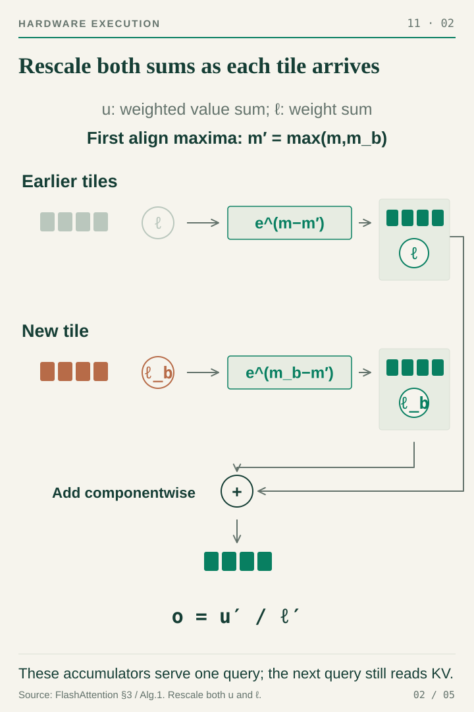</figure>
<em>Figure 11.2. Running maxima keep both normalization and weighted sums on the same exponential scale.</em>

Technical note: Rescale both sums as each tile arrives

Let m, ℓ, and u summarize the old tiles, and m_b, ℓ_b, and u_b summarize the new tile on its own scale. Rescale both contributions to the new maximum before summing. The resulting read preserves softmax attention up to floating-point effects; it is not a persistent summary that replaces historical KV for arbitrary future queries.

m′=max(m,m_b)
λ=exp(m−m′); λ_b=exp(m_b−m′)
ℓ′=λℓ+λ_bℓ_b
u′=λu+λ_bu_b
o=u′/ℓ′

Primary references: <a href="https://arxiv.org/pdf/2205.14135">FlashAttention, §3 / Algorithm 1</a>.

When a new tile changes the running maximum, rescale both the old weighted sum and the old normalization sum before adding the new tile. The accumulators belong to this attention read. They are not a reusable summary that answers every future query without revisiting KV.

<figure id="c11-vf-03-recompute">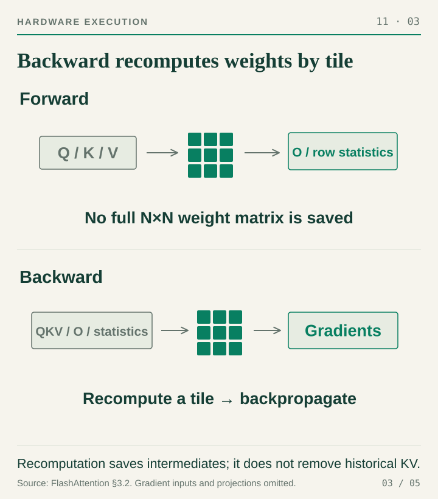</figure>
<em>Figure 11.3. Recompute local weights in backward instead of saving a full attention matrix.</em>

Technical note: Backward recomputes weights by tile

Saved inputs, outputs, and normalization statistics support tiled backward computation. This is a recomputation-versus-storage tradeoff for intermediates. It does not erase historical KV or change the architectural access pattern. Gradient inputs and projection details are omitted from the sketch.

Primary references: <a href="https://arxiv.org/pdf/2205.14135">FlashAttention, §3 / Algorithm 1</a>.

The backward pass recomputes local attention weights from saved inputs, outputs, and statistics. This trades recomputation for fewer saved intermediates. It does not eliminate the work of relating queries to keys.

Two other execution choices: paged caches and ring attention

<figure id="n11-paging">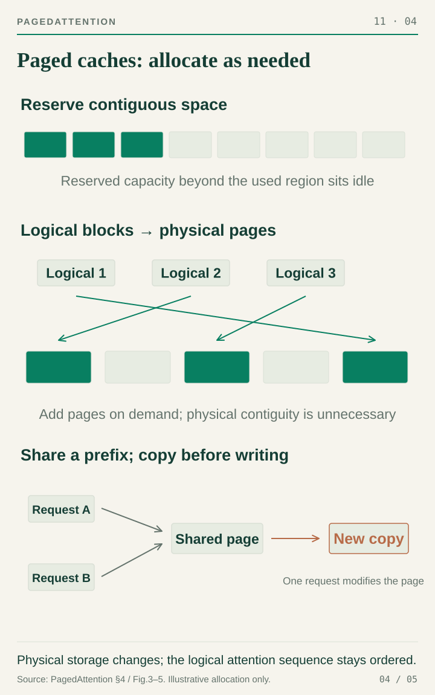</figure>
<em>Figure 11.4. Logical cache blocks need not occupy contiguous physical memory.</em>

Technical note: Paged caches: allocate as needed

Paged allocation assigns storage as needed. Shared prefixes can reuse suitable physical blocks; a request that modifies shared content requires copy-on-write. The mapping changes memory management, not the logical order of positions read by attention. The sketch does not assert a measured utilization ratio.

Primary references: <a href="https://arxiv.org/pdf/2309.06180">Efficient Memory Management for Large Language Model Serving with PagedAttention</a>.

<strong>PagedAttention</strong> separates logical KV blocks from physical memory pages. On-demand allocation reduces waste, and suitable shared-prefix pages can use copy-on-write. The logical sequence being attended to is unchanged.

<figure id="n11-ring"></figure>
<em>Figure 11.5. Each device keeps local queries while KV blocks circulate for successive partial reads.</em>

Technical note: Ring: circulate KV, overlap transfers

A ring schedule overlaps block computation with transfer of the next KV block. This distributes memory and computation across devices without eliminating full attention’s query–key pairs. Whether communication is hidden depends on block dimensions, hardware, and interconnects; the timeline is not measured performance.

Primary references: <a href="https://arxiv.org/pdf/2310.01889v4">Ring Attention, §3</a>.

<strong>Ring Attention</strong> distributes sequence blocks and circulates KV while queries stay local. Overlapping communication with block computation can make long-context execution practical across devices. The benefit depends on the hardware and communication balance; the full pairwise operation has not disappeared.

These techniques can compose with architectural choices. To understand a model, identify both the operation it specifies and the system that executes it.

<h2 id="chapter-12">12. How to Read a New Architecture</h2>

Return to the reports that opened this article. Instead of collecting acronyms, ask four questions: <strong>What is stored? What is read? What is updated? Which costs still grow?</strong>

DeepSeek-V4.1-Flash’s CSA2 makes cross-layer reuse explicit. A Full layer produces global KV and an index selection. A Reindex layer reuses global KV but scores it again with its own indexer query. A Reuse layer retains both the shared KV and an existing selection. Every mode still has its own main query and local-window KV.

<figure id="c12-vf-02-csa2"></figure>
<em>Figure 12.1. CSA2 separates reusing global KV from reusing the indices that select it.</em>

Technical note: CSA2: reuse KV, or reuse the selection

Full mode generates global main KV and indexer K and selects indices. Reindex reuses shared KV and indexer K but rescoring uses its own indexer query. Reuse also keeps a valid preceding selection for the same global KV. Every layer retains its own main query and local-window KV. The diagram does not imply that local caches disappear.

Primary references: <a href="https://arxiv.org/pdf/2609.19969">DeepSeek-V4.1-Flash, §2.2–2.3</a>.

Cache sharing and selection sharing save different work. They should be counted separately. The report’s causal encoder–decoder structure supplies the source representation for global KV; it is not itself a statement that every decoder layer uses identical projected KV.

<figure id="n12-map"></figure>
<em>Figure 12.2. The same storage, access, composition, and residual-cost questions apply to both model reports.</em>

Technical note: Place both models on the same map

DeepSeek-V4.1-Flash retains a global historical pool with compressed/sparse access and cross-layer reuse. Kimi K3 combines recurrent KDA states with Gated MLA history caches. These structural descriptions do not produce a controlled speed ranking: full-model configuration, training, kernels, and workload remain different.

Primary references: <a href="https://arxiv.org/pdf/2609.19969">DeepSeek-V4.1-Flash, §2.2–2.3</a>; <a href="https://arxiv.org/pdf/2607.24653v1">Kimi K3, §2.1–2.2</a>.

Kimi K3 takes another route through the same questions: fixed KDA state in recurrent layers, addressable historical KV in Gated MLA layers, and a repeating composition along depth. Neither model is summarized adequately by one attention acronym.

<figure id="n12-costs"></figure>
<em>Figure 12.3. Sharing and compression shrink entries; a recurrent state removes the historical-entry axis.</em>

Technical note: What grows with a longer history?

The drawing compares growth with history length under fixed feature dimensions. Block areas are not quantitative memory ratios. MHA/MQA/GQA preserve the history factor N. DeepSeek-V2-style MLA preserves N while storing d_c+d_r elements per position. The normalized kernel example carries S and z without adding a position axis.

MHA/MQA/GQA: N·Hkv·(dₖ+dᵥ)
DeepSeek-V2-style MLA: N·(d_c+d_r)
Normalized kernel core: H·(m·dᵥ+m)

Primary references: <a href="https://arxiv.org/pdf/2305.13245">GQA, §2.2</a>; <a href="https://arxiv.org/pdf/2405.04434">DeepSeek-V2, §2.1</a>; <a href="https://github.com/deepseek-ai/DeepSeek-V3/blob/main/inference/model.py">Author implementation</a>; <a href="https://arxiv.org/pdf/2006.16236">Transformers Are RNNs, §3</a>.

With dimensions fixed, these core growth patterns make the distinction concrete. Count elements before converting to bytes; precision, batch size, layers, positional components, and auxiliary state must then be included.

<table class="cost-table"><thead><tr><th>Core form</th><th>Persistent elements</th><th>One decode step</th><th>Full-sequence prefill</th></tr></thead><tbody>
<tr><td data-label="Core form">MHA / MQA / GQA</td><td data-label="Persistent elements">N·Hkv·(dₖ+dᵥ)</td><td data-label="One decode step">O(N·Hq·(dₖ+dᵥ))</td><td data-label="Full-sequence prefill">O(N²·Hq·(dₖ+dᵥ))</td></tr>
<tr><td data-label="Core form">DeepSeek-V2-style MLA, absorbed content path</td><td data-label="Persistent elements">N·(d_c+d_r)</td><td data-label="One decode step">O(N·Hq·(d_c+d_r))</td><td data-label="Full-sequence prefill">Pairwise attention remains quadratic for full-history reads</td></tr>
<tr><td data-label="Core form">Normalized kernel state</td><td data-label="Persistent elements">H·(m·dᵥ+m)</td><td data-label="One decode step">O(H·m·dᵥ)</td><td data-label="Full-sequence prefill">O(N·H·m·dᵥ) state-core work</td></tr>
</tbody></table>

These are per-sequence, per-layer core expressions, not latency predictions. They omit projections and model-wide work; the MLA expression assumes the absorbed form described here. Sparse indexing, compressed pools, gates, and kernels introduce their own terms. Chunked training can prefer more arithmetic if that arithmetic uses the hardware better.

A compact checklist for the next architecture name

<figure id="n12-options"></figure>
<em>Figure 12.4. Locate the changed operation before comparing architecture names.</em>

Locate the changed object and axis: head sharing, feature compression, position selection, state transition, cross-layer reuse, or execution schedule. Then ask what remained unchanged. A kernel optimization and a memory update rule can both be valuable while answering different questions.

CED, fair comparisons, depth-wise attention, and a newer delta rule

<figure id="n12-ced"></figure>
<em>Figure 12.5. CED provides a common encoder representation for layer-specific global KV projections.</em>

Technical note: CED: one source, layer-specific KV

In the V4.1 causal encoder–decoder design, decoder layers derive global attention inputs from the final encoder representations. A common source does not mean all projected tensors are identical. The CSA2 mode assignment separately specifies which layers compute new global KV and which reuse it. Local decoder KV remains a distinct object.

C_l = H_enc W_l^KV
Z_l = H_enc W_l^Z

Primary references: <a href="https://arxiv.org/pdf/2609.19969">DeepSeek-V4.1-Flash, §2.2–2.3</a>.

<figure id="c12-vf-04-compare"></figure>
<em>Figure 12.6. An answer-quality comparison and a resource comparison need matched conditions.</em>

Technical note: Compare answers and costs together

Hold the task and inputs fixed, then account for model dimensions, training, context length, batch, hardware, precision, and implementation. Changes at model scale cannot automatically be attributed to one attention mechanism. The figure is a comparison protocol, not an experiment or a result table.

Analytical framework in this article; no experimental result implied.

A useful comparison needs both answer quality and cost under aligned conditions. Model size, training data and budget, sequence length, batch, precision, hardware, and implementation can overwhelm the effect of the attention mechanism itself.

<figure id="c12-vf-03-depth-axis"></figure>
<em>Figure 12.7. Attention over depth reads preceding block representations at the same token position.</em>

Technical note: Attention can also read across depth

Attention Residuals replaces fixed residual aggregation with a selective read over preceding layer or block outputs. The depth axis is different from the historical sequence axis. It also differs from cross-layer KV-cache reuse, which lets later layers share retained tensors for sequence attention. The sketch omits the current block and normalization.

Primary references: <a href="https://arxiv.org/pdf/2603.15031">Attention Residuals</a>; <a href="https://arxiv.org/pdf/2607.24653v1">Kimi K3, §2.2</a>.

<strong>Attention Residuals (AttnRes)</strong> reads across preceding layer or block representations at a token position. That changes the depth-wise aggregation interface. It is distinct from sharing KV caches across layers for future sequence positions.

<figure id="c12-vf-05-delta2"></figure>
<em>Figure 12.8. Gated DeltaNet-2 decouples the active edit’s erase and write gates.</em>

Technical note: What controls erasing and writing?

The erase gate weights the key-side read direction used to remove old content, while the write gate weights incoming value components. With both gates tied to the same scalar β, the update reduces to KDA; scalar retention additionally recovers the GDN form. This is a research extension, not a reported component of the opening models.

S̄ₜ=DₜSₜ₋₁
eₜ=bₜ⊙kₜ; z_edit=wₜ⊙vₜ
Sₜ=S̄ₜ+kₜ(z_edit−S̄ₜᵀeₜ)ᵀ

Primary references: <a href="https://arxiv.org/pdf/2605.22791v1">Gated DeltaNet-2, §3</a>.

<strong>Gated DeltaNet-2</strong> separates channelwise erase and write gates within the active edit. It provides a useful new example for our checklist: identify what the gate acts on and which previous restriction it relaxes. It is a research method, not an asserted component of the two model configurations above.

<table><tr><th>Year</th><th>A useful reading milestone</th></tr><tr><td>2014–2015</td><td>Neural encoder–decoders and dynamic source alignment</td></tr><tr><td>2017</td><td>Transformer attention as the main sequence-mixing operation</td></tr><tr><td>2019–2020</td><td>Multi-query decoding and recurrent linear-attention formulations</td></tr><tr><td>2023–2024</td><td>Grouped KV, latent KV, gated states, and efficient delta-rule training</td></tr><tr><td>2025–2026</td><td>Finer state edits, sparse/compressed reads, cross-layer reuse, and hybrid systems</td></tr></table>

This is a reading guide, not a claim that each row replaced the previous one. The mechanisms remain composable.

<h2 id="chapter-13">13. What Attention’s Evolution Adds Up To</h2>

The history becomes easier to follow once we stop treating it as a succession of better attention formulas. Its recurring problem is <strong>how to make past information useful without making every future step increasingly expensive.</strong>

<figure id="n13-memory-system"></figure>
<em>Figure 13.1. Attention’s scope expands from a read operator to the organization of a memory system.</em>

Technical note: From reading context to managing memory

This is a synthesis of the preceding mechanisms, not a claim that each newer method replaces the earlier ones. Retained entries, associative states, update policies, composition, and physical execution answer different parts of the same question: how can useful past information influence the next computation at an affordable cost?

Primary references: <a href="https://arxiv.org/pdf/1706.03762">Attention Is All You Need, §3.2</a>; <a href="https://arxiv.org/pdf/2006.16236">Transformers Are RNNs, §3</a>; <a href="https://arxiv.org/html/2501.00663v1#S3">Titans</a>; <a href="https://arxiv.org/html/2404.07143v1#S2">Infini-attention</a>; <a href="https://arxiv.org/html/2203.08913v1#S3.SS1">Memorizing Transformers</a>.

First came a more flexible read. Then came smaller or shared entries, fewer reads, finite states, selective forgetting, corrective writes, and combinations of those interfaces. Execution techniques made these operations fit real memory hierarchies. Each step moved a different part of the cost–capability boundary.

<table class="memory-table"><thead><tr><th>Memory problem</th><th>Method</th><th>What changes</th><th>What remains</th></tr></thead><tbody>
<tr><td data-label="Memory problem">Flexible context access</td><td data-label="Method">MHA</td><td data-label="What changes">Separate learned reads across visible positions</td><td data-label="What remains">Pairwise work and per-head historical KV</td></tr>
<tr><td data-label="Memory problem">Many KV copies per position</td><td data-label="Method">MQA</td><td data-label="What changes">Share one KV head across query heads</td><td data-label="What remains">History grows; query heads still score independently</td></tr>
<tr><td data-label="Memory problem">A middle ground between MHA and MQA</td><td data-label="Method">GQA</td><td data-label="What changes">Share one KV head per query group</td><td data-label="What remains">History growth and a model-dependent quality tradeoff</td></tr>
<tr><td data-label="Memory problem">Wide per-position KV</td><td data-label="Method">MLA</td><td data-label="What changes">Joint latent compression and projection absorption</td><td data-label="What remains">Retain one compact entry per historical position</td></tr>
<tr><td data-label="Memory problem">Too many token-level reads</td><td data-label="Method">MoBA</td><td data-label="What changes">Route to blocks, then read selected tokens</td><td data-label="What remains">Block-selection cost and candidate history</td></tr>
<tr><td data-label="Memory problem">Different scales need different reads</td><td data-label="Method">NSA</td><td data-label="What changes">Gate compressed, selected, and local branch outputs</td><td data-label="What remains">Multiple read branches and their retained data</td></tr>
<tr><td data-label="Memory problem">Main attention reads too many positions</td><td data-label="Method">DSA</td><td data-label="What changes">Use a lightweight indexer to select positions</td><td data-label="What remains">Indexer work and candidate storage</td></tr>
<tr><td data-label="Memory problem">Historical positions are too numerous</td><td data-label="Method">CSA / HCA</td><td data-label="What changes">Compress positions and read historical plus local KV</td><td data-label="What remains">Compressed history can still grow</td></tr>
<tr><td data-label="Memory problem">Every position needs a retained entry</td><td data-label="Method">Linear attention</td><td data-label="What changes">Accumulate associations in a fixed-shape state</td><td data-label="What remains">Finite capacity and interference</td></tr>
<tr><td data-label="Memory problem">Old additive contributions do not fade</td><td data-label="Method">RetNet</td><td data-label="What changes">Apply retention with parallel, recurrent, and chunkwise forms</td><td data-label="What remains">Forgetting alone does not correct predictions</td></tr>
<tr><td data-label="Memory problem">One fixed retention schedule is restrictive</td><td data-label="Method">GLA</td><td data-label="What changes">Make key-feature retention input-dependent</td><td data-label="What remains">Finite state and gate-aware training work</td></tr>
<tr><td data-label="Memory problem">Old and new values accumulate together</td><td data-label="Method">DeltaNet</td><td data-label="What changes">Predict, compute error, and write a correction</td><td data-label="What remains">Correlated keys can still interfere</td></tr>
<tr><td data-label="Memory problem">Need both clearing and targeted editing</td><td data-label="Method">GDN</td><td data-label="What changes">Decay the state, then correct its prediction</td><td data-label="What remains">One headwise retention factor is coarse</td></tr>
<tr><td data-label="Memory problem">Headwise forgetting is too coarse</td><td data-label="Method">KDA</td><td data-label="What changes">Retain key-feature directions separately before correction</td><td data-label="What remains">Learned coordinates, finite capacity, auxiliary state</td></tr>
<tr><td data-label="Memory problem">State and historical reads offer different strengths</td><td data-label="Method">Hybrid</td><td data-label="What changes">Combine memory interfaces across layers or branches</td><td data-label="What remains">Count both recurrent states and historical caches</td></tr>
<tr><td data-label="Memory problem">Layers duplicate related global histories</td><td data-label="Method">CSA2 cross-layer reuse</td><td data-label="What changes">Reuse global KV, optionally reusing index selections</td><td data-label="What remains">Layer-local queries/local KV and remaining history costs</td></tr>
<tr><td data-label="Memory problem">Full intermediates cause heavy traffic</td><td data-label="Method">FlashAttention</td><td data-label="What changes">Tile, normalize online, and recompute locally</td><td data-label="What remains">The specified pairwise attention still occurs</td></tr>
<tr><td data-label="Memory problem">Physical cache allocation wastes memory</td><td data-label="Method">PagedAttention</td><td data-label="What changes">Map logical blocks to pages and share safely</td><td data-label="What remains">Logical KV content remains necessary</td></tr>
<tr><td data-label="Memory problem">Long context spans devices</td><td data-label="Method">Ring Attention</td><td data-label="What changes">Circulate KV and overlap transfer with compute</td><td data-label="What remains">Communication and full pairwise work</td></tr>
</tbody></table>

The broader lesson is a change of scope: <strong>attention design increasingly includes the organization of memory, not just the score used for a read.</strong> That does not make every cache a human-like memory. It gives us a more useful set of questions about capability, retention, and cost.

<h2 id="chapter-14">14. Where Memory Systems Could Go Next</h2>

The following is an outlook, not a report of a settled architecture. Existing work already combines local detail, compressed or retrieved history, and recurrent state. The open question is how well the model can learn to divide work among them.

<figure id="n14-memory-tiers"></figure>
<em>Figure 14.1. Different memory interfaces could specialize in recent detail, compact history, and updated associations.</em>

Technical note: A possible division of memory roles

Dashed connections denote a candidate organization to test, not an implemented architecture or a proven routing policy. Existing retrieval and recurrent-memory research motivates the roles, but does not establish universal proportions. A finite state cannot be assumed to reconstruct discarded detail; training and task results must justify the division.

Primary references: <a href="https://arxiv.org/pdf/2607.24653v1">Kimi K3, §2.1–2.2</a>; <a href="https://arxiv.org/html/2501.00663v1#S3">Titans</a>; <a href="https://arxiv.org/html/2404.07143v1#S2">Infini-attention</a>; <a href="https://arxiv.org/html/2203.08913v1#S3.SS1">Memorizing Transformers</a>.

Recent detail might remain directly accessible; older information might be compressed or selectively retrieved; a recurrent state might track associations that need continual updating. A controller could learn what to write and which source to consult. These roles need not occupy one literal three-tier module, and a state cannot be assumed to reconstruct details it no longer retains.

That leads to a stronger set of design questions: <strong>What should persist? What should be revised? When should a cheap state read be supplemented by an explicit retrieval?</strong> Architectures such as <a href="https://arxiv.org/html/2404.07143v1#S2">Infini-attention</a>, <a href="https://arxiv.org/html/2203.08913v1#S3.SS1">Memorizing Transformers</a>, and <a href="https://arxiv.org/html/2501.00663v1#S3">Titans</a> explore parts of this space. They do not establish one universally best division of memory roles.

<figure id="n14-memory-lifecycle"></figure>
<em>Figure 14.2. A useful memory system also needs policies for reuse, movement, and release.</em>

Technical note: Memory also needs a lifecycle

The repeated colors show physical relocation of the same KV content across storage tiers. LMCache documents real reuse and movement mechanisms. The further semantic policy—what an assistant should remember, revise, or forget across sessions—is a separate open design problem. No performance or capacity ratio is implied by the boxes.

Primary references: <a href="https://docs.lmcache.ai/">LMCache documentation</a>; <a href="https://arxiv.org/html/2501.00663v1#S3">Titans</a>; <a href="https://arxiv.org/html/2404.07143v1#S2">Infini-attention</a>; <a href="https://arxiv.org/html/2203.08913v1#S3.SS1">Memorizing Transformers</a>.

The serving system has related decisions to make. KV content may reside on a GPU, in CPU memory, or in storage; it can be reused, moved, or released. Systems such as <a href="https://docs.lmcache.ai/">LMCache</a> already implement cache reuse and movement. Keeping a cache longer is a physical capability. Understanding and integrating a user’s experiences across sessions is a different semantic capability.

Which predictions would be worth testing?

We would look for evidence that a learned memory policy improves the joint quality–cost tradeoff: retaining information that matters, revising stale associations, retrieving details when a compressed state is insufficient, and doing so within a measured storage and latency budget. Comparisons should include workloads that expose forgetting, interference, revision, and long-range detail retrieval.

Cross-layer sharing and physical cache tiers offer additional opportunities, but their benefits depend on reuse patterns and implementation. A model’s semantic decisions and a serving system’s placement decisions must agree on what information exists, what is reusable, and when it is safe to discard it.

These are hypotheses to validate through training and tasks. A plausible block diagram, a lower asymptotic term, or a cache that survives a restart is not enough evidence by itself.

Attention began by giving a decoder a better way to look back. Its evolution now asks how a model should organize the past: <strong>what to keep, how to access it, and how to change it when the world moves on.</strong> Follow those choices, and the next unfamiliar attention name becomes a design we can inspect.

<em>Sources: <a href="https://arxiv.org/pdf/1409.0473">Neural Machine Translation by Jointly Learning to Align and Translate</a>; <a href="https://arxiv.org/pdf/1706.03762">Attention Is All You Need</a>; <a href="https://arxiv.org/pdf/2305.13245">GQA</a>; <a href="https://arxiv.org/pdf/2405.04434">DeepSeek-V2</a>; <a href="https://arxiv.org/pdf/2006.16236">Transformers Are RNNs</a>; <a href="https://arxiv.org/pdf/2412.06464v3">Gated Delta Networks</a>; <a href="https://arxiv.org/pdf/2510.26692">Kimi Linear</a>; <a href="https://arxiv.org/pdf/2205.14135">FlashAttention</a>; <a href="https://arxiv.org/pdf/2609.19969">DeepSeek-V4.1-Flash</a>; <a href="https://arxiv.org/pdf/2607.24653">Kimi K3</a>. Additional primary references accompany the figure notes.</em>

</section>

