
<section class="attention-article">

读 DeepSeek-V4.1-Flash 的报告，会遇到 CSA2、稀疏选择、跨层复用；读 Kimi K3，又会遇到 KDA、门控 MLA、Hybrid。一篇报告里，常常同时出现好几个 Attention 名字。

它们为什么会共存？哪些改的是同一件事，哪些可以叠加？看到一个新架构，怎样判断它究竟解决了什么问题？

先抓住最基本的一件事：<strong>Attention（注意力机制）让模型按当前需要，从上下文各处提取、融合信息。</strong> 一句话中的词不再各管各的，远处的信息可以影响当前位置的表示。

要读出有用的信息，先得有东西可读。模型必须决定：过去留下什么，新信息怎样写进去，旧内容何时淡出，需要时又怎样找回来。把这些选择合起来看，就得到一套 <strong>Context Memory（上下文记忆）系统</strong>。

<figure id="n02-fork">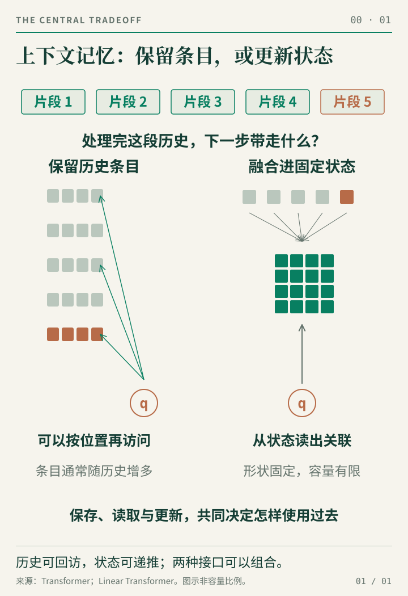</figure>

左边留下可按位置回访的历史条目，右边把经历融合成不断更新的状态。Memory 在本文首先指处理上下文时产生的运行记忆，例如历史条目和内部状态；它们与训练后固定的模型参数、跨会话保存的用户档案各有不同的生命周期。

统一比较坐标：历史长度、表示维度与层数

逐位置缓存规模 ∝ 历史条目数 × 每条大小 × 独立缓存层数
固定关联状态核心：每头 m × dᵥ；本文所示核形式另有 m 维 z（其他状态另计）

m 为映射后的 key/query 特征维度，不必等于原始 dₖ。这是对象规模关系，不是性能测量。共享头、latent、序列压缩、跨层复用改不同因子；固定窗口是缓存可有界的例外，但放弃窗口外的直接访问。固定状态同样不是无限信息容量，不保证所有任务上更好；混合模型还要把逐位置分支加回去。

原文：Transformer；Linear Transformer；各方法配置

这就是全文的主线：<strong>从“怎样读取上下文”，逐步走到“怎样管理上下文记忆”。</strong> 先让历史可读取，再让保存和访问更省，接着学会遗忘与纠错，最后让不同记忆在同一系统中协作。机制的名字很多，追问的是同一件事：<strong>有限的存储与计算，怎样留下更多真正用得上的过去？</strong>

阅读地图：读取上下文 → 保存与更新 → 记忆系统 → 未来
<nav aria-label="章节导航"><a href="#chapter-1">一、Attention 的由来：从整句记忆到按需读取</a><a href="#chapter-2">二、标准 Attention：灵活读取的成本</a><a href="#chapter-3">三、MQA 与 GQA：让查询头共享 KV</a><a href="#chapter-4">四、MLA：压缩 KV，也重排读取</a><a href="#chapter-5">五、稀疏与压缩：减少本次读取</a><a href="#chapter-6">六、Linear Attention：把历史汇入固定状态</a><a href="#chapter-7">七、RetNet 与 GLA：遗忘，也要高效计算</a><a href="#chapter-8">八、DeltaNet：用误差修正旧关联</a><a href="#chapter-9">九、KDA：把遗忘细化到特征通道</a><a href="#chapter-10">十、Hybrid：让不同记忆协作</a><a href="#chapter-11">十一、FlashAttention：少搬数据，完成同一项计算</a><a href="#chapter-12">十二、看懂新架构：还原它的记忆系统</a><a href="#chapter-13">十三、总结：从读取上下文到管理记忆</a><a href="#chapter-14">十四、展望：走向分层协作的记忆系统</a></nav>
<h2 id="chapter-1">一、Attention 的由来：从整句记忆到按需读取</h2>

把一句英文翻成中文，译出后半句时，怎样用上前半句的原文？在早期神经机器翻译中，常见做法是 Encoder–Decoder（编码器—解码器）：编码器用 RNN（Recurrent Neural Network，循环神经网络）逐词读取，把源句汇入固定长度的表示，解码器再据此逐词翻译。LSTM、GRU 是这类递归网络的常见单元。

不管源句多长，交给解码器的“整句行李”大小固定。句子长了，要在同一个向量里照顾所有细节，形成瓶颈。<strong>Attention 打开的新通道，是让译文在每一步重新读取源句各位置的表示。</strong> 从记忆角度看，重要变化是保留了可再次访问的源文表示，而不只依赖一份整句摘要。

<figure id="n01-history">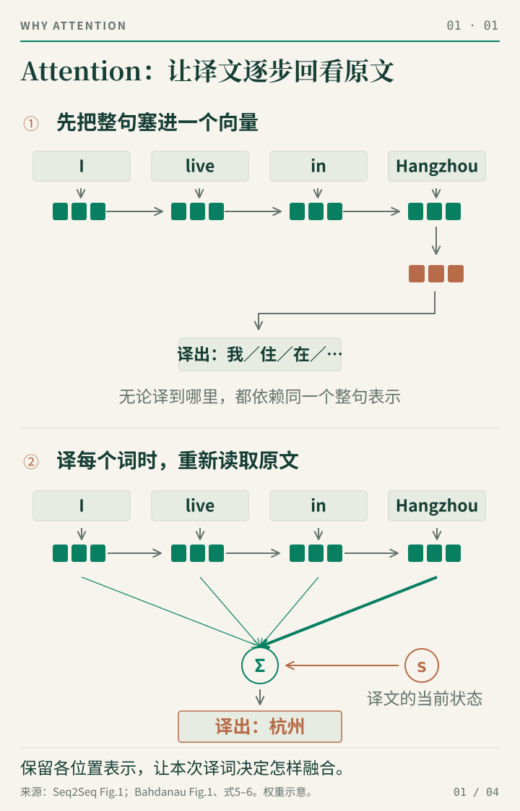</figure>

上半图中，译到哪里都依赖同一个整句表示；下半图中，译“杭州”时，可以给相关源位置更高权重，再把各位置的信息融合。粗线只是机制示意，真实权重由训练学出。源位置的表示也已包含上下文，不是孤立的单词卡片。

技术补充：动态上下文不是固定句向量

cᵢ = Σⱼ αᵢⱼ hⱼ；αᵢⱼ = softmaxⱼ a(sᵢ₋₁,hⱼ)

Bahdanau 用译文当前解码状态与源位置 annotation 计算对齐分数，每个译出步骤得到不同上下文 cᵢ。hⱼ 来自双向 RNN，本身融合上下文；图省略双向细节。整句固定表示的瓶颈与后来的固定递归状态有联系，但接口和具体更新不同，不能把 Seq2Seq 直接称为今天的 Linear Attention。

原文：<a href="https://arxiv.org/pdf/1409.0473">Bahdanau §3.1、式5–6</a>

这里的 Attention 仍然配着 RNN 使用。Bahdanau 等人的工作把对齐与翻译一起学习；Luong 等人进一步研究了不同的匹配和访问方式。<strong>Attention 先出现，Transformer 后出现。</strong>

Transformer 在 2017 年把注意力提升为主要的序列交互方式，用 Self-Attention（自注意力）让同一序列中的位置直接交换信息。

<figure id="n01-transformer">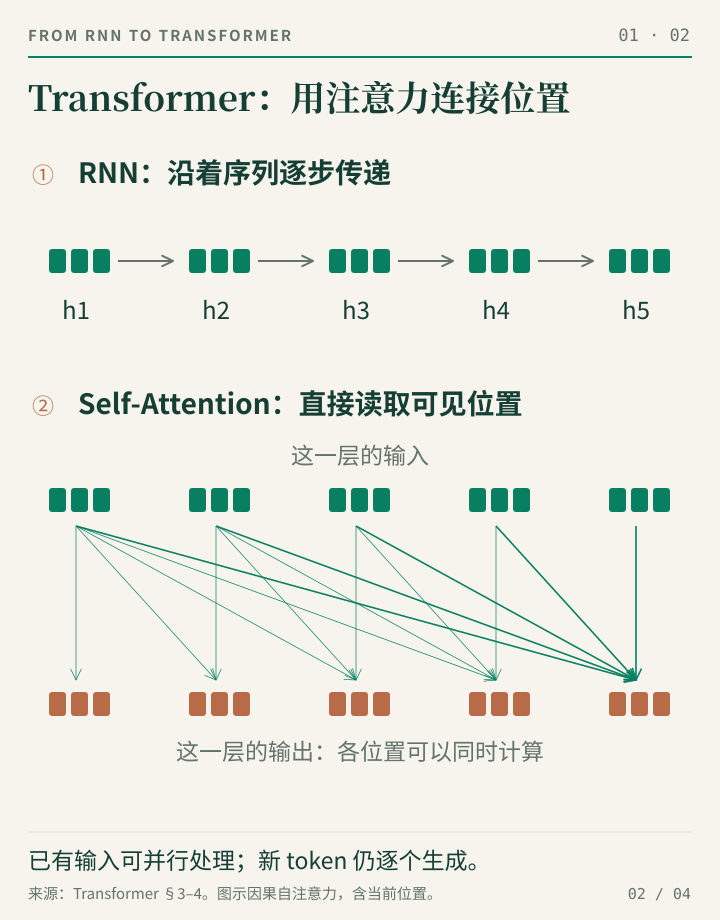</figure>

RNN 在同一层沿序列逐步递推；自注意力让各位置直接读取可见输入。因此，训练和处理已有输入时，各位置可以并行计算；远距离位置也有直接的信息通路。这些性质，加上多层堆叠和逐位置的特征变换，使 Transformer 成为现代大模型广泛使用的基础。

并行的范围：层内、已知输入和生成过程

同一层的 Q/K/V 均由这一层的已知输入计算，不需要等到前一个位置完成本层 Attention。模型深度方向仍需逐层计算。自回归解码中新 token 依赖之前生成的 token，所以不能同时知道所有未来输入。图中含各位置对自己的连接；编码器双向自注意力可以使用不同掩码。

原文：<a href="https://arxiv.org/pdf/1706.03762">Transformer §3、§4</a>

图中下半部分使用因果约束：每个位置可读自己与前面。自回归生成仍然逐个产生新 token；已有输入能并行处理，不等于未来的词已经知道。

补充：机器翻译之前还有什么？Attention 在模型中的位置？

更早的统计机器翻译用概率词语对齐、短语表、重排序与搜索等机制建立源文和译文的联系（见 <a href="https://aclanthology.org/N03-1017.pdf">Statistical Phrase-Based Translation</a>）；本文重点追踪现代神经网络中从 RNN 编码器—解码器到 Attention 的转折。它不是所有机器翻译方法的完整年表。

Bahdanau 的具体编码器是双向 RNN，源位置的 annotation 同时融合两个方向；历史图省略双向编码细节，只突出固定整句表示与逐步动态读取的差别。Attention 也不是把源句全文未经处理地交给解码器。

<figure id="c2-vf-05-block">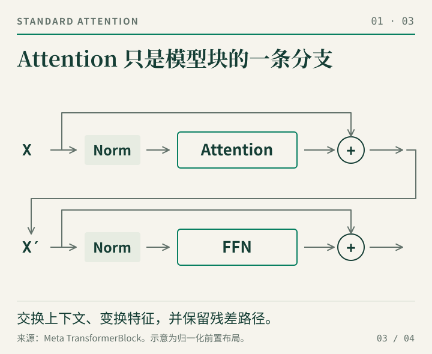</figure>

Attention 负责跨位置交换信息；FFN（前馈网络）逐位置变换特征；归一化调整尺度，残差把原表示加回来。图示常见的前置归一化布局，不能把 Attention 当成整个模型。

图中两个缩写

Norm：Normalization，归一化，调整数值尺度。FFN：Feed-Forward Network，前馈网络，逐位置变换特征。图示采用常见的前置归一化；原始 Transformer 的归一化位置不同。

<figure id="c2-vf-06-sources">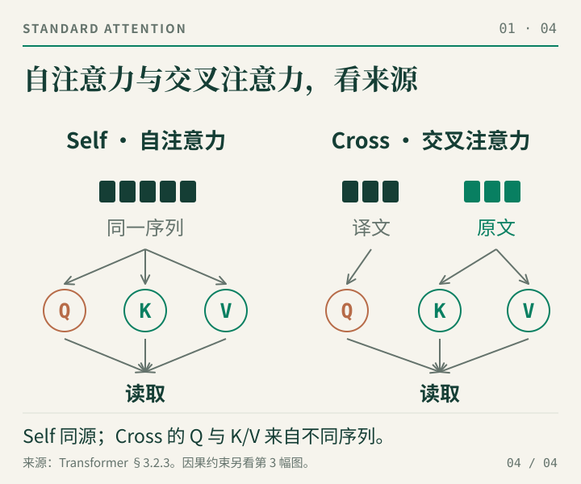</figure>

机器翻译中，译文查询源文通常是 Cross-Attention（交叉注意力）；同一序列取得 Q/K/V 是自注意力。来源与可见范围是两件事，自注意力也可以双向读取。

<em>主要来源：<a href="https://arxiv.org/pdf/1409.3215">Seq2Seq Fig.1</a>；<a href="https://arxiv.org/pdf/1409.0473">Bahdanau Attention §2–3</a>；<a href="https://aclanthology.org/D15-1166.pdf">Luong Attention</a>；<a href="https://arxiv.org/pdf/1706.03762">Transformer §3–4</a></em>

<h2 id="chapter-2">二、标准 Attention：灵活读取的成本</h2>

下面转到大语言模型：给定一段对话，预测下一个 token。token 是模型处理的文本单位，不一定等于一个字。为了便于画图，我们把对话简写成五段：上海、闲聊、改杭州、闲聊、哪里。后面反复用这段历史比较机制；这些词块不是实际分词，向量也不是人工设置的城市字段。

标准 Attention 先把每个位置的表示变成三组向量：Q（Query，查询）负责发起匹配，K（Key，键）负责被匹配，V（Value，值）提供参与融合的内容。当前位置的 Q 匹配各处 K，再用得到的权重融合对应 V。

<figure id="n02-qkv">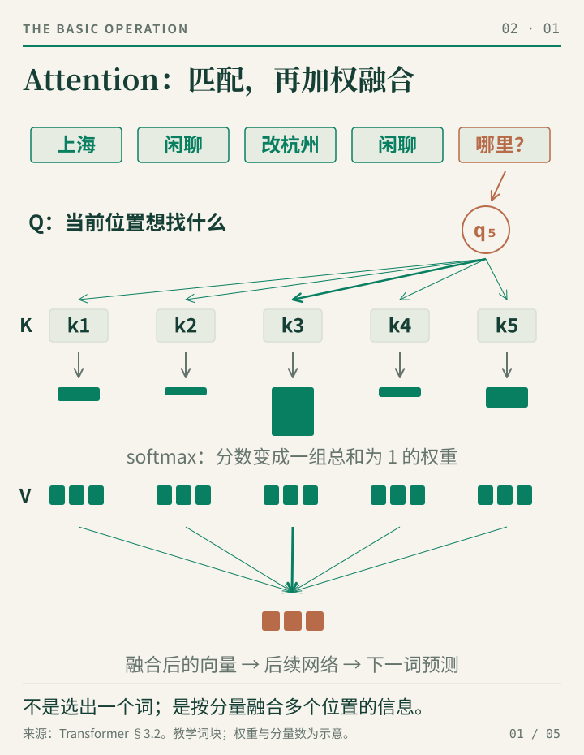</figure>

所有可见位置的分数共同经过 softmax，成为总和为 1 的权重。输出是一条融合后的向量，还要经过后续网络，才成为下一词的预测。Attention 提供利用上下文的通道，并不保证一次匹配就理解正确。

公式与形状：一行权重融合多条 V

Q=XW_Q；K=XW_K；V=XW_V
A=softmax_row(QKᵀ/√dₖ + M)；O=AV

对单个 query，权重覆盖可见位置且总和为1，输出长度由 V 的特征维度决定。M 表示可见范围，因果遮罩用负无穷屏蔽未来；也可用双向等其他范围。图中柱高只是教学示意，不是实测分数。

原文：<a href="https://arxiv.org/pdf/1706.03762">Transformer §3.2</a>

一次读取只有一套匹配方式。MHA（Multi-Head Attention，多头注意力）同时使用多套 Q/K/V 投影，让多个头分别匹配、读取，再拼接结果。不同头可以学到不同关系，没有人为指定谁管语法、谁管地址。

<figure id="c2-vf-04-heads">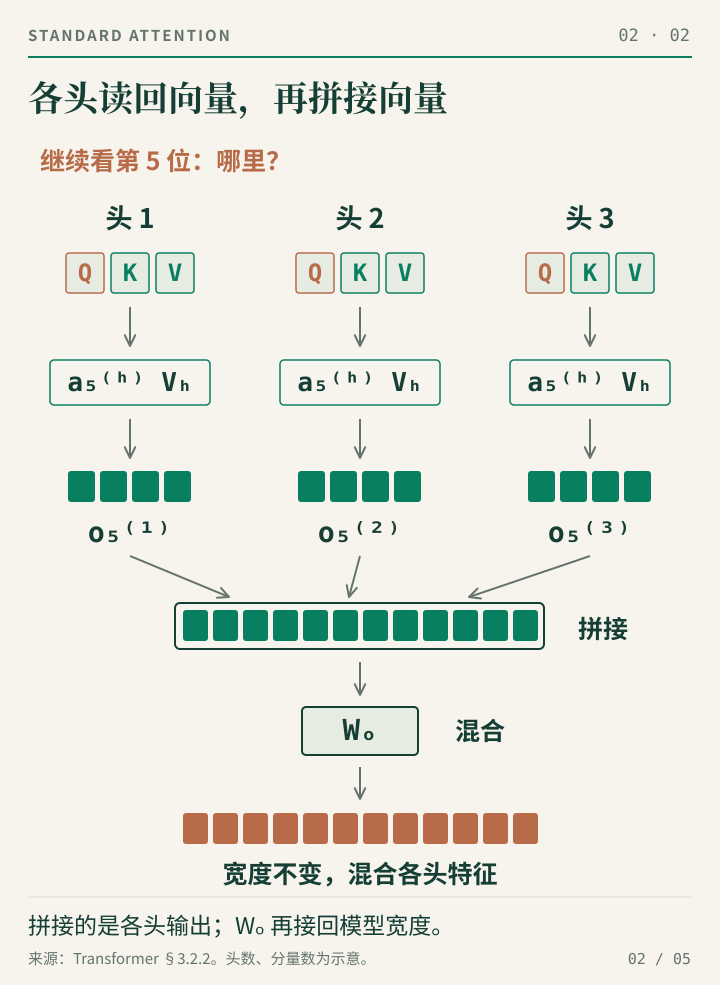</figure>

多头增加了表达方式，也多了要保存和读取的 K/V。在因果模型中，旧位置看不到新位置，旧 K/V 可以缓存下来，下次继续用。这就是 KV Cache：省掉旧投影的重算，却没有省掉历史条目。

头怎样接回模型宽度

o₅⁽ʰ⁾ = Σⱼ a₅ⱼ⁽ʰ⁾vⱼ⁽ʰ⁾
o₅ = W_O Concat(o₅⁽¹⁾, …, o₅⁽ᴴ⁾)

拼接的是各头读取的value向量，再由输出投影混合；不是拼接N×N权重矩阵。模型宽度与头内维度需按具体配置核对。

<figure id="c2-vf-09-costs">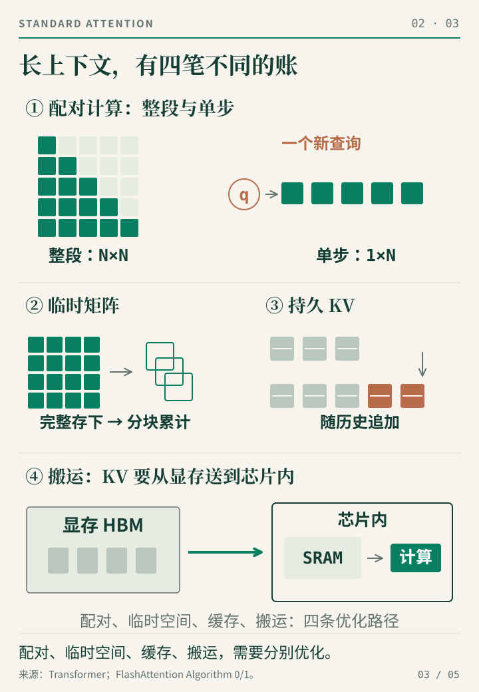</figure>

先分清两种场景：Prefill 处理已有输入，要计算许多位置之间的配对；Decode 每次处理一个新位置，使用缓存，却仍要访问历史 KV。全历史注意力的配对计算、缓存大小、显存流量，是不同的成本。

增长阶数，不等于实际速度

一个头的匹配与汇合：整段 O(N²(dₖ+dᵥ))，单步 O(N(dₖ+dᵥ))；尚未计入投影、FFN、多头、多层和批量。临时中间矩阵可以按块累计，持久 K/V 仍随历史增长。FlashAttention 改善执行与搬运，保留标准注意力的数学目标。图中整段只保留下三角的可见配对，数量仍按 N² 增长；实际内核可跳过或屏蔽无效区域。单步是一行，按 N 增长。分块执行也不意味着历史 K/V 无需搬运。

<strong>改进从这里分岔。</strong> 可以保留可寻址的历史条目，设法存得更省、每次读得更少；也可以把历史持续融合进固定形状的状态，从状态读出，但必须面对有限容量与信息干扰。

回到开篇的两种记忆：<strong>接下来先改左边的保存与访问，再改右边的状态更新，最后把两者组合起来。</strong> 这是一张设计地图，各条路线可以并行发展、叠加使用。

展开：公式、因果掩码与缓存

<figure id="c2-vf-03-matrix"><svg aria-label="一行查询，只能看到自己和前面" height="765" id="matrix-scene" role="img" viewbox="0 0 720 765" width="720" xmlns="http://www.w3.org/2000/svg"><rect fill="#F6F4ED" height="765" width="720"></rect><text fill="#64736C" font-family='"PingFang SC","Noto Sans CJK SC",sans-serif' font-size="15" font-weight="600" letter-spacing="2" text-anchor="start" x="28" y="41">STANDARD ATTENTION</text><text fill="#64736C" font-family='"SFMono-Regular",Menlo,monospace' font-size="17" font-weight="500" letter-spacing="0" text-anchor="end" x="690" y="41">02 · 04</text><line stroke="#087F61" stroke-width="2" x1="28" x2="692" y1="57" y2="57"></line><text fill="#153E35" font-family='"Songti SC","Noto Serif CJK SC",serif' font-size="35" font-weight="700" letter-spacing="0" text-anchor="start" x="28" y="111">一行查询，只能看到自己和前面</text><rect data-token-box="0" fill="#E7ECE2" height="49" rx="5" width="112" x="39" y="152"></rect><text data-token-text="0" fill="#153E35" font-family='"PingFang SC","Noto Sans CJK SC",sans-serif' font-size="27" font-weight="600" letter-spacing="0" text-anchor="middle" x="95" y="185">上海</text><text fill="#64736C" font-family='"SFMono-Regular",Menlo,monospace' font-size="22" font-weight="500" letter-spacing="0" text-anchor="middle" x="95" y="229">1</text><rect data-token-box="1" fill="#E7ECE2" height="49" rx="5" width="112" x="171" y="152"></rect><text data-token-text="1" fill="#153E35" font-family='"PingFang SC","Noto Sans CJK SC",sans-serif' font-size="27" font-weight="600" letter-spacing="0" text-anchor="middle" x="227" y="185">闲聊</text><text fill="#64736C" font-family='"SFMono-Regular",Menlo,monospace' font-size="22" font-weight="500" letter-spacing="0" text-anchor="middle" x="227" y="229">2</text><rect data-token-box="2" fill="#E7ECE2" height="49" rx="5" width="112" x="303" y="152"></rect><text data-token-text="2" fill="#153E35" font-family='"PingFang SC","Noto Sans CJK SC",sans-serif' font-size="27" font-weight="600" letter-spacing="0" text-anchor="middle" x="359" y="185">改杭州</text><text fill="#64736C" font-family='"SFMono-Regular",Menlo,monospace' font-size="22" font-weight="500" letter-spacing="0" text-anchor="middle" x="359" y="229">3</text><rect data-token-box="3" fill="#E7ECE2" height="49" rx="5" width="112" x="435" y="152"></rect><text data-token-text="3" fill="#153E35" font-family='"PingFang SC","Noto Sans CJK SC",sans-serif' font-size="27" font-weight="600" letter-spacing="0" text-anchor="middle" x="491" y="185">闲聊</text><text fill="#64736C" font-family='"SFMono-Regular",Menlo,monospace' font-size="22" font-weight="500" letter-spacing="0" text-anchor="middle" x="491" y="229">4</text><rect data-token-box="4" fill="#B76B48" height="49" rx="5" width="112" x="567" y="152"></rect><text data-token-text="4" fill="#FFFFFF" font-family='"PingFang SC","Noto Sans CJK SC",sans-serif' font-size="27" font-weight="600" letter-spacing="0" text-anchor="middle" x="623" y="185">哪里？</text><text fill="#64736C" font-family='"SFMono-Regular",Menlo,monospace' font-size="22" font-weight="500" letter-spacing="0" text-anchor="middle" x="623" y="229">5</text><text data-query-label="" fill="#B76B48" font-family='"PingFang SC","Noto Sans CJK SC",sans-serif' font-size="26" font-weight="600" letter-spacing="0" text-anchor="middle" x="360" y="278">第 5 位的 q₅：哪里？</text><text fill="#153E35" font-family='"PingFang SC","Noto Sans CJK SC",sans-serif' font-size="27" font-weight="600" letter-spacing="0" text-anchor="middle" x="182" y="328">全部配对</text><text fill="#153E35" font-family='"PingFang SC","Noto Sans CJK SC",sans-serif' font-size="27" font-weight="600" letter-spacing="0" text-anchor="middle" x="537" y="328">遮住未来</text><text fill="#64736C" font-family='"SFMono-Regular",Menlo,monospace' font-size="22" font-weight="500" letter-spacing="0" text-anchor="middle" x="93" y="370">1</text><text fill="#64736C" font-family='"SFMono-Regular",Menlo,monospace' font-size="22" font-weight="500" letter-spacing="0" text-anchor="middle" x="58" y="405">1</text><text fill="#64736C" font-family='"SFMono-Regular",Menlo,monospace' font-size="22" font-weight="500" letter-spacing="0" text-anchor="middle" x="134" y="370">2</text><text fill="#64736C" font-family='"SFMono-Regular",Menlo,monospace' font-size="22" font-weight="500" letter-spacing="0" text-anchor="middle" x="58" y="446">2</text><text fill="#64736C" font-family='"SFMono-Regular",Menlo,monospace' font-size="22" font-weight="500" letter-spacing="0" text-anchor="middle" x="175" y="370">3</text><text fill="#64736C" font-family='"SFMono-Regular",Menlo,monospace' font-size="22" font-weight="500" letter-spacing="0" text-anchor="middle" x="58" y="487">3</text><text fill="#64736C" font-family='"SFMono-Regular",Menlo,monospace' font-size="22" font-weight="500" letter-spacing="0" text-anchor="middle" x="216" y="370">4</text><text fill="#64736C" font-family='"SFMono-Regular",Menlo,monospace' font-size="22" font-weight="500" letter-spacing="0" text-anchor="middle" x="58" y="528">4</text><text fill="#64736C" font-family='"SFMono-Regular",Menlo,monospace' font-size="22" font-weight="500" letter-spacing="0" text-anchor="middle" x="257" y="370">5</text><text fill="#64736C" font-family='"SFMono-Regular",Menlo,monospace' font-size="22" font-weight="500" letter-spacing="0" text-anchor="middle" x="58" y="569">5</text><text fill="#64736C" font-family='"SFMono-Regular",Menlo,monospace' font-size="22" font-weight="500" letter-spacing="0" text-anchor="middle" x="448" y="370">1</text><text fill="#64736C" font-family='"SFMono-Regular",Menlo,monospace' font-size="22" font-weight="500" letter-spacing="0" text-anchor="middle" x="413" y="405">1</text><text fill="#64736C" font-family='"SFMono-Regular",Menlo,monospace' font-size="22" font-weight="500" letter-spacing="0" text-anchor="middle" x="489" y="370">2</text><text fill="#64736C" font-family='"SFMono-Regular",Menlo,monospace' font-size="22" font-weight="500" letter-spacing="0" text-anchor="middle" x="413" y="446">2</text><text fill="#64736C" font-family='"SFMono-Regular",Menlo,monospace' font-size="22" font-weight="500" letter-spacing="0" text-anchor="middle" x="530" y="370">3</text><text fill="#64736C" font-family='"SFMono-Regular",Menlo,monospace' font-size="22" font-weight="500" letter-spacing="0" text-anchor="middle" x="413" y="487">3</text><text fill="#64736C" font-family='"SFMono-Regular",Menlo,monospace' font-size="22" font-weight="500" letter-spacing="0" text-anchor="middle" x="571" y="370">4</text><text fill="#64736C" font-family='"SFMono-Regular",Menlo,monospace' font-size="22" font-weight="500" letter-spacing="0" text-anchor="middle" x="413" y="528">4</text><text fill="#64736C" font-family='"SFMono-Regular",Menlo,monospace' font-size="22" font-weight="500" letter-spacing="0" text-anchor="middle" x="612" y="370">5</text><text fill="#64736C" font-family='"SFMono-Regular",Menlo,monospace' font-size="22" font-weight="500" letter-spacing="0" text-anchor="middle" x="413" y="569">5</text><rect data-c="0" data-grid="full" data-r="0" fill="#087F61" height="37" rx="2" width="37" x="75" y="382"></rect><rect data-c="1" data-grid="full" data-r="0" fill="#087F61" height="37" rx="2" width="37" x="116" y="382"></rect><rect data-c="2" data-grid="full" data-r="0" fill="#087F61" height="37" rx="2" width="37" x="157" y="382"></rect><rect data-c="3" data-grid="full" data-r="0" fill="#087F61" height="37" rx="2" width="37" x="198" y="382"></rect><rect data-c="4" data-grid="full" data-r="0" fill="#087F61" height="37" rx="2" width="37" x="239" y="382"></rect><rect data-c="0" data-grid="full" data-r="1" fill="#087F61" height="37" rx="2" width="37" x="75" y="423"></rect><rect data-c="1" data-grid="full" data-r="1" fill="#087F61" height="37" rx="2" width="37" x="116" y="423"></rect><rect data-c="2" data-grid="full" data-r="1" fill="#087F61" height="37" rx="2" width="37" x="157" y="423"></rect><rect data-c="3" data-grid="full" data-r="1" fill="#087F61" height="37" rx="2" width="37" x="198" y="423"></rect><rect data-c="4" data-grid="full" data-r="1" fill="#087F61" height="37" rx="2" width="37" x="239" y="423"></rect><rect data-c="0" data-grid="full" data-r="2" fill="#087F61" height="37" rx="2" width="37" x="75" y="464"></rect><rect data-c="1" data-grid="full" data-r="2" fill="#087F61" height="37" rx="2" width="37" x="116" y="464"></rect><rect data-c="2" data-grid="full" data-r="2" fill="#087F61" height="37" rx="2" width="37" x="157" y="464"></rect><rect data-c="3" data-grid="full" data-r="2" fill="#087F61" height="37" rx="2" width="37" x="198" y="464"></rect><rect data-c="4" data-grid="full" data-r="2" fill="#087F61" height="37" rx="2" width="37" x="239" y="464"></rect><rect data-c="0" data-grid="full" data-r="3" fill="#087F61" height="37" rx="2" width="37" x="75" y="505"></rect><rect data-c="1" data-grid="full" data-r="3" fill="#087F61" height="37" rx="2" width="37" x="116" y="505"></rect><rect data-c="2" data-grid="full" data-r="3" fill="#087F61" height="37" rx="2" width="37" x="157" y="505"></rect><rect data-c="3" data-grid="full" data-r="3" fill="#087F61" height="37" rx="2" width="37" x="198" y="505"></rect><rect data-c="4" data-grid="full" data-r="3" fill="#087F61" height="37" rx="2" width="37" x="239" y="505"></rect><rect data-c="0" data-grid="full" data-r="4" fill="#B76B48" height="37" rx="2" width="37" x="75" y="546"></rect><rect data-c="1" data-grid="full" data-r="4" fill="#B76B48" height="37" rx="2" width="37" x="116" y="546"></rect><rect data-c="2" data-grid="full" data-r="4" fill="#B76B48" height="37" rx="2" width="37" x="157" y="546"></rect><rect data-c="3" data-grid="full" data-r="4" fill="#B76B48" height="37" rx="2" width="37" x="198" y="546"></rect><rect data-c="4" data-grid="full" data-r="4" fill="#B76B48" height="37" rx="2" width="37" x="239" y="546"></rect><rect aria-label="选择第1行查询" data-query="0" fill="transparent" height="41" role="button" style="cursor:pointer" tabindex="0" width="211" x="70" y="380"></rect><rect aria-label="选择第2行查询" data-query="1" fill="transparent" height="41" role="button" style="cursor:pointer" tabindex="0" width="211" x="70" y="421"></rect><rect aria-label="选择第3行查询" data-query="2" fill="transparent" height="41" role="button" style="cursor:pointer" tabindex="0" width="211" x="70" y="462"></rect><rect aria-label="选择第4行查询" data-query="3" fill="transparent" height="41" role="button" style="cursor:pointer" tabindex="0" width="211" x="70" y="503"></rect><rect aria-label="选择第5行查询" data-query="4" fill="transparent" height="41" role="button" style="cursor:pointer" tabindex="0" width="211" x="70" y="544"></rect><rect data-c="0" data-grid="causal" data-r="0" fill="#087F61" height="37" rx="2" width="37" x="430" y="382"></rect><rect data-c="1" data-grid="causal" data-r="0" fill="#E7ECE2" height="37" rx="2" width="37" x="471" y="382"></rect><rect data-c="2" data-grid="causal" data-r="0" fill="#E7ECE2" height="37" rx="2" width="37" x="512" y="382"></rect><rect data-c="3" data-grid="causal" data-r="0" fill="#E7ECE2" height="37" rx="2" width="37" x="553" y="382"></rect><rect data-c="4" data-grid="causal" data-r="0" fill="#E7ECE2" height="37" rx="2" width="37" x="594" y="382"></rect><rect data-c="0" data-grid="causal" data-r="1" fill="#087F61" height="37" rx="2" width="37" x="430" y="423"></rect><rect data-c="1" data-grid="causal" data-r="1" fill="#087F61" height="37" rx="2" width="37" x="471" y="423"></rect><rect data-c="2" data-grid="causal" data-r="1" fill="#E7ECE2" height="37" rx="2" width="37" x="512" y="423"></rect><rect data-c="3" data-grid="causal" data-r="1" fill="#E7ECE2" height="37" rx="2" width="37" x="553" y="423"></rect><rect data-c="4" data-grid="causal" data-r="1" fill="#E7ECE2" height="37" rx="2" width="37" x="594" y="423"></rect><rect data-c="0" data-grid="causal" data-r="2" fill="#087F61" height="37" rx="2" width="37" x="430" y="464"></rect><rect data-c="1" data-grid="causal" data-r="2" fill="#087F61" height="37" rx="2" width="37" x="471" y="464"></rect><rect data-c="2" data-grid="causal" data-r="2" fill="#087F61" height="37" rx="2" width="37" x="512" y="464"></rect><rect data-c="3" data-grid="causal" data-r="2" fill="#E7ECE2" height="37" rx="2" width="37" x="553" y="464"></rect><rect data-c="4" data-grid="causal" data-r="2" fill="#E7ECE2" height="37" rx="2" width="37" x="594" y="464"></rect><rect data-c="0" data-grid="causal" data-r="3" fill="#087F61" height="37" rx="2" width="37" x="430" y="505"></rect><rect data-c="1" data-grid="causal" data-r="3" fill="#087F61" height="37" rx="2" width="37" x="471" y="505"></rect><rect data-c="2" data-grid="causal" data-r="3" fill="#087F61" height="37" rx="2" width="37" x="512" y="505"></rect><rect data-c="3" data-grid="causal" data-r="3" fill="#087F61" height="37" rx="2" width="37" x="553" y="505"></rect><rect data-c="4" data-grid="causal" data-r="3" fill="#E7ECE2" height="37" rx="2" width="37" x="594" y="505"></rect><rect data-c="0" data-grid="causal" data-r="4" fill="#B76B48" height="37" rx="2" width="37" x="430" y="546"></rect><rect data-c="1" data-grid="causal" data-r="4" fill="#B76B48" height="37" rx="2" width="37" x="471" y="546"></rect><rect data-c="2" data-grid="causal" data-r="4" fill="#B76B48" height="37" rx="2" width="37" x="512" y="546"></rect><rect data-c="3" data-grid="causal" data-r="4" fill="#B76B48" height="37" rx="2" width="37" x="553" y="546"></rect><rect data-c="4" data-grid="causal" data-r="4" fill="#B76B48" height="37" rx="2" width="37" x="594" y="546"></rect><rect aria-label="选择第1行查询" data-query="0" fill="transparent" height="41" role="button" style="cursor:pointer" tabindex="0" width="211" x="425" y="380"></rect><rect aria-label="选择第2行查询" data-query="1" fill="transparent" height="41" role="button" style="cursor:pointer" tabindex="0" width="211" x="425" y="421"></rect><rect aria-label="选择第3行查询" data-query="2" fill="transparent" height="41" role="button" style="cursor:pointer" tabindex="0" width="211" x="425" y="462"></rect><rect aria-label="选择第4行查询" data-query="3" fill="transparent" height="41" role="button" style="cursor:pointer" tabindex="0" width="211" x="425" y="503"></rect><rect aria-label="选择第5行查询" data-query="4" fill="transparent" height="41" role="button" style="cursor:pointer" tabindex="0" width="211" x="425" y="544"></rect><line stroke="#64736C" stroke-width="2" x1="310" x2="395" y1="481" y2="481"></line><path d="M384.1946347717679 486.21958640933474 L395 481 L384.1946347717679 475.78041359066526" fill="none" stroke="#64736C" stroke-linecap="round" stroke-linejoin="round" stroke-width="2"></path><text fill="#64736C" font-family='"PingFang SC","Noto Sans CJK SC",sans-serif' font-size="24" font-weight="400" letter-spacing="0" text-anchor="start" x="55" y="623">查询 ↓</text><text fill="#64736C" font-family='"PingFang SC","Noto Sans CJK SC",sans-serif' font-size="24" font-weight="400" letter-spacing="0" text-anchor="start" x="430" y="623">键 → · 淡格不可见</text><text fill="#153E35" font-family='"PingFang SC","Noto Sans CJK SC",sans-serif' font-size="27" font-weight="600" letter-spacing="0" text-anchor="middle" x="360" y="664">沿每一行做 softmax</text><line stroke="#D9DFD5" stroke-width="1" x1="28" x2="692" y1="677" y2="677"></line><text data-range-label="" fill="#153E35" font-family='"PingFang SC","Noto Sans CJK SC",sans-serif' font-size="23" font-weight="500" letter-spacing="0" text-anchor="start" x="28" y="714">第 5 位读 1–5；点选更早行，观察未来怎样被遮住。</text><text fill="#64736C" font-family='"PingFang SC","Noto Sans CJK SC",sans-serif' font-size="15" font-weight="400" letter-spacing="0" text-anchor="start" x="28" y="744">来源：Transformer §3.2。点选一行可切换查询。</text><text fill="#64736C" font-family='"SFMono-Regular",Menlo,monospace' font-size="15" font-weight="500" letter-spacing="0" text-anchor="end" x="691" y="744">04 / 05</text></svg></figure>

标准缩放点积注意力写作 softmax(QKᵀ/√d + M)V，其中 M 表示可见范围；因果模型遮住未来位置，双向编码器可使用其他范围。图中点选一行，可以观察因果约束。

矩阵形状与实现

<math display="block" xmlns="http://www.w3.org/1998/Math/MathML"><semantics><mrow><mi>O</mi><mo>=</mo><msub><mrow><mi mathvariant="normal">softmax</mi><mo>⁡</mo></mrow><mrow><mi mathvariant="normal">r</mi><mi mathvariant="normal">o</mi><mi mathvariant="normal">w</mi></mrow></msub><mtext> ⁣</mtext><mrow><mo fence="true">(</mo><mfrac><mrow><mi>Q</mi><msup><mi>K</mi><mi mathvariant="normal">⊤</mi></msup></mrow><msqrt><msub><mi>d</mi><mi>k</mi></msub></msqrt></mfrac><mo>+</mo><mi>M</mi><mo fence="true">)</mo></mrow><mi>V</mi><mi mathvariant="normal">.</mi></mrow><annotation encoding="application/x-tex">O=\operatorname{softmax}_{\mathrm{row}}\!\left(\frac{QK^{\top}}{\sqrt{d_k}}+M\right)V.</annotation></semantics></math>
单头：Q/K 为 N×dₖ，V 为 N×dᵥ；配对是 N×N，输出是 N×dᵥ。代码中另外保留批量 B 和头数 H，输入为 [B,H,N,d]。
<pre><code class="language-python">import math
import torch

def causal_attention(q, k, v):
    n = q.shape[-2]
    scale = math.sqrt(q.shape[-1])
    score = q @ k.transpose(-2, -1)
    score = score / scale
    future = torch.ones(
        n, n,
        device=q.device,
        dtype=torch.bool,
    ).triu(1)
    score = score.masked_fill(
        future, float('-inf')
    )
    weight = torch.softmax(
        score.float(), dim=-1
    ).to(v.dtype)
    return weight @ v

</code></pre>
教学代码处理无前缀缓存、无填充的一整段因果注意力。它显式展开中间矩阵；生产内核可融合、分块。

<a href="https://docs.pytorch.org/docs/main/generated/torch.nn.functional.scaled_dot_product_attention.html">PyTorch 定义</a>

<figure id="c2-vf-08-cache">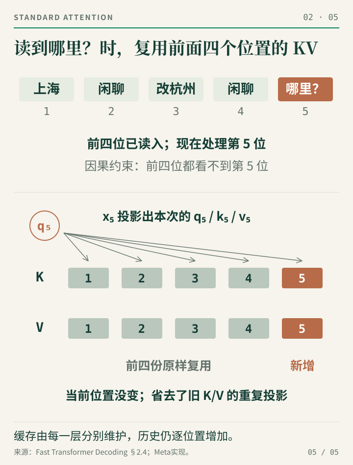</figure>

KV Cache 按层、按位置保存 K/V。它依赖可复用的计算条件；改变前缀、位置或掩码等条件，不能一概沿用旧缓存。

为什么不缓存旧 Q？掩码怎样对齐？

图中先 Prefill 前四个位置，再处理第5位。同一层的旧位置受因果掩码限制，无法依赖第5位；逐层递推，旧表示与旧 K/V 保持不变。前提是模型、前缀、位置编码与掩码一致。

旧 Q 已完成当次读取；未来用的是新 Q 和旧 K/V。缓存是每层各自的运行状态。

单步解码仅在缓存全部有效、且只有过去和当前位置时全部可见。新块含多个 token、有填充或预分配位置时，须按实际位置建立掩码；不能误用左上角对齐的非方形因果掩码。

<a href="https://docs.pytorch.org/docs/main/generated/torch.nn.functional.scaled_dot_product_attention.html">PyTorch 非方形掩码约定</a>

<em>主要来源：<a href="https://arxiv.org/pdf/1706.03762">Transformer §3.2</a>；<a href="https://arxiv.org/pdf/1911.02150v1">Fast Transformer Decoding §2</a></em>

<h2 id="chapter-3">三、MQA 与 GQA：让查询头共享 KV</h2>

先解决第一笔记忆账：相同历史位置，要为各个头重复保存多少份？保留历史位置，先减少这种重复。MHA 每个头都有自己的 K/V；查询头多，每个位置就要留下多套表示。<strong>MQA 与 GQA 保留多个查询头，减少它们使用的 KV 头。</strong>

<figure id="c3-vf-01-head-map">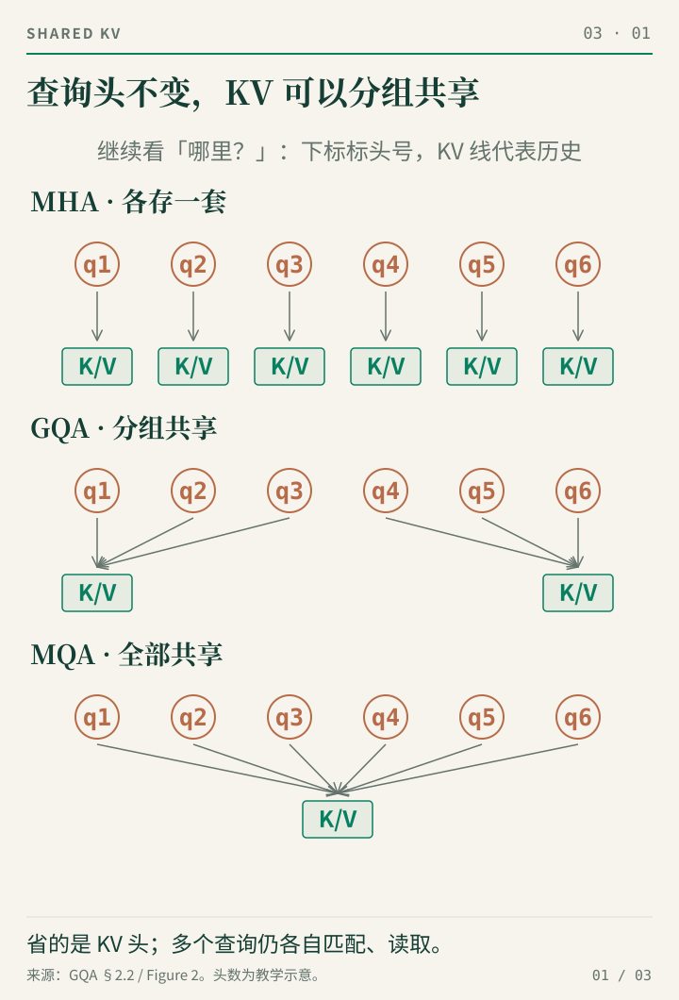</figure>

MQA（Multi-Query Attention，多查询注意力）让所有查询头共用一套 KV；GQA（Grouped-Query Attention，分组查询注意力）让每组查询头共用一套。图的横向是头号，所有查询都来自同一个当前位置，不能把它们看成不同历史位置。

头映射、投影与公式

令 Hq 为查询头数、Hkv 为 KV 头数，r=Hq/Hkv。以从零开始的头号 h，常见连续分组映射为 g(h)=⌊h/r⌋。

qₜ,ₕ ∈ ℝᵈᵏ；kⱼ,g(h) ∈ ℝᵈᵏ；vⱼ,g(h) ∈ ℝᵈᵛ
aₜⱼ,ₕ = softmaxⱼ(qₜ,ₕᵀkⱼ,g(h)/√dₖ + Mₜⱼ)
oₜ,ₕ = Σⱼ aₜⱼ,ₕ vⱼ,g(h)

MHA：Hkv=Hq；MQA：Hkv=1；GQA：两端之间。若输入模型宽度为 d_model，查询投影输出 Hq·dₖ，键和值投影分别输出 Hkv·dₖ 和 Hkv·dᵥ。本文采用相等大小分组，Hq 须能被 Hkv 整除。

共享之后，各头的 Q 仍然不同，匹配权重和读回结果也可以不同。省下的是 KV 的套数和相应存储、搬运机会；减少的是各头独立塑造 K/V 的自由。实际质量与加速取决于训练和实现。

历史仍然一个位置一条。<strong>GQA 改了头轴，没有消掉长度轴。</strong> 下一步，MLA 从另一个方向入手：让一个位置的多头内容 K/V 由更紧凑的表示提供。

看清共享之后，哪些东西相同、哪些仍然不同

<figure id="c3-vf-02-shared-weights">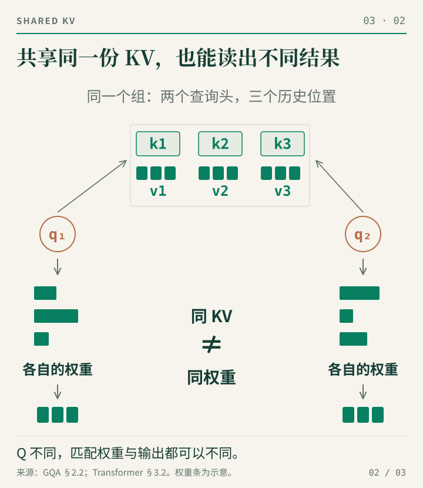</figure>

同一份 KV 不等于同一组注意力权重，查询头仍各自匹配和输出。

共享表示不等于复制输出

每个查询头独立产生一行权重，并独立加权读取同组的 V；之后仍按前述多头读取的方法拼接各头输出。K/V 投影受共享约束，不能因此推断模型总能力必然下降或与 MHA 完全相同。

这是需要训练适配的架构选择。GQA 原论文从 MHA checkpoint 转换时，对组内 K/V 投影做均值初始化，再继续预训练；只改配置名或删除头并不是完整转换。

<figure id="c3-vf-03-cache-axes">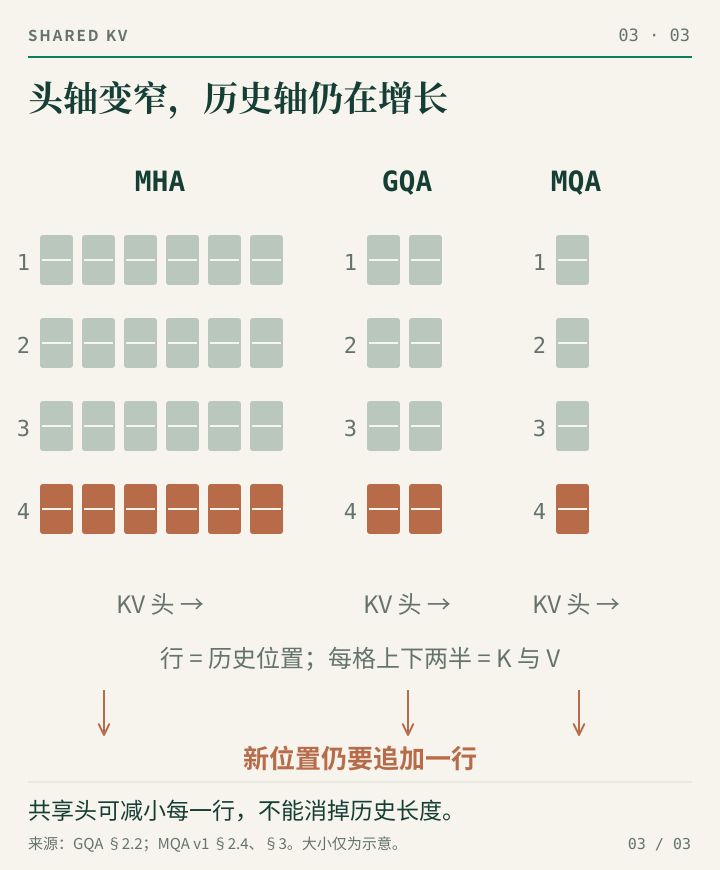</figure>

纵轴是历史位置，横轴是 KV 头。新增位置仍要追加缓存；共享不会让每个查询头的配对工作自动消失。

缓存形状与教学实现

Q：[B,Hq,N,dₖ]
K/V 缓存：[B,Hkv,N,dₖ] / [B,Hkv,N,dᵥ]
每层元素数：B·N·Hkv·(dₖ+dᵥ)

这是张量元素数，不含分页、填充、量化元数据、跨卡复制；没有将它换算成通用的速度倍数。教学实现可以复制 KV 对齐头轴，高效内核应尽量直接复用共享条目。
<pre><code># 一整段、无填充、无前缀缓存的因果教学实现
# q:[B,Hq,N,dk], k:[B,Hkv,N,dk], v:[B,Hkv,N,dv]
r = q.shape[1] // k.shape[1]
assert q.shape[1] % k.shape[1] == 0
k_for_heads = k.repeat_interleave(r, dim=1)
v_for_heads = v.repeat_interleave(r, dim=1)
scores = q @ k_for_heads.transpose(-1, -2)
scores = scores / math.sqrt(q.shape[-1])
future = torch.ones(q.shape[-2], q.shape[-2],
                    device=q.device, dtype=torch.bool).triu(1)
a = scores.masked_fill(future, -float('inf')).softmax(-1)
o = a @ v_for_heads</code></pre>
以上 repeat_interleave 仅用于说明头映射，可能实际复制内存。PyTorch SDPA 提供 enable_gqa；支持范围取决于版本与后端。含前缀缓存的多 token 输入需按实际位置构建掩码，不能照搬这里的方形三角掩码。

查询头没有减少，每个查询头仍要与可见历史匹配；核心配对计算不会仅因减少 KV 头就按同一比例下降。共享首先改变缓存与数据复用条件。

<em>主要来源：<a href="https://arxiv.org/pdf/1911.02150v1#page=5">MQA v1 §3</a>；<a href="https://arxiv.org/pdf/2305.13245">GQA §2、Fig.2</a></em>

<h2 id="chapter-4">四、MLA：压缩 KV，也重排读取</h2>

共享减少了记忆的副本；接下来，还可以改变每个副本的表示。MLA（Multi-Head Latent Attention，多头潜在注意力）为每个位置学习一个较小的 latent（潜在向量），联合承载多头内容 K/V 所需的信息；位置 key 另存。

<figure id="c4-vf-01-latent-cache">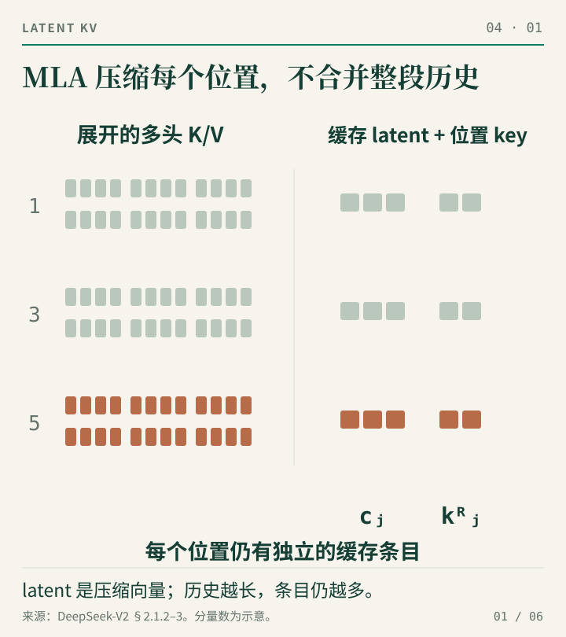</figure>

每一行仍对应一个历史位置。多个头可以从同一个 latent 经各自投影取得内容 K/V；MLA 没有把整段历史揉成一份固定状态。

到底保存哪些张量

cⱼ = Wᴰᴷⱽxⱼ ∈ ℝᵈᶜ
缓存 c：[B,N,d_c]；缓存 kᴿ：[B,N,d_r]
每层元素数：B·N·(d_c+d_r)

同一位置的 latent 联合参数化多个头的内容 K/V；没有取消位置轴 N。压缩维度 d_c、RoPE 维度 d_r 和其他比较配置决定缓存差异，不能把论文某一配置的节省比例当成普遍定律。作者实现对压缩内容还做归一化，此处把归一化后的向量也记作 c。

不过，存的时候紧凑，读的时候若逐条恢复完整多头 KV，就可能把节省又花在计算和搬运上。<strong>MLA 的另一关键，是把投影移到查询和融合结果一侧，让读取直接围绕 latent 进行。</strong>

<figure id="c4-vf-03-absorption">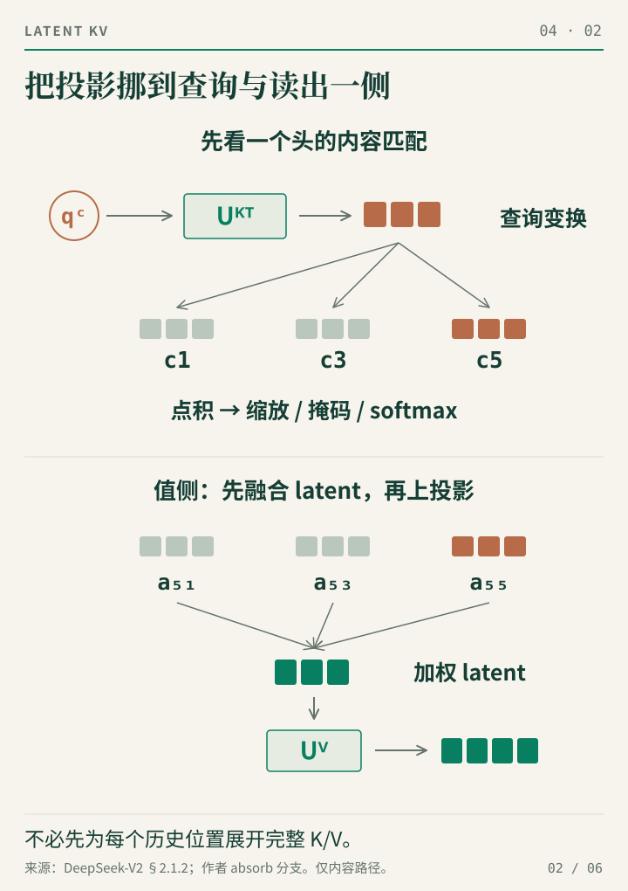</figure>

图只抽出第 1、3、5 位，其余可见位置仍参与归一化，并非稀疏读取。内容 key 的投影可吸收到 query 的变换里；value 的投影可移到加权融合之后。这样，每个头先匹配历史 latent，再融合 latent，最后完成值侧和输出投影。不必先为每个历史位置展开完整内容 K/V。这是同一个 MLA 模块内部的计算重排，不是把任意 MHA 无损变成 MLA。

吸收为什么成立，代码走哪条路

qᶜᵀ(Uᴷcⱼ) = (Uᴷᵀqᶜ)ᵀcⱼ
Σⱼ aⱼ(Uⱽcⱼ) = Uⱽ(Σⱼ aⱼcⱼ)

两个等式分别把内容键的上投影移到查询侧，把值的上投影移到加权融合之后。多头各自得到 zₕ=Σⱼaₕⱼcⱼ；若将输出投影按头分块为 Wᴼₕ，最终输出也可写成 Σₕ(WᴼₕUⱽₕ)zₕ。

等价的是同一个 MLA 模块的展开与吸收计算，不是说 MLA 与任意 MHA 模型等价。不能把吸收跨过 RMSNorm 等非线性；作者代码缓存的正是归一化后的 latent。

DeepSeek-V3 参考代码的 naive 分支保存展开 K/V，absorb 分支保存 latent 与位置 key，查询先乘内容上投影，融合 latent 后再做值投影。Prefill 的多查询可使用展开路径或不同融合内核，Decode 则适合紧凑缓存读取；最终选择依赖实现，不能由方法名推出固定速度。

图中只展开第1、3、5位的几条路径；完整权重在所有可见位置共同归一化，不表示其余位置被屏蔽。

GQA 少存几套，MLA 学习联合表示；两者改动的约束不同，不能仅用“压缩率”判断谁更好。而且，MLA 的历史位置仍在增加。<strong>存得下之后，还要问每次是否必须读遍。</strong>

展开：多头恢复、权重吸收与位置编码

<figure id="c4-vf-02-latent-expand">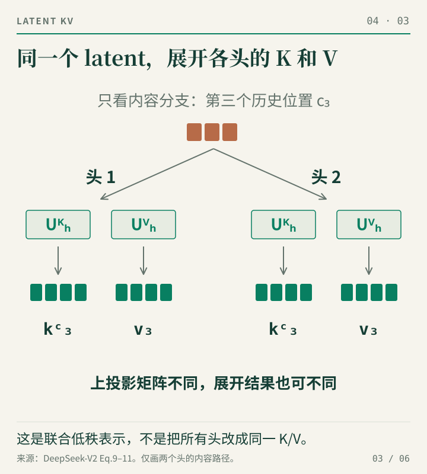</figure>

从一个 latent 展开各头，是理解表示关系的方式；它不意味着高效解码实现必须真的逐条展开。

联合低秩表示是什么

kᶜⱼ,ₕ = Uᴷₕ cⱼ；vⱼ,ₕ = Uⱽₕ cⱼ
Uᴷₕ ∈ ℝᵈᵏᶜ×ᵈᶜ；Uⱽₕ ∈ ℝᵈᵛ×ᵈᶜ

这里用列向量；各头的上投影是整套上投影矩阵中相应的行块。latent 的通道不是人工指定的订单、城市等字段。MLA 也可压缩查询侧，但本章集中解释 KV 压缩及读取。

<figure id="c4-vf-04-rope-obstacle">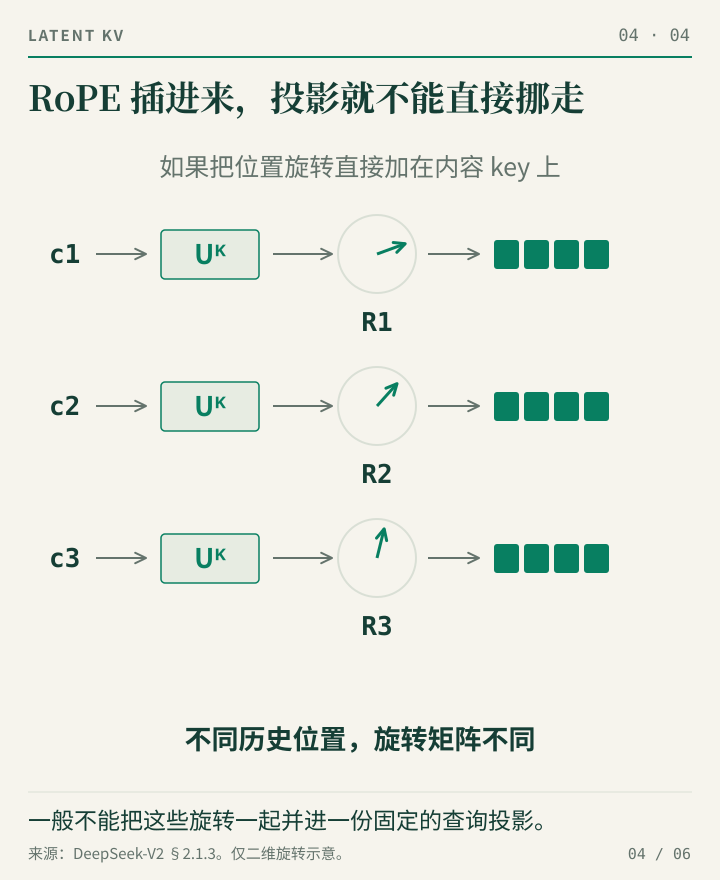</figure>

RoPE（Rotary Position Embedding，旋转位置编码）让匹配包含相对位置信息。若把依赖历史位置的旋转直接插进内容上投影路径，简单的权重吸收会遇到障碍。

矩阵顺序里的障碍

旋转后的内容匹配：qᵢᵀ Rᵢᵀ Rⱼ Uᴷ cⱼ
若挪到查询侧： (Uᴷᵀ Rⱼᵀ Rᵢ qᵢ)ᵀ cⱼ

挪过去的查询变换依赖历史位置 j。一般矩阵不交换，不能把 RᵢᵀRⱼ 从 Uᴷ 旁边随意搬开，变成对所有历史位置通用的一次固定投影。这里解释 DeepSeek-V2 采用解耦 RoPE 的动机，不声称所有可能的结构化位置设计都无法与低秩缓存组合。

<figure id="c4-vf-05-decoupled-rope">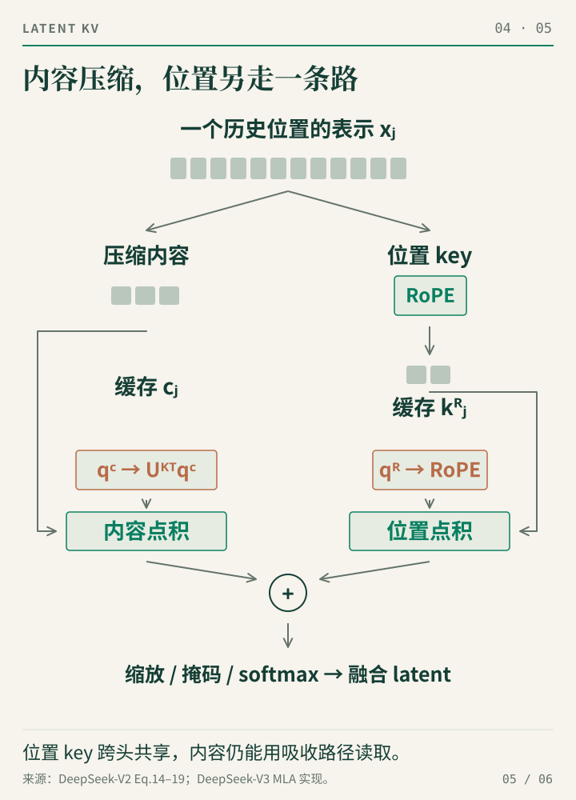</figure>

解耦 RoPE 将内容路径与位置路径分开，两项共同形成分数，再统一归一化。不能让两路各自 softmax 后简单相加。

两项分数怎样合成一次注意力

内容分数 = (Uᴷₕᵀqᶜₜ,ₕ)ᵀcⱼ
位置分数 = qᴿₜ,ₕᵀkᴿⱼ
aₜⱼ,ₕ = softmaxⱼ((内容分数+位置分数)/√(dₖᶜ+d_r)+Mₜⱼ)

qᴿ 与 kᴿ 都已经按各自位置旋转；位置 key 来自该历史位置的输入投影，跨头共享。值路径不需要加这项旋转。缩放的维度是拼接后的内容键维度加 RoPE 维度，不是 latent 缓存宽度 d_c。图省略了投影与归一化细节，但没有从 Attention 输出生成缓存。

<figure id="c2-vf-07-position">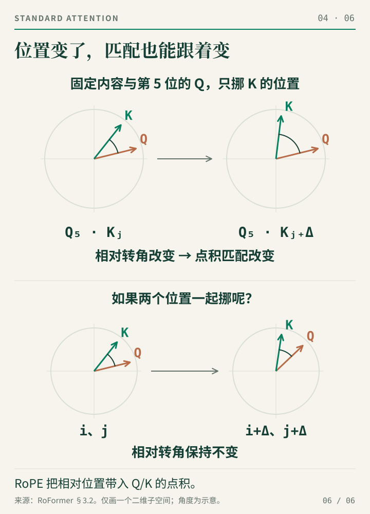</figure>

这里只用一个二维子空间说明旋转。相对转角相同，不意味着所有分数相同；也不能据此断言注意力权重随距离单调下降。

相对旋转怎样进入点积

用行向量，q̂ᵢ=qᵢRᵢᵀ，k̂ⱼ=kⱼRⱼᵀ；点积中出现相对旋转 RᵢᵀRⱼ。常见实现旋转 Q/K，V 留在内容路径。图中仅示意一个二维子空间，未规定注意力权重随距离单调下降。

<em>主要来源：<a href="https://arxiv.org/pdf/2405.04434">DeepSeek-V2 §2.1、Fig.3</a>；<a href="https://github.com/deepseek-ai/DeepSeek-V3/blob/main/inference/model.py">DeepSeek-V3 作者实现</a>；<a href="https://arxiv.org/pdf/2104.09864">RoFormer</a></em>

<h2 id="chapter-5">五、稀疏与压缩：减少本次读取</h2>

前两章让记忆存得更省，但保存下来，不等于每次都值得精读。上下文很长时，即使每条很小，全部读一遍也昂贵。<strong>稀疏注意力减少本次参与精细读取的候选。</strong>

最直接的是滑动窗口：只读附近一段。但远处也可能有用，于是有了按内容选择候选的方法。MoBA（Mixture of Block Attention，块注意力混合）先给历史块打分，再读取选中块内的 token；当前位置所在块的可见部分另行开放。

<figure id="c5-vf-02-moba">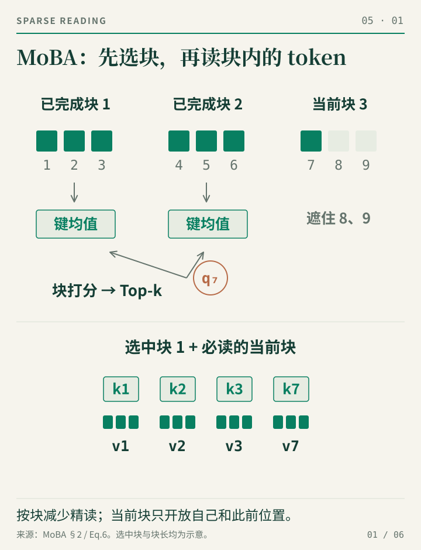</figure>

为看清分块，图把序列延长，查询移到第 7 位。这里省掉的是主 Attention 对未选块的精细读取，选块本身也要付费。DSA（DeepSeek Sparse Attention）进一步用轻量索引器挑选具体位置。块选择与位置选择改变了粒度，不等于能免费找到所有相关内容。

路由、因果与内核合并

块摘要 k̄_b = meanⱼ∈block_b(kⱼ)
块分数 s_b = qₜᵀk̄_b
精读集合 = Top-k 的已完成块 ∪ 当前块的可见部分

块摘要用于选择，精读时仍使用块内原始 K/V。当前块单独强制开放，不能用含未来 token 的整块均值做路由。选中块与当前块上的概率应联合归一化；把各块独立 softmax 后简单平均，会改掉运算。作者内核用 log-sum-exp 合并分块结果。

更大的块利于连续读取，却降低选择粒度；更小的块带来更多路由与调度。论文与作者实现中的块长、Top-k 是配置，不在此推算硬件收益。

还有另一种减法：<strong>先把若干历史位置压成更少的条目，再读取压缩表示。</strong> 压缩改变表示，筛选改变本次访问集合；它们可以一起用。DeepSeek-V4 的 CSA 会进一步筛选压缩条目，HCA 更重度压缩、读取可见压缩池，并结合局部 KV。

<figure id="n05-csa">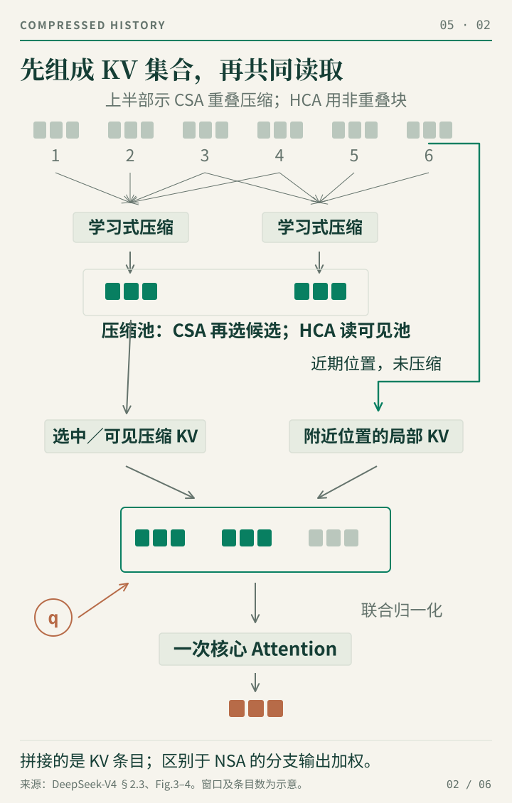</figure>

右侧从近期原始位置分出的路径绕过压缩器，生成未压缩的局部 KV。上半图用 CSA 的重叠窗口演示压缩；HCA 不作重叠压缩。两者在下半图的关键是汇合位置：选中或可见的压缩 KV，与局部 KV 拼接成核心 Attention 的读取集合，再共同归一化。压缩由学出的模块产生，不能理解成随手求平均。CSA/HCA 的层配置和具体压缩比也不同。

归一化边界：KV 拼接与分支输出加权

CSA/HCA 核心读取：Attn(q, concat(K_local,K_hist), concat(V_local,V_hist))
NSA：g_cmp·o_cmp + g_sel·o_sel + g_win·o_win

上式只抽出关键汇合关系，省略各分支投影和压缩器细节。局部 KV 从近期未压缩位置产生，绕过压缩器与压缩池；只有先前已完成的压缩块对当前查询开放。图中 q 位于已画序列之后，所用压缩块已完成；重叠窗口与局部范围不表示具体配置。原模块的部分 RoPE、RMSNorm 与 attention sink 未画出；sink 还参与分母，但不会改变局部与压缩 KV 在同一次核心注意力中共同归一化的关系。CSA 先在压缩池筛候选，HCA 读取可见压缩池；局部条目和历史候选进入同一核心 Attention 的归一化。NSA 则是分支各自读出后门控组合。不能因两张图都有两条线，就把算子当成一样。

原文：<a href="https://arxiv.org/pdf/2606.19348">V4 §2.3、Fig.3–4</a>；<a href="https://arxiv.org/pdf/2502.11089">NSA §3</a>

少读的代价，是候选可能漏掉有用信息；压缩的代价，是原来分开的细节开始共用表示。NSA（Native Sparse Attention，原生稀疏注意力）另采用压缩、选择、局部三路输出的门控融合，详见下方对照，不能与上图的 KV 拼接混为一谈。

走到这里，左边路线已做了三件事：共享头、压小表示、减少访问。<strong>它们仍维护可寻址的历史表示。</strong> 下一章改的是保存历史的方式本身。

展开：窗口、DSA、NSA，以及“少读”和“少存”

<figure id="c5-vf-01-patterns"><svg aria-label="把整片历史，换成规定的读取范围" height="750" role="img" viewbox="0 0 720 750" width="720" xmlns="http://www.w3.org/2000/svg"><rect fill="#F6F4ED" height="750" width="720"></rect><text fill="#64736C" font-family='"PingFang SC","Noto Sans CJK SC",sans-serif' font-size="15" font-weight="600" letter-spacing="2" text-anchor="start" x="28" y="41">SPARSE READING</text><text fill="#64736C" font-family='"SFMono-Regular",Menlo,monospace' font-size="17" font-weight="500" letter-spacing="0" text-anchor="end" x="690" y="41">05 · 03</text><line stroke="#087F61" stroke-width="2" x1="28" x2="692" y1="57" y2="57"></line><text fill="#153E35" font-family='"Songti SC","Noto Serif CJK SC",serif' font-size="35" font-weight="700" letter-spacing="0" text-anchor="start" x="28" y="111">把整片历史，换成规定的读取范围</text><text fill="#64736C" font-family='"PingFang SC","Noto Sans CJK SC",sans-serif' font-size="25" font-weight="500" letter-spacing="0" text-anchor="middle" x="360" y="173">以下延长示意历史，观察当前查询的一行</text><text fill="#153E35" font-family='"PingFang SC","Noto Sans CJK SC",sans-serif' font-size="25" font-weight="600" letter-spacing="0" text-anchor="middle" x="122" y="243">全部历史</text><rect data-c="0" data-pattern="full" data-r="0" fill="#087F61" height="27" rx="2" width="27" x="29" y="282"></rect><rect data-c="1" data-pattern="full" data-r="0" fill="#E7ECE2" height="27" rx="2" width="27" x="60" y="282"></rect><rect data-c="2" data-pattern="full" data-r="0" fill="#E7ECE2" height="27" rx="2" width="27" x="91" y="282"></rect><rect data-c="3" data-pattern="full" data-r="0" fill="#E7ECE2" height="27" rx="2" width="27" x="122" y="282"></rect><rect data-c="4" data-pattern="full" data-r="0" fill="#E7ECE2" height="27" rx="2" width="27" x="153" y="282"></rect><rect data-c="5" data-pattern="full" data-r="0" fill="#E7ECE2" height="27" rx="2" width="27" x="184" y="282"></rect><rect aria-label="选择第1行" data-sparse-query="0" fill="transparent" height="31" role="button" tabindex="0" width="186" x="27" y="280"></rect><rect data-c="0" data-pattern="full" data-r="1" fill="#087F61" height="27" rx="2" width="27" x="29" y="313"></rect><rect data-c="1" data-pattern="full" data-r="1" fill="#087F61" height="27" rx="2" width="27" x="60" y="313"></rect><rect data-c="2" data-pattern="full" data-r="1" fill="#E7ECE2" height="27" rx="2" width="27" x="91" y="313"></rect><rect data-c="3" data-pattern="full" data-r="1" fill="#E7ECE2" height="27" rx="2" width="27" x="122" y="313"></rect><rect data-c="4" data-pattern="full" data-r="1" fill="#E7ECE2" height="27" rx="2" width="27" x="153" y="313"></rect><rect data-c="5" data-pattern="full" data-r="1" fill="#E7ECE2" height="27" rx="2" width="27" x="184" y="313"></rect><rect aria-label="选择第2行" data-sparse-query="1" fill="transparent" height="31" role="button" tabindex="0" width="186" x="27" y="311"></rect><rect data-c="0" data-pattern="full" data-r="2" fill="#087F61" height="27" rx="2" width="27" x="29" y="344"></rect><rect data-c="1" data-pattern="full" data-r="2" fill="#087F61" height="27" rx="2" width="27" x="60" y="344"></rect><rect data-c="2" data-pattern="full" data-r="2" fill="#087F61" height="27" rx="2" width="27" x="91" y="344"></rect><rect data-c="3" data-pattern="full" data-r="2" fill="#E7ECE2" height="27" rx="2" width="27" x="122" y="344"></rect><rect data-c="4" data-pattern="full" data-r="2" fill="#E7ECE2" height="27" rx="2" width="27" x="153" y="344"></rect><rect data-c="5" data-pattern="full" data-r="2" fill="#E7ECE2" height="27" rx="2" width="27" x="184" y="344"></rect><rect aria-label="选择第3行" data-sparse-query="2" fill="transparent" height="31" role="button" tabindex="0" width="186" x="27" y="342"></rect><rect data-c="0" data-pattern="full" data-r="3" fill="#087F61" height="27" rx="2" width="27" x="29" y="375"></rect><rect data-c="1" data-pattern="full" data-r="3" fill="#087F61" height="27" rx="2" width="27" x="60" y="375"></rect><rect data-c="2" data-pattern="full" data-r="3" fill="#087F61" height="27" rx="2" width="27" x="91" y="375"></rect><rect data-c="3" data-pattern="full" data-r="3" fill="#087F61" height="27" rx="2" width="27" x="122" y="375"></rect><rect data-c="4" data-pattern="full" data-r="3" fill="#E7ECE2" height="27" rx="2" width="27" x="153" y="375"></rect><rect data-c="5" data-pattern="full" data-r="3" fill="#E7ECE2" height="27" rx="2" width="27" x="184" y="375"></rect><rect aria-label="选择第4行" data-sparse-query="3" fill="transparent" height="31" role="button" tabindex="0" width="186" x="27" y="373"></rect><rect data-c="0" data-pattern="full" data-r="4" fill="#087F61" height="27" rx="2" width="27" x="29" y="406"></rect><rect data-c="1" data-pattern="full" data-r="4" fill="#087F61" height="27" rx="2" width="27" x="60" y="406"></rect><rect data-c="2" data-pattern="full" data-r="4" fill="#087F61" height="27" rx="2" width="27" x="91" y="406"></rect><rect data-c="3" data-pattern="full" data-r="4" fill="#087F61" height="27" rx="2" width="27" x="122" y="406"></rect><rect data-c="4" data-pattern="full" data-r="4" fill="#087F61" height="27" rx="2" width="27" x="153" y="406"></rect><rect data-c="5" data-pattern="full" data-r="4" fill="#E7ECE2" height="27" rx="2" width="27" x="184" y="406"></rect><rect aria-label="选择第5行" data-sparse-query="4" fill="transparent" height="31" role="button" tabindex="0" width="186" x="27" y="404"></rect><rect data-c="0" data-pattern="full" data-r="5" fill="#B76B48" height="27" rx="2" width="27" x="29" y="437"></rect><rect data-c="1" data-pattern="full" data-r="5" fill="#B76B48" height="27" rx="2" width="27" x="60" y="437"></rect><rect data-c="2" data-pattern="full" data-r="5" fill="#B76B48" height="27" rx="2" width="27" x="91" y="437"></rect><rect data-c="3" data-pattern="full" data-r="5" fill="#B76B48" height="27" rx="2" width="27" x="122" y="437"></rect><rect data-c="4" data-pattern="full" data-r="5" fill="#B76B48" height="27" rx="2" width="27" x="153" y="437"></rect><rect data-c="5" data-pattern="full" data-r="5" fill="#B76B48" height="27" rx="2" width="27" x="184" y="437"></rect><rect aria-label="选择第6行" data-sparse-query="5" fill="transparent" height="31" role="button" tabindex="0" width="186" x="27" y="435"></rect><text fill="#64736C" font-family='"PingFang SC","Noto Sans CJK SC",sans-serif' font-size="24" font-weight="500" letter-spacing="0" text-anchor="middle" x="122" y="523">键 →</text><text fill="#153E35" font-family='"PingFang SC","Noto Sans CJK SC",sans-serif' font-size="25" font-weight="600" letter-spacing="0" text-anchor="middle" x="356" y="243">局部窗口</text><rect data-c="0" data-pattern="window" data-r="0" fill="#087F61" height="27" rx="2" width="27" x="263" y="282"></rect><rect data-c="1" data-pattern="window" data-r="0" fill="#E7ECE2" height="27" rx="2" width="27" x="294" y="282"></rect><rect data-c="2" data-pattern="window" data-r="0" fill="#E7ECE2" height="27" rx="2" width="27" x="325" y="282"></rect><rect data-c="3" data-pattern="window" data-r="0" fill="#E7ECE2" height="27" rx="2" width="27" x="356" y="282"></rect><rect data-c="4" data-pattern="window" data-r="0" fill="#E7ECE2" height="27" rx="2" width="27" x="387" y="282"></rect><rect data-c="5" data-pattern="window" data-r="0" fill="#E7ECE2" height="27" rx="2" width="27" x="418" y="282"></rect><rect aria-label="选择第1行" data-sparse-query="0" fill="transparent" height="31" role="button" tabindex="0" width="186" x="261" y="280"></rect><rect data-c="0" data-pattern="window" data-r="1" fill="#087F61" height="27" rx="2" width="27" x="263" y="313"></rect><rect data-c="1" data-pattern="window" data-r="1" fill="#087F61" height="27" rx="2" width="27" x="294" y="313"></rect><rect data-c="2" data-pattern="window" data-r="1" fill="#E7ECE2" height="27" rx="2" width="27" x="325" y="313"></rect><rect data-c="3" data-pattern="window" data-r="1" fill="#E7ECE2" height="27" rx="2" width="27" x="356" y="313"></rect><rect data-c="4" data-pattern="window" data-r="1" fill="#E7ECE2" height="27" rx="2" width="27" x="387" y="313"></rect><rect data-c="5" data-pattern="window" data-r="1" fill="#E7ECE2" height="27" rx="2" width="27" x="418" y="313"></rect><rect aria-label="选择第2行" data-sparse-query="1" fill="transparent" height="31" role="button" tabindex="0" width="186" x="261" y="311"></rect><rect data-c="0" data-pattern="window" data-r="2" fill="#087F61" height="27" rx="2" width="27" x="263" y="344"></rect><rect data-c="1" data-pattern="window" data-r="2" fill="#087F61" height="27" rx="2" width="27" x="294" y="344"></rect><rect data-c="2" data-pattern="window" data-r="2" fill="#087F61" height="27" rx="2" width="27" x="325" y="344"></rect><rect data-c="3" data-pattern="window" data-r="2" fill="#E7ECE2" height="27" rx="2" width="27" x="356" y="344"></rect><rect data-c="4" data-pattern="window" data-r="2" fill="#E7ECE2" height="27" rx="2" width="27" x="387" y="344"></rect><rect data-c="5" data-pattern="window" data-r="2" fill="#E7ECE2" height="27" rx="2" width="27" x="418" y="344"></rect><rect aria-label="选择第3行" data-sparse-query="2" fill="transparent" height="31" role="button" tabindex="0" width="186" x="261" y="342"></rect><rect data-c="0" data-pattern="window" data-r="3" fill="#E7ECE2" height="27" rx="2" width="27" x="263" y="375"></rect><rect data-c="1" data-pattern="window" data-r="3" fill="#087F61" height="27" rx="2" width="27" x="294" y="375"></rect><rect data-c="2" data-pattern="window" data-r="3" fill="#087F61" height="27" rx="2" width="27" x="325" y="375"></rect><rect data-c="3" data-pattern="window" data-r="3" fill="#087F61" height="27" rx="2" width="27" x="356" y="375"></rect><rect data-c="4" data-pattern="window" data-r="3" fill="#E7ECE2" height="27" rx="2" width="27" x="387" y="375"></rect><rect data-c="5" data-pattern="window" data-r="3" fill="#E7ECE2" height="27" rx="2" width="27" x="418" y="375"></rect><rect aria-label="选择第4行" data-sparse-query="3" fill="transparent" height="31" role="button" tabindex="0" width="186" x="261" y="373"></rect><rect data-c="0" data-pattern="window" data-r="4" fill="#E7ECE2" height="27" rx="2" width="27" x="263" y="406"></rect><rect data-c="1" data-pattern="window" data-r="4" fill="#E7ECE2" height="27" rx="2" width="27" x="294" y="406"></rect><rect data-c="2" data-pattern="window" data-r="4" fill="#087F61" height="27" rx="2" width="27" x="325" y="406"></rect><rect data-c="3" data-pattern="window" data-r="4" fill="#087F61" height="27" rx="2" width="27" x="356" y="406"></rect><rect data-c="4" data-pattern="window" data-r="4" fill="#087F61" height="27" rx="2" width="27" x="387" y="406"></rect><rect data-c="5" data-pattern="window" data-r="4" fill="#E7ECE2" height="27" rx="2" width="27" x="418" y="406"></rect><rect aria-label="选择第5行" data-sparse-query="4" fill="transparent" height="31" role="button" tabindex="0" width="186" x="261" y="404"></rect><rect data-c="0" data-pattern="window" data-r="5" fill="#E7ECE2" height="27" rx="2" width="27" x="263" y="437"></rect><rect data-c="1" data-pattern="window" data-r="5" fill="#E7ECE2" height="27" rx="2" width="27" x="294" y="437"></rect><rect data-c="2" data-pattern="window" data-r="5" fill="#E7ECE2" height="27" rx="2" width="27" x="325" y="437"></rect><rect data-c="3" data-pattern="window" data-r="5" fill="#B76B48" height="27" rx="2" width="27" x="356" y="437"></rect><rect data-c="4" data-pattern="window" data-r="5" fill="#B76B48" height="27" rx="2" width="27" x="387" y="437"></rect><rect data-c="5" data-pattern="window" data-r="5" fill="#B76B48" height="27" rx="2" width="27" x="418" y="437"></rect><rect aria-label="选择第6行" data-sparse-query="5" fill="transparent" height="31" role="button" tabindex="0" width="186" x="261" y="435"></rect><text fill="#64736C" font-family='"PingFang SC","Noto Sans CJK SC",sans-serif' font-size="24" font-weight="500" letter-spacing="0" text-anchor="middle" x="356" y="523">键 →</text><text fill="#153E35" font-family='"PingFang SC","Noto Sans CJK SC",sans-serif' font-size="25" font-weight="600" letter-spacing="0" text-anchor="middle" x="590" y="243">窗口 + 全局点</text><rect data-c="0" data-pattern="global" data-r="0" fill="#087F61" height="27" rx="2" width="27" x="497" y="282"></rect><rect data-c="1" data-pattern="global" data-r="0" fill="#E7ECE2" height="27" rx="2" width="27" x="528" y="282"></rect><rect data-c="2" data-pattern="global" data-r="0" fill="#E7ECE2" height="27" rx="2" width="27" x="559" y="282"></rect><rect data-c="3" data-pattern="global" data-r="0" fill="#E7ECE2" height="27" rx="2" width="27" x="590" y="282"></rect><rect data-c="4" data-pattern="global" data-r="0" fill="#E7ECE2" height="27" rx="2" width="27" x="621" y="282"></rect><rect data-c="5" data-pattern="global" data-r="0" fill="#E7ECE2" height="27" rx="2" width="27" x="652" y="282"></rect><rect aria-label="选择第1行" data-sparse-query="0" fill="transparent" height="31" role="button" tabindex="0" width="186" x="495" y="280"></rect><rect data-c="0" data-pattern="global" data-r="1" fill="#087F61" height="27" rx="2" width="27" x="497" y="313"></rect><rect data-c="1" data-pattern="global" data-r="1" fill="#087F61" height="27" rx="2" width="27" x="528" y="313"></rect><rect data-c="2" data-pattern="global" data-r="1" fill="#E7ECE2" height="27" rx="2" width="27" x="559" y="313"></rect><rect data-c="3" data-pattern="global" data-r="1" fill="#E7ECE2" height="27" rx="2" width="27" x="590" y="313"></rect><rect data-c="4" data-pattern="global" data-r="1" fill="#E7ECE2" height="27" rx="2" width="27" x="621" y="313"></rect><rect data-c="5" data-pattern="global" data-r="1" fill="#E7ECE2" height="27" rx="2" width="27" x="652" y="313"></rect><rect aria-label="选择第2行" data-sparse-query="1" fill="transparent" height="31" role="button" tabindex="0" width="186" x="495" y="311"></rect><rect data-c="0" data-pattern="global" data-r="2" fill="#087F61" height="27" rx="2" width="27" x="497" y="344"></rect><rect data-c="1" data-pattern="global" data-r="2" fill="#087F61" height="27" rx="2" width="27" x="528" y="344"></rect><rect data-c="2" data-pattern="global" data-r="2" fill="#087F61" height="27" rx="2" width="27" x="559" y="344"></rect><rect data-c="3" data-pattern="global" data-r="2" fill="#E7ECE2" height="27" rx="2" width="27" x="590" y="344"></rect><rect data-c="4" data-pattern="global" data-r="2" fill="#E7ECE2" height="27" rx="2" width="27" x="621" y="344"></rect><rect data-c="5" data-pattern="global" data-r="2" fill="#E7ECE2" height="27" rx="2" width="27" x="652" y="344"></rect><rect aria-label="选择第3行" data-sparse-query="2" fill="transparent" height="31" role="button" tabindex="0" width="186" x="495" y="342"></rect><rect data-c="0" data-pattern="global" data-r="3" fill="#087F61" height="27" rx="2" width="27" x="497" y="375"></rect><rect data-c="1" data-pattern="global" data-r="3" fill="#087F61" height="27" rx="2" width="27" x="528" y="375"></rect><rect data-c="2" data-pattern="global" data-r="3" fill="#087F61" height="27" rx="2" width="27" x="559" y="375"></rect><rect data-c="3" data-pattern="global" data-r="3" fill="#087F61" height="27" rx="2" width="27" x="590" y="375"></rect><rect data-c="4" data-pattern="global" data-r="3" fill="#E7ECE2" height="27" rx="2" width="27" x="621" y="375"></rect><rect data-c="5" data-pattern="global" data-r="3" fill="#E7ECE2" height="27" rx="2" width="27" x="652" y="375"></rect><rect aria-label="选择第4行" data-sparse-query="3" fill="transparent" height="31" role="button" tabindex="0" width="186" x="495" y="373"></rect><rect data-c="0" data-pattern="global" data-r="4" fill="#087F61" height="27" rx="2" width="27" x="497" y="406"></rect><rect data-c="1" data-pattern="global" data-r="4" fill="#E7ECE2" height="27" rx="2" width="27" x="528" y="406"></rect><rect data-c="2" data-pattern="global" data-r="4" fill="#087F61" height="27" rx="2" width="27" x="559" y="406"></rect><rect data-c="3" data-pattern="global" data-r="4" fill="#087F61" height="27" rx="2" width="27" x="590" y="406"></rect><rect data-c="4" data-pattern="global" data-r="4" fill="#087F61" height="27" rx="2" width="27" x="621" y="406"></rect><rect data-c="5" data-pattern="global" data-r="4" fill="#E7ECE2" height="27" rx="2" width="27" x="652" y="406"></rect><rect aria-label="选择第5行" data-sparse-query="4" fill="transparent" height="31" role="button" tabindex="0" width="186" x="495" y="404"></rect><rect data-c="0" data-pattern="global" data-r="5" fill="#B76B48" height="27" rx="2" width="27" x="497" y="437"></rect><rect data-c="1" data-pattern="global" data-r="5" fill="#E7ECE2" height="27" rx="2" width="27" x="528" y="437"></rect><rect data-c="2" data-pattern="global" data-r="5" fill="#E7ECE2" height="27" rx="2" width="27" x="559" y="437"></rect><rect data-c="3" data-pattern="global" data-r="5" fill="#B76B48" height="27" rx="2" width="27" x="590" y="437"></rect><rect data-c="4" data-pattern="global" data-r="5" fill="#B76B48" height="27" rx="2" width="27" x="621" y="437"></rect><rect data-c="5" data-pattern="global" data-r="5" fill="#B76B48" height="27" rx="2" width="27" x="652" y="437"></rect><rect aria-label="选择第6行" data-sparse-query="5" fill="transparent" height="31" role="button" tabindex="0" width="186" x="495" y="435"></rect><text fill="#64736C" font-family='"PingFang SC","Noto Sans CJK SC",sans-serif' font-size="24" font-weight="500" letter-spacing="0" text-anchor="middle" x="590" y="523">键 →</text><text fill="#64736C" font-family='"PingFang SC","Noto Sans CJK SC",sans-serif' font-size="24" font-weight="500" letter-spacing="0" text-anchor="middle" x="360" y="571">橙 = 当前查询的可见位置；淡格 = 不读取</text><text fill="#153E35" font-family='"PingFang SC","Noto Sans CJK SC",sans-serif' font-size="28" font-weight="600" letter-spacing="0" text-anchor="middle" x="360" y="628">查询仍不能看到未来</text><line stroke="#D9DFD5" stroke-width="1" x1="28" x2="692" y1="662" y2="662"></line><text fill="#153E35" font-family='"PingFang SC","Noto Sans CJK SC",sans-serif' font-size="23" font-weight="500" letter-spacing="0" text-anchor="start" x="28" y="699">窗口限制距离；全局点提供远处的直接连线。</text><text fill="#64736C" font-family='"PingFang SC","Noto Sans CJK SC",sans-serif' font-size="15" font-weight="400" letter-spacing="0" text-anchor="start" x="28" y="729">来源：Mistral §2；Longformer §3。因果模式为教学示意。</text><text fill="#64736C" font-family='"SFMono-Regular",Menlo,monospace' font-size="15" font-weight="500" letter-spacing="0" text-anchor="end" x="691" y="729">03 / 06</text></svg></figure>

图示因果模式。滑动窗口限制可见范围；全局点给部分远处位置保留通道。纯滚动窗口的缓存可以有界，但它放弃窗口外的直接读取；稀疏选择则常仍需保留未被本次选中的历史。

窗口、全局点与因果范围

局部窗口：max(1,t-w+1) ≤ j ≤ t
窗口 + 全局点：局部集合 ∪ 已开放的全局位置

图中窗口宽度和全局点均为示意，全局点放在第一个位置。它借用局部/全局设计思想并加入因果约束；Longformer 原始编码器的双向模式不同。纯窗口可限制直接访问范围，多层传播仍可能传递更远信息。仅当模型只需有限窗口且没有其他远程分支时，滚动淘汰旧 KV 才可能把缓存长度限制住。

<figure id="c5-vf-04-dsa">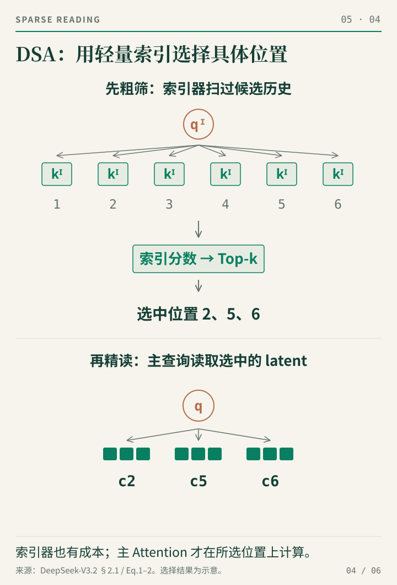</figure>

DSA 先由索引器选择位置，再由主 Attention 读取。索引器也有计算和缓存，主分支少读不等于整网成本同比下降。

索引不是免费，Top-k 也不是主权重

Iₜⱼ = Σₕ wᴵₜ,ₕ ReLU(qᴵₜ,ₕ·kᴵⱼ)
𝒥ₜ = Top-k({Iₜⱼ : j ≤ t})

在 DSA 的 MLA 实例中，主注意力读取所选位置的 latent 与相应位置表示；索引 query/key 使用更轻量的配置。索引 key 本身也是随历史保存的数据，不能只数主 latent 缓存。必须先排除未来、填充和无效位置，再做选择。

原报告区分主注意力的 O(Nk) 配对与索引器的 O(N²) 整段打分；不能把全模块笼统称为线性复杂度。索引低成本依赖更小的头/维度、低精度和内核，而不是没有访问候选历史。

<figure id="c5-vf-03-nsa">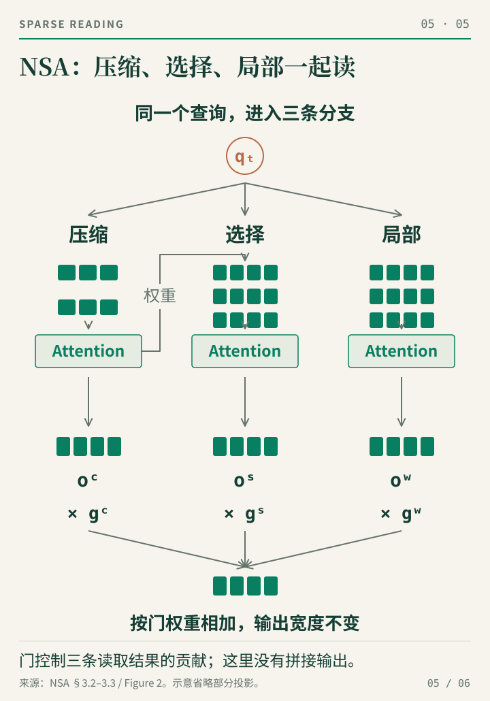</figure>

NSA 的压缩分支不仅输出信息，其权重也用于帮助选择细粒度块；三个分支各自读出，再通过门组合。这与先拼接 KV 后做一次核心读取有不同的归一化边界。

三分支的对象与门

oₜ = gᶜₜ oᶜₜ + gˢₜ oˢₜ + gʷₜ oʷₜ

压缩分支读取学习出的片段级 K/V，选择分支读取选中块的原始 K/V，局部分支读取近期窗口。块的重要性来自压缩分支注意力权重，并可在 GQA 组内聚合。三个输出都保持相同值维度，门在读取之后加权各输出；它不是递归状态的遗忘门。

原论文的门由输入经 MLP 与 sigmoid 得到，不要求三门之和为一。压缩块和选择块可以使用不同划分；图把部分空间关系省略。NSA 的原生训练与内核共同设计，不能只在任意已训练模型上加一个同名 mask，就声称得到相同性能。

<figure id="c5-vf-05-sparse-cache">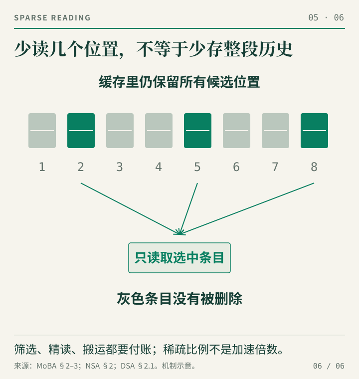</figure>

本次没读，不等于以后不需要，也不等于可以删除。读取集合、持久缓存、物理搬运量应分别核对。

选择、删除与速度的边界

选择只决定本次读哪些条目；淘汰则改变未来还能否读到它们。MoBA、NSA、DSA 的这些读取路径不能自动推出完整 KV 已被删除。索引、压缩、Top-k、gather、连续或离散访存及内核利用率都会影响实际延迟。

原生训练的稀疏架构与推理时近似筛选，也须分别评估。若引用加速结果，需同时注明模型、长度、批量、硬件、精度与训练/Prefill/Decode 边界；本章只给机制示意。

<em>主要来源：<a href="https://arxiv.org/pdf/2502.13189">MoBA §2</a>；<a href="https://arxiv.org/pdf/2502.11089">NSA §3</a>；<a href="https://arxiv.org/pdf/2512.02556">DSA §2.1</a>；<a href="https://arxiv.org/pdf/2606.19348">DeepSeek-V4 §2.3</a>；<a href="https://arxiv.org/pdf/2310.06825">Mistral §2</a></em>

<h2 id="chapter-6">六、Linear Attention：把历史汇入固定状态</h2>

到这里，我们都在管理一份逐位置增长的历史。能否进一步改变记忆的组织方式？第一章刚说“整句塞进固定向量”有瓶颈，为什么现在又回到固定状态？<strong>容量瓶颈没有消失；长上下文的保存和访问成本，促使研究者重新作取舍。</strong>

<figure id="n06-return">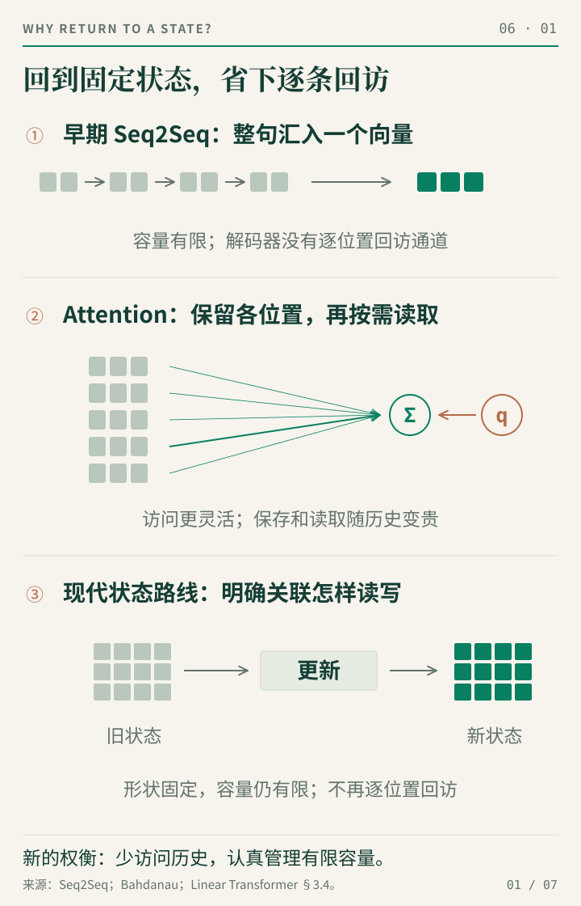</figure>

早期 Seq2Seq 把整句汇入表示；Attention 保留各位置、按需回访。现代状态路线则研究怎样把关联写进有限空间、怎样读出和更新，并寻找适合训练的并行或分块组织。它减少逐位置访问，却也放弃了这条直接回访通道。后面的遗忘与纠错，正是为了管理这个代价。

为什么仍值得研究固定状态？

这是成本与访问自由的权衡，不是声称容量瓶颈已经消失。早期 RNN 的递归更新也能依赖内容，不能把它概括为没有选择能力；现代关联状态强调明确的写入、读取、遗忘与纠错结构，以及相应的并行／分块训练算法。图中第三项概括这条研究路线，纯加法核形式本身还没有遗忘或纠错。

不同机制在训练与任务上有不同取舍；固定形状的递归状态没有恢复 Attention 的任意位置回访接口。参见 <a href="https://arxiv.org/pdf/2006.16236">Linear Transformer §3.4</a>。

Linear Attention（线性注意力）的一种做法，是把 Q/K 变成可用于核匹配的特征，改变匹配规则后重排计算。key 特征与 value 的关联累计到矩阵 S，query 特征再从 S 中读出；向量 z 负责归一化。先用一个只有两个方向的数学教具，看清它为什么能工作。

<figure id="n06-state">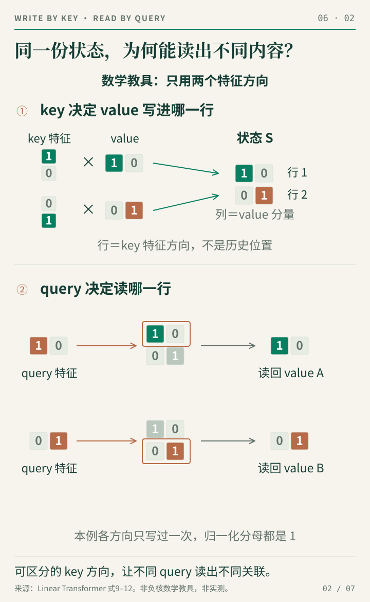</figure>

上半图两次写入：key 的第一个方向点亮，value A 写进第一行；第二个方向点亮，value B 写进第二行。下半图没有换状态：两个 query 各自激活一行，读回不同内容。<strong>行是 key 特征方向，列是 value 分量；没有哪一行专门留给某个历史位置。</strong>

状态更新、归一化与最小递归

教具直接给定映射后的非负特征：k̃₁=(1,0)、k̃₂=(0,1)，value A=(1,0)、B=(0,1)，初始 S=0、z=0。两次写入后 S=[[1,0],[0,1]]，z=(1,1)。query 特征 (1,0) 与 (0,1) 分别读回 A 与 B，分母均为 1。使用非负点积核，所示 query 的分母非零；这不是原论文实验采用的 ELU+1 特征映射的具体输出，也不是标准 softmax 的精确重排。

Sₜ=Sₜ₋₁+φ(kₜ)vₜᵀ；zₜ=zₜ₋₁+φ(kₜ)
oₜ=Sₜᵀφ(qₜ)/(zₜᵀφ(qₜ))

图中矩阵方向为 key×value，φ 是核特征映射。对同一种核形式，这与先算核权重再归一化相应等价；与标准 softmax 相似度通常不等价。固定的是此核心的解码持久状态形状，特征维度、卷积状态和层数仍有成本。完整推导和教学代码见下方外积与归一化图。

原文：<a href="https://arxiv.org/pdf/2006.16236">Linear Transformer §3</a>

下一步继续更新这份 S，形状不变。对于这个核心递推，解码持久状态的大小不随历史长度增加；固定的是大小，不是无限记忆能力。看同一教具中，两个 key 都指向第一行时会怎样。

<figure id="n06-interference">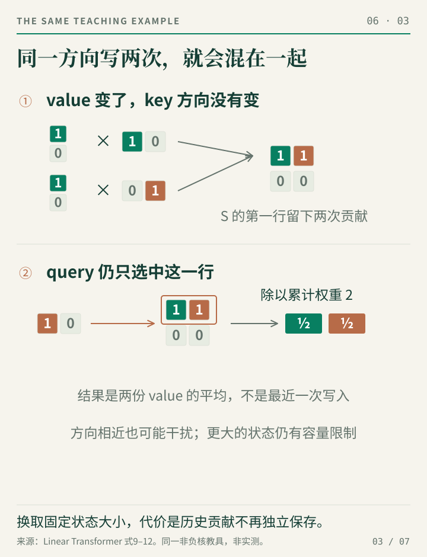</figure>

两次贡献叠在同一行，归一化后读回两份 value 的平均，无法仅凭这次 query 得到最近写入的那份。方向相近也可能互相影响。图里的 0、1 和直角方向是用来讲机制的数学构造，真实特征由训练学出，并不对应人工指定的城市、人物等字段。

同一教具：归一化后为什么得到平均？

k̃₁=k̃₂=q̃=(1,0)，v₁=(1,0)，v₂=(0,1)
S=[[1,1],[0,0]]，z=(2,0)
o=Sᵀq̃/(zᵀq̃)=(½,½)

图仍采用与上一图相同的非负点积核；先累计贡献，再统一归一化，没有把两次写入错误地画成覆盖。本例只证明这个受控情形会混合，不声称所有学习后的 key 都会碰撞，也不把“最新的一条”当作所有任务的目标。一般非正交特征方向可能产生串扰。

原文：<a href="https://arxiv.org/pdf/2006.16236">Linear Transformer 式9–12</a>。

<strong>记忆从追加历史条目，变成了持续编辑有限状态。</strong> 省下逐位置保存，换来有限状态怎样分配容量的问题。 遗忘管旧贡献留下多少，纠错管新关联怎样写进去，下面沿这两条线继续。

推导与实现：为什么能换括号，分母在哪里？

<figure id="c6-vf-01-kernel">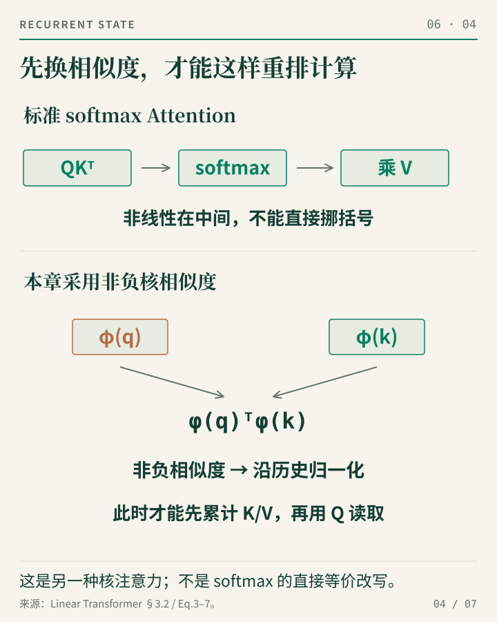</figure>

先改变匹配核，再使用结合律。标准 softmax 的完整运算不能任意交换括号，Linear Attention 也不是标准 softmax 的通用精确加速器。

核匹配与结合律

softmax 相似度：exp(qᵀk/√dₖ)
本章核相似度：κ(q,k)=φ(q)ᵀφ(k) ≥ 0
[Φ(Q)Φ(K)ᵀ]V = Φ(Q)[Φ(K)ᵀV]

最后一行只重排分子；归一化分母也要保留。原 Linear Transformer 的一种选择是 φ(x)=ELU(x)+1，这构造了不同于指数相似度的正值核。本章采用这条归一化核路线，后面的门控与 Delta 更新不应被强行写成完全相同的 softmax。

<figure id="c6-vf-02-outer-product">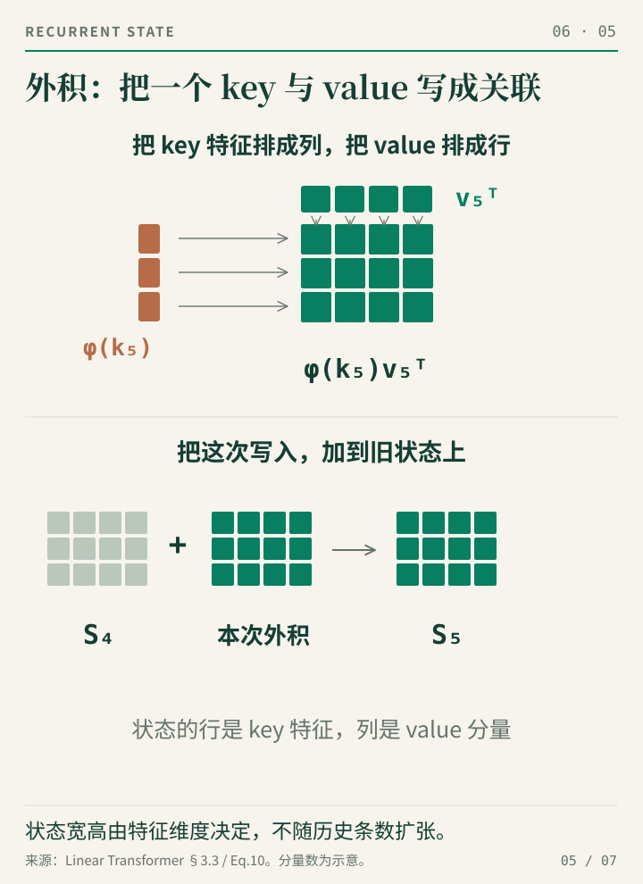</figure>

外积把一个 key 特征向量与一个 value 向量写成关联矩阵。本文统一将 S 画成 key×value；实现若转置存储，读取和广播轴也需相应转置。

状态方向与尺寸

φ(kₜ) ∈ ℝᵐ；vₜ ∈ ℝᵈᵛ
ΔSₜ = φ(kₜ)vₜᵀ ∈ ℝᵐ×ᵈᵛ
Sₜ = Sₜ₋₁ + ΔSₜ

m 是特征映射后的维度，不一定等于原 key 维度 dₖ。第 r 行第 c 列写入的是 φ(kₜ)[r]·vₜ[c]。这些坐标是数值特征，不是人工指定的独立语义槽。本文状态统一采用 m×dᵥ；代码若转置存成 dᵥ×m，读出方向也必须相应转置。

<figure id="c6-vf-03-normalization">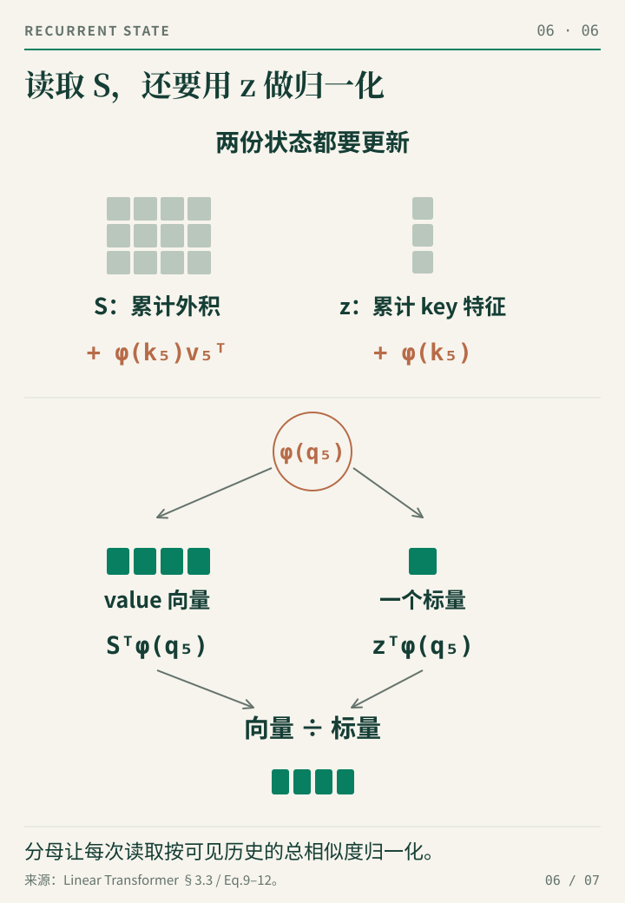</figure>

S 给出加权内容，z 给出总相似度，二者共同形成归一化读出。这里的 z 属于本节核形式，后面的 RetNet、GLA、Delta 系列有各自的规范化方式。

完整递归与单步教学代码

Sₜ = Sₜ₋₁ + φ(kₜ)vₜᵀ
zₜ = zₜ₋₁ + φ(kₜ)
oₜ = Sₜᵀφ(qₜ) / (zₜᵀφ(qₜ))

先写入当前位置，再读取，符合 j≤t 的因果范围。分子是 dᵥ 维向量，分母是标量。数值实现通常保护分母并控制累计精度。下面省略投影、位置编码、门与输出投影，输入已经是单个位置的 Q/K/V。
<pre><code>def linear_step(q, k, v, S, z):
    # q/k:[...,dk], v:[...,dv]
    # 此映射 m=dk；S:[...,m,dv], z:[...,m]，状态为fp32
    phi_q = torch.nn.functional.elu(q.float()) + 1
    phi_k = torch.nn.functional.elu(k.float()) + 1
    S = S + phi_k.unsqueeze(-1) * v.float().unsqueeze(-2)
    z = z + phi_k
    numerator = torch.einsum('...m,...mv-&gt;...v', phi_q, S)
    denominator = (phi_q * z).sum(-1).clamp_min(1e-6)
    return numerator / denominator.unsqueeze(-1), S, z</code></pre>
初始 S、z 为零，按有效位置调用。此代码用于说明更新顺序与维度，未经模型运行或性能测试；它不包含训练反向的内存优化。

<figure id="c6-vf-04-execution">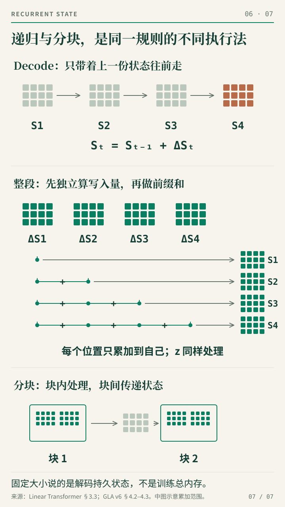</figure>

逐步递推适合解码；训练可用前缀或分块组织计算。线性复杂度的成立条件要包括特征维度、实现和计算范围，不能由名字推出实测快慢。

并行、递归与分块的成本

每层每头的持久状态：m·dᵥ + m 个元素
单步状态更新/读取：O(m·dᵥ)
整段核心状态运算：O(N·m·dᵥ)

以上固定 m、dᵥ，且未计特征映射、投影、层数、批量和 FFN。每个位置的 ΔS/z 写入量可先并行计算，再用前缀扫描形成自己的因果状态；分块把历史状态贡献与块内因果贡献合并，块间仍有状态依赖。图中的不同执行形式不表示自回归生成能同时生成全部未来 token。

解码只需保存当前 S/z。训练若朴素存下每个前缀状态，会占用随 N 增长的激活；原论文提供累积和形式的反向，后续分块算法进一步面向硬件组织。固定状态不等于全网训练内存 O(1)，也不等于对任意特征维度都线性。

这里只借用后续分块研究的执行组织；图中仍是本章的纯累加规则，尚无遗忘门。前缀图展示累加范围，不表示按图逐边展开一个 N×N 的实现。

<em>主要来源：<a href="https://arxiv.org/pdf/2006.16236">Linear Transformers §3、式9–12</a></em>

<h2 id="chapter-7">七、RetNet 与 GLA：遗忘，也要高效计算</h2>

记忆会写还不够，还得让旧贡献适时退场。第六章里，同一方向先写 A=(1,0)，再写 B=(0,1)，两份贡献混在了一起。先让旧 A 变弱，再加入同样的 B，会怎样？

<figure id="n07-example">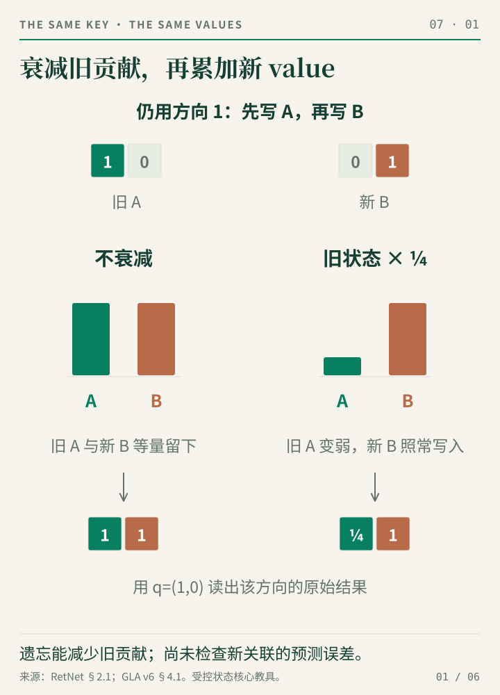</figure>

原来是 (1,1)，衰减后是 (¼,1)：新 B 一样多，旧 A 少了。<strong>从这里开始，图中比较的是规范化、输出门之前的状态核心读出，不再除以第六章的 z。</strong> 同样的 key/value 是共同教具，完整模块的读出处理仍需分别看。

同一教具的衰减更新与读出边界

k=q=e₁=(1,0)ᵀ；A=(1,0)ᵀ；B=(0,1)ᵀ
旧 S=e₁Aᵀ
不衰减：S′=S+e₁Bᵀ，S′ᵀq=(1,1)ᵀ
衰减：S′=¼S+e₁Bᵀ，S′ᵀq=(¼,1)ᵀ

这是裸状态核心的教学对照，不含位置变换、输出规范化、输出门。它不沿用第六章的 z 分母；若另定义带相同衰减的 z，归一化结果会变成 (⅕,⅘)，但这不是本图的读出，也不能把它直接等同完整 RetNet/GLA 层。柱高只表示本例两个 value 分量的贡献。

依据：<a href="https://arxiv.org/pdf/2307.08621">RetNet §2.1</a>；<a href="https://arxiv.org/pdf/2312.06635v6">GLA v6 §4.1，式3</a>。

加入衰减，可以让旧信息逐步退场。RetNet（Retentive Network，保留网络）为不同头设置不同的固定衰减，形成多种时间尺度。

但 RetNet 的重点还在另一件事：<strong>同一套 retention 计算，可以整段并行、逐步递归，也可以块内并行、块间递归。</strong> 这让训练与解码使用适合各自场景的计算组织。

<figure id="n07-retnet">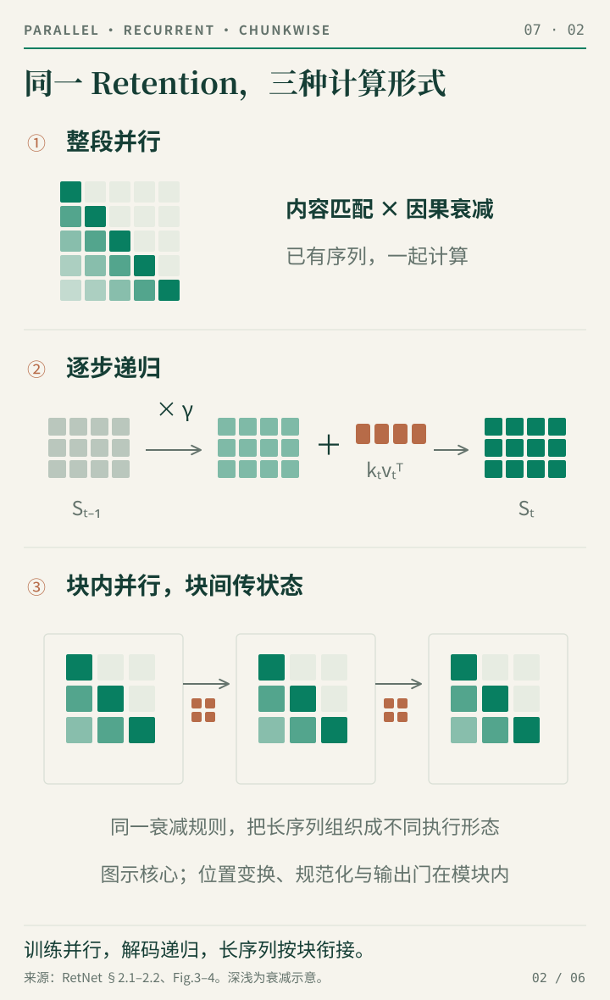</figure>

整段形式显式处理位置之间的内容匹配与衰减；递归形式带着状态往前走；分块形式则让块内计算与跨块状态传递配合。三种形式遵循同一套衰减规则，选择的是怎样组织计算。

三种形式怎样相接：衰减乘积与块边界

核心递归：Sₜ=γSₜ₋₁+kₜvₜᵀ；oₜ=Sₜᵀqₜ
并行核心：O=((QKᵀ)⊙D)V；Dᵢⱼ=γ⁽ⁱ⁻ʲ⁾，j≤i

式子统一改写为本文状态方向，省略相对位置变换等模块细节。块内用因果衰减矩阵，跨块用带适当衰减的边界状态连接。原文还处理 retention 规范化和多尺度头，完整层包含输出门；不能将裸递归与省掉规范化的另一条路径任意混用。

原文：<a href="https://arxiv.org/pdf/2307.08621">RetNet §2.1–2.2、式5–7、Fig.3–4</a>

固定衰减不会根据当前内容调整。GLA（Gated Linear Attention，门控线性注意力）把保留强度交给输入决定，并可沿 key 特征通道分别控制。

GLA 同时设计了适合硬件的分块训练方法。通道门的直观效果，第九章继续用同一组 key/value 演示；这里先记住，门控制的是学出的特征坐标，而非预先指定的语义字段。

遗忘让状态有取舍，却没有直接规定一个新关联应该改成什么。<strong>缩小旧贡献之后再累加，和检查旧关联、只写差额，是两种更新思路。</strong>

展开：RetNet、GLA 的公式与训练组织

<figure id="c7-vf-02-gate-axes">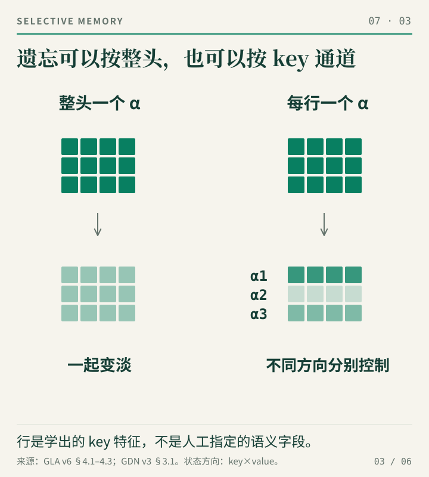</figure>

整头门让所有行使用同一强度；key 侧通道门分别缩放各行。图示的行是特征方向，不是历史条目。

门作用在哪一维

S ∈ ℝ^(d_k×d_v)
α 标量：αS
α 向量：Diag(α)S

本文选择GLA常见的key侧通道门。更一般门可以控制另一轴或两个轴，需读具体实现，不能只靠矩阵画法判断。颜色强弱表示保留强度的教学对照，不是权重/精度测量。

<figure id="n07-gla-chunks">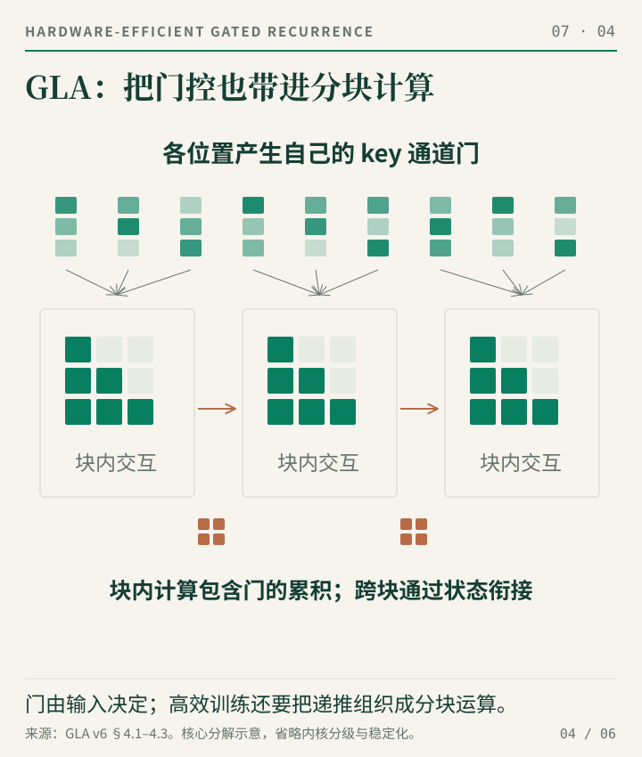</figure>

GLA 把输入相关门的累积也纳入块内交互与跨块状态传递。图只说明核心分解；原论文的内核组织和稳定化细节不能由这些方块全部推出。

门的累积怎样进入并行与分块形式

Sₜ=Diag(αₜ)Sₜ₋₁+kₜvₜᵀ
历史 j 的贡献在 t 时刻包含 ∏ᵤ₌ⱼ₊₁ᵗ Diag(αᵤ)

输入相关的逐通道门让块内位置之间的交互包含门的累积，块边界状态也要经过相应门乘积变换。原文的高效算法进一步用分块和硬件友好的计算组织处理数值稳定与吞吐。图没有展示全部内核分级，单步递归正确也不证明训练内核高效。

原文：<a href="https://arxiv.org/pdf/2312.06635v6">GLA v6 §4.1–4.3</a>

RetNet 的并行、递归、分块形式及规范化见原文式5–7、Fig.3–4。GLA 的块内局部交互与跨块状态传递，见 GLA v6 §4.2–4.3 的分块算法；不能把单步递归代码当成高效训练实现。

相关路线：Mamba 的选择性状态，Mamba-2 的 SSD

<figure id="c7-vf-03-mamba">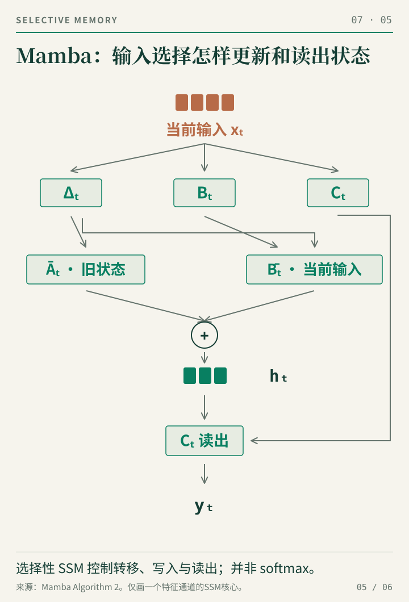</figure>

Mamba 使用选择性 SSM（State Space Model，状态空间模型）。输入影响离散化、写入与读出参数；图中 h 是单通道 SSM 核心，不能直接当作前文关联矩阵 S。高效 selective scan 也是原工作的关键，此图只说明状态选择机制。

SSM参数与完整模块

hₜ = Āₜhₜ₋₁ + B̄ₜxₜ
yₜ = Cₜᵀhₜ

图只画一个输入特征通道的SSM核心。A为学习的结构化参数，Δₜ、Bₜ、Cₜ由输入产生；离散化使Δ同时进入Ā和B̄，不能只把它视为作用在旧状态上的独立门。Mamba完整块还包含短卷积、跳连/输出门等，不等于这个简写。

<figure id="n07-ssd">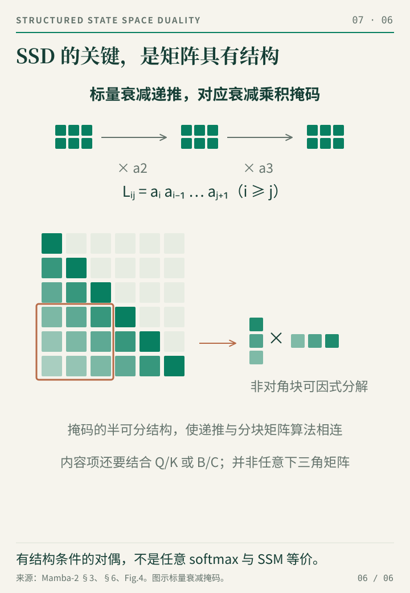</figure>

Mamba-2 的 SSD（State Space Duality，状态空间对偶）连接特定 SSM 与结构化掩码注意力。图中衰减掩码的非对角块可因式分解，结合内容项形成可用分块算法处理的结构。对偶有明确条件，普通下三角形状本身不够，更不意味着任意 softmax Attention 等同 SSM。

结构限制：不只是因果下三角

标量状态转移掩码：Lᵢⱼ=∏ᵤ₌ⱼ₊₁ⁱ aᵤ，j≤i
对应核心：Y=(L⊙QKᵀ)X

图示标量衰减掩码的严格非对角子块可分解；结合内容匹配后，整体低秩结构还取决于状态维度。SSD 利用这种半可分结构组织对角块计算与跨块状态传递。一般 SSM 还可有更广结构；不能将所有下三角矩阵或带 softmax 的注意力都归入同一种等价。

原文：<a href="https://arxiv.org/pdf/2405.21060">Mamba-2 §3、§6、Fig.4</a>

<em>主要来源：<a href="https://arxiv.org/pdf/2307.08621">RetNet §2、Fig.3–4</a>；<a href="https://arxiv.org/pdf/2312.06635v6#page=4">GLA v6 §4.1–4.3</a>；<a href="https://arxiv.org/pdf/2312.00752">Mamba</a>；<a href="https://arxiv.org/pdf/2405.21060">Mamba-2 §3、§6</a></em>

<h2 id="chapter-8">八、DeltaNet：用误差修正旧关联</h2>

遗忘调节旧内容的保留量；更新还可以利用记忆已经保存的关联。如果新 value 就是这次想写入的目标，能不能先问一句：状态现在已经记成什么样了？Delta 更新先用本次写入的 key 从旧状态读出预测，拿目标减去预测，再把这个差额写回。

<figure id="n08-delta">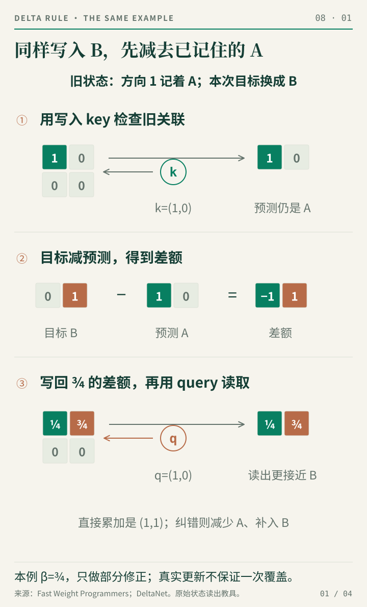</figure>

仍从“方向 1 记着 A”出发，这次目标是 B。预测为 A，差额就是 B−A；取写入强度 β=¾，结果从 (1,0) 走到 (¼,¾)，更接近 B。直接累加得到的则是 (1,1)。<strong>纠错用写入 key 检查旧关联；更新之后，query 才读取新状态。</strong> 图中二者碰巧都是 (1,0)，真实模型并不要求它们相同。

Delta 规则与梯度更新的关系

v̂ₜ=Sₜ₋₁ᵀkₜ；δₜ=vₜ−v̂ₜ
Sₜ=Sₜ₋₁+βₜkₜδₜᵀ；oₜ=Sₜᵀqₜ

该核心可看作用平方预测误差对关联矩阵做一步梯度更新。kₜ 用于写入与检查旧关联，qₜ 用于读出；二者不能混成同一个符号。对相关 key 的影响还取决于内积，有限容量问题仍在。并行训练需专门处理状态依赖，不能直接把 t 维循环去掉。

原文：<a href="https://arxiv.org/pdf/2102.11174">Fast Weight Programmers</a>；<a href="https://arxiv.org/pdf/2406.06484">Parallelizing DeltaNet</a>

本图固定 k=q=e₁，旧状态 e₁Aᵀ，目标 B，β=¾；δ=B−A=(−1,1)ᵀ，因此新状态第一行为 (¼,¾)，第二行为 (0,0)。读出不含第六章的 z 分母。β 是受控教具值，不是测得的真实门值，也不表示真实任务会一次更新成功。

Delta 规则本身有更早的学习理论历史。2021 年的 fast weight 工作把这种更新用于线性 Transformer 的关联记忆；后续 DeltaNet 工作进一步研究高效并行训练。这里按设计思路展开，不把 2024 年的并行化论文当成规则的发明时间。

遗忘与纠错可以一起做。GDN（Gated DeltaNet，门控 Delta 网络）先衰减旧状态，再以衰减后的状态预测、计算差额并修正。

<figure id="c8-vf-03-gated-delta">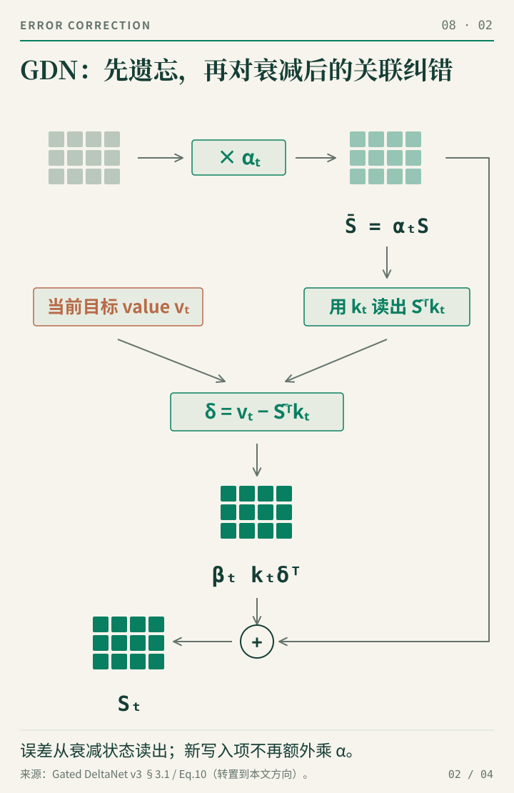</figure>

先衰减已经改变了关联，所以误差必须基于这份衰减状态计算。遗忘和纠错各管一步，也共同影响后续读出。它们没有消除有限容量：修改一个方向，相关 key 的方向仍可能受影响。

GDN的门控顺序

S̄ₜ = αₜSₜ₋₁
δₜ = vₜ − S̄ₜᵀkₜ
Sₜ = S̄ₜ + βₜkₜδₜᵀ
     = αₜ(I − βₜkₜkₜᵀ)Sₜ₋₁ + βₜkₜvₜᵀ

衰减的是旧状态；误差读出也必须使用衰减后的状态。若用未衰减的旧读出构造误差，再把新写入整体乘α，就会改变原式。实际完整模块可另有输出门与短卷积，图只聚焦此状态核心。

版本定位：<a href="https://arxiv.org/pdf/2412.06464v3#page=4">Gated DeltaNet v3 §3.1、式10</a>，按本文 key×value 方向改写。

GDN 对整头使用一个衰减强度。若想保留某些特征、同时淡化另一些，就接到了下一章的问题。

展开：Delta 与直接累加的区别

<figure id="c8-vf-02-delta-compare">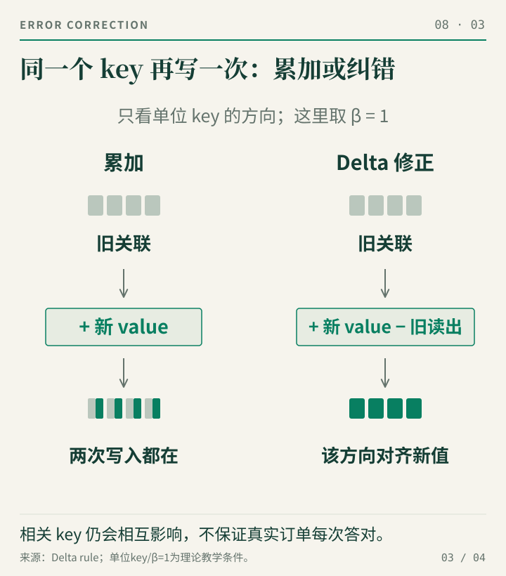</figure>

仅在单位 key、写入强度 β=1 等教学条件下，该方向一次更新能对齐新 value。真实模型的门、key 相似性和后续网络都有影响，不能由这张图保证一次真实对话就更新正确。

为何教学例能对齐，真实情况为何不同

Sₜᵀk = Sₜ₋₁ᵀk + β(v − Sₜ₋₁ᵀk)·(kᵀk)

当k单位归一化且β=1，该方向读回新v；这是理论教学条件，不代表sigmoid门每次都取到一。对另一个k′，状态改动还会乘上kᵀk′，所以相关key会受到影响。向量方向与更新规则有意义，但不自动保证真实文本的地址更新被全模型理解正确。

<figure id="c8-vf-01-delta-flow">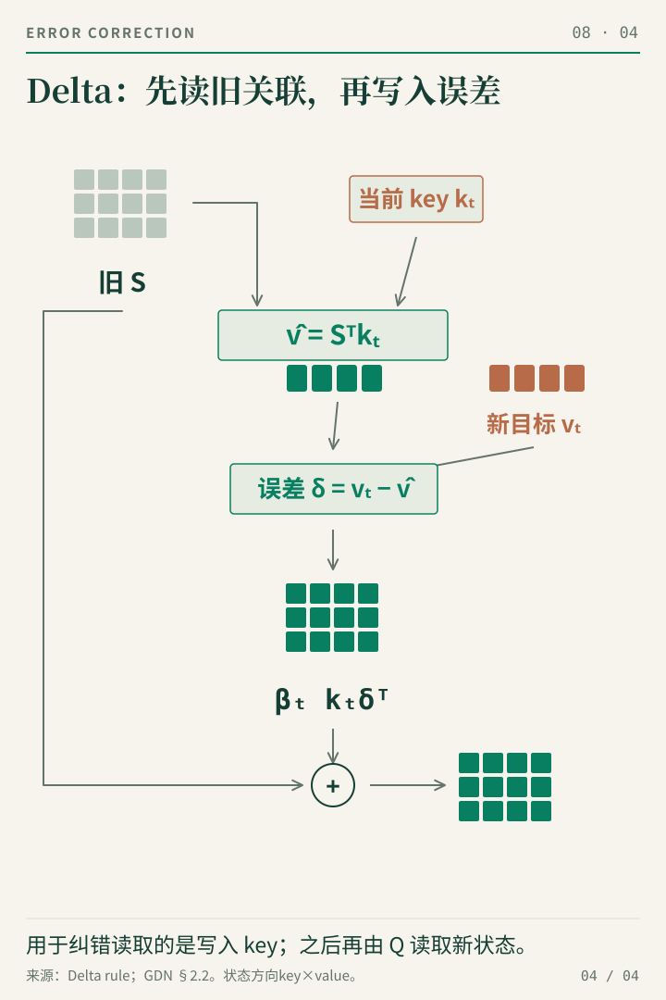</figure>

更新核心采用 key×value 方向；读旧值、计算残差、写回三步需使用同一时间定义。训练还需要处理状态更新之间的依赖，原文的分块并行方法不是把时间步直接独立展开。

Delta规则与状态方向

v̂ₜ = Sₜ₋₁ᵀ kₜ
δₜ = vₜ − v̂ₜ
Sₜ = Sₜ₋₁ + βₜkₜδₜᵀ
oₜ = Sₜᵀqₜ

这里采用Delta模块自己的Q/K处理，不能直接把第六章ELU+1特征与归一化分母原封不动搬来。β是写入强度；典型实现使用Q/K归一化与稳定状态精度。GDN原论文状态为value×key，本文已转置到key×value，所有乘法方向相应改变。

<em>主要来源：<a href="https://arxiv.org/pdf/2102.11174">Fast Weight Programmers 2021</a>；<a href="https://arxiv.org/pdf/2406.06484">Parallelizing DeltaNet 2024</a>；<a href="https://arxiv.org/pdf/2412.06464v3#page=4">Gated DeltaNet v3 §3.1、式10</a></em>

<h2 id="chapter-9">九、KDA：把遗忘细化到特征通道</h2>

同一块记忆，不同方向未必需要同时遗忘。KDA（Kimi Delta Attention）保留 GDN 的纠错思路，把遗忘从整头一个强度，细化到 key 特征通道各自的强度。

<figure id="n09-kda">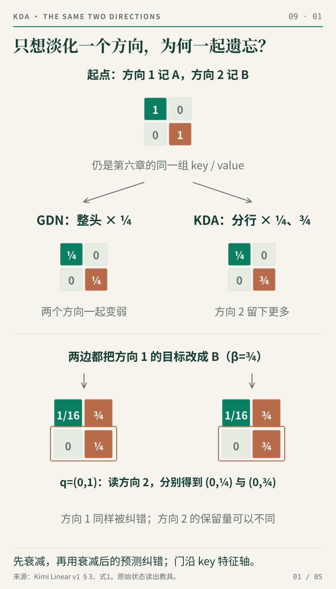</figure>

回到第六章的两个方向：方向 1 记 A，方向 2 记 B。现在要修改方向 1，却希望方向 2 少忘一些。GDN 的整头衰减让两行一起乘 ¼；KDA 可以让两行分别乘 ¼、¾。随后，两边都对方向 1 做同样的 Delta 修正。

按通道衰减之后，误差基于哪份状态？

Dₜ=Diag(αₜ)；S̄ₜ=DₜSₜ₋₁
δₜ=vₜ−S̄ₜᵀkₜ
Sₜ=S̄ₜ+βₜkₜδₜᵀ；oₜ=Sₜᵀqₜ

等价地可写为 Sₜ=(I−βₜkₜkₜᵀ)DₜSₜ₋₁+βₜkₜvₜᵀ。Dₜ 在此沿 key 特征轴作用，通常不能和擦除矩阵交换顺序。原文或实现可能使用转置状态，必须连同输出式一起核对。短卷积和输出门见模块图，chunk 算法见原文 §3.1。

原文：<a href="https://arxiv.org/pdf/2510.26692">Kimi Linear §3、式1</a>

连续教具从 S=I₂ 开始。GDN 的 D=¼I，KDA 的 D=Diag(¼,¾)；都用 k=e₁、v=B=e₂、β=¾。衰减后的预测均为 (¼,0)，δ=(−¼,1)；更新后两边第一行均为 (1/16,¾)，第二行分别为 (0,¼)、(0,¾)。q=e₂ 只读取第二行。数值是受控数学例子，完整模块另有规范化、卷积和输出门；实际特征并非人工语义字段。

用 q=(0,1) 回读方向 2，GDN 剩下 (0,¼)，KDA 则留下 (0,¾)。<strong>纠错方式相同，另一个方向留下多少可以不同。</strong> 预测依然必须来自衰减后的状态；相近方向还可能互相影响，这个正交教具不代表真实特征互不干扰。

通道遗忘在 GLA 中已经出现，不能说是 KDA 首创。把遗忘粒度和更新规则放到两条轴上，关系更容易看清。

<figure id="n09-family">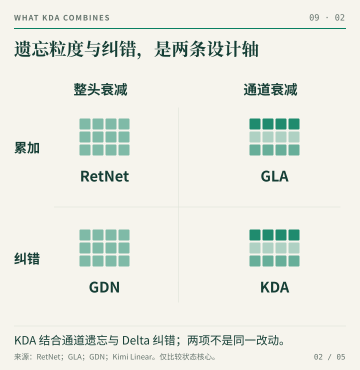</figure>

GLA 是通道门控加累加更新；GDN 是整头衰减加 Delta 纠错；KDA 将通道衰减与 Delta 纠错结合。这里只比较状态核心，几种完整模块还有各自的投影、规范化、输出门和执行算法。

这张比较表没有包含什么？

图按“旧状态的衰减粒度”和“新关联的写入规则”比较简化核心。RetNet 还有多尺度保留和三种执行形式，GLA 有硬件高效门控训练，GDN/KDA 有各自模块与分块算法。两因素相似不代表完整网络等价，也不能从格子位置推出质量或速度排名。

原文：RetNet；GLA；Gated DeltaNet；Kimi Linear

更细的门提供了更灵活的编辑方式，没有把固定状态变成无限容量。两条路线的根本取舍仍在：逐位置条目便于再次访问，固定状态把长期运行成本约束在特征维度上。为什么不让它们在一个网络里协作？

展开：矩阵方向、模块状态与分块实现

<figure id="c9-vf-01-row-decay">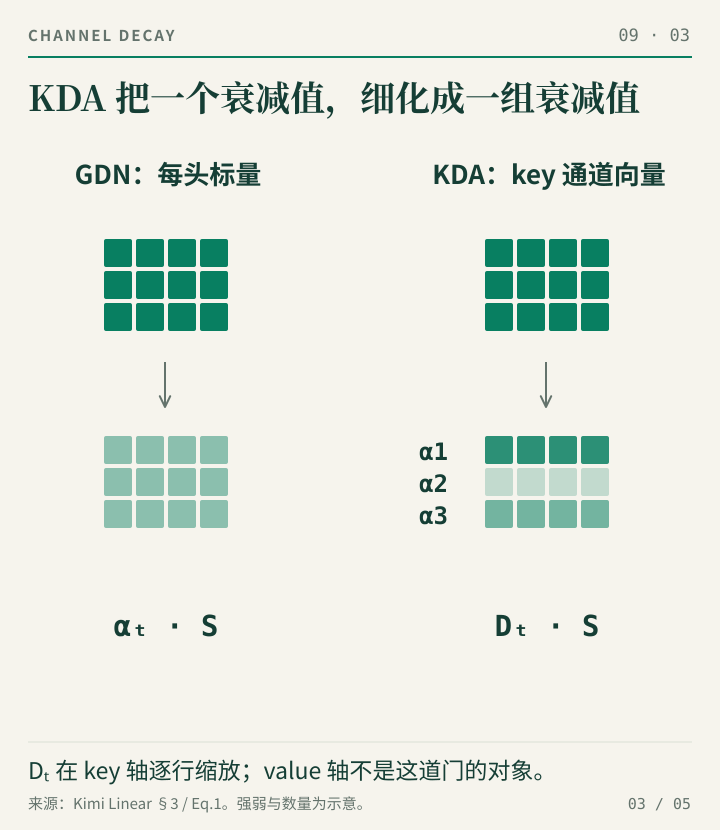</figure>

本文的 S 是 key×value，所以 key 通道门沿行作用。代码若把 S 存成 value×key，广播方向必须一起变。

KDA的状态转移

Dₜ = Diag(αₜ) ∈ ℝ^(d_k×d_k)
Sₜ = (I − βₜkₜkₜᵀ)DₜSₜ₋₁ + βₜkₜvₜᵀ

D沿key轴广播。对一般通道门，(I−βkkᵀ)D与D(I−βkkᵀ)不交换；把门移到另一侧或把读差改成旧S，会变成不同更新。退化为所有key通道同一α时，得到对应标量门控形式。

<figure id="c9-vf-02-update-order">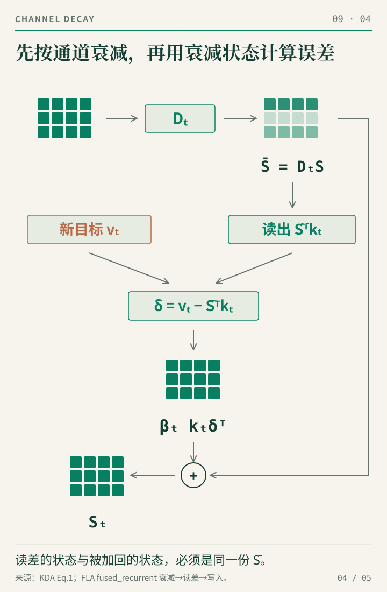</figure>

先衰减，再用衰减状态计算误差。矩阵顺序通常不可交换，不能把旧状态的预测直接放到衰减后使用。

最小递归教学实现

<pre><code>def kda_step(q, k, v, S, alpha, beta):
    # q/k:[...,dk], v:[...,dv], S:[...,dk,dv]
    # alpha:[...,dk], beta:[...]
    # 输入已完成投影/QK归一化；图中忽略Q的尺度因子
    decayed = S.float() * alpha.float().unsqueeze(-1)
    prediction = torch.einsum('...k,...kv-&gt;...v', k.float(), decayed)
    residual = v.float() - prediction
    edit = k.float().unsqueeze(-1) * residual.unsqueeze(-2)
    updated = decayed + beta.float()[..., None, None] * edit
    out = torch.einsum('...k,...kv-&gt;...v', q.float(), updated)
    return out, updated</code></pre>
这是公式教学代码，未运行模型或做性能测量。FLA递归核先在key轴乘exp(g)，再求当前key的旧读出与value残差，乘β后写入，最后用query读出；同时支持状态转置布局和其他可选扩展，不能把当前主分支所有选项归为原论文配置。

<figure id="c9-vf-03-module-state">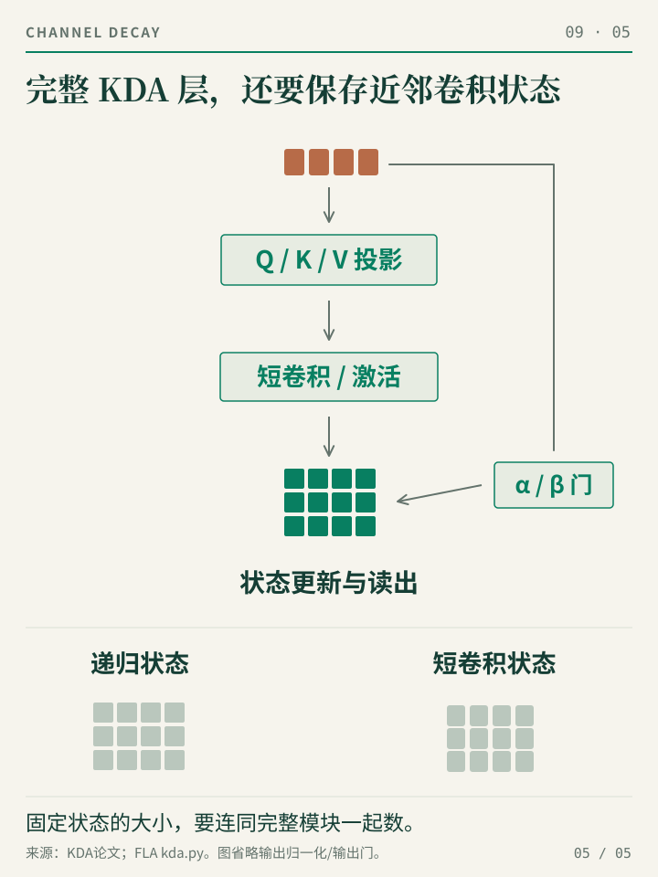</figure>

完整 KDA 层还包含短卷积、规范化与输出门，部署时也要保存近邻卷积状态。单步公式讲清了机制；原论文 §3.1 的高效分块算法才回答训练怎样做，不能由几行 Python 推出其性能。

实现中的状态、精度与分块

FLA层可维护recurrent_state与conv_state；短卷积保存有限近邻，递归矩阵保存关联。训练/长段可走chunk路径，单步可走fused_recurrent路径。常用对数衰减表示避免长乘积精度问题；累计状态常以fp32计算，但具体保存/消费精度需核对部署实现。固定指相对序列长度N，不指相对层数、批量、头数和特征维度。

<em>主要来源：<a href="https://arxiv.org/pdf/2510.26692">Kimi Linear §3、式1</a>；<a href="https://github.com/fla-org/flash-linear-attention/blob/main/fla/layers/kda.py">FLA KDA 层</a></em>

<h2 id="chapter-10">十、Hybrid：让不同记忆协作</h2>

现在，读、写、遗忘都有了各自的设计。但一种记忆形式仍难包办全部需求：固定状态不再保存可逐位置回访的历史列表；逐位置注意力又持续付出历史长度成本。Hybrid（混合架构）让两类通道共同承担上下文交互，而不要求每层都作同一种选择。

Kimi K3 的一个重复单元是三层 KDA 接一层门控 MLA，末端另有门控 MLA。沿模型深度看，表示依次经过这些层；每层保存自己的运行状态。

<figure id="n10-hybrid">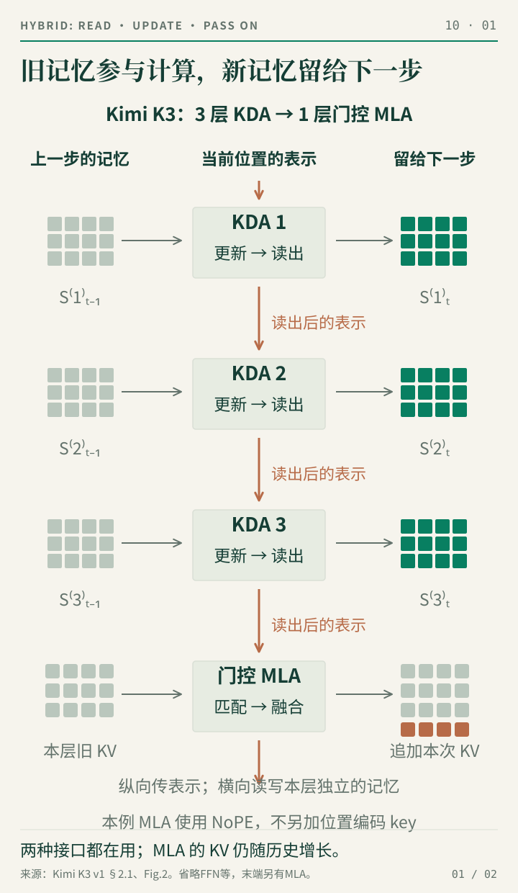</figure>

横向看，每层都取用自己的旧记忆：KDA 先更新状态，再由 query 读出；MLA 用当前 query 匹配历史 KV，并追加本次 KV。纵向看，读出后的表示继续进入下一层。三层 KDA 有三份独立的 S，MLA 又有自己的逐位置缓存，因此整网仍含随历史长度增长的部分。

层状态各自持有，长度成本怎样计算？

整网持久状态 = Σ状态层的固定状态 + Σ历史层的缓存 + 其他状态

K3 重复三层 KDA 加一层门控 MLA，末端另有 MLA。横向箭头区分旧记忆输入和更新后的持久对象；纵向箭头是当前位置表示沿层深流动。KDA 用旧 S 和当前投影先更新，再读出；MLA 生成本次 K/V，连同可见旧 KV 参与当前读取，追加后供后续位置使用。MLA 右侧灰色旧条目与橙色新条目只是缓存追加示意，不是从 Attention 输出投影生成 KV。图仅画时间混合核心，不画整块的 FFN、残差等。MLA 保留逐位置历史，所以整网仍有长度相关项；纯滚动窗口等其他混合设计则需按实际缓存生命周期计算。

原文：<a href="https://arxiv.org/pdf/2607.24653v1">Kimi K3 §2.1、Fig.2</a>

K3 具体变体：KDA 的对数衰减有下界，输出门改为满秩投影；全部 MLA 层采用 NoPE，不显式给 Q/K 编码位置，也不照搬独立 RoPE key 缓存。其 MLA 满秩输出门在读出后、输出投影前。见 K3 v1 §2.1.1 式5–6、Fig.3，§2.1.2 式7。

K3 也调整了模块本身：<strong>KDA 沿用通道遗忘加 Delta 纠错，改变遗忘参数化与输出门；MLA 使用 NoPE（No Position Encoding，不显式编码位置），不照搬第四章另存位置 key 的形式。</strong> 这些差异影响具体实现，改动与原因放在下面。

组合带来了不同的信息接口，也加上了各自的资源成本。它不保证“状态层负责概括，MLA 就能精确找回每个细节”；哪些层、以什么比例、放在哪里，仍要靠训练和任务评测决定。

也有层内多分支的混合，例如前文 NSA。但“层间组合”“层内组合”不是同一布局，需先看清组合的位置。至此，保存和读取的两条路线接到了一起。接下来换一条轴：选定了运算，怎样执行才少搬数据？

K3 的 KDA／MLA，具体改了哪里？

K3 v1 §2.1.1 保留同一状态递推：先通道衰减，再按预测误差修正。变化在门的参数化：Kimi Linear 的每步对数衰减 g 用负 Softplus，可趋向负无穷；K3 用带下界的 sigmoid，再令 α=exp(g)。它约束分块内累积衰减的数值范围，让对角 tile 也能使用稠密 Tensor Core 矩阵乘法；这不是由单步递归式直接得出的普遍加速结论。

K3 还将 KDA 的低秩输出门改为输入相关的满秩投影，在逐头 RMSNorm 后、输出投影前调节读出。MLA 也采用满秩输出门；这里的“满秩”描述门投影的参数化，不表示遗忘门或状态矩阵变成了另一种更新规则。

K3 v1 §2.1.2 的全部 MLA 层使用 NoPE：Q/K 不显式加入位置编码，序列中的位置与近期性混合由穿插的 KDA 层提供。它仍然逐位置保存 latent、进行全局内容匹配，但不应把 DeepSeek-V2 的独立 RoPE key 缓存项原样加进去。

两种门不能混淆：遗忘门与输出门

<figure id="n10-outputgate">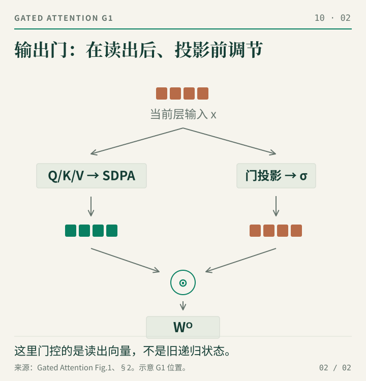</figure>

Gated Attention 的 G1 在 SDPA（Scaled Dot-Product Attention，缩放点积注意力）之后、输出投影 Wᴼ 之前，用输入产生的门逐元素调节读出。图示具体 G1 位置，不代表全部门控设计。

G1 的精确位置与输入相关门

h=SDPA(Q,K,V)
g=σ(W_gx)；o=Wᴼ(h⊙g)

这里用列向量投影习惯表达，实际代码的乘法方向依布局而变。门可以按头或按元素参数化；原文比较了多种门位置，图示效果最突出的 G1。门调节的是 Attention 读出，不能替代旧状态的遗忘门。

原文：<a href="https://arxiv.org/pdf/2505.06708">Gated Attention Fig.1、§2</a>

它作用在本次读出的向量上；KDA 的遗忘门作用在旧递归状态上。两种门可以同时存在，不能仅因都有 gate 就归为同一机制。

<em>主要来源：<a href="https://arxiv.org/pdf/2607.24653v1#page=4">Kimi K3 v1 §2.1、式5–7、Fig.2–3</a>；<a href="https://arxiv.org/pdf/2505.06708">Gated Attention §2、Fig.1</a></em>

<h2 id="chapter-11">十一、FlashAttention：少搬数据，完成同一项计算</h2>

记忆系统还要落到真实硬件上。前面的设计改变了保存对象、访问集合或状态更新；执行层继续决定这些对象怎样搬运、计算和管理。FlashAttention 主要回答执行问题：标准 Attention 计算中的完整分数、权重矩阵，能否不在显存里反复落地？

<figure id="c11-vf-01-flash-io"><svg aria-label="FlashAttention 分块，不存完整中间矩阵" height="1040" role="img" viewbox="0 0 720 1040" width="720" xmlns="http://www.w3.org/2000/svg"><rect fill="#F6F4ED" height="1040" width="720"></rect><text fill="#64736C" font-family='"PingFang SC","Noto Sans CJK SC",sans-serif' font-size="15" font-weight="600" letter-spacing="2" text-anchor="start" x="28" y="41">HARDWARE EXECUTION</text><text fill="#64736C" font-family='"SFMono-Regular",Menlo,monospace' font-size="17" font-weight="500" letter-spacing="0" text-anchor="end" x="690" y="41">11 · 01</text><line stroke="#087F61" stroke-width="2" x1="28" x2="692" y1="57" y2="57"></line><text fill="#153E35" font-family='"Songti SC","Noto Serif CJK SC",serif' font-size="35" font-weight="700" letter-spacing="0" text-anchor="start" x="28" y="111">FlashAttention 分块，不存完整中间矩阵</text><text fill="#153E35" font-family='"PingFang SC","Noto Sans CJK SC",sans-serif' font-size="28" font-weight="600" letter-spacing="0" text-anchor="middle" x="172" y="177">常规展开</text><text fill="#153E35" font-family='"PingFang SC","Noto Sans CJK SC",sans-serif' font-size="28" font-weight="600" letter-spacing="0" text-anchor="middle" x="548" y="177">分块执行</text><rect fill="#E7ECE2" height="61" rx="4" stroke="#64736C" stroke-width="1.5" width="231" x="64" y="216"></rect><text fill="#64736C" font-family='"PingFang SC","Noto Sans CJK SC",sans-serif' font-size="25" font-weight="600" letter-spacing="0" text-anchor="middle" x="179.5" y="255.25">HBM：Q / K / V</text><rect fill="#E7ECE2" height="61" rx="4" stroke="#64736C" stroke-width="1.5" width="231" x="439" y="216"></rect><text fill="#64736C" font-family='"PingFang SC","Noto Sans CJK SC",sans-serif' font-size="25" font-weight="600" letter-spacing="0" text-anchor="middle" x="554.5" y="255.25">HBM：Q / K / V</text><line stroke="#64736C" stroke-width="2" x1="177" x2="177" y1="292" y2="331"></line><path d="M171.78041359066523 320.1946347717679 L177 331 L182.21958640933477 320.1946347717679" fill="none" stroke="#64736C" stroke-linecap="round" stroke-linejoin="round" stroke-width="2"></path><line stroke="#64736C" stroke-width="2" x1="550" x2="550" y1="292" y2="331"></line><path d="M544.7804135906653 320.1946347717679 L550 331 L555.2195864093347 320.1946347717679" fill="none" stroke="#64736C" stroke-linecap="round" stroke-linejoin="round" stroke-width="2"></path><rect fill="#087F61" height="25" rx="2" width="25" x="87" y="354"></rect><rect fill="#E7ECE2" height="25" rx="2" stroke="#D9DFD5" stroke-width="1" width="25" x="460" y="354"></rect><rect fill="#E7ECE2" height="25" rx="2" width="25" x="116" y="354"></rect><rect fill="#E7ECE2" height="25" rx="2" stroke="#D9DFD5" stroke-width="1" width="25" x="489" y="354"></rect><rect fill="#E7ECE2" height="25" rx="2" width="25" x="145" y="354"></rect><rect fill="#E7ECE2" height="25" rx="2" stroke="#D9DFD5" stroke-width="1" width="25" x="518" y="354"></rect><rect fill="#E7ECE2" height="25" rx="2" width="25" x="174" y="354"></rect><rect fill="#E7ECE2" height="25" rx="2" stroke="#D9DFD5" stroke-width="1" width="25" x="547" y="354"></rect><rect fill="#E7ECE2" height="25" rx="2" width="25" x="203" y="354"></rect><rect fill="#E7ECE2" height="25" rx="2" stroke="#D9DFD5" stroke-width="1" width="25" x="576" y="354"></rect><rect fill="#E7ECE2" height="25" rx="2" width="25" x="232" y="354"></rect><rect fill="#E7ECE2" height="25" rx="2" stroke="#D9DFD5" stroke-width="1" width="25" x="605" y="354"></rect><rect fill="#087F61" height="25" rx="2" width="25" x="87" y="383"></rect><rect fill="#E7ECE2" height="25" rx="2" stroke="#D9DFD5" stroke-width="1" width="25" x="460" y="383"></rect><rect fill="#087F61" height="25" rx="2" width="25" x="116" y="383"></rect><rect fill="#E7ECE2" height="25" rx="2" stroke="#D9DFD5" stroke-width="1" width="25" x="489" y="383"></rect><rect fill="#E7ECE2" height="25" rx="2" width="25" x="145" y="383"></rect><rect fill="#E7ECE2" height="25" rx="2" stroke="#D9DFD5" stroke-width="1" width="25" x="518" y="383"></rect><rect fill="#E7ECE2" height="25" rx="2" width="25" x="174" y="383"></rect><rect fill="#E7ECE2" height="25" rx="2" stroke="#D9DFD5" stroke-width="1" width="25" x="547" y="383"></rect><rect fill="#E7ECE2" height="25" rx="2" width="25" x="203" y="383"></rect><rect fill="#E7ECE2" height="25" rx="2" stroke="#D9DFD5" stroke-width="1" width="25" x="576" y="383"></rect><rect fill="#E7ECE2" height="25" rx="2" width="25" x="232" y="383"></rect><rect fill="#E7ECE2" height="25" rx="2" stroke="#D9DFD5" stroke-width="1" width="25" x="605" y="383"></rect><rect fill="#087F61" height="25" rx="2" width="25" x="87" y="412"></rect><rect fill="#E7ECE2" height="25" rx="2" stroke="#D9DFD5" stroke-width="1" width="25" x="460" y="412"></rect><rect fill="#087F61" height="25" rx="2" width="25" x="116" y="412"></rect><rect fill="#E7ECE2" height="25" rx="2" stroke="#D9DFD5" stroke-width="1" width="25" x="489" y="412"></rect><rect fill="#087F61" height="25" rx="2" width="25" x="145" y="412"></rect><rect fill="#E7ECE2" height="25" rx="2" stroke="#D9DFD5" stroke-width="1" width="25" x="518" y="412"></rect><rect fill="#E7ECE2" height="25" rx="2" width="25" x="174" y="412"></rect><rect fill="#E7ECE2" height="25" rx="2" stroke="#D9DFD5" stroke-width="1" width="25" x="547" y="412"></rect><rect fill="#E7ECE2" height="25" rx="2" width="25" x="203" y="412"></rect><rect fill="#E7ECE2" height="25" rx="2" stroke="#D9DFD5" stroke-width="1" width="25" x="576" y="412"></rect><rect fill="#E7ECE2" height="25" rx="2" width="25" x="232" y="412"></rect><rect fill="#E7ECE2" height="25" rx="2" stroke="#D9DFD5" stroke-width="1" width="25" x="605" y="412"></rect><rect fill="#087F61" height="25" rx="2" width="25" x="87" y="441"></rect><rect fill="#E7ECE2" height="25" rx="2" stroke="#D9DFD5" stroke-width="1" width="25" x="460" y="441"></rect><rect fill="#087F61" height="25" rx="2" width="25" x="116" y="441"></rect><rect fill="#E7ECE2" height="25" rx="2" stroke="#D9DFD5" stroke-width="1" width="25" x="489" y="441"></rect><rect fill="#087F61" height="25" rx="2" width="25" x="145" y="441"></rect><rect fill="#E7ECE2" height="25" rx="2" stroke="#D9DFD5" stroke-width="1" width="25" x="518" y="441"></rect><rect fill="#087F61" height="25" rx="2" width="25" x="174" y="441"></rect><rect fill="#E7ECE2" height="25" rx="2" stroke="#D9DFD5" stroke-width="1" width="25" x="547" y="441"></rect><rect fill="#E7ECE2" height="25" rx="2" width="25" x="203" y="441"></rect><rect fill="#E7ECE2" height="25" rx="2" stroke="#D9DFD5" stroke-width="1" width="25" x="576" y="441"></rect><rect fill="#E7ECE2" height="25" rx="2" width="25" x="232" y="441"></rect><rect fill="#E7ECE2" height="25" rx="2" stroke="#D9DFD5" stroke-width="1" width="25" x="605" y="441"></rect><rect fill="#087F61" height="25" rx="2" width="25" x="87" y="470"></rect><rect fill="#E7ECE2" height="25" rx="2" stroke="#D9DFD5" stroke-width="1" width="25" x="460" y="470"></rect><rect fill="#087F61" height="25" rx="2" width="25" x="116" y="470"></rect><rect fill="#E7ECE2" height="25" rx="2" stroke="#D9DFD5" stroke-width="1" width="25" x="489" y="470"></rect><rect fill="#087F61" height="25" rx="2" width="25" x="145" y="470"></rect><rect fill="#E7ECE2" height="25" rx="2" stroke="#D9DFD5" stroke-width="1" width="25" x="518" y="470"></rect><rect fill="#087F61" height="25" rx="2" width="25" x="174" y="470"></rect><rect fill="#E7ECE2" height="25" rx="2" stroke="#D9DFD5" stroke-width="1" width="25" x="547" y="470"></rect><rect fill="#087F61" height="25" rx="2" width="25" x="203" y="470"></rect><rect fill="#E7ECE2" height="25" rx="2" stroke="#D9DFD5" stroke-width="1" width="25" x="576" y="470"></rect><rect fill="#E7ECE2" height="25" rx="2" width="25" x="232" y="470"></rect><rect fill="#E7ECE2" height="25" rx="2" stroke="#D9DFD5" stroke-width="1" width="25" x="605" y="470"></rect><rect fill="#087F61" height="25" rx="2" width="25" x="87" y="499"></rect><rect fill="#E7ECE2" height="25" rx="2" stroke="#D9DFD5" stroke-width="1" width="25" x="460" y="499"></rect><rect fill="#087F61" height="25" rx="2" width="25" x="116" y="499"></rect><rect fill="#E7ECE2" height="25" rx="2" stroke="#D9DFD5" stroke-width="1" width="25" x="489" y="499"></rect><rect fill="#087F61" height="25" rx="2" width="25" x="145" y="499"></rect><rect fill="#E7ECE2" height="25" rx="2" stroke="#D9DFD5" stroke-width="1" width="25" x="518" y="499"></rect><rect fill="#087F61" height="25" rx="2" width="25" x="174" y="499"></rect><rect fill="#E7ECE2" height="25" rx="2" stroke="#D9DFD5" stroke-width="1" width="25" x="547" y="499"></rect><rect fill="#087F61" height="25" rx="2" width="25" x="203" y="499"></rect><rect fill="#E7ECE2" height="25" rx="2" stroke="#D9DFD5" stroke-width="1" width="25" x="576" y="499"></rect><rect fill="#087F61" height="25" rx="2" width="25" x="232" y="499"></rect><rect fill="#E7ECE2" height="25" rx="2" stroke="#D9DFD5" stroke-width="1" width="25" x="605" y="499"></rect><text fill="#153E35" font-family='"PingFang SC","Noto Sans CJK SC",sans-serif' font-size="26" font-weight="600" letter-spacing="0" text-anchor="middle" x="174" y="586">N×N 中间矩阵</text><rect data-scan-frame="" fill="none" height="62" rx="3" stroke="#B76B48" stroke-width="3" width="62" x="456" y="350"></rect><text fill="#64736C" font-family='"PingFang SC","Noto Sans CJK SC",sans-serif' font-size="24" font-weight="500" letter-spacing="0" text-anchor="middle" x="548" y="586">块扫描示意，非存储矩阵</text><line stroke="#64736C" stroke-width="2" x1="175" x2="175" y1="625" y2="672"></line><path d="M169.78041359066523 661.1946347717678 L175 672 L180.21958640933477 661.1946347717678" fill="none" stroke="#64736C" stroke-linecap="round" stroke-linejoin="round" stroke-width="2"></path><line stroke="#64736C" stroke-width="2" x1="548" x2="548" y1="625" y2="672"></line><path d="M542.7804135906653 661.1946347717678 L548 672 L553.2195864093347 661.1946347717678" fill="none" stroke="#64736C" stroke-linecap="round" stroke-linejoin="round" stroke-width="2"></path><rect fill="#E7ECE2" height="57" rx="4" stroke="#64736C" stroke-width="1.5" width="235" x="61" y="687"></rect><text fill="#64736C" font-family='"PingFang SC","Noto Sans CJK SC",sans-serif' font-size="25" font-weight="600" letter-spacing="0" text-anchor="middle" x="178.5" y="724.25">读写完整中间矩阵</text><rect fill="#E7ECE2" height="174" rx="5" stroke="#D9DFD5" stroke-width="1.5" width="235" x="430" y="687"></rect><rect fill="#087F61" height="22" rx="2" width="22" x="449" y="708"></rect><rect fill="#F6F4ED" height="22" rx="2" width="22" x="475" y="708"></rect><rect fill="#087F61" height="22" rx="2" width="22" x="449" y="734"></rect><rect fill="#087F61" height="22" rx="2" width="22" x="475" y="734"></rect><rect fill="#087F61" height="29" rx="3" width="22" x="537" y="720"></rect><rect fill="#087F61" height="29" rx="3" width="22" x="564" y="720"></rect><rect fill="#087F61" height="29" rx="3" width="22" x="591" y="720"></rect><rect fill="#087F61" height="29" rx="3" width="22" x="618" y="720"></rect><text fill="#153E35" font-family='"PingFang SC","Noto Sans CJK SC",sans-serif' font-size="24" font-weight="600" letter-spacing="0" text-anchor="middle" x="548" y="827">片上：小块与累计量</text><line stroke="#D9DFD5" stroke-width="1" x1="28" x2="692" y1="952" y2="952"></line><text fill="#153E35" font-family='"PingFang SC","Noto Sans CJK SC",sans-serif' font-size="23" font-weight="500" letter-spacing="0" text-anchor="start" x="28" y="989">保留注意力目标；减少完整中间矩阵的显存读写。</text><text fill="#64736C" font-family='"PingFang SC","Noto Sans CJK SC",sans-serif' font-size="15" font-weight="400" letter-spacing="0" text-anchor="start" x="28" y="1019">来源：FlashAttention Fig.1/Alg.1。统计量可能回写HBM。</text><text fill="#64736C" font-family='"SFMono-Regular",Menlo,monospace' font-size="15" font-weight="500" letter-spacing="0" text-anchor="end" x="691" y="1019">01 / 05</text></svg>
<button data-scan-prev="">前一块</button><button data-scan-next="">下一块</button>
</figure>

HBM 是显存，SRAM 是芯片内小而快的存储。FlashAttention 分块载入 Q/K/V，在片上计算局部结果，用在线 softmax 把各块累计到同一份当前查询结果里，避开完整中间矩阵的显存读写。

精确目标与配对数量

FlashAttention用片上分块和融合减少完整score/weight矩阵的HBM读写，保持对应标准注意力的数学目标。精确不意味着不同浮点实现逐位一致，也不意味着因果全历史注意力的配对数从N²变成N。单步Decode的查询是一行，KV仍随历史增长；具体内核和瓶颈还取决于形状与硬件。

这里的“累计”与第六章不同：<strong>它只服务于本次查询。</strong> 换一个 query，匹配分数变了，仍要访问相应历史 KV。Linear Attention 的递归状态则是留给后续查询使用的历史摘要。

FlashAttention 保持对应注意力运算的数学目标，主要节省中间结果的存储和搬运。它不自动减少全历史配对数量，也不让 KV Cache 消失。对于兼容的结构，GQA、MLA、稀疏设计与高效内核还可以配合；具体能否组合，要看实现。

展开：各块怎样正确合并，训练时保存什么？

<figure id="c11-vf-02-online-softmax">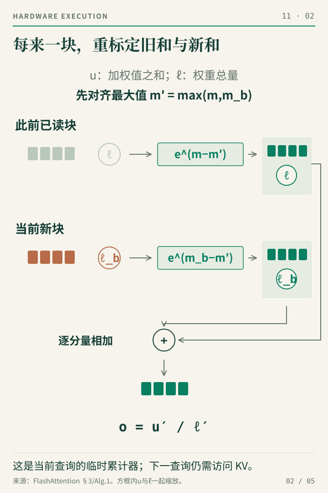</figure>

数学目标相同，浮点运算的结果不要求逐比特一致。不能各块独立 softmax 后简单平均。在线算法把旧累计量与新块换到共同基准，再合并，保留统一归一化。

在线合并公式与状态边界

m′ = max(m, m_b)
λ = exp(m−m′)；λ_b = exp(m_b−m′)
ℓ′ = λℓ + λ_bℓ_b
u′ = λu + λ_bu_b
o = u′ / ℓ′

u是未归一化的加权value和。块内也按自己的最大值稳定化，合并时先把两份和换到共同基准。m、ℓ、u只属于本次query的临时扫描；新query通常有不同分数，不能像第六章S/z那样直接复用它们来省去历史KV访问。

<figure id="c11-vf-03-recompute">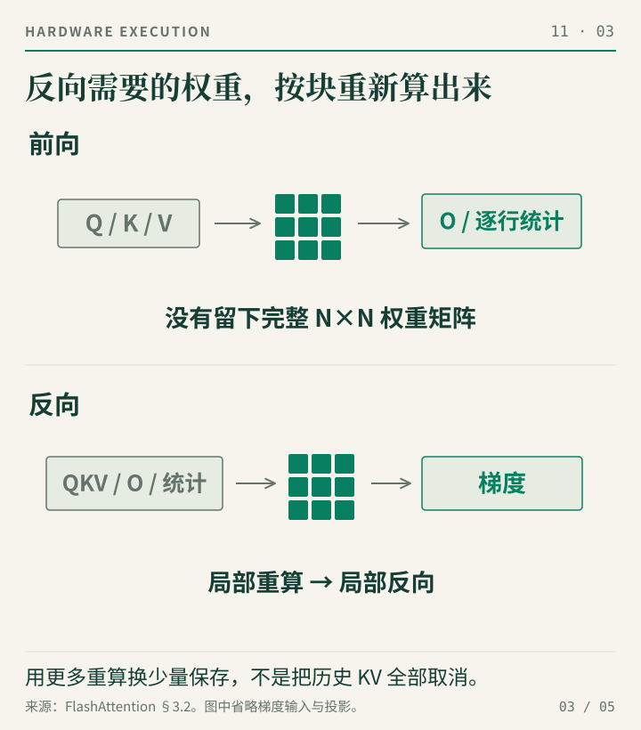</figure>

训练反向按块重算局部权重，以重算换取更少的中间激活保存。这是执行和存储安排的改变，不能把它解读成架构换成了固定状态。

前向统计、反向重算与限制

前向保存输出及逐行归一化统计等必要量，反向结合Q/K/V、输出、统计和输出梯度重算局部概率并求梯度。图省略了输出梯度和具体kernel。这里减少注意力激活保存，不是训练全网内存固定，更不表示训练与Decode采用相同的缓存接口。

系统中的另外两笔账：分页管理与跨设备通信

<figure id="n11-paging">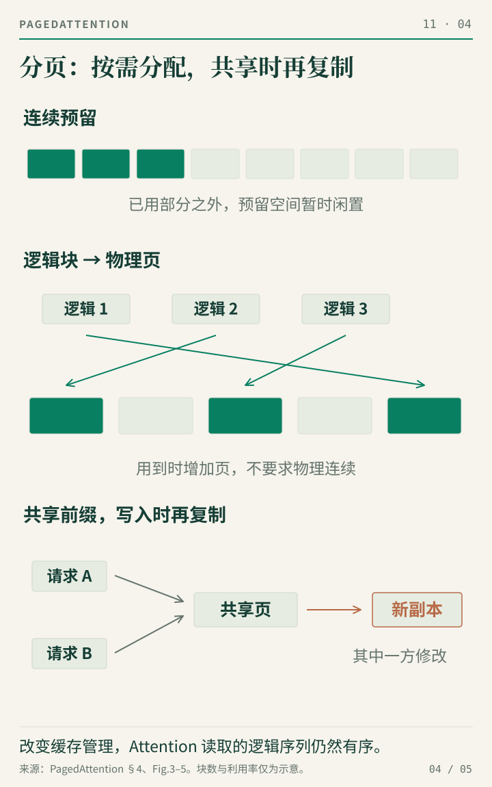</figure>

PagedAttention 用逻辑块到物理页的映射，缓解连续预留带来的浪费，支持按需分配、共享与写时复制。图只示意管理关系，不给出实测利用率；减少碎片不等于减少逻辑历史长度。

分页不改变逻辑位置；共享需要写时复制

逻辑块表指向可能不连续的物理页，运行时按需增加页。对共享前缀的请求，引用计数和写时复制可在复用与修改之间保持正确性。图的空白量和页数只是机制示意；未测得任何本机利用率或加速。

原文：<a href="https://arxiv.org/pdf/2309.06180">PagedAttention §4</a>

<figure id="n11-ring"></figure>

Ring Attention 让各设备保留本地 Q、轮转 KV 块，并尽量重叠当前块的计算与下一块的传输。环形拓扑只是基础，通信是否能被覆盖也是效率关键。它分布式执行长序列计算，不消除全配对本身。

计算—通信重叠的条件

各设备以本地查询块依次读取轮转来的 KV 块，并累计对应输出；在线归一化保持跨块读取的一致性。通信隐藏效果取决于计算量、网络带宽和内核调度，时间条长度不表示实测。环形图只是拓扑，下面的交叠时间线才说明边算边传。

原文：<a href="https://arxiv.org/pdf/2310.01889v4">Ring Attention v4 §3、Fig.2</a>

<em>主要来源：<a href="https://arxiv.org/pdf/2205.14135">FlashAttention §3、Algorithm 1</a>；<a href="https://arxiv.org/pdf/2309.06180">PagedAttention §4</a>；<a href="https://arxiv.org/pdf/2310.01889v4#page=3">Ring Attention v4 §3、Fig.2</a></em>

<h2 id="chapter-12">十二、看懂新架构：还原它的记忆系统</h2>

现在回到开篇。把一个模型报告读成记忆系统设计图，几个名字就能接到一起：存的是什么，怎样更新，读哪些对象，又由哪些层共享。

DeepSeek-V4.1-Flash 的 CSA2 沿历史条目路线继续节省成本：部分层复用主 KV，有的重新计算候选，有的沿用同一主 KV 上最近一次筛选。共享缓存和共享筛选结果，是两种不同的复用。

<figure id="c12-vf-02-csa2"></figure>

Full 产生相关缓存与选择，Reindex 复用主 KV、重新筛选，Reuse 进一步沿用选择；每层仍有自己的主 Q 与局部 KV。报告中的解码器采用不合并位置的主 KV 配置，不能从 V4 的压缩图直接照搬。模型还使用 CED（Causal Encoder–Decoder，因果编码器—解码器），从下部编码器生成解码器读取的全局 KV；局部滑窗仍按层计算，详见补充。

Full、Reindex、Reuse与范围

V4.1报告§2.3.1：Full生成主KV及indexer K并筛选；Reindex复用最近可用主KV和indexer K，用本层indexer Q重打分；Reuse复用最近针对同一主KV产生的Top-K索引，不计算本层indexer Q。三模式均计算自己的main Q与SWA KV。图省略CED、分层候选池、压缩具体窗口与实际模式排布，只保留共享对象。

Kimi K3 则把固定状态的 KDA 与逐位置的门控 MLA 按层组合。第十章已画出这一布局：不能仅凭“KDA 层占多数”，就断言整个模型的持久状态不随历史增长。

两模型都组合多种设计。沿“保存什么→怎样取用→在哪里组合→还付什么代价”四个问题，把它们放回同一张地图。

<figure id="n12-map"></figure>

V4.1 的跨层复用与稀疏选择，仍在历史条目路线内；K3 则沿层深组合固定状态与逐位置读取。它们节省的对象不同，剩下的成本也不同。

这张模型地图保留了哪些条件？

V4.1-Flash 的 CED 由编码器末层表示提供解码器全局 KV 的共同输入，层相关投影与 CSA2 显式复用应分开。CSA2 Full 生成主 KV／indexer K 并筛选，Reindex 复用前两者重新筛选，Reuse 进一步沿用同一主 KV 上最近的选择。每层仍有自己的主 Q 与局部 KV。解码器报告采用压缩比 1，未合并位置；编码器还有不同配置，图不把所有层概括成同一种压缩比。

K3 的重复单元为 KDA×3→门控 MLA，末端另有 MLA；每层持有独立状态。图中两种对象属于各自层，不是同一层同时维护两套分支，也不表示 KDA 的 S 被转换成 MLA 缓存。橙色箭头表示当前位置的表示沿深度传递。

来源：<a href="https://arxiv.org/pdf/2609.19969">V4.1 §2.2–2.3</a>；<a href="https://arxiv.org/pdf/2607.24653v1">Kimi K3 §2.1</a>。

<figure id="n12-costs"></figure>

历史从短变长：MHA 多添几行；GQA 每行少几套 KV；MLA 每行改存紧凑表示，但行数仍增加。固定状态继续更新，形状不随历史条目增加。图只展示增长方式，方块面积不代表实际压缩比。<strong>省掉 N，不等于其他成本消失。</strong> 各层求和、加上其他状态后，才能算整网；符号说明与单步／整段运算表在展开区。

增长方式背后的核心持久元素数

全历史 MHA/MQA/GQA：N Hₖᵥ(dₖ+dᵥ)
DeepSeek-V2 型 MLA：N(d_c+d_r)
本文归一化核形式：H(m dᵥ+m)

数单样本、单层的核心持久元素；不把容量图的块数当作比例尺。MHA 的 Hₖᵥ=H_q，MQA 的 Hₖᵥ=1，GQA 介于二者之间。MLA 的 d_c 是缓存 latent 的宽度，d_r 是共享位置 key 宽度；这是解耦位置路径的 MLA 形式，不代表每个后续变体都另存位置 key。归一化核形式使用映射后维度 m，另存 z；不是所有线性／Delta 形式都需要 z。

乘以批量 B、各独立层求和，并按实际精度换成字节后，再计分页、索引、卷积等状态。同口径 Decode／Prefill 运算表见本章下方展开区；这些公式不能代替实际访存、质量或延迟测量。

K3 NoPE MLA 不另计独立位置 key 的 d_r 项；仍按 N 个 latent 条目增长。本图短、长两帧只比较随历史增长的对象，不给出真实压缩比或性能数据。固定状态在两帧大小相同，内容继续更新；Delta 状态核心通常没有 z，完整成本按实际实现另计。

遇到新名字，先用图里的对象问：它少存了什么、少读了什么，还是改变了状态怎样更新？它改变了模型的信息接口，还是保持运算、换一种执行方式？组合发生在哪一层或哪条分支？

这些问题能帮助读结构，还不能代替评测。<strong>比谁更好，要同时看任务质量、延迟和资源。</strong> 索引器、卷积状态、局部缓存和其他模块不能漏算；输入输出长度、批量、硬件、精度与计时范围也要对齐。条件不齐时，把结论保留在相应条件内。

读懂一个模型，还不是这段演进史的终点。接下来把这些设计放回一起，看看我们究竟从一次 Attention 运算，走到了怎样的记忆系统。

展开：统一成本口径与设计选项

为便于横向核算，先固定为单样本、单层，N 表示本次解码可见的位置数。Hₖᵥ 为 KV 头数，H_q 为查询头数，H 为状态头数；dₖ、dᵥ 为每头 key／value 宽度，d_c、d_r 为 latent／位置 key 宽度。m 为映射后的核特征维度，<strong>不必等于 dₖ</strong>。下面的 Prefill 是从零处理长度 N 的因果序列，Decode 是产生一个新位置的核心运算；都不含投影、特征映射、FFN、索引器、卷积或通信。表中数元素与渐近运算量，不是字节数、实际显存流量或延迟。

<table class="cost-table">
<thead>
<tr>
<th>核心形式</th>
<th>持久元素数</th>
<th>单步 Decode 核心</th>
<th>整段 Prefill 核心</th>
</tr>
</thead>
<tbody><tr>
<td data-label="核心形式">MHA / MQA / GQA，全历史</td>
<td data-label="持久元素数">N Hₖᵥ(dₖ+dᵥ)</td>
<td data-label="单步 Decode 核心">O(N H_q(dₖ+dᵥ))</td>
<td data-label="整段 Prefill 核心">O(N² H_q(dₖ+dᵥ))</td>
</tr>
<tr>
<td data-label="核心形式">MLA，紧凑缓存</td>
<td data-label="持久元素数">N(d_c+d_r)</td>
<td data-label="单步 Decode 核心">吸收路径 O(N H_q(d_c+d_r))</td>
<td data-label="整段 Prefill 核心">展开路径 O(N² H_q(dₖ+dᵥ))；吸收路径 O(N² H_q(d_c+d_r))</td>
</tr>
<tr>
<td data-label="核心形式">本文归一化核形式</td>
<td data-label="持久元素数">H(m dᵥ+m)</td>
<td data-label="单步 Decode 核心">O(H m dᵥ)</td>
<td data-label="整段 Prefill 核心">累积／分块核心 O(N H m dᵥ)</td>
</tr>
</tbody></table>

H_q 为查询头数；MHA 中 Hₖᵥ=H_q。GQA 减少 KV 头数，查询头仍各自匹配，所以不能把配对运算也直接按同一倍数缩小。表中 MLA 特指第四章的 DeepSeek-V2 解耦位置形式；K3 的 NoPE MLA 不应额外计入独立位置 key 的 d_r 项。MLA 的 dₖ 包含该形式的内容与位置匹配宽度；表中两种路径只数匹配与融合，投影和内核选择另计，不能推出统一加速比。若每头、每层宽度不相同，应逐项求和。

该核形式每头 S∈R^(m×dᵥ)，z∈R^m。m 固定时，核心对 N 线性；若扩大 m，存储与运算也随之增加。Delta 系列的状态核心通常没有这里的 z，不能把此行当作所有递归机制的完整成本。

压缩要按实际保留的条目数和宽度计算；稀疏要同时记读取集合与保留池，另算选择开销。跨层复用数独立持有的对象；Hybrid 将状态层和历史层相加。FlashAttention 则另外减少中间结果的显存读写，不改变这张持久对象账。

<figure id="n12-options"></figure>

这张通用选项图可用于拆解其他架构。先找到对象与改变的轴，再回原报告核对其具体条件。

展开：CED、比较证据，以及历史轴之外的研究

<figure id="n12-ced"></figure>

这里的编码器和解码器属于同一个因果语言模型，不是机器翻译中“整句源文→译文”的可见范围。各层从共同的因果编码器末层表示，通过层相关投影取得全局 KV；CSA2 再决定哪些层显式复用这些对象。图示 CED 核心关系，不是 V4.1 的具体复用排布；局部滑窗仍逐层计算。

CED 与机器翻译 Encoder–Decoder 的区别

C_l=H_enc W_l^KV；Z_l=H_enc W_l^Z

CED 的编码器、解码器都在同一因果语言模型中。解码器全局 KV 从因果编码器末层表示产生，采用层相关投影；共同输入不自动等于共同 KV。CSA2 再决定哪些层显式复用缓存。局部 SWA 仍由各层产生。CSA2 的压缩比1是不合并位置的特殊情形。跨层复用指共享指定对象，不能让各层的主 Q 或局部 KV 也被误认为相同。图省略层数、模式分配与层次索引器。

原文：<a href="https://arxiv.org/pdf/2609.19969">V4.1 §2.2–2.3、Fig.3–5</a>

<figure id="c12-vf-04-compare"></figure>

相同任务面对两种设计，答案与成本一起看。论文中不同模型、不同训练量的结果，不能只归因于 Attention 结构；复杂度也不等于某个硬件上的实际速度。

比较协议与文献时间线

明确任务、模型规模与训练预算、输入/输出长度、批量/并发、硬件、精度、实现版本及计时边界。Prefill看读入延迟，Decode看每步延迟与输出吞吐；服务吞吐须带SLO与负载条件。缓存容量、峰值内存、理论配对数和实际搬运分别报告。未匹配的跨模型数据只能做条件化观察，不能提供单一模块的因果结论。

下面按论文首次公开年份整理阅读线索，不表示前者被后者全面淘汰。
<table><tr><th>年份</th><th>阅读节点</th></tr><tr><td>2017–2020</td><td>Transformer → MQA；Linear Transformer / Longformer</td></tr><tr><td>2022–2023</td><td>FlashAttention；GQA / RetNet / GLA / Mamba</td></tr><tr><td>2024</td><td>MLA / Mamba-2 / Delta 并行化 / Gated DeltaNet</td></tr><tr><td>2025</td><td>MoBA / NSA / DSA / KDA</td></tr><tr><td>2026</td><td>CSA2 / K3 的 AttnRes 组合 / Gated DeltaNet-2 研究</td></tr></table>
各节点的原始论文见对应章节来源；时间线只帮助定位，不构成速度或能力排名。

<figure id="c12-vf-03-depth-axis"></figure>

AttnRes（Attention Residuals，注意力残差）沿同一 token 的不同深度表示读取，与历史序列读取、跨层 KV 复用是不同的轴。这里作为延伸，不占据历史记忆主线。

AttnRes读取的是同一token的深度表示

K3的Block AttnRes使用学习出的pseudo-query w对同一token在embedding、当前块与此前块的表示产生权重。权重依赖表示内容，不是把所有token用同一组固定块系数混合。图只画几个此前块；层深读取、历史序列读取、跨层KV复用须分别辨认。

<figure id="c12-vf-05-delta2"></figure>

Gated DeltaNet-2 进一步分开擦除与写入的控制。它仍可沿“状态怎样被编辑”来理解；这是研究方法的延伸，不作为开篇两模型部署了它的证据。

研究阅读练习：解耦编辑门

S̄ = DₜS_old；e = bₜ ⊙ kₜ；z_edit = wₜ ⊙ vₜ
S_new = S̄ + kₜ(z_edit − S̄ᵀe)ᵀ

这里z_edit是写入目标，不是第六章核归一化状态z。擦除门在key轴控制旧关联读出，写入门在value轴控制新目标；两者共同参与残差编辑。令b=β·1_key、w=β·1_value可回到对应KDA绑定形式，再令所有衰减通道相等回到对应GDN形式。它是论文方法，不据此声称已部署在V4.1或K3，也不从公式推断所有任务领先。

<em>主要来源：<a href="https://arxiv.org/pdf/2609.19969">DeepSeek-V4.1-Flash §2.3</a>；<a href="https://arxiv.org/pdf/2405.04434">DeepSeek-V2 §2.1</a>；<a href="https://arxiv.org/pdf/2006.16236">Linear Transformer §3</a>；<a href="https://arxiv.org/pdf/2607.24653">Kimi K3 §2</a>；<a href="https://arxiv.org/pdf/2603.15031">Attention Residuals</a>；<a href="https://arxiv.org/pdf/2605.22791">Gated DeltaNet-2</a></em>

<h2 id="chapter-13">十三、总结：从读取上下文到管理记忆</h2>

再看开篇的两种对象，名字已经有了共同的含义：<strong>历史条目解决“还能回访哪里”，递归状态解决“怎样持续吸收经历”。</strong> 围绕它们，研究逐步扩大了设计范围。

<figure id="n13-memory-system"></figure>

最初，重点是从已保存的上下文中读出关联；随后，保存形式、访问范围、遗忘和纠错都成为设计对象；Hybrid 再把不同接口组织到一起。<strong>Attention 的读取运算，是这套记忆系统中的一个环节。</strong> 图中的层层展开表示问题范围扩大，各路线并不按图依次替代。

记忆视角的范围：运行状态、模型参数与系统对象

这里将可回访的上下文条目、递归状态及其读写接口合起来讨论。它是对前文机制的统一视角，不声称所有机制计算同一个目标。KV 表示、压缩表示和递归状态均由输入及模型计算产生，并不等同原文逐字副本。训练时学到的模型参数、推理中的上下文状态，以及外部跨会话记录的生命周期需区分。

图按研究问题的范围展开，各阶段不是严格年代顺序。最后的组合框只表示系统可以同时持有多种对象，不规定共用 query、所在层或融合算子；具体实例见 K3 和第十章。

下面这张表把主要机制放回同一份账。先记住“它改了记忆的哪一处”，细节可以回头再查。

<table class="memory-table">
<thead>
<tr>
<th>记忆问题</th>
<th>方法</th>
<th>改了什么</th>
<th>仍付出的代价</th>
</tr>
</thead>
<tbody><tr>
<td data-label="记忆问题">怎样从多种角度关联上下文</td>
<td data-label="方法">MHA</td>
<td data-label="改了什么">多套 Q/K/V 分别读，再融合</td>
<td data-label="仍付出的代价">多套 KV，历史继续增长</td>
</tr>
<tr>
<td data-label="记忆问题">每个头都存 KV，重复太多</td>
<td data-label="方法">MQA</td>
<td data-label="改了什么">全部查询头共享一套 KV</td>
<td data-label="仍付出的代价">共享更强；仍存完整历史</td>
</tr>
<tr>
<td data-label="记忆问题">希望共享与表达更灵活地折中</td>
<td data-label="方法">GQA</td>
<td data-label="改了什么">查询头分组，共享组内 KV</td>
<td data-label="仍付出的代价">仍按位置保存，各查询仍计算</td>
</tr>
<tr>
<td data-label="记忆问题">每个位置的表示太宽</td>
<td data-label="方法">MLA</td>
<td data-label="改了什么">联合保存紧凑 latent</td>
<td data-label="仍付出的代价">仍按位置保存；表示需学习</td>
</tr>
<tr>
<td data-label="记忆问题">每次精读的块太多</td>
<td data-label="方法">MoBA</td>
<td data-label="改了什么">先选块，再读块内 token</td>
<td data-label="仍付出的代价">候选池与块选择仍有成本</td>
</tr>
<tr>
<td data-label="记忆问题">希望组合多种稀疏读取</td>
<td data-label="方法">NSA</td>
<td data-label="改了什么">压缩、选择、局部分支共同读出</td>
<td data-label="仍付出的代价">各支路与选择成本另计</td>
</tr>
<tr>
<td data-label="记忆问题">精读全部位置太贵</td>
<td data-label="方法">DSA</td>
<td data-label="改了什么">轻量索引先选具体位置</td>
<td data-label="仍付出的代价">索引本身仍保存、访问历史</td>
</tr>
<tr>
<td data-label="记忆问题">历史条目本身太多</td>
<td data-label="方法">CSA / HCA</td>
<td data-label="改了什么">多个位置组成压缩条目</td>
<td data-label="仍付出的代价">位置粒度变粗；局部支路另计</td>
</tr>
<tr>
<td data-label="记忆问题">不想逐条保存历史</td>
<td data-label="方法">Linear Attention</td>
<td data-label="改了什么">将关联汇入固定形状状态</td>
<td data-label="仍付出的代价">容量有限，贡献可能混合</td>
</tr>
<tr>
<td data-label="记忆问题">状态要衰减，也要适合训练</td>
<td data-label="方法">RetNet</td>
<td data-label="改了什么">固定整头衰减，组织三种计算形式</td>
<td data-label="仍付出的代价">衰减不随当前内容调整</td>
</tr>
<tr>
<td data-label="记忆问题">保留强度要随内容改变</td>
<td data-label="方法">GLA</td>
<td data-label="改了什么">输入相关的通道门与分块运算</td>
<td data-label="仍付出的代价">有用内容也可能被遗忘</td>
</tr>
<tr>
<td data-label="记忆问题">累加缺少针对性的修正</td>
<td data-label="方法">DeltaNet</td>
<td data-label="改了什么">用目标减预测，再写回差额</td>
<td data-label="仍付出的代价">相关方向仍可能互相影响</td>
</tr>
<tr>
<td data-label="记忆问题">纠错之外还要主动遗忘</td>
<td data-label="方法">GDN</td>
<td data-label="改了什么">先整头衰减，再按误差修正</td>
<td data-label="仍付出的代价">同一头仍使用共同衰减强度</td>
</tr>
<tr>
<td data-label="记忆问题">整头遗忘的粒度太粗</td>
<td data-label="方法">KDA</td>
<td data-label="改了什么">key 通道各自衰减，再纠错</td>
<td data-label="仍付出的代价">状态仍有限，细门也有成本</td>
</tr>
<tr>
<td data-label="记忆问题">单一记忆接口难以兼顾</td>
<td data-label="方法">Hybrid</td>
<td data-label="改了什么">组合历史条目与递归状态</td>
<td data-label="仍付出的代价">各类成本相加，需协同训练</td>
</tr>
<tr>
<td data-label="记忆问题">多层重复持有相同对象</td>
<td data-label="方法">CSA2 等跨层复用</td>
<td data-label="改了什么">共享特定 KV 或筛选结果</td>
<td data-label="仍付出的代价">Q、局部 KV 等未必共享</td>
</tr>
<tr>
<td data-label="记忆问题">中间矩阵的显存读写太多</td>
<td data-label="方法">FlashAttention</td>
<td data-label="改了什么">片上分块、在线归一化与重算</td>
<td data-label="仍付出的代价">仍要完成对应注意力配对</td>
</tr>
<tr>
<td data-label="记忆问题">预留与连续分配浪费空间</td>
<td data-label="方法">PagedAttention</td>
<td data-label="改了什么">逻辑块映射到按需物理页</td>
<td data-label="仍付出的代价">不减少逻辑历史长度</td>
</tr>
<tr>
<td data-label="记忆问题">长序列需要分布式执行</td>
<td data-label="方法">Ring Attention</td>
<td data-label="改了什么">轮转 KV，重叠计算与传输</td>
<td data-label="仍付出的代价">配对与通信成本仍在</td>
</tr>
</tbody></table>

这些改进没有取消取舍，而是把取舍拆开了：<strong>记忆的容量、可寻址性、可编辑性和访问代价，可以分别设计，再共同优化。</strong> 这也解释了为什么一个现代模型会同时使用多个 Attention 名字。

<em>主要来源：前十二章所引原始论文；<a href="https://arxiv.org/html/2501.00663v1#S1">Titans §1–2 的记忆视角</a></em>

<h2 id="chapter-14">十四、展望：走向分层协作的记忆系统</h2>

<strong>我的判断是：下一阶段更值得追踪的方向，是把短期读取、持续更新和历史检索，组织成可协作、可调度的记忆系统。</strong> 下面依据已有研究讨论三种走向；图示是一张候选设计图，并非某个已部署模型的复现。

<h3>一种记忆不够，就让不同记忆分工</h3>

近期信息可以保留较细的表示，反复出现的关联持续写入状态，需要回访的历史保留可寻址条目。真正的研究问题，是怎样在有限预算下决定哪些信息走哪条路，以及查询该向谁取用。

<figure id="n14-memory-tiers"></figure>

三种对象可在不同层、分支或时间尺度上组合，未必是硬件缓存式的上下级关系。图中不画“从状态还原原文”的箭头：写入固定状态后的细节，不能假定还能完整恢复。状态提供紧凑关联，显式历史保留进一步回访的入口；两者都不保证正确检索。

候选分工，不是已经实现的统一架构

虚线表示待验证的写入和查询组织。q 代表当前读取需求，不要求不同层、分支共用同一个投影向量。三种对象没有固定速度、精度和时间尺度排名；图没有从状态到原文的无损恢复路径。具体组合仍需训练与任务评测，包括干扰、遗忘、检索覆盖和路由开销。

实例依据：<a href="https://arxiv.org/html/2404.07143v1#S2">Infini-attention v1 §2</a>在块内组合局部注意力与压缩状态；<a href="https://arxiv.org/html/2203.08913v1#S3.SS1">Memorizing Transformers v1 §3.1</a>组合局部读取和近邻检索。二者都不是本图三对象结构的直接复现。

这已有不同形式的信号：K3 组合 KDA 与 MLA；Infini-attention 把局部注意力与压缩状态接在同一块内；Memorizing Transformers 将局部读取与外部 KV 检索结合。这些实例已经把问题推进到：<strong>组合的比例、位置和策略，怎样随任务与预算一起选择？</strong>

<h3>从学习关联，继续走向学习怎样读写</h3>

KDA 已能按输入调节不同方向的保留量；Gated DeltaNet-2 进一步分开擦除与写入；Titans 研究在测试时更新神经记忆。顺着这条线，<strong>读写规则本身会成为更重要的学习对象：记多少、改多少、保留多久、何时检索，都可以进一步随内容和任务改变。</strong>

这使“记得住多久”变成写入、遗忘与检索共同决定的结果。评价它们，既要测长程回忆，也要测反复修正后留下了什么、噪声会挤掉什么，以及记错、忘错带来的代价。

<h3>记忆还要有生命周期</h3>

模型决定如何表达和使用过去，运行系统决定对象放在哪里、复用多久、何时搬入或释放。这两层会越来越需要共同设计。

<figure id="n14-memory-lifecycle"></figure>

图中同色条目在 GPU、CPU 与存储间迁移，改变的是物理驻留位置；在满足复用条件时，可以再次使用已有计算。LMCache 已提供这类分层 KV 管理。<strong>把 KV 留到磁盘上，只是让一份运行对象保存得更久；它不会自动成为跨会话理解、整合用户经历的长期语义记忆。</strong> 模型版本、上下文、位置与掩码等兼容条件也仍需核对。

物理驻留更久，不等于长期语义记忆

图示 KV 的物理调入、调出和复用；CPU/SSD 后端属于系统的缓存管理。复用需符合对应模型、上下文、位置、掩码及具体实现的兼容要求，不能把任意用户或任意前缀的 KV 混用。所画未来策略仅为待优化的问题，不声称自动决策已经普遍部署。

<a href="https://docs.lmcache.ai/">LMCache 官方文档</a>在本轮访问时列有 CPU、存储、远端后端及跨请求复用。本文只据此说明对象管理能力，不沿用产品吞吐宣传，也不将运行缓存直接叫作跨会话语义记忆。

三个框表示可能的驻留地点及对象在其间迁移，不要求同时保留三份副本。图中的 q 表示需要在计算侧使用缓存，不规定存储后端也执行同一 Attention 内核。

更远的研究问题，是让经历变成可修订的长期记忆：哪些信息值得留下，新内容怎样纠正旧记录，取用时如何保留上下文与来源。这还需要语义层面的整理和使用规则，单纯延长 KV 的保存时间并不够。

更完整的 Memory 系统，因而要把两份设计接起来：<strong>模型怎样读写记忆，系统怎样保存和调度这些记忆。</strong> 前者要面对遗忘、干扰与信息选择，后者要面对容量、带宽与生命周期；共同目标是在给定资源下，保住任务真正需要的信息。

如果未来这些策略的额外成本超过收益，或一种简单架构能在相同质量和资源下胜出，分层协作就未必值得。这仍需要训练与真实任务来回答。

回到开篇那些名字：我们已经能把它们拼成一套读、写、忘、存、取的设计。<strong>这篇演进史最终要留下的，是一个观察新模型的视角：它怎样管理自己的上下文记忆，又为这种能力付出了什么。</strong> Attention 会继续演进，值得比较的对象，也会从一个算子扩大到整套记忆系统。

研究线索：三种“长期”不要混在一起

Infini-attention 的压缩关联矩阵跨片段递推，仍是有限状态；标题中的 infinite 不表示可以无损记住无限细节。Memorizing Transformers 的外部记忆保留先前 KV，使用近邻查找返回候选；它与把经历写进固定状态的形式不同。

Titans 的神经长期记忆在测试时更新，而该论文专门命名的 persistent memory 是输入无关的可学习参数，并非磁盘 KV Cache。这里借鉴其组合与更新思路，不把论文术语中的 persistent 直接解释成跨会话用户档案。

推理系统的持久 KV 复用，保留的是特定计算条件下的运行对象；Agent 的长期语义记忆还涉及记录含义、修订、整合与使用规则。物理保存时间、模型内状态时间尺度、跨会话语义生命周期是不同问题。

<em>主要来源：<a href="https://arxiv.org/html/2607.24653v1#S2.SS1">Kimi K3 v1 §2.1</a>；<a href="https://arxiv.org/html/2404.07143v1#S2">Infini-attention v1 §2</a>；<a href="https://arxiv.org/html/2203.08913v1#S3.SS1">Memorizing Transformers v1 §3.1</a>；<a href="https://arxiv.org/pdf/2605.22791v1">Gated DeltaNet-2 v1</a>；<a href="https://arxiv.org/html/2501.00663v1#S3">Titans v1 §3–4</a>；<a href="https://docs.lmcache.ai/">LMCache 官方文档</a></em>

</section>

