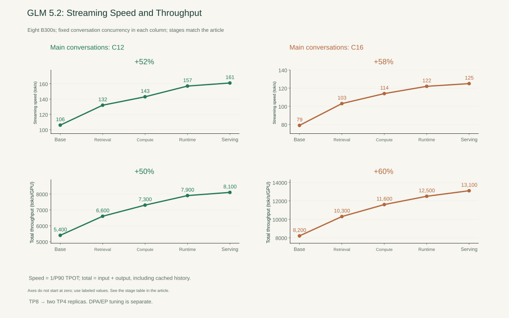
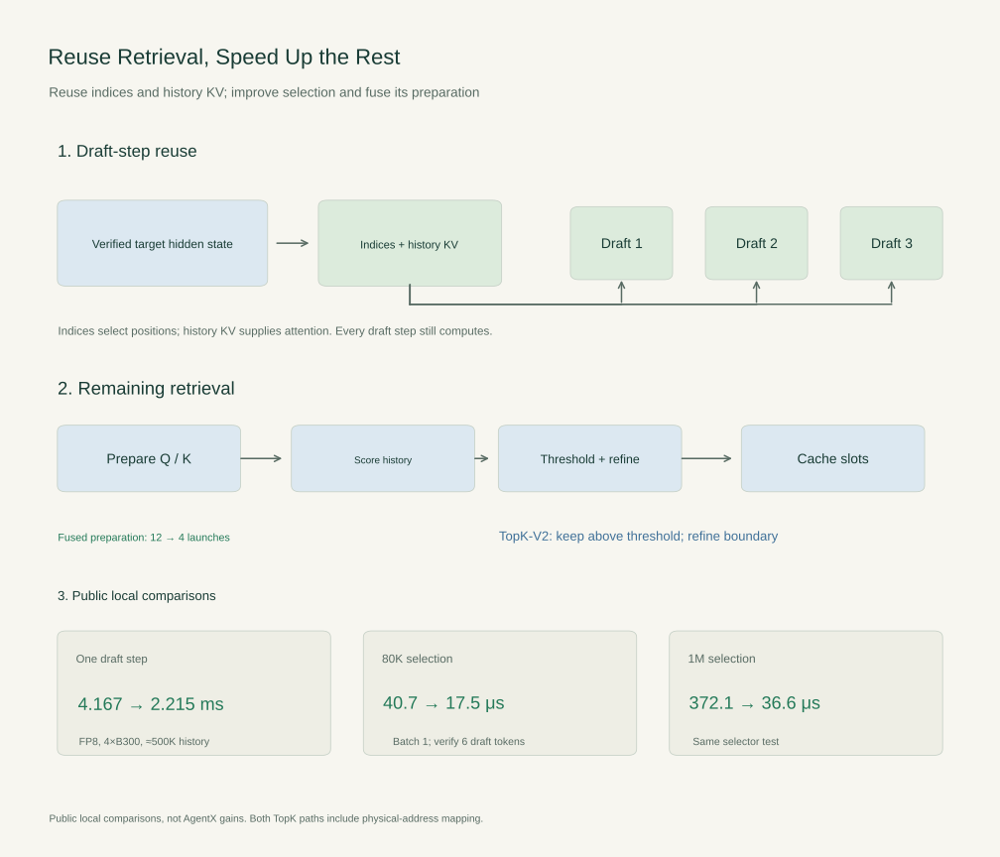
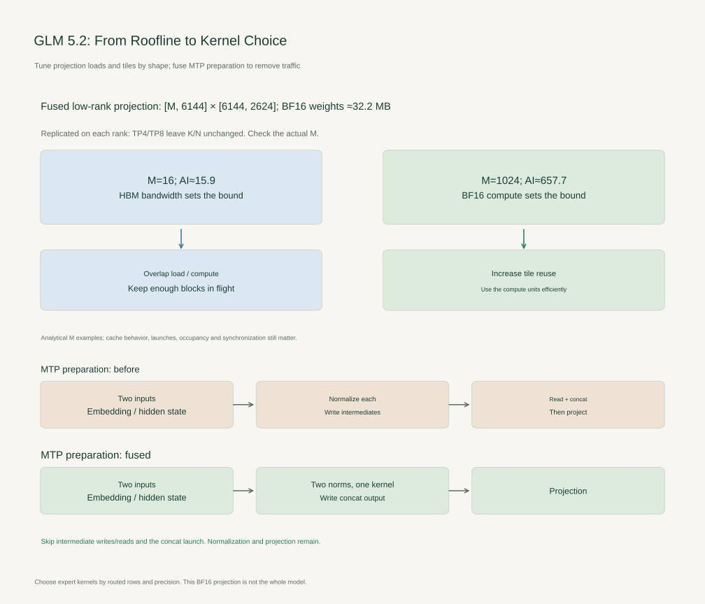
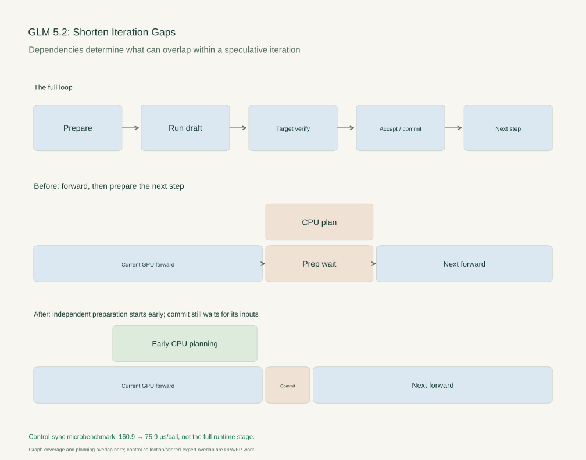
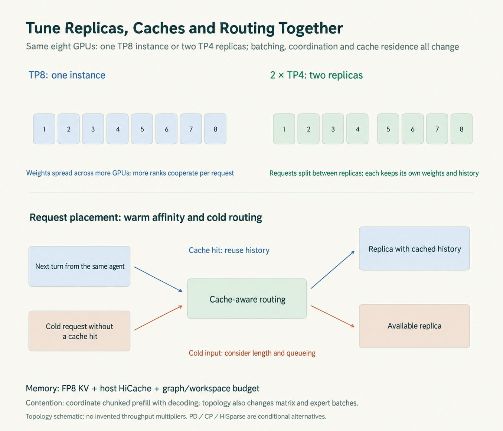
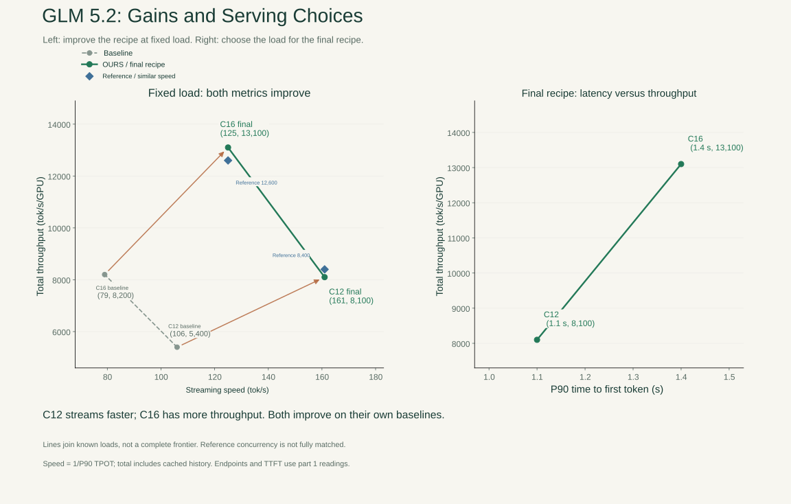

*Part 2 of the B300 case study. [Part 1: results, workload, and architecture](/en/posts/b300-find-the-bottleneck/). [Part 3: Kimi K3](/en/posts/kimi-k3-state-memory-motion/).*

> **Key points**
>
> • The four groups improve GLM 5.2 streaming speed by 52–58% and total throughput by 50–60% in the series comparison.
>
> • Index reuse, kernel choice, iteration scheduling, and replica placement have to work as one recipe.
>
> • Local kernel gains and deployment-load choices retain their separate conditions.
>

A GLM 5.2 speculative iteration does more than generate a draft. It selects history positions, runs projections and experts, verifies candidates with the target model, commits the accepted tokens, and prepares the next forward pass. Accelerating one operation helps only while the surrounding loop lets that saving reach the request.

The recipe here changes four parts of that loop. At fixed main-conversation concurrency, the series comparison takes streaming speed from 106 to 161 tok/s at C12 and from 79 to 125 at C16. Total throughput rises by 50–60% on the same eight B300s.

## The Decode Loop

The baseline already uses mixed precision and MTP. Routed experts use NVFP4, attention and the shared branch use BF16, and the KV cache uses FP8. MTP proposes three tokens; the synthetic acceptance target is 2.99 committed tokens per verification, including the target-verified token. These settings compare execution under a fixed acceptance condition, not the draft's quality on arbitrary coding tasks.

The first three groups use one TP8 instance. The final group divides the same eight GPUs into two TP4 replicas.

| Stage | C12 streaming tok/s | C12 total tok/s/GPU | C16 streaming tok/s | C16 total tok/s/GPU |
|---|---:|---:|---:|---:|
| Baseline | 106 | 5,400 | 79 | 8,200 |
| Reuse indices, improve selection, fuse preparation | 132 | 6,600 | 103 | 10,300 |
| Choose compute kernels by shape; fuse MTP inputs | 143 | 7,300 | 114 | 11,600 |
| Overlap preparation and expand graph coverage | 157 | 7,900 | 122 | 12,500 |
| Retune replicas, caches, routing, and chunks | 161 | 8,100 | 125 | 13,100 |

*Figure 9 | Both metrics improve at two fixed concurrency levels. The four groups correspond to the changes described below. The axes do not start at zero, so read the labeled values rather than the visual height of a gain.*

Streaming speed is `1 / P90` of request-average time per output token after the first token. Total throughput counts input and output, including cached history. [Part 1](/en/posts/b300-find-the-bottleneck/) gives the full replay conditions and explains why neither quantity substitutes for P90 time to first token.

## Reuse the Retrieval Work

GLM 5.2's IndexShare lets later computation reuse a selection of sparse-attention history positions. That saves work only if the runtime passes the selection to its next consumer.

A [public fix](https://github.com/sgl-project/sglang/pull/29654) exposed a silent failure. Each draft forward received a copied `ForwardBatch`. Writing `topk_indices` into that copy left the outer loop's object unchanged, so the next draft step found no reusable indices. Moving them into shared speculative state made the result survive the per-step wrappers.

The [follow-up](https://github.com/sgl-project/sglang/pull/29787) corrected the seed's origin: draft extension captures the selection from the last verified token's target-derived hidden state. Batch filtering and merging, overlap scheduling, and graph replay must preserve its alignment with the right request and history position.

KVShare addresses a related but separate cost. Later MTP draft steps can reuse the first step's historical KV representation. The indices say where to read; the cache holds what to read. Prefix caching, IndexShare, and KVShare therefore avoid different work: repeated prefill, repeated selection, and repeated preparation of draft history. The new query and necessary attention computation remain.

For the selection we still need, TopK-V2 avoids sorting the entire score row. A histogram locates the bin containing the selection boundary; values above it are kept, and boundary candidates receive exact refinement. Long rows are divided among cooperating thread blocks. The selected logical positions are translated directly into physical cache slots.

Preparation can be shorter too. The indexer originally launched separate projections and postprocessing steps. Combining the key and head-gate projections, fusing query/key tails, and including the cache store in the key path removes temporary handoffs. Independent key and query work can overlap.

| Public local comparison | Conditions | Reported change |
|---|---|---:|
| Index reuse | GLM 5.2 FP8, 4×B300, approximately 500K history, one draft step | 4.167 → 2.215 ms |
| TopK-V2 | Batch 1, target verification of six draft tokens, 80K input | 40.7 → 17.5 μs |
| TopK-V2 | Same comparison, 1M input | 372.1 → 36.6 μs |
| Indexer preparation fusion | Kernel-launch count for the prologue | 12 → 4 |

*Figure 10 | Preserve reusable indices, accelerate the selection that remains, and fuse its producers. The local comparisons retain their own conditions. Both TopK versions already fuse address conversion; adding that fusion does not explain their entire difference.*

In the series profile, this group moves C12 from 106 to 132 tok/s while total throughput moves from 5,400 to 6,600 tok/s/GPU. The public microbenchmarks explain the mechanisms; their speedup ratios cannot be multiplied into that service-level result.

## Choose Kernels for the Actual Shapes

Removing redundant retrieval leaves the necessary projections, attention, and experts. Their shapes differ across prefill, draft decode, and target verification; expert routing makes their row counts smaller still.

The fused low-rank projection from part 1 is `[M,6144] × [6144,2624]`, with roughly 32.2 MB of BF16 weights. Those weights are replicated on each rank. Switching from TP8 to TP4 does not change this projection's K or N.

At small M, the Roofline calculation points toward memory traffic. A useful kernel pipelines loads, computation, and stores, but its tiles must leave enough blocks to occupy the GPU. At larger M, more rows reuse the weights and compute efficiency becomes increasingly valuable.

The [CuTe DSL backend](https://github.com/sgl-project/sglang/pull/30117) selects strategies for actual `(M,N,K)` shapes. Serving needs to compare those strategies across execution modes, provision the graph workspaces they need, and fall back where a specialized kernel loses. BF16 attention and shared-expert layers do not inherit the routed experts' NVFP4 arithmetic. Draft expert paths also need their own [autotuning coverage](https://github.com/sgl-project/sglang/pull/29595).

MTP input preparation offers a direct way to remove traffic. The original path normalizes embeddings and target hidden states separately, writes two intermediate tensors, then reads them again to concatenate them. The [fused path](https://github.com/sgl-project/sglang/pull/29667) still performs the two independent normalizations, but writes directly into the concatenated output consumed by the next projection. It removes the intermediate writes and reads and the standalone concatenation launch.

*Figure 11 | Kernel dispatch improves the computation we retain. Directly producing the normalized concatenation removes intermediate traffic. These are distinct changes, even when both shorten the same iteration.*

This group takes the C12 profile from 132 to 143 tok/s and from 6,600 to 7,300 total tok/s/GPU.

## Close the Gaps Between Iterations

Once kernels finish sooner, CPU preparation can become exposed. Reading back a sequence length, allocating cache space, or assembling metadata can delay the next graph replay even while every individual GPU kernel looks fast.

Spec V2 prepares the next step's cache and metadata alongside the current forward pass. For the DSA draft-extension path, that required [graph-compatible shapes](https://github.com/sgl-project/sglang/pull/29413), removal of unnecessary host/device synchronization, and [fused metadata updates](https://github.com/sgl-project/sglang/pull/29499).

A CUDA graph records a GPU execution structure and replays it with stable buffers. Enabling a flag does not make dynamic host-dependent object construction capturable. The runtime has to provision the draft width and update the graph's metadata within those conventions.

Some preparation can move earlier; committing the accepted state cannot precede verification. The implementation has to preserve that dependency while overlapping the independent work.

*Figure 12 | The bars show ordering, not measured duration. Acceptance-dependent commit remains after verification. Independent planning can run earlier.*

The C12 stage profile moves from 143 to 157 tok/s, with throughput from 7,300 to 7,900 tok/s/GPU.

Two additional paths are worth keeping separate from this default TP comparison:

- **Attention-data-parallel control collection.** A function that first transferred partial control data and then blocked on three `.item()` calls was changed to transfer the complete control row once and aggregate it on the CPU. Its B300 microbenchmark fell from 160.9 to 75.9 μs. The default TP path does not call it every iteration.
- **Shared-expert overlap under expert parallelism.** A separate stream can run the shared expert alongside routed-expert dispatch and computation, then synchronize before adding the results. Backends that already fuse the work, or hide the wait, may leave little additional benefit.

The trace decides which waits are exposed. A short blocking operation repeated each iteration can matter more than a longer kernel already hidden behind other work.

## Tune Replicas, Caches, and Scheduling Together

One TP8 instance distributes weights over more ranks, but each request involves more GPUs. Two TP4 replicas duplicate the model while dividing conversations between smaller groups. That can reduce coordination and also fragment the batch and cache history.

The final group tunes three decisions with that layout:

**History placement.** FP8 KV reduces history storage. HiCache retains inactive history in host memory and can overlap layer-by-layer restoration with computation. Its GPU and host tiers belong to an individual instance: two replicas on one machine do not automatically pool their L1/L2 caches.

**Routing.** A returning conversation benefits from cache affinity. Cold requests have a different problem: the recipe switches their placement from a queue-load choice to strict round robin to avoid concentrated queues. That choice depends on the mix of long and short requests; it is not a universally best policy. Moving a warm request incurs restoration or recomputation, while insisting on affinity can leave one replica overloaded.

**Chunks and workspaces.** A large prefill chunk can stall streams already generating. Small chunks add launches and scheduling overhead and change operator M. Larger graph captures reserve more workspace; retaining more history consumes some of the same memory. Those budgets have to be tuned together.

*Figure 13 | Compare one TP8 instance with two TP4 replicas on the same eight GPUs. Recheck shapes, cache residence, and queueing after changing the layout.*

In the profile, C12 moves from 157 to 161 tok/s and 7,900 to 8,100 tok/s/GPU. C16 moves from 122 to 125 tok/s and 12,500 to 13,100 tok/s/GPU.

Long cold prompts offer other routes. Prefill/decode disaggregation can use context or pipeline parallelism on the prefill side; [DSA LayerSplit](https://github.com/sgl-project/sglang/pull/29421) distributes cache layers, and [handoff code](https://github.com/sgl-project/sglang/pull/30839) has to preserve layer ranges and MTP indices. HiSparse can retain full KV in host memory and fetch selected positions, but the inspected version disables radix caching and does not support speculative decoding. Those alternatives introduce transfer and deployment costs and are outside this final recipe.

## From Decode Speed to Serving Capacity

*Figure 14 | Left: a fixed-load comparison moves both speed and throughput upward. Reference markers are comparison-period InferenceX readings at similar speeds. Right: final throughput and P90 TTFT. Lines connect known points, not a full measured frontier.*

Across the two loads, the comparison improves streaming speed by 52–58% and total throughput by 50–60%. C12 reaches 161 tok/s, approximately 8,100 total tok/s/GPU, and 1.1 seconds P90 TTFT. C16 reaches 125 tok/s, approximately 13,100 total tok/s/GPU, and 1.4 seconds.

A service requiring at least 150 tok/s and P90 TTFT within 1.5 seconds can use C12 from this set. At 120 tok/s with the same initial-delay limit, C16 offers more throughput. Separate P90 checks do not establish joint per-request compliance.

At similar streaming speeds, the reference is about 12,600 versus this recipe's 13,100 tok/s/GPU at 125 tok/s, and 8,400 versus 8,100 at 161 tok/s. That supports “close to the comparison-period frontier,” with advantages on either side. Unmatched configurations and small gaps do not support a general leadership claim.

The recipe connects shared indices, kernel dispatch, graph preparation, and replica placement. Every layout change sends us back to shapes, queueing, and the memory budget. [Kimi K3](/en/posts/kimi-k3-state-memory-motion/) needs the same discipline, but its private recurrent state changes what we have to save and move before those requests can run.

## Sources

*Sources: [Index reuse](https://github.com/sgl-project/sglang/pull/29654); [seed propagation](https://github.com/sgl-project/sglang/pull/29787); [IndexShare and KVShare](https://z.ai/blog/glm-5.2); [TopK](https://github.com/sgl-project/sglang/pull/26788); [indexer fusion](https://github.com/sgl-project/sglang/pull/27705); [GLM 5.2 engineering report](https://www.lmsys.org/blog/2026-07-13-glm52-optimization); [CuTe DSL](https://github.com/sgl-project/sglang/pull/30117); [MTP input fusion](https://github.com/sgl-project/sglang/pull/29667); [draft-extension graphs](https://github.com/sgl-project/sglang/pull/29413); [metadata fusion](https://github.com/sgl-project/sglang/pull/29499); [HiCache](https://docs.sglang.io/docs/advanced_features/hicache_design). Stage comparisons use the supplied series profile; public microbenchmarks retain their own configurations.*
