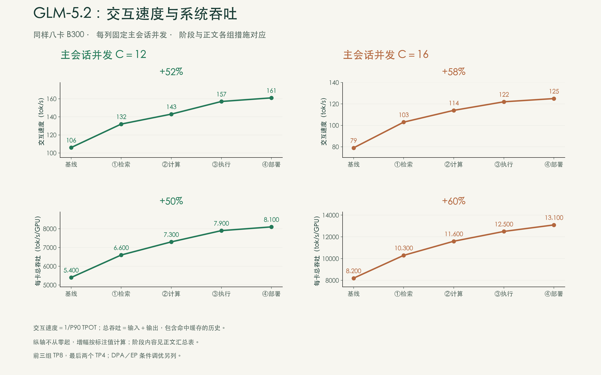
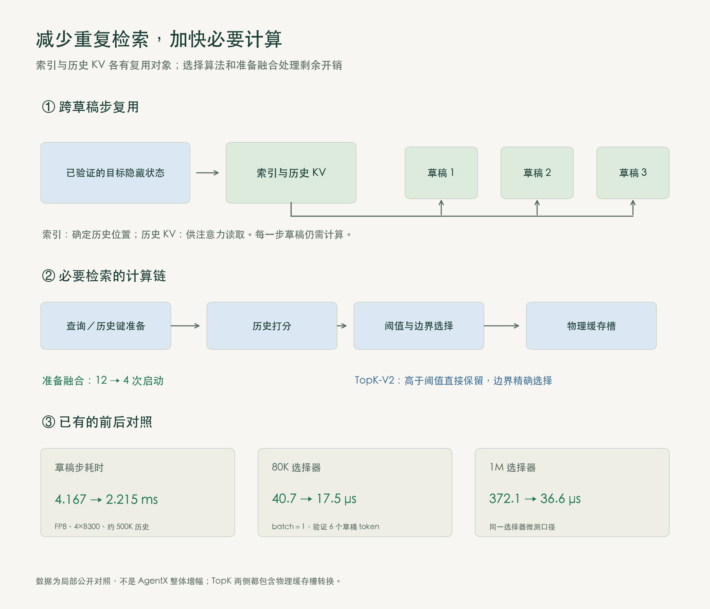
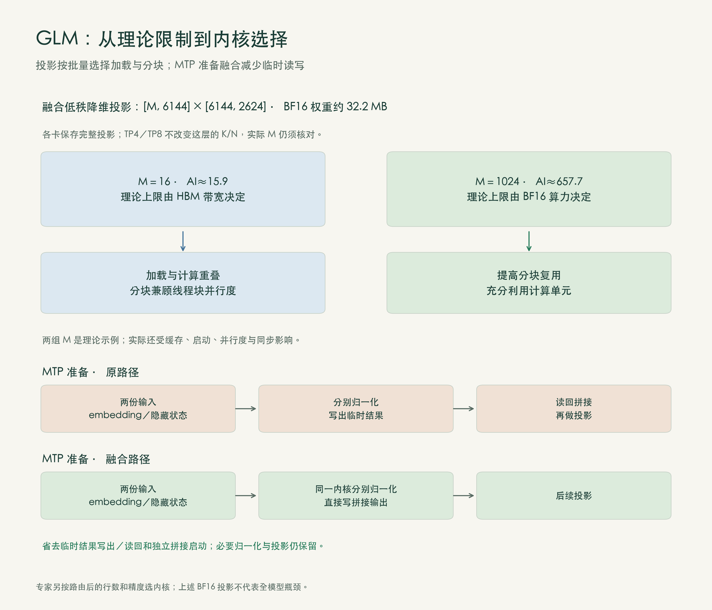
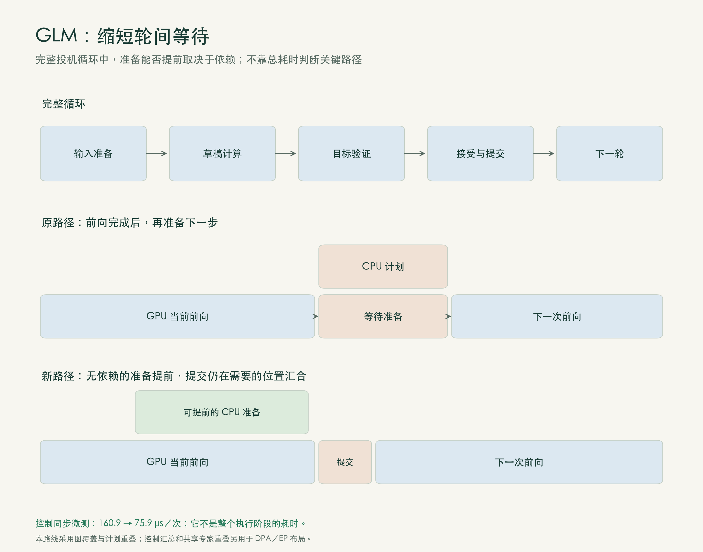
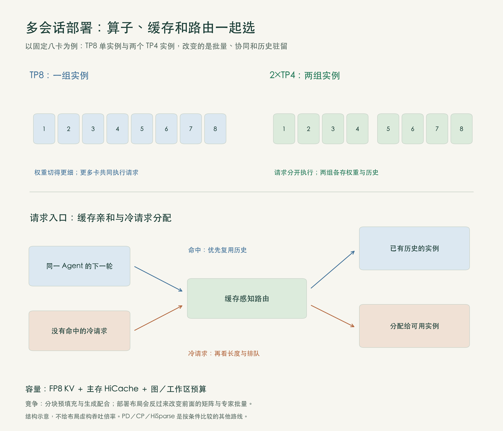
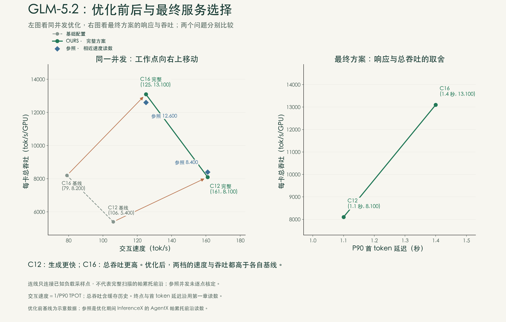

[上篇：成绩与瓶颈](/posts/b300-results-bottlenecks/) · [中篇：GLM 5.2：缩短生成循环](/posts/b300-glm-generation-loop/) · [下篇：Kimi K3：状态、通信与服务选择](/posts/b300-kimi-state-serving/)

*推理优化系列 · 第3篇（中）*

> **本篇要点**
>
>
> - 四组优化让GLM 5.2交互速度提高52%—58%，每卡总吞吐同时提高50%—60%。
>
> - 先消除重复检索，再优化计算内核和轮间衔接，最后让实例、缓存与调度共同支撑多会话服务。
>
> - 从索引传递到矩阵分块，再到CPU/GPU协作，优化对象始终是完整生成循环。

本篇的AgentX整体比较使用同样八卡B300，分别固定主会话并发C12或C16。C表示同时运行的主Agent会话树数量；子Agent发起的请求也参与回放。公开局部对照另列测试条件，容量与Roofline分析给出计算假设。

**阅读口径。** 交互速度为`1/P90 TPOT`：先对每条请求计算首token之后的平均生成间隔，再取P90并求倒数，数值越高越好。开始回答前等多久，另看P90 TTFT。总吞吐按输入＋输出计数，**包含命中缓存的历史**，不等于新生成token的速度。

主方案使用NVFP4路由专家、BF16注意力与共享分支、FP8 KV。基线及前三组使用TP8，即八卡张量并行；最后改为两个各用四卡的TP4实例。MTP起草3个token，合成接受长度目标2.99，计入验证token。该设置统一草稿接受条件，用来比较系统执行。完整回放条件见[上篇第二节](/posts/b300-results-bottlenecks/#二-Agent场景的开销)。

## 一、生成循环

旧历史命中缓存以后，Agent提交测试结果，只需对少量新增输入做预填充。但接下来生成回答，仍要反复经过：

**输入准备→检索与草稿计算→目标验证→接受提交→准备下一轮。**

MTP一次起草多个token，目标模型批量验证。若前两个草稿被接受、第三个被拒绝，就保留前两个，并由目标模型在拒绝处给出替代token，随后继续生成。它减少了目标模型逐token执行的轮数，也增加了草稿计算、批量验证和提交的成本。接受条件固定后，优化要缩短的是整轮时间。

四组措施分别处理这条循环中的重复工作、必要计算、轮间等待和多会话资源争用：

| 阶段 | 改动 | C12交互速度 | C12每卡总吞吐 | C16交互速度 | C16每卡总吞吐 |
|---|---|---:|---:|---:|---:|
| 基线 | TP8，已启用MTP与混合精度 | 106 | 5,400 | 79 | 8,200 |
| ① 检索复用 | 传递共享索引，TopK-V2，索引准备融合 | 132 | 6,600 | 103 | 10,300 |
| ② 计算内核 | 按形状选矩阵内核，融合MTP输入准备 | 143 | 7,300 | 114 | 11,600 |
| ③ 执行衔接 | 提前准备下一轮，草稿步可图捕获 | 157 | 7,900 | 122 | 12,500 |
| ④ 多会话部署 | TP8改两个TP4，联调缓存、路由和分块 | 161 | 8,100 | 125 | 13,100 |

交互速度单位为tok/s，每卡总吞吐单位为tok/s/GPU。总卡数始终为8，每列内主会话并发固定。

**图9｜两档固定并发，交互速度与系统吞吐同时改善。** 四组措施与下文逐一对应；各小图纵轴不从零起，收益以标注值为准。

## 二、减少重复检索

GLM 5.2支持索引共享，但模型允许共享，不代表运行时一定把索引传对了。一个公开修复记录揭示：新索引只写进当前草稿步的批次副本，没有更新草稿循环持有的对象，下一步找不到，只好重新检索。修复后，索引放入各草稿步共享的投机状态。〔资料1〕

共享还要维护对应关系。草稿扩展根据最后一个已验证token的目标隐藏状态取得起始索引；批次合并、拆分、异步调度和图回放，都不能把索引交给错误的请求或历史位置。MTP的KVShare则让后续草稿步复用第一步的历史KV。索引决定读哪里，KV保存历史表示，两者配合，才能减少重复工作。〔资料2〕

剩下的检索也要做快。TopK-V2先用直方图找到第k大分数所在区间，保留高于边界的候选，只在边界区间内精确选取；长分数行由多个线程块协作，选择结果直接转换为缓存物理槽。它避免完整排序，并提高长历史下的处理效率。〔资料3〕

索引准备同样有多余开销。原路径把投影、归一化、位置变换、量化和缓存写入拆成多个操作，反复传递临时结果。合并历史键与门控投影、融合查询和键的后处理及缓存写入，再让独立分支并行，可以减少中间读写与启动。〔资料4〕

| 公开局部对照 | 条件 | 前→后 |
|---|---|---|
| 索引传递修复 | GLM 5.2-FP8，4×B300，约50万token历史，单草稿步 | 4.167→2.215 ms，减少约47% |
| TopK-V2 | batch=1，验证6个草稿token，8万token输入 | 40.7→17.5 μs |
| TopK-V2 | 同上，100万token输入 | 372.1→36.6 μs |
| 索引准备融合 | 准备过程的内核启动数 | 12→4 |

这些局部对照各有模型、形状和配置条件，用于解释机制。TopK新旧两版均已包含地址转换，其差异主要来自选择算法和长行协作。〔资料5〕

**图10｜共享索引、加快选择、融合准备。** 三种改动分别减少重复检索、必要检索的执行时间，以及准备过程的临时传递。

我们在服务中启用并比较TopK-V2、相关后端和CUDA Graph配置。这组措施对应C12交互速度106→132 tok/s、每卡总吞吐5,400→6,600 tok/s。前缀缓存、索引共享、KVShare各有分工：分别复用旧输入的预填充结果、已有位置选择，以及草稿所需的历史表示；新的查询和各步必要的注意力仍要计算。

## 三、按形状选择计算内核

消除重复检索后，投影、注意力和专家计算仍须完成。生成、验证、预填充的矩阵形状不同，路由又会把专家批量进一步切小，内核策略必须随之变化。

上篇分析的融合低秩降维投影为`[M,6144]×[6144,2624]`，BF16权重约32.2 MB。这层在各卡上完整复制，TP8改为TP4不会改变它的K/N。M=16时，AI约15.9，理论上限受HBM带宽约束；M增大，同一份权重由更多行复用，计算效率逐渐更重要。〔资料5〕

这给内核调优一个明确方向：低M时，提高加载流水效率，让加载、计算和写回重叠；分块又不能过大，否则线程块数量不足，难以充分利用GPU。大M时，则可利用更大的分块提高复用和计算效率。Roofline用于判断限制，具体分块和并行度仍须按实际形状比较。

我们启用并比较CuTe DSL后端的形状策略，分别处理生成、验证和预填充的M/N/K，调整图捕获范围与工作区，不合适的新内核回退原后端。NVFP4专家、BF16注意力与共享分支的精度不同，专家还要按路由后的行数选策略。〔资料6〕

MTP输入准备则可以直接减少读写。原路径对embedding和目标隐藏状态分别归一化，写出两份临时结果，再读回拼接。融合后，同一内核仍分别完成两次归一化，却直接写入后续投影所需的拼接输出，省去临时结果的写出、读回及独立拼接启动。〔资料7〕

**图11｜从Roofline判断到具体改动。** 小批量投影优化加载与并行度，大批量投影优化复用与计算；准备融合直接减少中间读写。两者作用不同，共同缩短生成循环。

对应图9第二组，C12交互速度132→143 tok/s，每卡总吞吐6,600→7,300 tok/s。

## 四、缩短轮间等待

内核变快，下一轮若仍要等CPU读回控制数据、分配缓存、生成页表，GPU还是会停顿。Roofline只描述算子的理论执行上限，消除不了算子之间的这段等待。

Spec V2提前准备下一步的缓存和元数据，与当前前向计算并行。DSA的draft-extend原来使用动态形状，还要与CPU同步序列长度；改成可捕获的固定草稿宽度、融合元数据操作后，才能配合CUDA Graph和异步调度。〔资料8〕

CUDA Graph记录一段GPU执行过程，之后按相同结构回放，减少逐项提交。打开开关还不够：形状和缓冲必须符合捕获约定，临时回读长度、动态创建不同大小的对象都会妨碍回放。这里同时调整草稿准备与元数据路径，才能把已有内核连续执行起来。

提前准备也有边界：缓存分配和部分调度计划可以先做，接受哪些token、提交哪份状态，必须等当前验证结果确定。关键路径上的依赖保留，独立工作尽量提前。

**图12｜独立准备与当前计算重叠。** 状态提交仍等待验证结果，图中条长只表示先后关系。对应第三组，C12交互速度143→157 tok/s，每卡总吞吐7,300→7,900 tok/s。

其他布局下，我们还做过两项调优，分别用于相应路径，不计入图9：

- **DPA控制汇总。** 注意力数据并行路径原来先回传部分数据，再三次阻塞调用`.item()`读取字段；改为一次回传完整控制行，由CPU集中汇总。B300函数微测160.9→75.9 μs，每次减少约85 μs。默认TP方案并非每轮调用该函数。
- **EP共享专家重叠。** 共享专家在另一执行流运行，与路由专家的跨卡分发和计算并行，最后同步相加。后端若已融合或等待已被其他计算掩盖，额外重叠未必还有收益。

内核耗时较长，不一定最值得先改；阻挡下一步的同步即使只有几十微秒，也可能每轮都发生。执行时间线用于分清这两种情况。

## 五、实例、缓存与调度一起调整

最后，同样八卡上比较一个TP8实例和两个TP4实例。TP8每卡权重占用较少，但单个请求要更多卡协同；两个TP4各自接收会话，需要两份权重，也会分散批量与历史缓存。减少跨卡等待的收益，要与每实例M变小、权重复用降低的代价一起看。

我们把实例布局与三类选择联调：

- **历史缓存。** FP8 KV降低占用，HiCache将暂时不用的历史保存在主存，按层恢复时与计算重叠。〔资料9〕
- **请求路由。** 历史可复用的请求保持缓存亲和；冷请求从按队列负载选择实例改为严格轮询，减少集中排队。频繁换实例会增加恢复或重算，过度追求命中又会造成局部排队，因而两类请求采用不同规则。
- **分块与工作区。** 预填充分块大，生成请求等得久；分块小，启动和调度次数增加，矩阵M也会改变。更大图捕获批量需要更多工作区，保留更多历史又会挤占这些空间。分块大小、静态显存预留、图捕获范围和主存缓存须一起比较。

**图13｜多会话部署改变了批量、协同和历史驻留。** 每次切换实例布局，都须重查算子形状与显存预算。冷请求轮询的收益依赖长短请求混合情况，不是通用最优策略。

这一组将C12交互速度157→161 tok/s、每卡总吞吐7,900→8,100；C16交互速度122→125 tok/s、每卡总吞吐12,500→13,100。低延迟档与高吞吐档一起比较，才能看出部署选择的作用。

更长的冷输入还提供其他路线：预填充/解码分离可让预填充侧使用上下文或流水线并行，DSA LayerSplit分配层缓存，交接时维护层范围与MTP索引；HiSparse可把完整KV保存在主存，只换入选中位置。前者增加部署与交接开销，后者增加数据换入；所核查HiSparse版本要求关闭radix缓存且不支持投机解码。这些方案有适用条件，未用于本文最终配置。〔资料10〕

## 六、从生成循环到服务能力

**图14｜固定并发的工作点向右上移动。** 左图同时观察交互速度与每卡总吞吐，蓝点为优化期间InferenceX前沿的相近速度读数；右图比较最终方案的TTFT与吞吐。连线仅连接已知负载点，不表示完整前沿扫描。

这里的“参照”是优化期间InferenceX的AgentX帕累托前沿：如果还存在速度不降、吞吐更高的配置，或吞吐不降、速度更快的配置，当前点就不在前沿上。左图向右上移动表示两项同时改善；右图的TTFT则越短越好。

四组优化共同作用于完整循环：共享索引减少重复检索，内核策略与准备融合加快必要工作，图执行和计划重叠缩短轮间等待，实例与缓存联调让多会话获得执行机会。

**同一并发下，GLM 5.2交互速度提高52%—58%，每卡总吞吐提高50%—60%。** C12达到161 tok/s、约8,100 tok/s/GPU，C16达到125 tok/s、约13,100 tok/s/GPU。选择哪一档，取决于服务目标。

与参照相近速度的读数相比，125 tok/s处为13,100对12,600 tok/s/GPU，161 tok/s处为8,100对8,400。整体接近前沿、各有高低，图示小差距不足以认定领先；参照逐点配置仍未全部对应。

为让这些措施在同一套服务中配合，我们比较TopK-V2与CuTe DSL后端、图覆盖和工作区，把一个TP8实例与两个TP4实例放到同样八卡下比较，再联调历史缓存、冷请求路由和预填充分块。每次改变部署方式，都须重新检查内核形状、缓存驻留与排队，单项调快以后还要看完整服务。

这也把前两篇的方法落实到了工程：先按模型与Agent负载找成本，再沿完整执行过程改系统，最后同时检查吞吐、交互与首token延迟。

[下篇](/posts/b300-kimi-state-serving/)继续看Kimi K3。它既要容纳长历史、私有状态与投机暂存，也要压缩混合注意力和92个专家层反复发生的读写、启动与跨卡等待，容量和执行须同时优化。

## 参考资料

**资料 1**：[索引复用修复与4×B300局部对照，PR #29654](https://github.com/sgl-project/sglang/pull/29654)。
**资料 2**：[草稿扩展索引传递，PR #29787](https://github.com/sgl-project/sglang/pull/29787)；[GLM 5.2的IndexShare与KVShare](https://z.ai/blog/glm-5.2)。
**资料 3**：[TopK选择实现，PR #26788](https://github.com/sgl-project/sglang/pull/26788)。
**资料 4**：[索引准备融合，PR #27705](https://github.com/sgl-project/sglang/pull/27705)。
**资料 5**：[GLM 5.2优化：TopK局部对照、复制式投影与BF16内核](https://www.lmsys.org/blog/2026-07-13-glm52-optimization)。
**资料 6**：[CuTe DSL形状策略，PR #30117](https://github.com/sgl-project/sglang/pull/30117)；[混合精度路径，PR #35368](https://github.com/sgl-project/sglang/pull/35368)；[草稿专家路径，PR #29595](https://github.com/sgl-project/sglang/pull/29595)。
**资料 7**：[归一化与拼接融合，PR #29667](https://github.com/sgl-project/sglang/pull/29667)。
**资料 8**：[draft-extend图执行，PR #29413](https://github.com/sgl-project/sglang/pull/29413)；[元数据融合，PR #29499](https://github.com/sgl-project/sglang/pull/29499)。
**资料 9**：[HiCache设计](https://docs.sglang.io/docs/advanced_features/hicache_design)。
**资料 10**：[DSA LayerSplit，PR #29421](https://github.com/sgl-project/sglang/pull/29421)；[阶段交接，PR #30839](https://github.com/sgl-project/sglang/pull/30839)；[HiSparse所核查版本限制](https://github.com/sgl-project/sglang/blob/2a5f45d3d47879f5524194789fe0db61fe206671/python/sglang/srt/arg_groups/hisparse_hook.py)。
