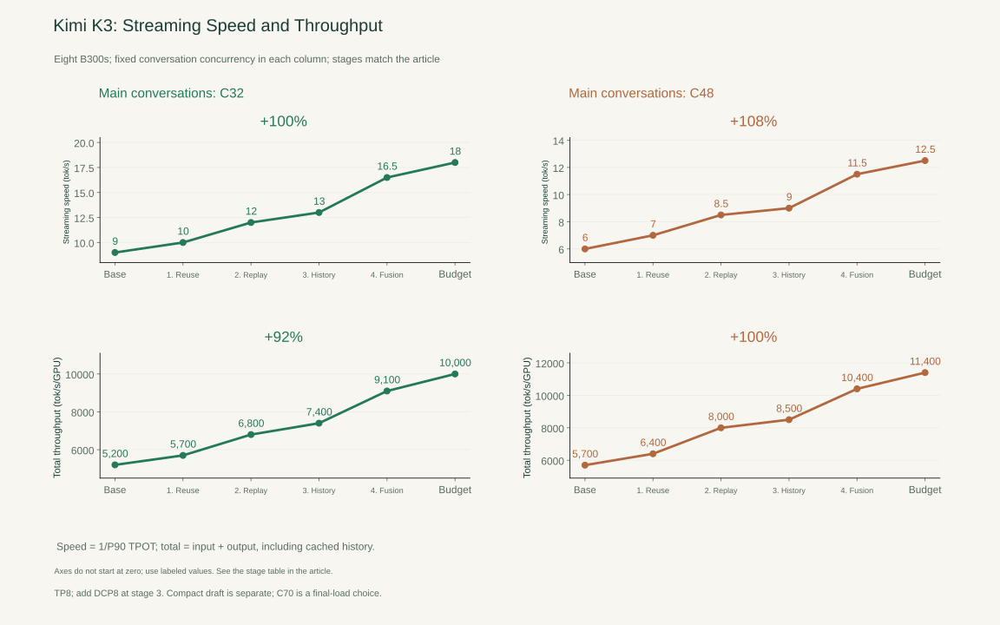
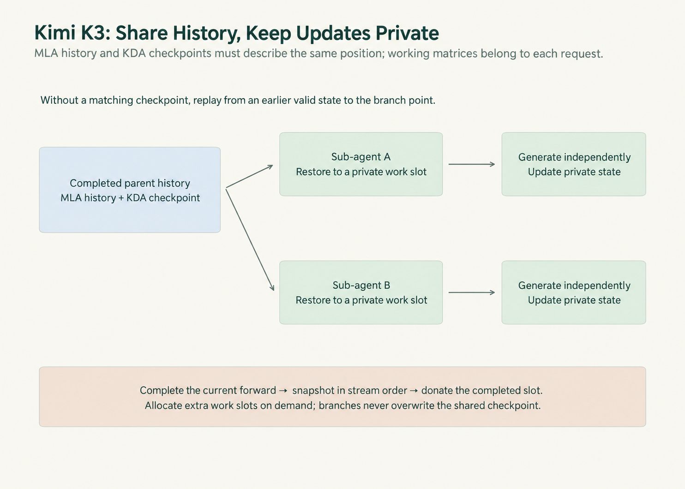
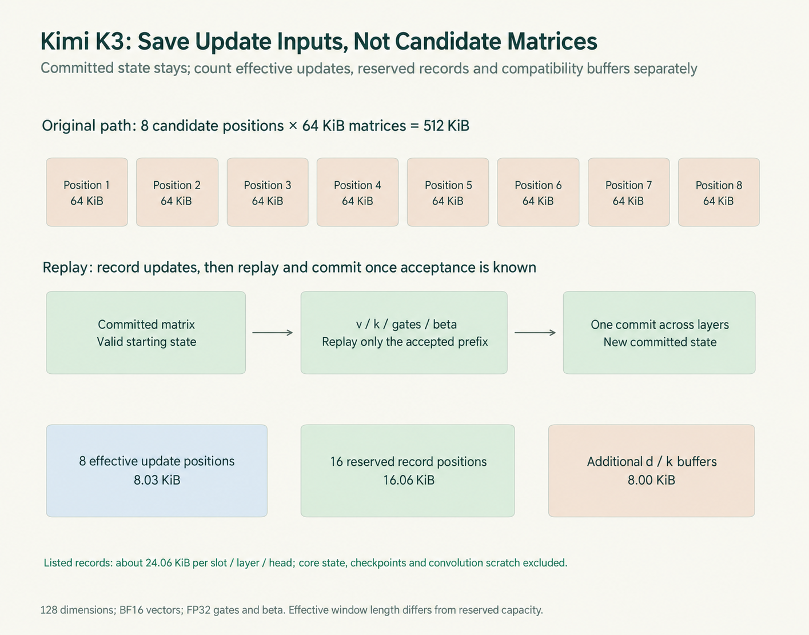
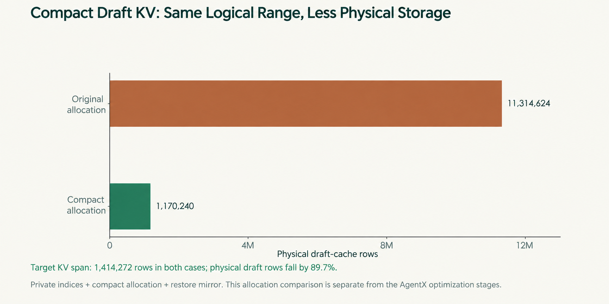
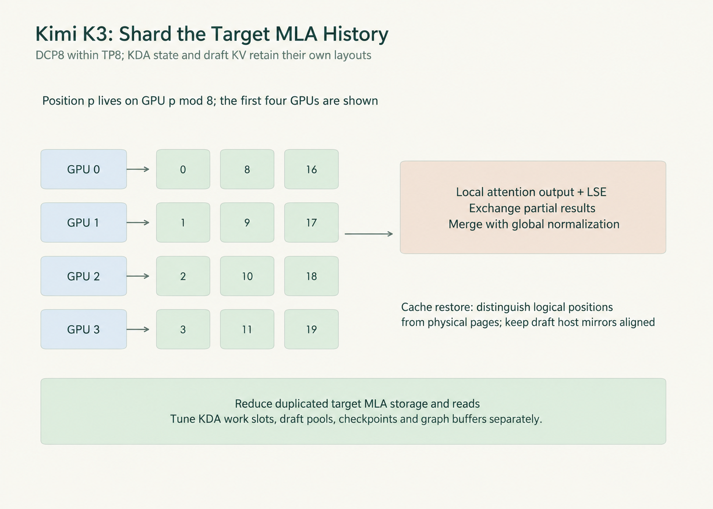
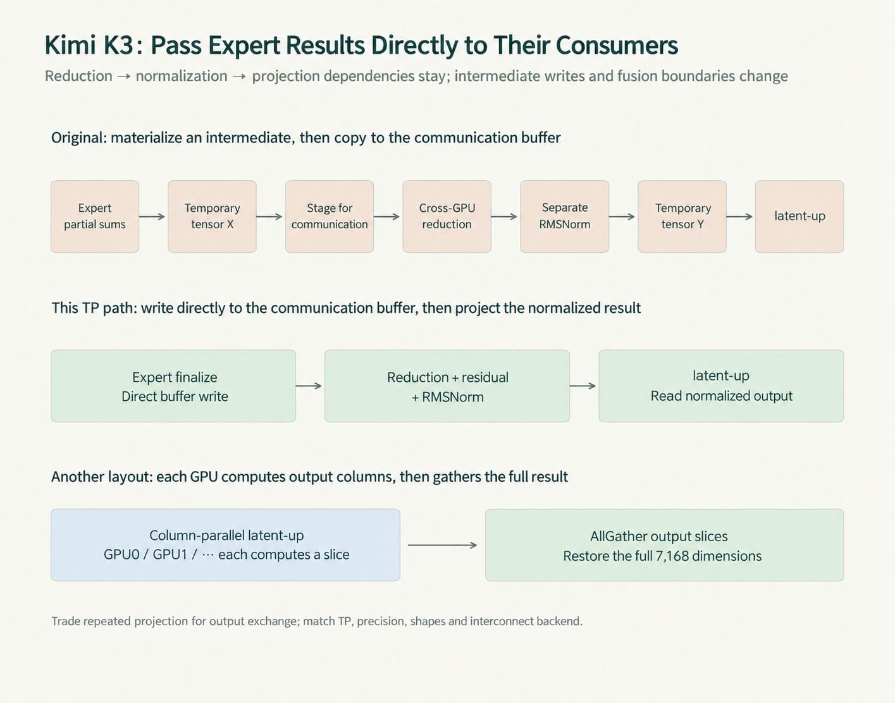
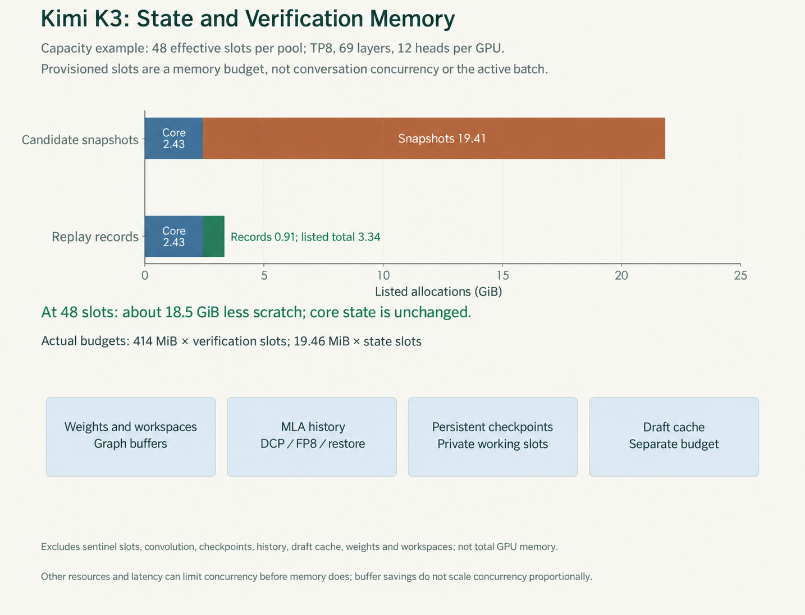
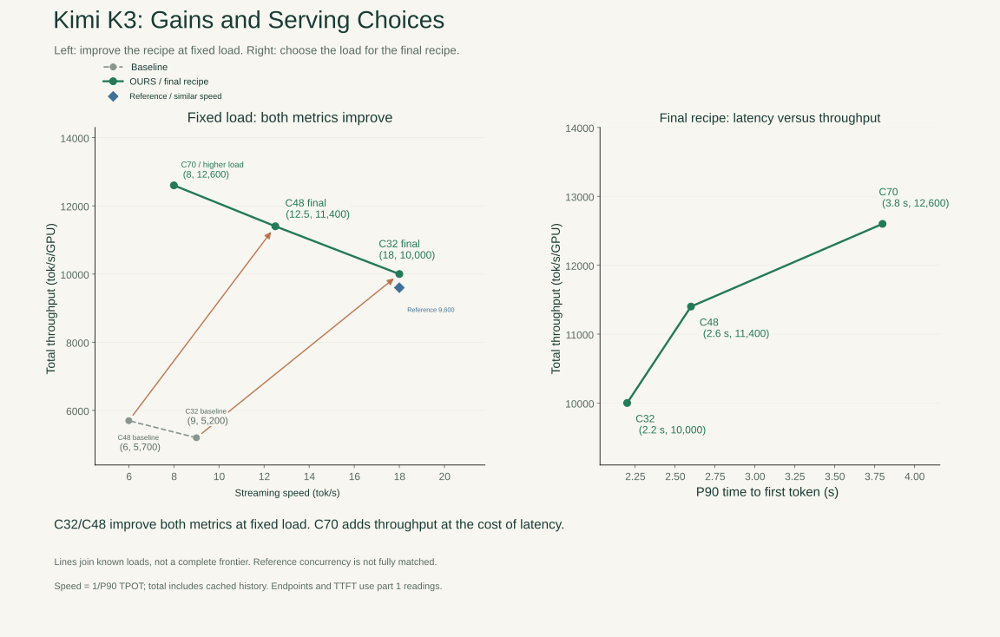
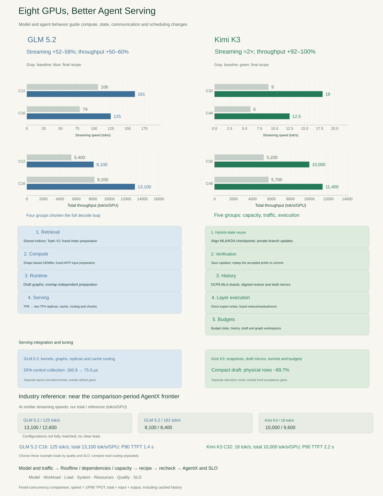

*Part 3 of the B300 case study. Previously: [results and bottlenecks](/en/posts/b300-find-the-bottleneck/) and [the complete GLM 5.2 decode loop](/en/posts/glm-5-2-faster-decode-loop/).*

> **Key points**
>
> • The five groups roughly double Kimi K3 streaming speed while increasing total throughput by 92–100% in the series comparison.
>
> • State reuse, replay, history sharding, and fused layer execution address different costs.
>
> • Memory savings require a new serving budget; quality and SLO determine the load we can use.
>

Kimi K3 makes fitting requests and executing them quickly two closely related engineering problems.

Its roughly 2.8 trillion parameters would occupy about 1.4 TB even if every weight used four bits. The server then needs space for long attention histories, private recurrent states, checkpoints, draft-model history, and speculative scratch. Those allocations also create traffic: the system has to restore them, read them, update them, and sometimes discard them.

The model repeats this work across 69 KDA layers, 24 MLA layers, and 92 expert layers. Small projections and short collectives accumulate. Finding room for another request does not by itself make the next token arrive sooner.

The five groups below address both sides. In the series comparison, streaming speed roughly doubles at fixed concurrency while total throughput rises by 92–100%, on the same eight B300s.

## Capacity and Execution

Alongside the weights, the service has five distinct kinds of stored state:

| Allocation | What it retains | What makes it grow |
|---|---|---|
| Target MLA history | Earlier tokens' attention representations | Retained token positions |
| Private KDA working state | The recurrent matrix a request updates | Provisioned working slots |
| Reusable checkpoints | Saved KDA states for later restoration | Retained checkpoint slots |
| Speculative scratch | Candidate matrices or update records | Reserved window length and pool capacity |
| Draft-model KV | History used by the draft model | Allocated draft-cache pages |

The recipe uses TP8, W4A8 routed experts, BF16 projections, FP8 MLA history, and FP32 KDA core state. DCP8 joins the recipe in the history-parallel group. DSpark proposes seven tokens; target verification covers eight positions including the extra verification position. A synthetic acceptance target of 3.84, counting the target-verified token, holds proposal acceptance fixed for the system comparison.

| Stage | C32 streaming tok/s | C32 total tok/s/GPU | C48 streaming tok/s | C48 total tok/s/GPU |
|---|---:|---:|---:|---:|
| Baseline: hybrid attention and DSpark | 9 | 5,200 | 6 | 5,700 |
| Reuse hybrid history and checkpoints safely | 10 | 5,700 | 7 | 6,400 |
| Save updates and replay accepted recurrent state | 12 | 6,800 | 8.5 | 8,000 |
| Shard long MLA history with DCP8 | 13 | 7,400 | 9 | 8,500 |
| Fuse layer computation and communication | 16.5 | 9,100 | 11.5 | 10,400 |
| Rebalance the serving-memory budgets | 18 | 10,000 | 12.5 | 11,400 |

*Figure 15 | The five groups correspond to the changes described below. Both metrics improve at fixed concurrency, and its axis does not start at zero. The compact draft pool discussed separately is not included in these gains.*

Streaming speed is the reciprocal of P90 request-average time per output token after the first token. Total throughput includes cached input history. [Part 1](/en/posts/b300-find-the-bottleneck/) gives the replay contract and the distinction between conversation concurrency, active requests, and operator rows.

## Share History, Keep Updates Private

MLA history is append-only: calculating the next token does not overwrite earlier cache entries. KDA carries a recurrent matrix that advances in place. Two agents branching from the same conversation can share the former, but need separate writable copies of the latter.

The Unified Radix Cache follows a common token path for MLA history and KDA checkpoints. A request finds the matching restore boundary and copies the checkpoint into a private working slot. If the exact state is unavailable, it restores an earlier checkpoint and computes forward.

The sequence is restore, forward computation, snapshot, then donation to the cache. Donation can transfer a slot index rather than copying the whole matrix again. A second snapshot slot is allocated lazily, avoiding a permanent extra working allocation for every request.

*Figure 16 | Branches share a saved prefix and advance separate states. Snapshot too early and it contains old state; snapshot too late and another update may have overwritten it. The restore boundary and stream order must agree.*

The copies are ordered on the forward stream between their producers and consumers. Recurrent state cannot generally run backward, so checkpoint placement determines how far a branch must replay. Aligned branch points are particularly useful: later branches can restore there rather than repeat the same recovery work.

The first group takes the C32 profile from 9 to 10 tok/s and from 5,200 to 5,700 total tok/s/GPU. It reduces repeated restoration and movement; it does not eliminate the model computation required by each new token.

## Save Updates During Speculative Verification

DSpark verification can accept only part of its proposed block. KDA must finish with the state corresponding to that accepted prefix, with no contribution from the rejected suffix.

The straightforward path saves a complete recurrent matrix after every candidate position, then keeps the appropriate version. With eight verification positions, that creates eight full matrices per request, layer, and head.

ReplaySSM records each update's inputs—v, k, gate values, and beta—instead. Once acceptance is known, a fold kernel starts from the committed checkpoint and applies the accepted updates in order. One launch covers layers and heads together.

The target still verifies the candidates and performs the necessary recurrence. Replay changes how the accepted KDA state is reconstructed; it does not rerun the entire target model token by token. It also avoids writing every candidate's full matrix during verification.

The storage calculation needs the actual allocation conventions:

| Per layer and local head | Storage |
|---|---:|
| Eight 128×128 FP32 candidate matrices | 512 KiB |
| Update inputs for eight effective positions | approximately 8.03 KiB |
| Update records reserved for sixteen positions | approximately 16.06 KiB |
| Additional d/k compatibility buffers | 8 KiB |
| **Listed Replay records and compatibility buffers** | **approximately 24.06 KiB** |

The vectors use BF16; gate values and beta use FP32. Sixteen is the branch's reserved record length, not its eight-position verification window. The d/k compatibility allocation still exists in that branch. Together the listed records occupy about one twenty-first of the old candidate snapshots.

Across 69 KDA layers and 12 heads per GPU under TP8, the old scratch is about 414 MiB per verification slot; the new records are about 19.46 MiB per state slot. Committed matrices, checkpoints, and convolution state are separate.

*Figure 17 | Count effective positions, reserved positions, and compatibility buffers separately. Verification remains; commit replays only the accepted prefix from a valid checkpoint.*

This differs from sharing weights across a batch. Each request owns its recurrent matrix, so more requests do not amortize that matrix's traffic in the same way. Replay reduces storage and matrix writes in exchange for reconstruction after acceptance. A roughly 21-fold storage reduction is not a 21-fold execution speedup.

The C32 profile moves from 10 to 12 tok/s and from 5,700 to 6,800 total tok/s/GPU with the acceptance condition unchanged. Checkpoints recover state across turns and branches; Replay commits the right state within one speculative iteration.

### Sidebar: A Compact Draft Cache

Draft KV is another allocation. The compact-pool path retains recent hot pages and samples older history, with its own logical-to-physical mapping. The allocator, prefix restoration, and host mirror must all use that mapping.

For the same target logical range of 1,414,272 rows, draft physical allocation falls from 11,314,624 to 1,170,240 rows, a reduction of 89.7%.

*Figure 18 | Reducing the physical pool differs from merely limiting which rows attention reads. The original allocation is about eight times the target logical range; the draft KV is already head-sharded under TP, so this does not represent eliminating eight complete replicas.*

Skipping old positions while still allocating all of them saves little capacity. Shrinking the pool while restoring through the old indices can write to the wrong location. Retention policy, mapping, allocator, and mirror have to change together.

History pruning can also affect draft quality. The inspected branch cannot combine this path with the fixed synthetic acceptance setting, so the allocation result stays outside the stage-profile service gains.

## Spread Long Histories Across GPUs

Once speculative scratch is smaller, the 24 MLA layers still retain and read long histories. Their shared latent KV cannot simply be divided by KV heads in the usual way. Ordinary tensor parallelism may leave every rank storing and reading the same latent history.

DCP8 distributes target MLA history by position within the existing TP8 group: position p belongs to rank `p mod 8`. Each rank computes a local attention output and log-sum-exp normalization term. The ranks exchange those values and reweight the outputs against the complete history, then restore the head layout expected by the output projection.

Adding independently normalized shard outputs would assign the wrong weights. LSE carries the information needed to merge them correctly. Sharding changes where history lives and how it is read; it does not shorten the context the model uses.

*Figure 19 | The saving applies to target MLA history. DCP does not divide private KDA state or the already TP-head-sharded draft cache by another factor of eight.*

The trade is saved history reads versus exchange and merge costs. Long contexts offer more traffic to save; short contexts may favor less context parallelism. Some paths replicate the full query projection to remove an AllGather, trading extra weights and computation for one fewer collective.

HiCache adds restoration to this layout. Target physical pages are striped, but the draft has its own indices. Sizing the draft host mirror from one rank's target-page count can leave valid logical indices outside the allocation. The corresponding [public fix](https://github.com/sgl-project/sglang/pull/35221) sizes the sidecar for the logical range. The local integration also checks restoration completion so computation does not consume data before it arrives. The PR documents the matching mechanism, not the provenance of every local change.

The selected branch uses static DSpark verification, `cutedsl_mla` in decode mode for generation and verification, and `trtllm_mla` for prefill. It requires FlashInfer 0.6.17 or later and the corresponding DCP interface. “Decode mode” names the backend path; verification still processes candidate positions together. These are versioned composition requirements, not proof that every DCP, cache, and speculative option can be mixed.

This group takes C32 from 12 to 13 tok/s and from 6,800 to 7,400 total tok/s/GPU. Restoration, new-input processing, and merging still belong in the full-request comparison.

## Streamline Layer Computation and Communication

Kimi K3's `7168 → 3584` projection has low arithmetic intensity at small M, but optimizing that matrix alone leaves the rest of the layer: expert computation, cross-GPU reduction, normalization, and projection back to 7,168 dimensions. The model repeats this path through 92 expert layers.

Start with the expert output. A conventional path writes a temporary tensor, copies it into a communication buffer, performs the reduction, then launches residual addition and RMSNorm before latent-up reads the result. Directly writing the expert result into the communication buffer removes a copy. Fusing reduction, residual addition, and normalization removes more handoffs while preserving their dependency order.

The collective still exists, and the next operation needs its result. A reduction saving on that exposed chain can shorten the layer directly. The serving integration ports and connects the relevant matrix and reduction kernels to the actual execution path.

*Figure 20 | Direct writes and fused consumers remove intermediate traffic. A separate lower path shows column-parallel latent-up followed by AllGather: less repeated projection, but an added communication cost.*

AllReduce adds partial sums from ranks. AllGather collects different output slices. A column-parallel latent-up computes only part of the output per rank, then gathers the full 7,168-dimensional representation. That removes repeated projection but adds a collective's fixed cost, which can be unattractive at very small batches. The changed per-rank shape needs new kernel selection.

Before the experts, the same input feeds the latent projection, router, and shared branch. Combining compatible projections reduces repeated input reads and launches. Paired narrow KDA projections, state updates, and residual aggregation offer other fusion opportunities. Wider fused outputs change M/N/K; the original projection's Roofline analysis cannot simply be reused.

The draft side needs attention too. DSpark moves embedding lookup inside graph replay and combines context-KV projections across draft layers, reducing eager staging and repeated launches around proposal generation.

**Implementation Conditions**

| Implementation boundary | Selected path |
|---|---|
| Compute | BF16 CuTe DSL tactics; W4A8 experts with SiTU and `flashinfer_mxfp4`; TMA-assisted residual movement |
| Communication | TP collectives, A2A backend `none`; CustomAllReduceV2 push for small messages and NVLS two-stage reduction for larger ones |
| Buffers and fallback | Dedicated symmetric buffers, distinct from the general `enable_symm_mem` flag; fall back outside supported shapes; EP A2A requires its own implementation |

The C32 profile moves from 13 to 16.5 tok/s and from 7,400 to 9,100 total tok/s/GPU. The trace still decides what to optimize next: an already-hidden kernel can get faster without shortening the iteration.

## Budget Memory for the Serving Workload

Active requests determine which slots are currently in use. Provisioned pool capacity determines how much memory is reserved. The old snapshots are allocated by verification-pool size; Replay records use KDA state-pool size, which may also reserve slots for recoverable history. Those counts need not equal the current batch.

For an independent capacity example, give both pools 48 effective slots, use TP8 with 69 layers and 12 local heads, keep FP32 core matrices, and use the sixteen-position record allocation above. Sentinel slots are excluded.

| Per-GPU allocation | Candidate-matrix path | Replay path |
|---|---:|---:|
| Core state per slot | 51.75 MiB | 51.75 MiB |
| Verification scratch / records per slot | 414 MiB | approximately 19.46 MiB |
| Core state, 48 slots | approximately 2.43 GiB | approximately 2.43 GiB |
| Scratch / records, 48 slots | approximately 19.41 GiB | approximately 0.91 GiB |
| **Listed total** | **approximately 21.83 GiB** | **approximately 3.34 GiB** |

The listed scratch saving is about 18.5 GiB. Actual budgeting uses `414 MiB × verification slots` and `19.46 MiB × state slots` separately. Weights, convolution state, persistent checkpoints, MLA history, draft history, and graph workspaces are outside this table.

*Figure 21 | Core state is unchanged; verification storage shrinks. A smaller buffer does not imply a proportional increase in concurrency, because another pool may fill first.*

After weights and quantization metadata, the budget must accommodate history, working states, drafts, and workspaces. History grows with retained tokens; writable slots grow with active requests; graph reservations depend on captured shapes. Enlarging one pool takes room from another.

The service tuning therefore combines TP/DCP, FP8 KV, working and cache slots, lazy buffers, HiCache, prefill chunks, and graph memory. Allocation retries and mirror indices have to remain correct. Spare bytes are useful only if the allocator can provide the particular page, slot, and buffer a request needs. An agent waiting on a tool needs recoverable history without necessarily holding every active work slot.

Prefill chunks affect other requests' waits too. A large tool log can monopolize execution; smaller chunks add launches and scheduling. The comparison needs cold-request TTFT, ongoing streams' token intervals, and the resource budget together. Further single-round chunk limits lack a complete service comparison and are not included in the stage gains. Unified byte pools, prefill/decode disaggregation, and pipeline parallelism are alternatives with their own state-boundary and transfer requirements, not implicit parts of this recipe.

The final budget group takes C32 from 16.5 to 18 tok/s and from 9,100 to 10,000 total tok/s/GPU; C48 moves from 11.5 to 12.5 tok/s and from 10,400 to 11,400.

> **On Different Hardware**
>
> The state semantics stay fixed; their cheapest implementation may change. Different compute, bandwidth, local memory, and interconnect move operators along their Rooflines and change the cost of a transfer or recomputation.
>
> A static execution plan can remove some runtime preparation, but agent branches, changing batches, and speculative windows still need handling. On-chip weight residence can remove some HBM reads only if capacity, loading frequency, on-chip bandwidth, and cross-chip exchange all work out. Neither feature alone establishes that the waits have disappeared.
>
> Branches still need private writable state. Rejected tokens must not be committed. Checkpoints, history, and draft indices must stay aligned. Saving full matrices or saving update inputs must meet the same correctness requirements; the hardware decides which cost balance is attractive.

## Select the Load Against an SLO

*Figure 22 | Fixed-load arrows compare the baseline with the final recipe. Final-load points add the TTFT trade-off. The reference is the comparison-period InferenceX frontier; connecting known points does not fill the gaps between them.*

C32 reaches 18 tok/s streaming speed, about 10,000 total tok/s/GPU, and 2.2 seconds P90 TTFT. C48 reaches 12.5 tok/s, about 11,400, and 2.6 seconds. At C70, total throughput rises to 12,600 while speed falls to 8 tok/s and TTFT rises to 3.8 seconds.

At approximately 18 tok/s, the reference reading is about 9,600 total tok/s/GPU versus this recipe's 10,000. As with GLM 5.2, the gap is small and configurations are not fully matched. The supported conclusion is proximity to the comparison-period frontier.

These example targets illustrate how the two recipes would be selected:

| Example requirement, using this series' percentile definitions | Choice among the supplied points |
|---|---|
| GLM 5.2: speed ≥120 tok/s, TTFT ≤1.5 s; prefer throughput | C16: 125 tok/s, 1.4 s, 13,100 total tok/s/GPU |
| GLM 5.2: speed ≥150 tok/s, TTFT ≤1.5 s | C12: 161 tok/s and 1.1 s |
| Kimi K3: speed ≥15 tok/s, TTFT ≤2.5 s | C32: 18 tok/s and 2.2 s |
| Kimi K3: speed ≥12 tok/s, TTFT ≤3 s; prefer throughput | C48: 12.5 tok/s, 2.6 s, 11,400 total tok/s/GPU |

These are illustrative targets, not customer acceptance criteria. Separate TPOT and TTFT percentiles do not establish that 90% of requests satisfy both together, nor do they determine request-level goodput. Quality comes first; synthetic acceptance is not a task-quality result.

## Two Recipes, One Optimization Method

GLM 5.2 improves streaming speed by 52–58% and total throughput by 50–60% in the fixed-load comparison. Kimi K3 roughly doubles streaming speed while total throughput rises by 92–100%.

The GLM 5.2 work connects shared-index propagation, TopK-V2, shape-aware CuTe DSL dispatch, graph coverage, and two-TP4 deployment with cache-aware routing. The separate DPA control change retains its own conditions.

For Kimi K3, the representation and movement of state are central: correctly ordered checkpoints, update records instead of candidate matrices, striped MLA history, expert output written into communication buffers, and fused reduction and normalization. The serving integration aligns host mirrors with draft logical indices, connects the kernels, and budgets state slots, history, and graph memory together. The compact draft allocation remains a separate result.

*Figure 23 | Four GLM 5.2 groups and five Kimi K3 groups connect architectural costs to serving choices. Separate DPA and compact-draft results are not folded into the default stage gains.*

The baseline comparison answers how much the recipe changes. The external frontier shows its approximate position among alternatives. Quality and SLO select the load we can use. Returning to all three is how kernel, state, communication, and scheduling work becomes a better service for the agents on those eight GPUs.

## Sources

*Sources: [Unified Radix Cache](https://github.com/sgl-project/sglang/blob/2a5f45d3d47879f5524194789fe0db61fe206671/python/sglang/srt/mem_cache/unified_radix_cache.py); [ReplaySSM](https://tridao.me/blog/2026/replayssm/); [KDA verification and replay](https://github.com/sgl-project/sglang/blob/2a5f45d3d47879f5524194789fe0db61fe206671/python/sglang/kernels/ops/attention/fla/kda_replayssm_spec_decode.py); [buffer allocation](https://github.com/sgl-project/sglang/blob/2a5f45d3d47879f5524194789fe0db61fe206671/python/sglang/srt/mem_cache/memory_pool.py); [DCP](https://docs.sglang.io/docs/advanced_features/dcp); [host-mirror correction](https://github.com/sgl-project/sglang/pull/35221); [Kimi K3 engineering](https://www.lmsys.org/blog/2026-07-27-kimi-k3-day0-support); [communication fusion](https://github.com/sgl-project/sglang/blob/2a5f45d3d47879f5524194789fe0db61fe206671/python/sglang/srt/layers/communication/k3_ar_fusion.py); [DSpark graph and projection work](https://github.com/sgl-project/sglang/pull/31986); [deployment recipe](https://docs.sglang.io/cookbook/autoregressive/Moonshotai/Kimi-K3). Comparisons, allocation examples, and the separate compact-pool result retain the supplied series records and their stated conditions.*
