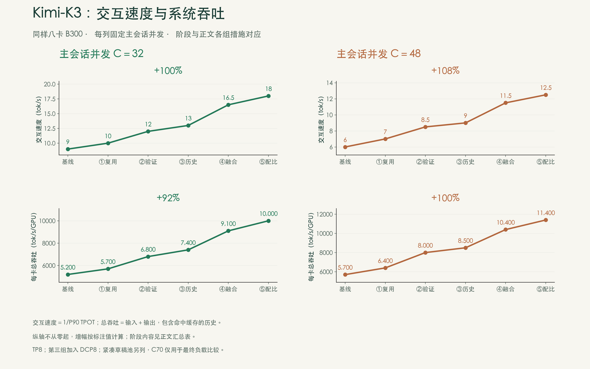
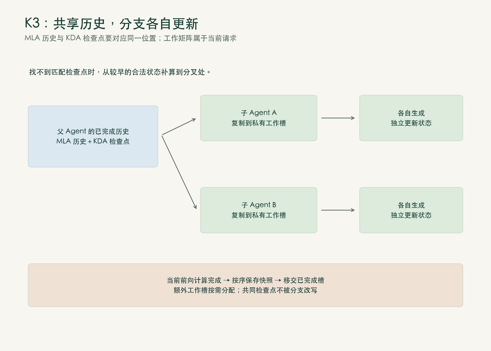
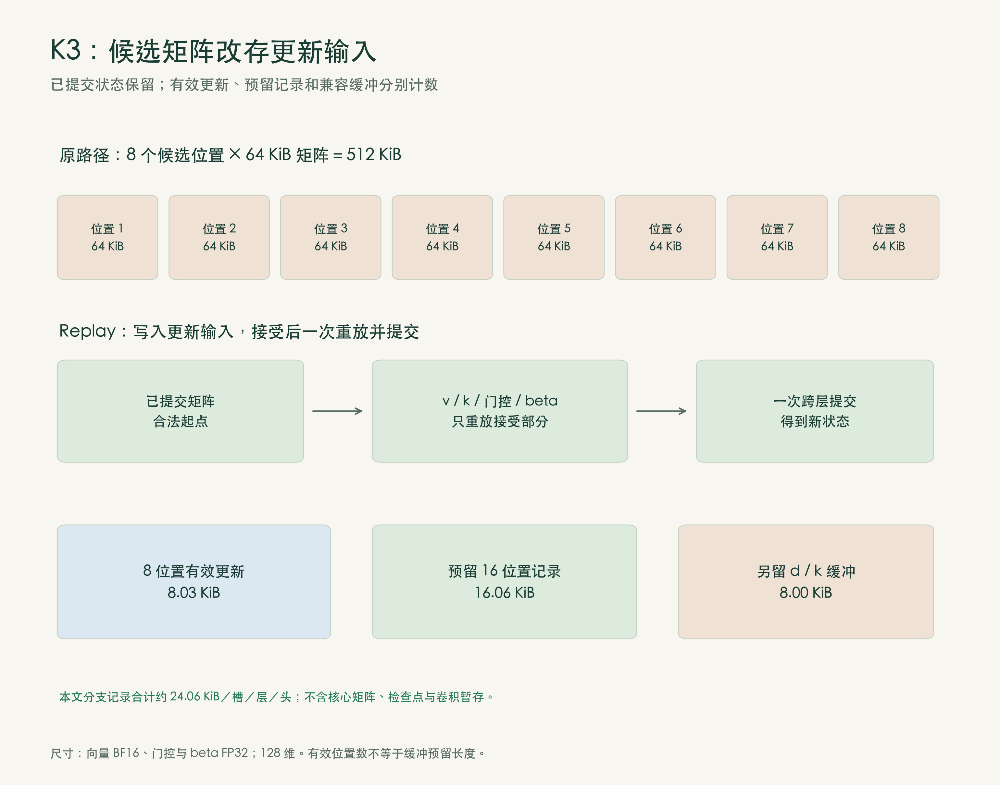
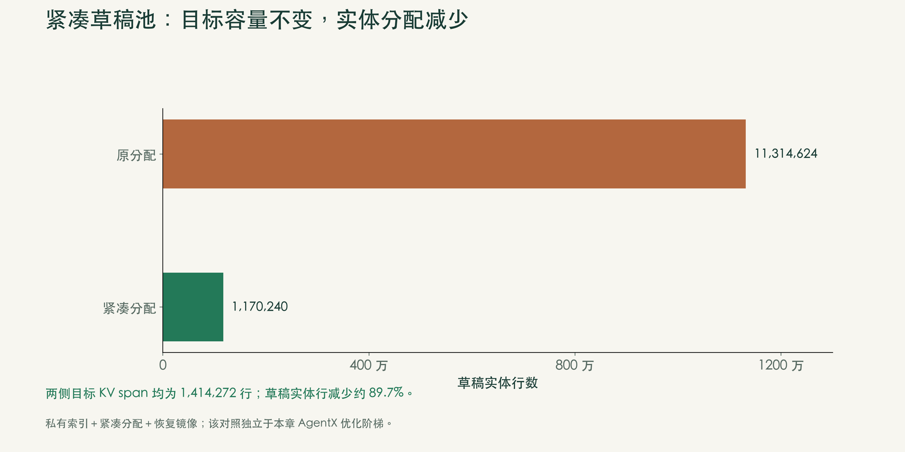
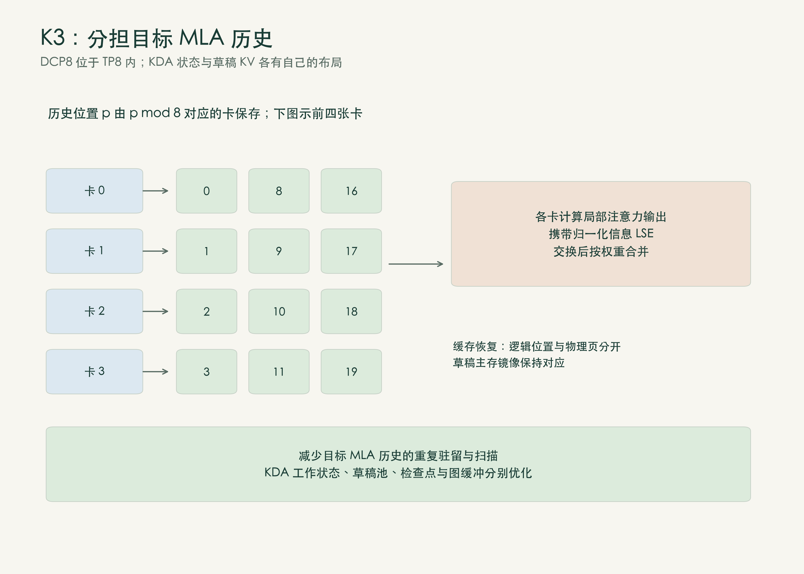
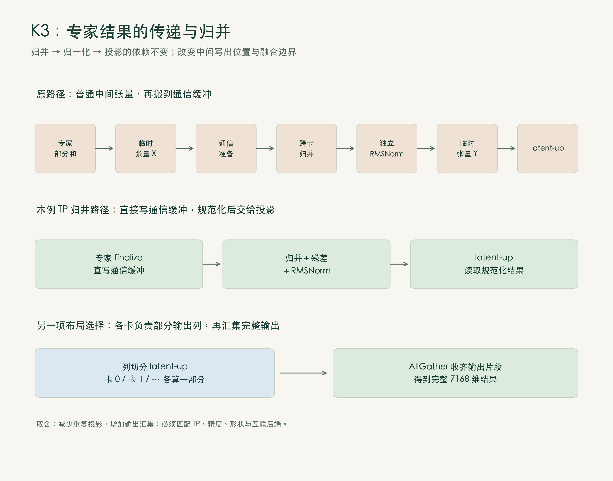
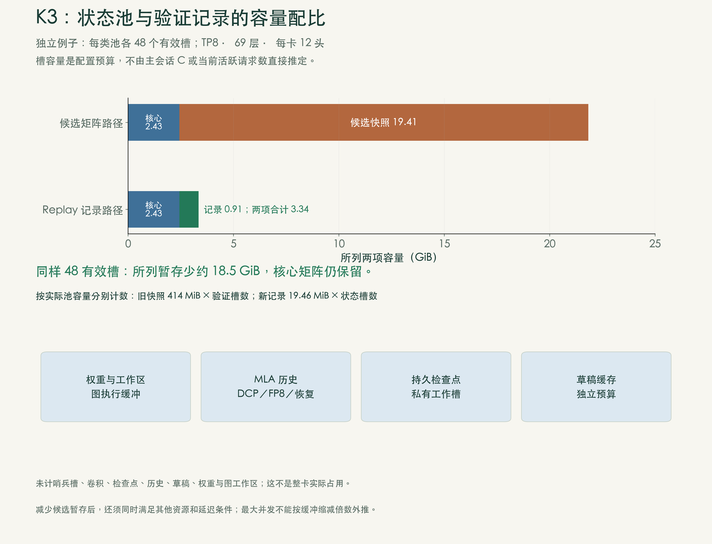
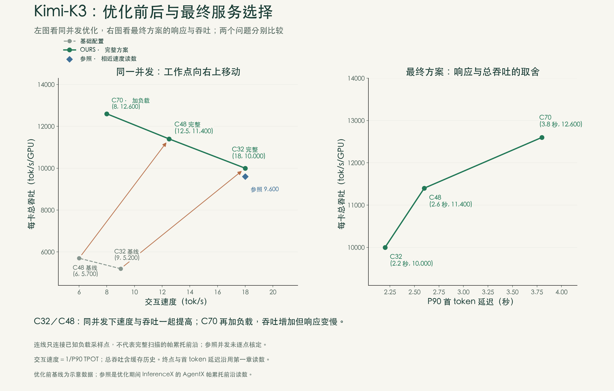
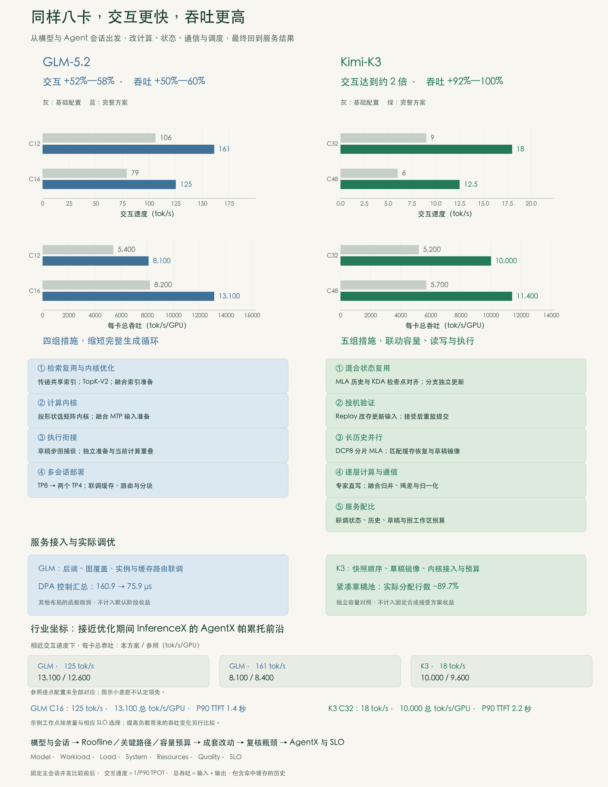

[上篇：成绩与瓶颈](/posts/b300-results-bottlenecks/) · [中篇：GLM 5.2：缩短生成循环](/posts/b300-glm-generation-loop/) · [下篇：Kimi K3：状态、通信与服务选择](/posts/b300-kimi-state-serving/)

> **数据口径说明：** 本系列图表中的基线与中间阶段数值属于内部演练示意，并非逐阶段实测结果；完整方案终点沿用原 AgentX 成果图读数。由这些示意点计算的增幅不能视为已核定的实测提升，也不能用于判断单项优化的因果贡献。

*推理优化系列 · 第3篇（下）*

> **本篇要点**
>
>
> - 五组优化让Kimi K3交互速度达到基础配置的约2倍，每卡总吞吐提高92%—100%。
>
> - 改变候选状态的保存方式、分担长历史读取、融合逐层计算与通信，同时缓解容量、读写和执行等待。
>
> - 用同一组AgentX结果选择满足SLO的工作点，并说明换硬件时哪些判断要重做。

本篇用同样八卡B300，分别固定主会话并发C32、C48比较优化前后。C表示同时运行的主Agent会话树数量；回放包含子Agent的并行请求。下面先分清会话历史、私有状态和投机暂存，再看五组措施如何共同改善服务。

**阅读口径。** 交互速度为`1/P90 TPOT`：先对每条请求计算首token之后的平均生成间隔，再取P90并求倒数，数值越高越好。开始回答前等多久，另看P90 TTFT。总吞吐按输入＋输出计数，**包含命中缓存的历史**，不等于新生成token的速度。

主方案使用TP8，即八卡张量并行，第三组起加入按历史位置分片的DCP8；W4A8路由专家、BF16投影、FP8 MLA KV、FP32 KDA核心状态。DSpark起草7个token，合成接受长度目标3.84，计入验证token，用来统一系统比较条件。公开局部对照另列条件，容量分析按明确尺寸计算。完整回放条件见[上篇第二节](/posts/b300-results-bottlenecks/#二-Agent场景的开销)。

## 一、容量与执行一起优化

Kimi K3约2.8万亿参数，即使全按4 bit存储，裸权重也约1.4 TB。在八卡B300上，权重之外还要容纳五类存储：

| 保存对象 | 保留什么 | 随什么增长 |
|---|---|---|
| MLA历史KV | 目标模型可追加的历史表示 | 历史token数 |
| KDA私有矩阵 | 当前请求正在更新的递推状态 | 活跃请求数 |
| KDA检查点 | 历史位置的状态快照，供恢复与分叉 | 复用边界和保留数量 |
| 验证暂存 | 一轮投机中的候选矩阵或更新输入 | 窗口、层、头和池槽数 |
| DSpark KV | 草稿模型自己的历史表示 | 草稿历史与池布局 |

这些对象必须沿同一条请求对齐。会话分叉后，子Agent各自更新KDA矩阵；候选被拒绝，只能提交接受位置对应的状态；下一轮恢复时，MLA历史、KDA检查点和草稿索引必须对应同一位置。

容量只是其中一面。状态和历史还要读写，目标与草稿仍须计算；69层KDA、24层MLA及92个专家层反复执行小矩阵、状态更新和跨卡归并。**能放下更多请求，与让每个请求更快，是相互关联、又需要分别优化的两件事。**

五组措施因此覆盖完整过程：

| 阶段 | 改动 | C32交互速度 | C32每卡总吞吐 | C48交互速度 | C48每卡总吞吐 |
|---|---|---:|---:|---:|---:|
| 基线 | TP8，已支持混合注意力与DSpark | 9 | 5,200 | 6 | 5,700 |
| ① 混合状态复用 | 对齐MLA历史与KDA检查点，分支独立更新 | 10 | 5,700 | 7 | 6,400 |
| ② 投机验证 | 改存更新输入，接受后一次重放提交 | 12 | 6,800 | 8.5 | 8,000 |
| ③ 长历史并行 | DCP8按位置分片MLA历史 | 13 | 7,400 | 9 | 8,500 |
| ④ 逐层计算与通信 | 专家直写通信缓冲，融合归并与归一化 | 16.5 | 9,100 | 11.5 | 10,400 |
| ⑤ 服务配比 | 联调状态、历史、草稿与图预算 | 18 | 10,000 | 12.5 | 11,400 |

交互速度单位为tok/s，每卡总吞吐单位为tok/s/GPU。紧凑草稿池单独比较，C70只用于最终方案的负载选择。

**图15｜固定并发下，两项指标同时改善。** 下文五组措施与图中阶段对应，既处理资源容量，也压缩读写、启动与等待。各小图纵轴不从零起，增幅以标注值为准。

## 二、共享历史，独立更新状态

父Agent读完代码后，两个子Agent从这里分叉。MLA缓存可能已覆盖到代码库末尾，KDA检查点却停在更早位置；仅有前缀命中还不够，还要从检查点补算到同一位置。直接让两个分支共用正在更新的KDA矩阵，又会混淆状态。

Unified Radix按同一条token路径管理MLA KV与KDA检查点，查找缓存时一并确定恢复边界。找到匹配状态，复制到请求独占的工作槽；找不到，从较早检查点补算，再保留可复用快照。状态沿“恢复→计算→保存快照→移交槽位”流转，完成后直接移交槽号可以省去整份复制，第二工作槽按需分配。〔资料1〕

两个子Agent复用的是分叉前的历史，之后的矩阵分别更新。我们在此基础上调整快照顺序、检查点边界和占用统计：快照放入前向计算的同一执行流，避免跨流先后不确定；检查点数量在恢复补算和工作槽空间之间取舍，让调度器看到的占用与实际一致。

**图16｜共同历史可以复用，工作状态各自更新。** 保存过早会得到旧状态，过晚可能被下一轮覆盖，恢复边界与执行顺序必须同时正确。

对应第一组，C32交互速度9→10 tok/s，每卡总吞吐5,200→5,700。减少恢复补算和重复搬运，也减轻了会话间的资源争用；每个新token所需的计算仍然保留。

## 三、投机验证改存更新输入

DSpark每轮起草7个token，本文目标侧验证窗口共8个位置，包含额外验证位置。若只接受前几个，KDA必须提交对应位置的状态。原路径给每个位置保存完整矩阵，验证后取出接受位置的版本，暂存和矩阵写回随窗口、层数、头数及参与请求增加。

ReplaySSM改变保存内容：记录各步更新所需的v、k、门控和beta，接受位置确定后，从已提交状态出发，按序重放被接受的更新，用一次内核启动完成各层、各头的状态提交。目标验证和必要递推照常进行，但不再写回每份中间矩阵；重放只更新KDA状态，不需要再次逐token运行整个目标模型。〔资料2〕

| 单槽、单层、单头 | 大小 |
|---|---|
| 原路径：8份128×128 FP32矩阵 | 512 KiB |
| 8个位置的有效更新输入 | 约8.03 KiB |
| 本文分支预留16位置的记录 | 约16.06 KiB |
| 额外d/k兼容缓冲 | 8 KiB |
| **所列Replay记录合计** | **约24.06 KiB，约为原路径的1/21** |

16是所用分支的记录缓冲预留长度，KDA沿用该长度分配；它与本轮8位置验证窗口不同，并不表示本轮验证16个位置。向量采用BF16，门控与beta采用FP32；d/k兼容缓冲仍在这一分支中分配。〔资料3〕

按TP8、69层、每卡12头计算，旧快照每个验证槽约414 MiB，新记录每个状态槽约19.46 MiB。已提交矩阵、检查点和卷积暂存另计。

**图17｜保留合法起点，用更新输入替代候选矩阵。** 接受后只重放接受部分；8个有效位置、16位置预留和额外缓冲分别计数。

这与上篇的权重分析形成一个重要区别：权重可由同批请求共享，KDA私有矩阵却不能共用，增加批量不会同样摊薄状态读写。Replay直接改变必须保存和写出的内容，既降低容量，也减少矩阵写回，代价是接受后的重放。容量缩小约21倍，不等于执行提速21倍，仍要比较完整验证与提交时间。

对应第二组，C32交互速度10→12 tok/s，每卡总吞吐5,700→6,800，草稿接受长度没有变化。检查点负责跨轮次、跨分支的恢复，Replay负责本轮接受状态的提交，两者各管一段。

### 旁注：紧凑草稿池

草稿KV是另一笔占用。我们实现过保留近期热页、间隔采样较远历史的紧凑草稿池：用独立索引映射物理槽，同时调整分配器、前缀恢复和主存镜像。目标KV逻辑范围同为1,414,272行时，草稿实际分配从11,314,624降至1,170,240行，减少89.7%。

**图18｜缩小物理分配，而不只是限制读取窗口。** 原分配约为目标逻辑范围的8倍；草稿KV本已按TP头分片，这不代表消除了八份完整副本。

只跳过较早历史，分配器仍可能预留完整空间；物理池缩小、恢复却沿用旧索引，又会写错位置。因此，页面保留、独立索引、分配与镜像须一起修改。这一路线减少的是草稿KV，Replay减少的是验证暂存。历史裁剪会影响草稿预测；所核查分支不能与固定合成接受设置同时运行，未计入图15的服务收益。

## 四、长历史由多卡分担

验证暂存缩小后，24层MLA仍要保存和读取长历史。MLA的共享潜向量KV不能像多个KV头那样直接按头切分，普通TP下，各卡可能仍保有、读取完整历史。

DCP8在同一TP8组内按历史位置分片：位置p保存在编号为`p mod 8`的卡上，各卡分别处理本地片段。它们先计算局部注意力输出与log-sum-exp（LSE），交换后按归一化权重合并，再恢复输出投影需要的头布局。〔资料4〕

各片段的注意力分数不同，局部归一化后直接相加会得到错误权重。交换LSE，才能按完整历史重新加权；分片改变存放和读取方式，模型使用的历史没有缩短。

**图19｜分担目标MLA历史的存储与读取。** DCP不会把KDA工作状态、已按TP头分片的草稿KV再缩小八倍。

这里优化的是历史访问，不能套用降维投影的Roofline。应比较特定历史长度、KV精度和分片布局下节省的读取，与新增交换、合并的成本。历史越长，读取节省越有机会抵消通信；短会话可能适合更小的DCP度数。部分实现复制完整query以省去一次AllGather，也增加了投影计算和权重占用。

HiCache与DCP配合时，还有两套布局要对齐。HiCache在主存保留暂时不用的历史，DCP分担当前生成所需的历史读取；目标物理页已分片，草稿却有自己的索引，不能用某张卡的目标页数分配草稿镜像。我们按草稿逻辑空间和页面构造镜像，修正组合限制并做池级回归，同时检查恢复完成通知，使后续计算在数据就绪后开始。〔资料5〕

所选分支采用静态DSpark验证，生成和验证使用`cutedsl_mla`的decode模式，预填充使用`trtllm_mla`，要求FlashInfer≥0.6.17及相应DCP接口。这里的decode是后端执行模式，不是逐token验证；候选批量、历史分片和缓存恢复须同时得到支持。

对应第三组，C32交互速度12→13 tok/s，每卡总吞吐6,800→7,400。收益要放回完整请求，连同历史恢复、新输入计算和结果交换一起比较。

## 五、压缩逐层计算与通信

上篇中，`7168→3584`降维投影在M=16时AI约15.9，提示小批量下要重视加载。但每层还要计算专家、跨卡归并部分和、归一化，再投影回7,168维。92个专家层反复经过这些步骤，压缩临时读写、启动和阻塞同步，才能让小矩阵的优化转化为完整执行收益。〔资料6〕

先改专家结果的传递。原路径先写临时张量，再搬到通信缓冲；归并后单独计算残差与RMSNorm（均方根归一化），再写出另一份结果供latent-up读取。新路径让专家输出直接落入通信缓冲，融合归并、残差和归一化。**归并→归一化→投影的依赖顺序不变，中间读写和独立启动减少。**

跨卡归并仍然存在，但下一步必须等它完成。减少这段阻塞，会直接缩短关键路径。我们将相关矩阵和归并内核移植到所用服务版本，并接入实际执行。〔资料7〕

**图20｜直写通信缓冲，融合相邻操作。** 归并本身保留。下方另示按列切分的latent-up与AllGather，比较重复计算减少和新增通信的取舍。

latent-up还可按列切分，让各卡只算部分输出，再用AllGather汇集完整7,168维表示。前面的AllReduce将各卡的部分和相加，这里的AllGather收集不同输出片段。这样减少重复投影，却增加通信固定开销，批量很小时未必划算；单卡形状也随之改变，须重新选内核。

进入专家前，同一输入还分别用于降维投影、路由器和共享分支。条件允许时，合成一次矩阵计算，减少输入重复读取和独立启动。KDA成对窄投影、状态更新与残差聚合，也按数据依赖融合。融合改变输出宽度，内核须按新M/N/K重选，不能沿用原投影的分析。

草稿侧也要减少固定开销。DSpark将embedding纳入图执行，并合并各草稿层的context-KV投影，让目标模型和草稿模型两侧的执行衔接一起改善。〔资料8〕

对应第四组，C32交互速度13→16.5 tok/s，每卡总吞吐7,400→9,100，是五组中增益较大的一组。**优先处理阻挡下一层的归并和等待；已被其他计算掩盖的内核，继续加速未必能缩短整轮。**

> **实现条件**
>
> 上述数据流对应具体后端与缓冲约定，接入服务时还须核对以下条件：
>
> | 对象 | 所用实现与边界 |
> |---|---|
> | 计算内核 | BF16采用对应的CuTe DSL策略；W4A8专家匹配SiTU激活，采用`flashinfer_mxfp4`；残差使用TMA硬件机制异步搬运 |
> | 跨卡归并 | 通信走TP，A2A后端设为`none`；CustomAllReduceV2的小消息用单次push，大消息用NVLS双阶段归并 |
> | 缓冲与回退 | 融合采用专用对称缓冲，与通用`enable_symm_mem`开关不同；不满足条件则回退，改用EP A2A时另选实现 |

## 六、显存预算与服务配比

节省显存后，还要重新分配预算。活跃请求数决定当前用了多少状态，池槽容量决定预留多少空间；旧快照按验证池分配，新记录按KDA状态池分配，后者还可能为可恢复历史留槽。

看一个独立容量例子：各类池均为48个有效槽，TP8、69层、每卡12头、FP32核心矩阵，采用前述16位置记录，不计哨兵槽。

| 每卡对象 | 原路径 | Replay路径 |
|---|---:|---:|
| 单槽核心状态 | 51.75 MiB | 51.75 MiB |
| 单槽验证暂存／记录 | 414 MiB | 约19.46 MiB |
| 48槽核心状态 | 约2.43 GiB | 约2.43 GiB |
| 48槽验证暂存／记录 | 约19.41 GiB | 约0.91 GiB |
| **所列两项合计** | **约21.83 GiB** | **约3.34 GiB** |

同为48槽，所列暂存少约18.5 GiB，核心状态不变。实际要分别计算`414 MiB×验证槽数`和`19.46 MiB×状态槽数`；表中没有权重、卷积、持久检查点、MLA历史、草稿与图工作区，不代表整卡占用。〔资料3〕

**图21｜释放验证暂存，再联调其他资源。** 缓冲缩小多少倍，最大并发不会自动增加多少倍，另一类资源可能先用完。

预算先扣除权重与量化附加数据，再分配历史、状态、草稿和工作区。历史页随保留token数增长，私有工作槽随活跃请求数增长，图工作区则受捕获形状影响；调大一个池，可能挤占另一个池。

我们实际联调TP/DCP、FP8 KV、KDA工作槽与缓存槽、按需缓冲、HiCache、预填充分块和图预算，并处理分配重试与镜像索引。有空闲字节，还要能分配出下一份请求所需的页、槽和缓冲；等工具的会话需要可恢复历史，也不必一直占着所有工作槽。

分块大小还会改变请求之间的等待。长工具日志一次占用GPU太久，其他会话生成就会停顿；块很小，启动与调度次数又增加。应同时看冷请求TTFT、已有请求的生成间隔和各类资源是否够用。

对应第五组，C32交互速度16.5→18 tok/s、每卡总吞吐9,100→10,000；C48为11.5→12.5 tok/s、10,400→11,400。限制单轮预填充分块的进一步探索尚缺完整服务对照，未计入阶段收益。统一字节池、预填充/解码分离与流水线并行也是可选路线，采用时须维护状态边界、层范围与缓存交接，不默认属于最终配置。〔资料9〕

> **拓展：换硬件时，哪些判断要重做？**
>
> 这些经验可以迁移，具体配置不能照搬。芯片的算力、带宽、片上容量和互联不同，同一个算子的Roofline位置、读写代价、通信与重算取舍也会改变。
>
> 静态执行计划可以减少部分运行时准备，但Agent的分叉、批量变化和投机窗口仍需要处理。若权重能够驻留片上，部分HBM访问可以减少，还须算清驻留容量、装载频率、片上带宽与跨芯片数据交换；不能仅凭“静态调度”或“片上存储”就认定等待已经消失。
>
> 不变的是请求的语义：分支状态各自更新，拒绝候选不能提交，历史、检查点与草稿索引必须对齐。保存完整状态还是更新输入，正确性要求相同，最合适的选择却取决于硬件上的容量、读写和重算成本。比较其他架构，仍然要回到同一组模型、工作负载、负载、系统、资源、质量与SLO。

## 七、从提速到服务选择

**图22｜容量、读写与执行优化，共同改善服务工作点。** 左图连接同并发的基础配置与完整方案，右图比较最终方案的TTFT与吞吐。参照为优化期间InferenceX前沿的已知读数，点间连线不是完整扫描。

在所比较的配置中，如果还有速度不低、吞吐更高的配置，或吞吐不低、速度更快的配置，当前点就不在前沿上。左图向右上移动，表示同并发的速度与吞吐一起提高；沿完整方案提高并发，则是另一种负载取舍。约18 tok/s处，本方案每卡总吞吐约10,000，参照约9,600，接近前沿；参照逐点配置仍未全部对应，小幅差距不足以认定领先。

**Kimi K3交互速度达到基础配置的约2倍，每卡总吞吐提高92%—100%。** C32达到18 tok/s、约10,000 tok/s/GPU，C48达到12.5 tok/s、约11,400 tok/s/GPU。完整方案继续加到C70，可得到约12,600 tok/s/GPU，但交互速度降到8 tok/s，P90 TTFT增至3.8秒。

用第二篇的方法，最后按服务目标筛选。以下阈值仅作示例，不是客户验收要求：

| 目标（按本文P90口径） | 选择 | 理由 |
|---|---|---|
| GLM 5.2：交互≥120 tok/s、TTFT≤1.5秒，优先吞吐 | C16 | 125 tok/s、1.4秒、13,100 tok/s/GPU；C12也符合，但吞吐较低 |
| GLM 5.2：交互≥150 tok/s、TTFT≤1.5秒 | C12 | 161 tok/s、1.1秒；C16速度不够 |
| Kimi K3：交互≥15 tok/s、TTFT≤2.5秒 | C32 | 18 tok/s、2.2秒；C48、C70不满足 |
| Kimi K3：交互≥12 tok/s、TTFT≤3秒，优先吞吐 | C48 | 12.5 tok/s、2.6秒；C70为8 tok/s、3.8秒，不合格 |

分别用TPOT的P90和TTFT的P90筛选，不代表90%的请求同时满足两个阈值，也不足以计算逐请求有效吞吐。质量要求先满足，再用SLO决定可承受的负载；合成接受长度不能代替真实任务质量。

与基线比较看优化幅度，与前沿比较看性能水平，按SLO筛选决定部署。三种判断合起来，才能把提速变成可用的服务能力。

## 八、两套方案，一套方法

**同样八卡B300，GLM 5.2交互速度提高52%—58%、每卡总吞吐提高50%—60%；Kimi K3交互速度达到约2倍、每卡总吞吐提高92%—100%。** 两套方案都在固定主会话并发下同时改善速度与吞吐，最终工作点接近优化期间的AgentX前沿。

GLM 5.2沿完整生成循环展开优化：传递可共享的索引，加快必要计算，提前执行独立准备，再配合实例、缓存与调度。我们比较TopK-V2、CuTe DSL和图执行配置，联调TP8与两个TP4、缓存亲和及冷请求路由；在DPA布局中，还把分散的控制数据回传合成一次CPU汇总，减少轮间同步。这些具体工作将内核、执行衔接和多会话部署连接起来。

Kimi K3则改变状态与数据的保存、传递方式：用更新输入替代候选矩阵，多卡分担MLA历史读取，专家输出直写通信缓冲，融合归并与归一化。我们调整快照顺序和检查点边界，按草稿逻辑空间修正主存镜像，接入相关矩阵与归并内核，再联调状态槽、历史缓存和图工作区。历史与状态必须正确恢复，请求也要能拿到所需的页、槽和缓冲，前面的计算与通信优化才能转化为服务收益。

**图23｜同样八卡，两套完整方案同时提高速度与吞吐。** 上方比较同并发前后，中间对应GLM 5.2四组、Kimi K3五组的具体改动，下方汇总实际工程工作、行业位置与服务选型。DPA调优及紧凑草稿池保留各自条件，不计入默认方案的阶段收益。

两套方案都遵循同一判断过程：从模型与Agent会话找成本，用Roofline、执行依赖和容量预算选择措施；布局与数据流改变后，重新检查形状、等待和资源分配，再回到AgentX曲线复核。与基线比较看提升，与前沿比较看水平，按质量与SLO选择部署。

第一篇定义怎样才算快，第二篇建立测量与比较规则，这一篇把七维性能框架用到了计算、状态、通信和调度。**优化的价值，最终体现在同样八卡上，Agent回答得更快，系统吞吐也更高，还能按服务目标选出合适的配置。**

## 参考资料

**资料 1**：[Unified Radix混合缓存实现](https://github.com/sgl-project/sglang/blob/2a5f45d3d47879f5524194789fe0db61fe206671/python/sglang/srt/mem_cache/unified_radix_cache.py)。
**资料 2**：[ReplaySSM作者原理说明](https://tridao.me/blog/2026/replayssm/)；[Kimi K3验证与重放内核](https://github.com/sgl-project/sglang/blob/2a5f45d3d47879f5524194789fe0db61fe206671/python/sglang/kernels/ops/attention/fla/kda_replayssm_spec_decode.py)。
**资料 3**：[记录预留长度、dtype与缓冲分配](https://github.com/sgl-project/sglang/blob/2a5f45d3d47879f5524194789fe0db61fe206671/python/sglang/srt/mem_cache/memory_pool.py)；[状态提交路径](https://github.com/sgl-project/sglang/blob/2a5f45d3d47879f5524194789fe0db61fe206671/python/sglang/srt/layers/attention/linear/kda_backend.py)。
**资料 4**：[DCP文档](https://docs.sglang.io/docs/advanced_features/dcp)。
**资料 5**：[Kimi K3组合规则](https://github.com/sgl-project/sglang/blob/2a5f45d3d47879f5524194789fe0db61fe206671/python/sglang/srt/arg_groups/model_overrides/kimi_k3.py)；[对应的主存草稿镜像修复，PR #35221](https://github.com/sgl-project/sglang/pull/35221)。该PR用于说明公开对应机制，不表示本地改动均来自此提交。
**资料 6**：[Kimi K3模型、内核与并行优化](https://www.lmsys.org/blog/2026-07-27-kimi-k3-day0-support)；[完整模型实现](https://github.com/sgl-project/sglang/blob/2a5f45d3d47879f5524194789fe0db61fe206671/python/sglang/srt/models/kimi_k3.py)。
**资料 7**：[Kimi K3归并、归一化与投影融合](https://github.com/sgl-project/sglang/blob/2a5f45d3d47879f5524194789fe0db61fe206671/python/sglang/srt/layers/communication/k3_ar_fusion.py)。
**资料 8**：[DSpark图执行与context-KV投影合并，PR #31986](https://github.com/sgl-project/sglang/pull/31986)。
**资料 9**：[统一内存池实现](https://github.com/sgl-project/sglang/blob/2a5f45d3d47879f5524194789fe0db61fe206671/python/sglang/srt/mem_cache/unified_memory_pool.py)；[Kimi K3部署配方](https://docs.sglang.io/cookbook/autoregressive/Moonshotai/Kimi-K3)。
