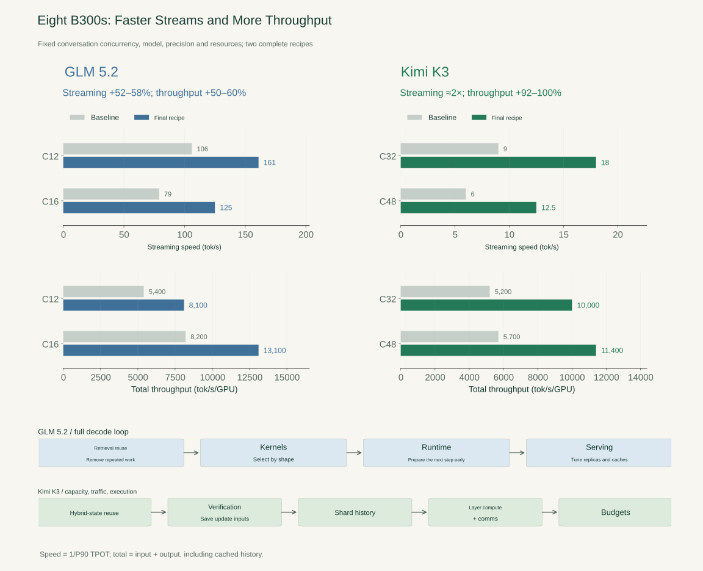
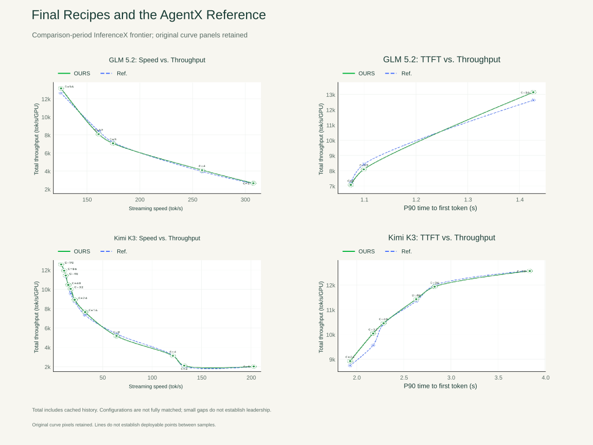
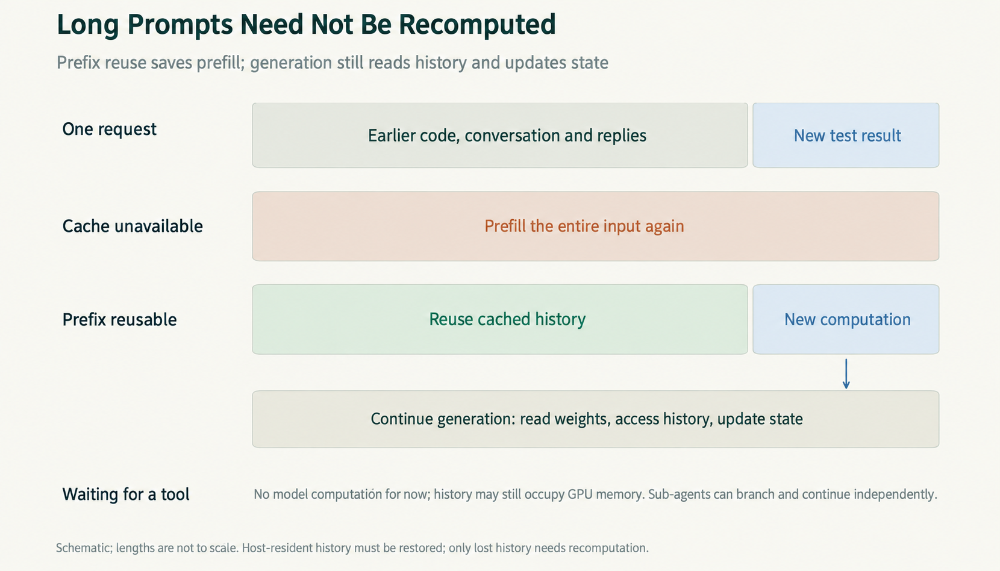
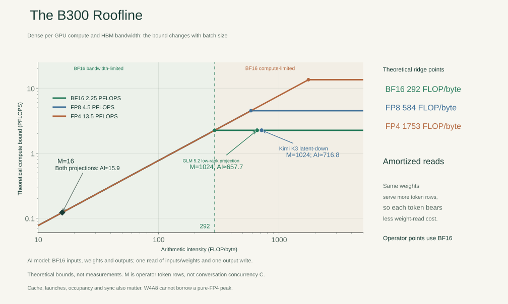
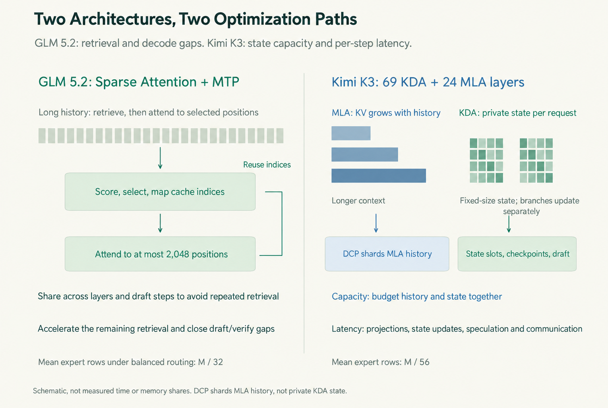
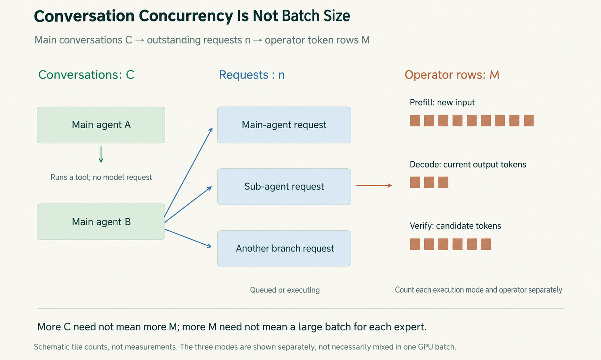

*Part 1 of a three-part B300 case study. Continue with [GLM 5.2](/en/posts/glm-5-2-faster-decode-loop/) and [Kimi K3](/en/posts/kimi-k3-state-memory-motion/).*

> **Key points**
>
> • At fixed load on eight B300s, both recipes improve streaming speed and total throughput.
>
> • Workload behavior, Roofline, execution dependencies, and memory budgets explain the gains.
>
> • GLM 5.2 needs a faster complete decode loop; Kimi K3 also needs better state and history management.
>

Eight B300 GPUs give us plenty of hardware. Getting a coding agent to make good use of them takes more than loading a model and increasing the batch size.

An agent alternates between reading code, generating an edit, running a command, and interpreting the result. We want each reply to arrive quickly, but we also want the server to handle many agents at once. Larger batches can amortize weight reads while lengthening the wait for an individual reply. Keeping more conversation history makes the next turn cheaper to resume while leaving less memory for other requests.

This case study follows GLM 5.2 and Kimi K3 through those trade-offs. The [first article in the wider series](/en/posts/what-does-fast-mean-llm-inference/) established what we mean by fast; the [second](/en/posts/every-speedup-lives-on-a-curve/) covered measurement and comparison. Here we apply that framework to the serving system.

## Results

The comparison holds model, precision, GPU count, and main-conversation concurrency fixed within each row. All configurations use one eight-B300 machine.

| Model | Main conversations | Streaming speed, tok/s | Total tok/s/GPU | Final P90 TTFT, s |
|---|---:|---:|---:|---:|
| GLM 5.2 | 12 | 106 → 161 (+52%) | 5,400 → 8,100 (+50%) | 1.1 |
| GLM 5.2 | 16 | 79 → 125 (+58%) | 8,200 → 13,100 (+60%) | 1.4 |
| Kimi K3 | 32 | 9 → 18 (+100%) | 5,200 → 10,000 (+92%) | 2.2 |
| Kimi K3 | 48 | 6 → 12.5 (+108%) | 5,700 → 11,400 (+100%) | 2.6 |



*Figure 1 | Fixed-load before-and-after comparisons from the series profile. GLM 5.2 follows four groups of changes; Kimi K3 follows five. The next two articles explain the complete recipes rather than attributing the totals to a single kernel.*

Improving both columns at fixed load is different from admitting more conversations. With the final Kimi K3 recipe, increasing concurrency from 32 to 70 raises total throughput from 10,000 to 12,600 tok/s/GPU, but streaming speed falls from 18 to 8 tok/s and P90 time to first token rises from 2.2 to 3.8 seconds. The faster system still needs a sensible operating load.

For an external reference, we use the AgentX frontier shown on InferenceX during the optimization period. That reference is separate from our starting configuration:

| Model and streaming speed | This recipe, total tok/s/GPU | Reference at a similar speed |
|---|---:|---:|
| GLM 5.2, approximately 125 tok/s | 13,100 | 12,600 |
| GLM 5.2, approximately 161 tok/s | 8,100 | 8,400 |
| Kimi K3, approximately 18 tok/s | 10,000 | 9,600 |



*Figure 2 | The original curve panels, retained alongside English labels. Green identifies the final recipe; dashed blue is the comparison-period reference. Left: throughput versus streaming speed. Right: throughput versus time to first token. Small gaps do not establish leadership: configurations have not been matched at every point, and a line between points is not a complete deployment sweep.*

A configuration lies on a Pareto frontier when none of the configurations compared can improve one dimension without sacrificing another. Moving a fixed-load point up and right improves the available choice. Moving along a final recipe's curve changes the load and usually trades response speed for throughput. We need both comparisons, then a latency target to choose a deployment.

## The Agent Workload

The first request after an agent opens a repository can contain a great deal of new text. After a test fails, the next request includes much of the same code and conversation, plus a short error message.

A prefix-cache hit lets the server skip prompt computation it has already performed. The model still has to read weights, access retained history, update state, and generate the reply. If the history has moved to host memory, it must be restored. If it has been discarded, it must be recomputed. A few lines of new tool output can therefore trigger a substantial amount of data movement.



*Figure 3 | Submitted input, new prompt computation, and generation-time history access are different quantities. Prefix reuse removes repeated prefill; it does not remove the decode path.*

AgentX replays `semianalysis_cc_traces_weka_062126`, including sub-agent activity. Requests follow the dependencies and waits in the conversation tree. When a tree finishes, another replaces it to maintain the configured number of main conversations. Synthetic prompts preserve prefix-sharing relationships through cache-block identifiers.

A faster reply can bring the next request forward. One agent waiting for a tool may leave room for another to run; sub-agents can share a prefix and issue requests in parallel. This is a different workload from keeping a fixed batch continuously busy. The [AgentX](https://github.com/ai-dynamo/aiperf/blob/main/docs/tutorials/agentx-mvp.md) and [trace-replay](https://github.com/ai-dynamo/aiperf/blob/main/docs/tutorials/weka-trace.md) documentation describe these mechanics.

The seven-variable framework from the earlier articles remains useful:

```text
Performance = f(Model, Workload, Load, System, Resources, Quality, SLO)
```

The model creates the computation and storage requirements. The workload determines what arrives and when. Load changes batching and contention. We change the system and resource allocation, then choose a configuration that meets quality and service-level objectives.

### Test Setup

| Condition | GLM 5.2 | Kimi K3 |
|---|---|---|
| Hardware | One machine, 8×B300 | One machine, 8×B300 |
| Precision | NVFP4 routed experts; BF16 attention and shared branch; FP8 KV | W4A8 routed experts; BF16 projections; FP8 MLA KV; FP32 KDA core state |
| Speculation | MTP proposes 3 tokens; synthetic acceptance target 2.99 | DSpark proposes 7 tokens; static verification; synthetic acceptance target 3.84 |
| Main-conversation loads | 12 and 16 | 32 and 48 |
| Parallel layout | TP8, then two TP4 replicas in the final group | TP8; DCP8 added in the history-parallel group |

The replay uses a fixed seed and conversation set, runs for 1,800 seconds after warmup, filters whole conversation trees against the model's native context limit, caps global idle time at 10 seconds, and isolates the first-turn prefixes. Trace lengths determine generation length; EOS is ignored rather than used to shorten the replay.

### Reading the Metrics

**Streaming speed** is `1 / P90 TPOT`: compute each request's average output-token interval after its first token, take the P90 across requests, then invert it. This is not a percentile over individual token gaps. **TTFT** measures the initial wait separately.

**Total throughput** counts input plus output, including cached input history. Resubmitting a 100,000-token prefix counts those tokens even when most prompt computation is reused. A total rate of 10,000 tok/s/GPU does not mean the GPU generates 10,000 new tokens each second.

The acceptance targets 2.99 and 3.84 count tokens committed per verification, including the extra target-verified token; they are not percentages. [InferenceX's calibration](https://github.com/SemiAnalysisAI/InferenceX/blob/main/inferencex-e2e/infx/golden_al_distribution/README.md) derives the standard targets from coding tasks. Fixing them keeps draft-quality differences out of the system comparison. Natural acceptance on synthetic prompts is not evidence of real coding performance, and task quality and state correctness still need their own checks.

## What Roofline Tells Us

B300 provides 270 GB of HBM3e per GPU, 7.7 TB/s of memory bandwidth, and 1.8 TB/s of bidirectional NVLink bandwidth. The dense arithmetic ceilings used here are:

| Precision | Peak per GPU | Peak compute / HBM bandwidth |
|---|---:|---:|
| BF16 | 2.25 PFLOPS | approximately 292 FLOP/byte |
| FP8 | 4.5 PFLOPS | approximately 584 FLOP/byte |
| FP4 | 13.5 PFLOPS | approximately 1,753 FLOP/byte |

Arithmetic intensity, or AI, is the number of floating-point operations performed per byte transferred from HBM. The Roofline bound is:

```text
rate <= min(peak compute, memory bandwidth × arithmetic intensity)
```

For a BF16 matrix multiplication `[M,K] × [K,N]`, assuming one input read, one weight read, and one output write:

```text
AI = MNK / (MK + KN + MN)
```

Larger `M` lets more token rows reuse the same weights. Consider GLM 5.2's fused low-rank projection `6144 → 2624` and Kimi K3's latent projection `7168 → 3584`. At `M=16`, both have an AI near 15.9. At `M=1024`, the values are approximately 657.7 and 716.8. The former case is below the BF16 ridge point; the latter is above it. GLM 5.2's 2,624 output dimensions combine 2,048 query dimensions with `512+64` key/value dimensions.



*Figure 4 | The same projection moves from a bandwidth-limited bound to a compute-limited bound as more rows reuse its weights. M=16 and M=1024 are analytical examples, not observed AgentX batch sizes. All curves and points are theoretical bounds.*

At low AI, efficient loads and fewer intermediate reads and writes matter. At higher AI, tiling and compute reuse become more valuable. A tile can still be too large for a small matrix: too few thread blocks may leave the GPU underoccupied. W4A8 experts also need their own analysis rather than borrowing the pure-FP4 ceiling.

Roofline covers the two projections, not the whole request. Index selection, recurrent updates, and history reads have different traffic. CPU preparation, kernel launches, and collectives introduce dependencies. We use Roofline to narrow kernel choices, traces to locate exposed waits, and a memory budget to determine which requests can run.

## Two Architectures, Two Optimization Paths

### GLM 5.2: get through the next decode iteration sooner

GLM 5.2 has 78 layers. The first three use dense feed-forward networks; the remaining layers route each token to eight of 256 experts, alongside a shared expert. Its sparse attention selects up to 2,048 history positions and supports sharing index selections across layers and MTP draft steps.


*Figure 5 | GLM 5.2 architecture, from [Sebastian Raschka's architecture gallery](https://sebastianraschka.com/llm-architecture-gallery/). Sparse indexing, expert computation, and multi-token prediction create different costs within the same decode loop.*

Reading fewer positions makes attention cheaper, but finding those positions still requires scoring, selection, and cache-address conversion. Lost shared indices cause redundant selection. Projections and experts still need to run after selection, and the next iteration may then wait for the CPU.

The four groups address that complete path: reuse and accelerate retrieval; choose kernels for the remaining arithmetic; overlap preparation and extend graph coverage; then retune replicas, caches, and scheduling together.

### Kimi K3: state capacity and execution both matter

Kimi K3 combines 69 Kimi Delta Attention (KDA) layers with 24 Multi-head Latent Attention (MLA) layers. Across its 92 expert layers, each token selects 16 of 896 routed experts. The experts operate in a 3,584-dimensional latent space before projection back to 7,168 dimensions.


*Figure 6 | Kimi K3 architecture, also from the architecture gallery. MLA retains token history; KDA advances private recurrent state; LatentMoE repeatedly projects, computes, communicates, and projects back.*

At roughly 2.8 trillion parameters, even a hypothetical all-4-bit weight representation needs about 1.4 TB, or 175 GB per GPU over eight GPUs. This is a rough lower bound before higher-precision components and quantization metadata, not a complete serving-memory budget.

The KDA matrix adds a different cost. Under TP8 with 12 local heads across 69 layers, a request's FP32 core state occupies:

```text
69 × 12 × 128 × 128 × 4 bytes = 51.75 MiB per GPU
```

Checkpoints, convolution state, and speculative scratch are additional. Requests can share a weight read, but they cannot share a writable recurrent matrix. Increasing the batch therefore does not amortize all state traffic as it amortizes weights.

The five groups cover checkpoint reuse, speculative-state storage, long-history sharding, layer computation and communication, and the final resource budget. Capacity determines what fits; repeated reads, writes, launches, and collectives determine how quickly it executes.



*Figure 7 | Four groups for GLM 5.2 and five for Kimi K3. Each recipe combines kernel work with runtime and serving decisions.*

## Concurrency and Batch Size

A main conversation can be waiting on a tool while its sub-agents issue requests. Some requests wait in a queue; others enter the next model step. Speculative verification can give one active request several token rows.

| Symbol | Quantity |
|---|---|
| C | Main conversation trees allowed concurrently |
| n | Requests issued but not completed, including queued requests |
| n_active | Requests executing in the current forward pass |
| M | Token rows received by a particular operator |



*Figure 8 | Roofline takes an operator's M. Substituting conversation concurrency C skips the scheduler, execution mode, and expert routing.*

Routing makes expert batches smaller still. With balanced routing, a GLM 5.2 expert receives an average of `M/32` rows; a Kimi K3 expert receives `M/56`. At global `M=1024`, that is 32 rows and roughly 18 rows respectively. A projection can have crossed its theoretical compute ridge while its experts still execute small batches.

Every change to replicas, cache placement, or scheduling can change those shapes and waits. We return to the operators and resource budget after each layout change, then to the AgentX operating points. [The next article](/en/posts/glm-5-2-faster-decode-loop/) follows that process through the full GLM 5.2 recipe.

## Quick Reference

| Term | Meaning |
|---|---|
| TPOT / TTFT | Average output-token interval after the first token / time to first token |
| TP / DCP | Tensor parallelism / decode context parallelism over history positions |
| MTP / DSpark | Built-in multi-token prediction / the independent draft model used with Kimi K3 |
| DSA / MLA / KDA | DeepSeek Sparse Attention / Multi-head Latent Attention / Kimi Delta Attention |
| MoE / LatentMoE | Mixture of experts / expert computation in a projected latent space |
| NVFP4 / W4A8 | NVIDIA's 4-bit floating-point format / 4-bit weights with 8-bit activations |
| CUDA Graph / CuTe DSL | GPU execution capture and replay / tools for specialized GPU kernels |
| AI / Roofline | Arithmetic intensity / an operator bound set by compute and bandwidth |
| Pareto frontier / SLO | Best trade-offs among compared configurations / a service-level objective |

## Sources

*Sources: [AgentX](https://github.com/ai-dynamo/aiperf/blob/main/docs/tutorials/agentx-mvp.md); [trace replay](https://github.com/ai-dynamo/aiperf/blob/main/docs/tutorials/weka-trace.md); [acceptance calibration](https://github.com/SemiAnalysisAI/InferenceX/blob/main/inferencex-e2e/infx/golden_al_distribution/README.md); [HGX specifications](https://www.nvidia.com/en-us/data-center/hgx/); [matrix-multiplication guide](https://docs.nvidia.com/deeplearning/performance/dl-performance-matrix-multiplication/index.html); [GLM 5.2 configuration](https://huggingface.co/zai-org/GLM-5.2/blob/main/config.json); [Kimi K3 configuration](https://huggingface.co/moonshotai/Kimi-K3/blob/c5d1dd4c428bd1ce8b88c5044f3b6ccde9e3b721/config.json); [GLM 5.2 engineering](https://www.lmsys.org/blog/2026-07-13-glm52-optimization); [Kimi K3 engineering](https://www.lmsys.org/blog/2026-07-27-kimi-k3-day0-support). Comparison values use the supplied series profile; the original reference curves retain their source pixels.*
