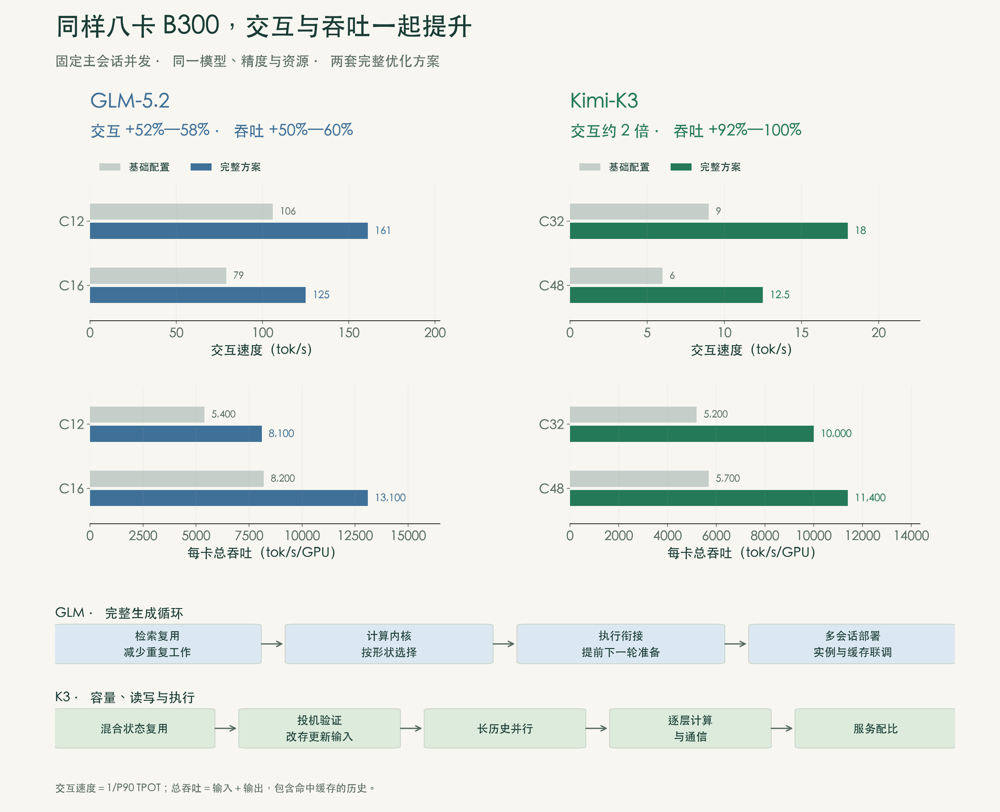
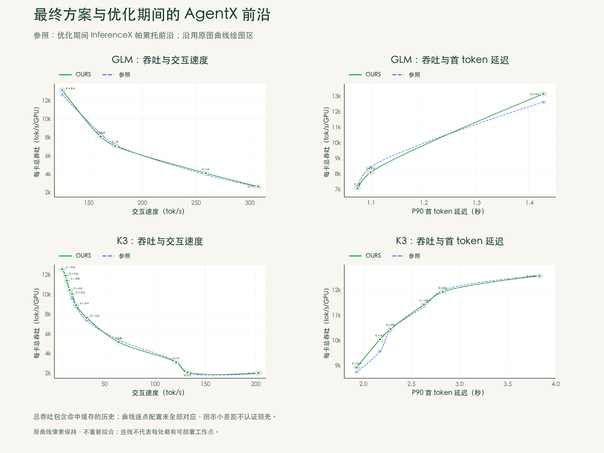
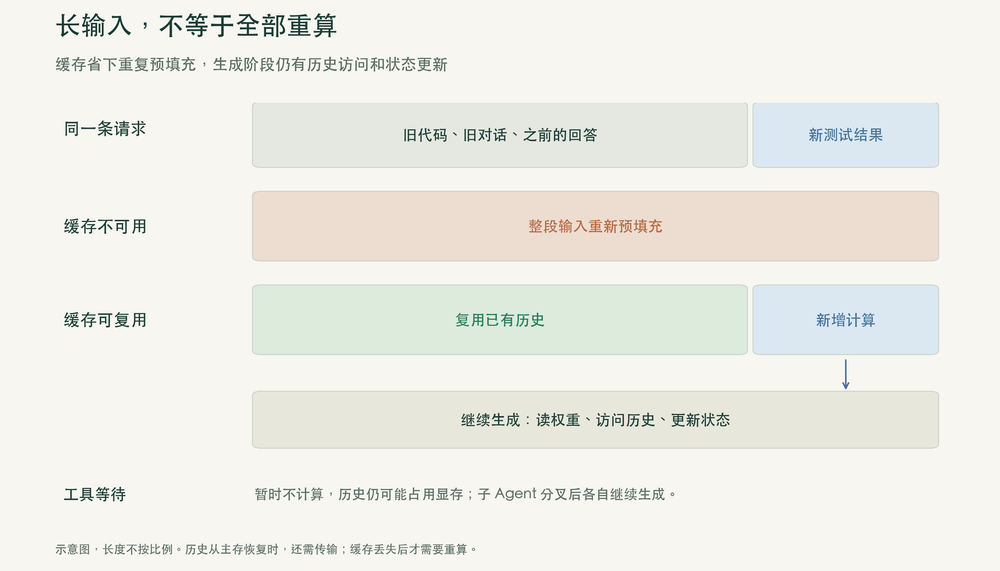
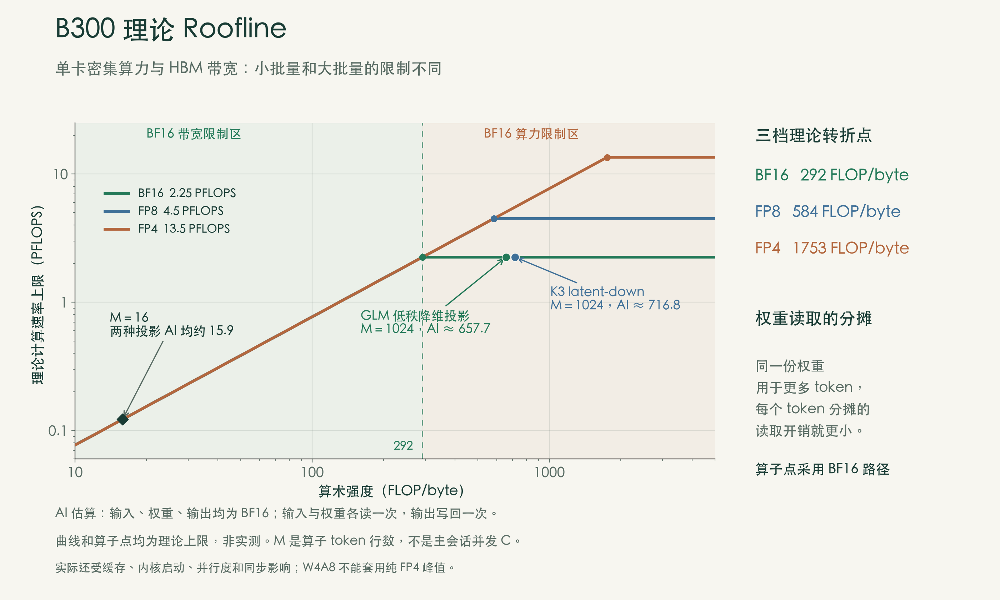
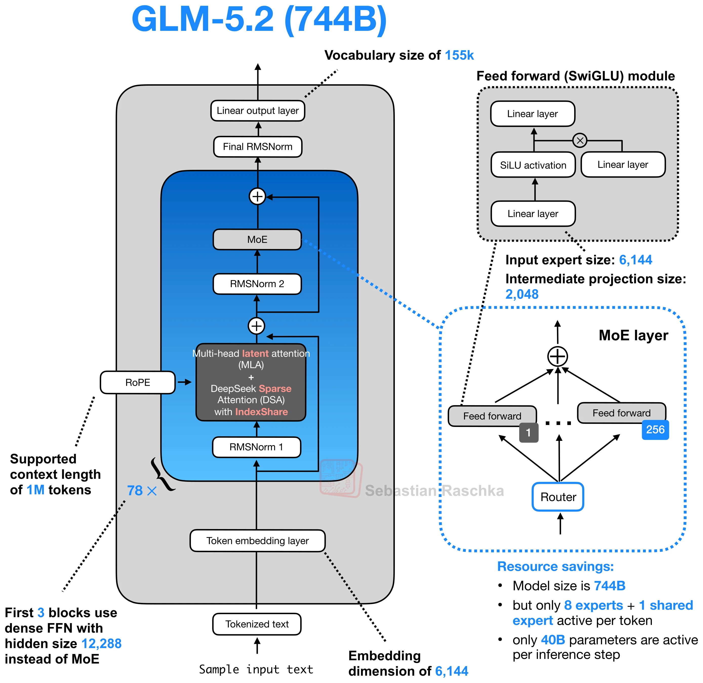
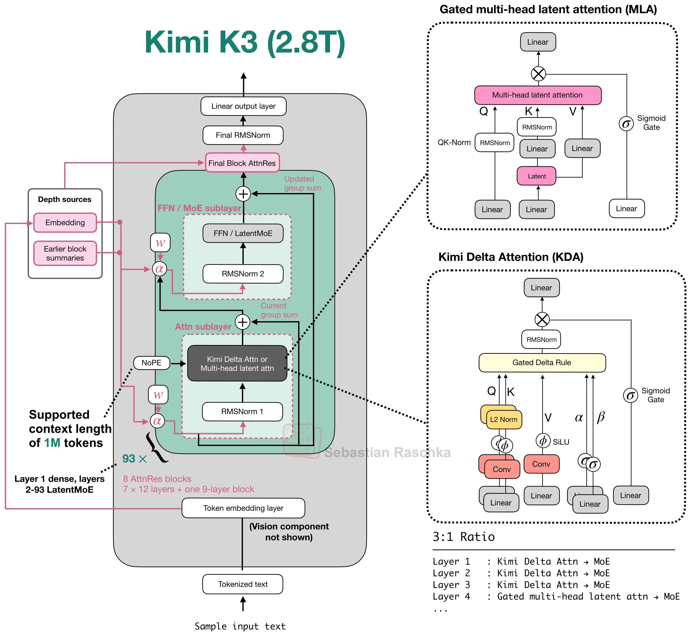
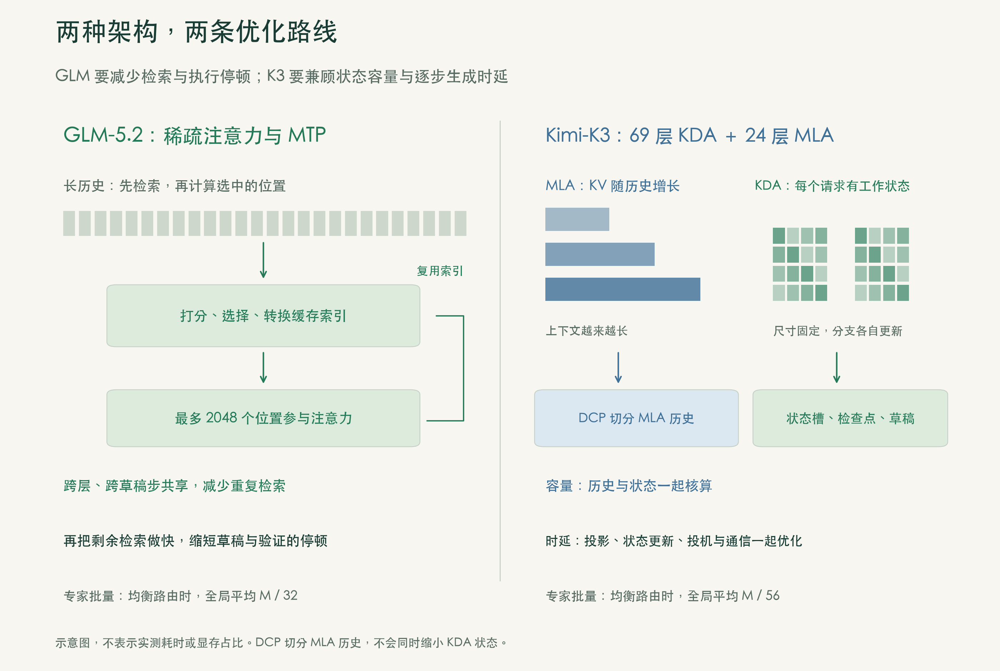
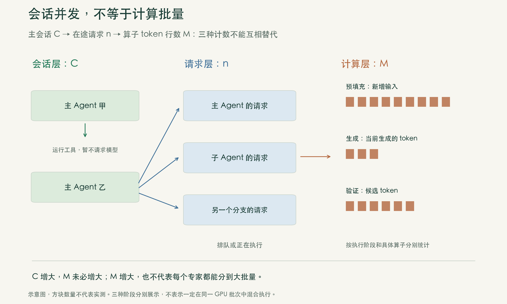

[上篇：成绩与瓶颈](/posts/b300-results-bottlenecks/) · [中篇：GLM 5.2：缩短生成循环](/posts/b300-glm-generation-loop/) · [下篇：Kimi K3：状态、通信与服务选择](/posts/b300-kimi-state-serving/)

*推理优化系列 · 第3篇（上）*

> **本篇要点**
>
>
> - 同样八卡B300、固定并发下，GLM 5.2的交互速度提高52%—58%，Kimi K3达到约2倍，每卡总吞吐也同时提高。
>
> - 从成果出发，用前两篇的性能框架判断：哪些工作可以省，哪些计算需要加快，哪些等待直接阻挡下一步。
>
> - GLM 5.2围绕完整生成循环优化；Kimi K3同时处理状态容量、长历史读写，以及逐层计算与通信。

## 一、先看成绩

第一篇讲“快”怎么定义，第二篇讲性能怎样测、怎样比。这一篇落到具体工程：GLM 5.2与Kimi K3，怎样在B300上更好地服务编程Agent？

编程Agent读代码、改代码、运行测试，再把报错交给模型分析。单个会话需要及时、流畅的回答，多个会话同时运行又要求服务器维持较高吞吐。批量增大，可以让更多请求共用一次权重读取，但每个Agent可能等得更久；保留更多历史，下一轮恢复更快，却会挤占其他请求可用的显存。

在模型、精度、总卡数和主会话并发数都固定的条件下，优化前后的结果如下：

| 模型 | 主会话并发 | 交互速度（tok/s） | 每卡总吞吐（tok/s/GPU） | P90 TTFT（秒，完整方案） |
|---|---|---|---|---|
| GLM 5.2 | C12 | 106 → 161（+52%） | 5,400 → 8,100（+50%） | 约1.1 |
| GLM 5.2 | C16 | 79 → 125（+58%） | 8,200 → 13,100（+60%） | 约1.4 |
| Kimi K3 | C32 | 9 → 18（+100%） | 5,200 → 10,000（+92%） | 约2.2 |
| Kimi K3 | C48 | 6 → 12.5（+108%） | 5,700 → 11,400（+100%） | 约2.6 |

**图1｜同样资源，同时改善交互速度与系统吞吐。** 上方比较固定并发下的优化前后，下方给出GLM 5.2四组、Kimi K3五组措施。后两篇沿这两条路线展开。

同一并发下，两项指标同时提高，体现的是优化收益。完整方案继续增加并发，则是在速度与吞吐之间取舍。例如Kimi K3从C32加到C70，每卡总吞吐从10,000升到12,600（+26%），交互速度却从18降到8 tok/s，P90 TTFT从2.2升到3.8秒。最终部署哪个档位，要按服务目标选。

成果还要放到行业参照中看。这里的“参照”是优化期间InferenceX上AgentX的帕累托前沿，不是我们的优化前基线：

在所比较的配置中，如果还有配置能在速度不降低的情况下提高吞吐，或在吞吐不降低的情况下加快生成，当前配置就不在前沿上。**处于前沿，意味着想进一步提高一项指标，就得在另一项上作出取舍。**

| 模型与交互速度 | 本方案每卡总吞吐 | 参照相近速度处的每卡总吞吐 |
|---|---|---|
| GLM 5.2，约125 tok/s | 约13,100 | 约12,600 |
| GLM 5.2，约161 tok/s | 约8,100 | 约8,400 |
| Kimi K3，约18 tok/s | 约10,000 | 约9,600 |

**图2｜接近优化期间的AgentX前沿。** 绿线为OURS，蓝色虚线为参照；同时观察吞吐与交互速度、首token延迟的关系。图中小差距只支持“接近前沿、各有高低”的判断，不认证领先；曲线逐点配置仍未全部对应。

左侧两图中，交互速度和吞吐都越高越好。图2的绿线连接完整方案在不同负载下的工作点，沿线增加并发，通常是吞吐提高、生成变慢。同并发的优化前后则另作比较，见中、下篇的图14和图22：工作点向右上移动，才表示两项同时改善。右侧两图的横轴换成了TTFT，要看的是同等吞吐下能否更早开始回答。

接下来要回答的是：这些改善从哪里来？Kimi K3的绝对速度与GLM 5.2相差较大，不能仅凭总参数或显存占用解释。两个模型的计算结构、历史访问、状态更新和跨卡协同不同，要沿各自的执行过程找原因。

## 二、Agent场景的开销

Agent第一次读代码库时，需要处理大量新输入。测试后的下一条请求仍带着旧代码、旧对话和上一轮回答，只多了一段报错。如果历史缓存还在，预填充只需处理新增内容；生成回答时，仍要读取权重、访问历史并更新状态。

历史不在GPU上时，也有两种代价：转存到了主存，就要传回；已经丢失，就要重算。因此，只有几行新报错的请求，也可能需要恢复很长的历史。只看新增输入会低估存储和恢复开销，只看完整输入又会高估预填充计算量。

**图3｜长输入，不等于全部重算。** 前缀缓存省掉重复预填充，生成阶段的权重读取、历史访问和状态更新仍须执行。

AgentX用包含子Agent的`semianalysis_cc_traces_weka_062126`回放这些关系。下一轮何时发出，取决于上一轮何时完成、会话依赖和等待；一棵会话树结束后补入新树，维持指定的主会话并发。提示词按缓存块标识合成，保留前缀共享关系。〔资料1〕

这与固定长度、持续占满GPU的压测不同：模型越早回答，后续请求越早到来；一个会话等工具时，其他会话仍在计算；子Agent既可能共享历史，又会并行发出请求。优化会改变后续负载节奏，不能只看某个孤立请求。

判断这些成本，仍用前两篇的框架：

**Performance = f(Model, Workload, Load, System, Resources, Quality, SLO)**

模型决定计算和存储需求，工作负载决定请求内容与调用顺序，负载决定批量与争用。我们调整系统执行方式和资源分配，最终按质量、正确性及SLO选择能持续服务的工作点。

### 测试条件

| 条件 | GLM 5.2 | Kimi K3 |
|---|---|---|
| 模型与资源 | 单机8×B300 | 单机8×B300 |
| 固定精度 | NVFP4路由专家；BF16注意力与共享分支；FP8 KV | W4A8路由专家；BF16投影；FP8 MLA KV；FP32 KDA核心状态 |
| 投机解码 | MTP起草3个token，合成接受长度目标2.99 | DSpark起草7个token，静态验证，合成接受长度目标3.84 |
| 固定负载档位 | C12、C16 | C32、C48 |
| 并行布局 | 前三组TP8；最后一组为两个TP4实例 | TP8；第三组起加入DCP8 |

比较固定随机种子和会话集，暖机后测试1,800秒；按模型原生上下文上限筛选整棵会话树，全局空闲上限10秒，首轮前缀做缓存隔离；按轨迹长度生成并忽略EOS，不额外截短输入输出。〔资料1〕

### 指标口径

**交互速度 = 1 / P90 TPOT。** 先计算每条请求首token之后的平均生成间隔，再取这些间隔的P90，最后求倒数。它反映生成较慢的请求，不保证每个token都能及时输出；开始回答前的等待另用P90 TTFT衡量。AIPerf报告中的Inter Token Latency按请求平均计算，与这里的TPOT口径对应，不能与原始逐token间隔混淆。

**总吞吐 = 输入 + 输出，输入包含命中缓存的历史。** 一条请求再次提交10万token历史，即使大部分无需重算，也按完整输入长度计数。每卡总吞吐1万tok/s，不代表每秒新生成1万token。

**合成设置固定的是接受长度目标。** 2.99和3.84表示一轮验证平均提交的token数，计入目标模型保证输出的验证token，不是百分比。统一接受条件，是为了比较推理系统，而不把草稿质量的差异混入系统优化。标准值来自真实编程题上的标定。〔资料2〕

回放提示词是合成内容，在上面测得的自然接受长度不能直接当作真实编程业务的表现；生成速度也不能只按接受长度的比例换算，还取决于起草、验证、提交的整轮耗时。真实编程任务的质量和状态计算正确性须另行检验。

参照点用于观察行业位置，基线用于观察优化幅度，SLO用于选择部署配置。三种比较各有用途，后两篇沿用这些定义。

## 三、Roofline怎么指导优化

B300每卡有270 GB HBM3e，显存带宽7.7 TB/s，NVLink双向带宽1.8 TB/s。按HGX八卡规格折算，每卡理论密集算力及其与HBM带宽的比值如下。〔资料3〕

| 精度 | 每卡理论密集算力 | 算力 ÷ 显存带宽（转折点） |
|---|---|---|
| BF16 | 2.25 PFLOPS | 约292 FLOP/byte |
| FP8 | 4.5 PFLOPS | 约584 FLOP/byte |
| FP4 | 13.5 PFLOPS | 约1,753 FLOP/byte |

算子每搬运一个字节完成多少次浮点运算，叫算术强度（AI）。Roofline将它与硬件转折点比较，估计性能上限：

`AI = 浮点运算量 / HBM搬运量`

`理论速率上限 = min（峰值算力，HBM带宽 × AI）`

对`[M,K]×[K,N]`矩阵乘法，若输入、权重、输出均为BF16，输入与权重各读一次、输出写一次，则`AI = MNK / (MK + KN + MN)`。M是参与计算的token行数，越大，同一份权重就能由更多行分摊。〔资料4〕

取GLM 5.2的融合低秩降维投影`6144→2624`，以及Kimi K3的LatentMoE降维投影`7168→3584`：M=16时，两者AI都约15.9；M=1024时，分别约657.7和716.8。前者的理论上限由HBM带宽决定，后者越过BF16转折点，由算力决定。GLM 5.2的2624由`q_a`的2048维和`kv_a`的512+64维组成。〔资料5〕

**图4｜同一投影，批量不同，理论限制也不同。** M=16与1024是示例形状，不是AgentX实测批量；图中曲线和算子点均为理论上限。

这直接影响内核选择：**低AI时重视加载效率和中间读写，高AI时重视分块复用与计算效率。** 小矩阵可能因线程块不足而跑不满带宽，分块也不能一味求大。生成、验证、预填充须按各自形状选内核，W4A8专家不能套用纯FP4峰值。

图4只分析两个投影。检索、状态更新和历史访问要另算工作量与读写量，内核启动、CPU等待和跨卡同步还要看执行时间线。**Roofline指出算子的优化方向，关键路径确定先改哪里，容量预算约束并发规模。** 后两篇会分别展示这三类判断如何改变方案。

## 四、两种架构，两套方案

### GLM 5.2：减少重复检索，缩短生成循环

GLM 5.2有78层，前3层为常规前馈网络，其余为MoE；每个token从256个路由专家中选8个，另有1个共享专家。稀疏注意力每步最多选择2,048个历史位置，并支持跨层、跨MTP草稿步共享索引。〔资料6〕

**图5｜GLM 5.2架构。** 重点看历史位置选择、专家计算和MTP：它们决定检索量、矩阵形状和生成循环。原图来自Sebastian Raschka架构图库。〔资料7〕

只让2,048个位置参与注意力，省下了计算，但选择这些位置仍要对长历史打分、筛选并转换缓存地址。如果MTP下一步拿不到已有索引，就会重复检索。选择完成后，投影、注意力和验证仍须执行；内核结束后，下一轮又可能等CPU准备。

因此，GLM 5.2的四组措施连成一个完整循环：**检索复用与内核优化→计算内核→执行衔接→多会话部署。** 既减少重复工作，也加快保留下来的计算，再把下一轮准备、实例布局与缓存配好。

### Kimi K3：同时处理容量、读写与逐层执行

Kimi K3有93层，其中69层为KDA、24层为MLA。每个token从896个路由专家中选16个，在3,584维潜空间内计算专家，再投影回7,168维。〔资料8〕

**图6｜Kimi K3架构。** MLA访问长历史，KDA更新私有状态，LatentMoE逐层经过降维、专家计算、归并和升维。这些开销须分别处理。原图来自架构图库。〔资料7〕

先看容量：约2.8万亿参数即使全按4 bit存储，裸权重也约1.4 TB，平均分到八卡约175 GB；高精度部分和量化附加数据尚未计入。这是权重容量的粗略下界，不能据此推算完整服务还剩多少显存。

再看读写：MLA历史随上下文增长，生成时需要访问；KDA矩阵尺寸固定，但每个活跃请求独占一份。按TP8、69层、每卡12头、FP32状态计算，单请求每卡核心矩阵为`69×12×128×128×4 byte≈54.3 MB`，即51.75 MiB，检查点和投机暂存另计。批量增大能分摊权重读取，却不能让各请求共用这份私有矩阵。

最后看执行：92个专家层逐层降维、计算、跨卡归并、归一化，再投影回原维度。每段操作即使很短，启动和阻塞同步也会反复累积。容量决定能放下多少请求，读写与执行关键路径决定它们跑得多快；显存账不能独自解释生成速度。〔资料9〕

Kimi K3的五组措施因此同时覆盖三方面：**混合状态复用→投机验证→长历史并行→逐层计算与通信→服务配比。** 省下的空间用于缓解资源争用，减少的写回、历史读取和逐层等待用于缩短执行时间，最后再按实际负载重新配置预算。

**图7｜架构决定优化对象，完整执行过程决定方案。** GLM 5.2围绕生成循环，Kimi K3围绕混合状态、长历史与逐层执行；两者都需要结合内核、并行和调度。

## 五、并发不等于计算批量

| 符号 | 含义 |
|---|---|
| C | 主会话并发：同时运行的Agent会话树数量 |
| n | 已发出、尚未完成的在途请求，可能还在排队 |
| n_active | GPU当前实际计算的请求数 |
| M | 某个算子本次计算的token行数 |

主Agent可能在等工具，子Agent可能同时发请求，在途请求又可能尚未获得执行机会。因此，C、n和n_active不同。预填充、生成、投机验证处理的token数不同，M也不同。

**图8｜Roofline要用具体算子的M，不能直接代入主会话并发C。**

路由还会进一步缩小专家批量。假设均衡，GLM 5.2每个专家平均分到M/32行，Kimi K3为M/56行。全局M=1024时，每个专家也平均只有32行和约18行；投影已进入算力限制区，专家仍可能是小批量计算。

增加会话既能提高权重复用，也会增加历史、状态和草稿占用；分成更多实例可以减少跨卡协同，却可能分散批量与历史缓存。优化的任务，是让这些选择在同一套服务中配合起来。

因此，每次改变实例布局、缓存或调度，都要回头检查算子形状、执行等待与资源预算，再用同一口径的AgentX结果复核。GLM 5.2与Kimi K3的架构不同，具体措施不同，这套判断过程相同。

[中篇](/posts/b300-glm-generation-loop/)沿GLM 5.2的完整生成循环展开；[下篇](/posts/b300-kimi-state-serving/)讲Kimi K3如何同时改变状态保存、历史布局和逐层执行，并用SLO选择部署工作点。

## 术语速查

| 术语 | 说明 |
|---|---|
| TPOT / TTFT | 首token之后的平均生成间隔 / 请求发出至首token的延迟 |
| TP / DCP | 张量并行 / 在TP组内按历史位置分片的解码上下文并行 |
| MTP / DSpark | 模型自带的多token预测模块 / Kimi K3所用独立草稿模型 |
| DSA / MLA / KDA | 稀疏注意力 / 多头潜注意力 / Kimi Delta Attention递推状态机制 |
| MoE / LatentMoE | 混合专家 / 先降维、计算专家，再升维的MoE |
| NVFP4 / W4A8 | NVIDIA的4 bit浮点格式 / 4 bit权重与8 bit激活的混合精度方案 |
| CUDA Graph / CuTe DSL | GPU执行过程的捕获与回放 / 用于编写GPU计算内核的工具 |
| AI / Roofline | 算术强度 / 由算力与带宽共同界定算子理论上限的方法 |
| 帕累托前沿 / SLO | 所比较配置中，无法在不牺牲其他指标时继续改善的边界 / 服务目标，如生成速度与首token延迟要求 |

## 参考资料

**资料 1**：[AIPerf AgentX规则](https://github.com/ai-dynamo/aiperf/blob/main/docs/tutorials/agentx-mvp.md)；[WEKA轨迹回放与提示词合成](https://github.com/ai-dynamo/aiperf/blob/main/docs/tutorials/weka-trace.md)。规则以所用版本为准。
**资料 2**：[InferenceX标准接受长度：标定、定义与AgentX使用规则](https://github.com/SemiAnalysisAI/InferenceX/blob/main/inferencex-e2e/infx/golden_al_distribution/README.md)。
**资料 3**：[NVIDIA Blackwell Ultra数据表](https://dam-cdn.nvd.orangelogic.com/AssetLink/1k0p832eq8r5ca0u5383ie5o4tp3bst1.pdf)，HGX B300单卡规格及Sparse/Dense脚注；[HGX规格](https://www.nvidia.com/en-us/data-center/hgx/)。
**资料 4**：[NVIDIA矩阵乘法：算术强度、分块与并行度](https://docs.nvidia.com/deeplearning/performance/dl-performance-matrix-multiplication/index.html)。
**资料 5**：[GLM 5.2投影形状与BF16内核](https://www.lmsys.org/blog/2026-07-13-glm52-optimization)；[Kimi K3降维投影实现](https://github.com/sgl-project/sglang/blob/2a5f45d3d47879f5524194789fe0db61fe206671/python/sglang/srt/models/kimi_k3.py)。
**资料 6**：[GLM 5.2模型配置](https://huggingface.co/zai-org/GLM-5.2/blob/main/config.json)。
**资料 7**：[Sebastian Raschka架构图库](https://sebastianraschka.com/llm-architecture-gallery/)，GLM 5.2及Kimi K3条目。
**资料 8**：[Kimi K3模型配置](https://huggingface.co/moonshotai/Kimi-K3/blob/c5d1dd4c428bd1ce8b88c5044f3b6ccde9e3b721/config.json)。
**资料 9**：[Kimi K3状态、计算内核与通信优化](https://www.lmsys.org/blog/2026-07-27-kimi-k3-day0-support)。
